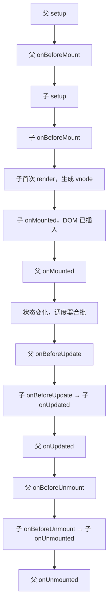
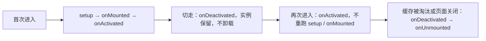

# 生命周期与实战总结

## 使用入口：先解决问题，再做验证

在合适时机加载数据并清理页面副作用。

**先做基本操作**：先在 onMounted 加载数据，在退出清理监听和计时，验证复用/缓存组件再讲钩子时序。初次学习可先完成[本模块基础实践](/doc/Vue/Vue组件与页面基本使用)。

**再逐步深入**：基本 API 与输入输出 → 常见失败和使用边界 → 场景排查与优化 → 本文机制分析与源码。面试先讲用途和自己的操作过程，再回答场景与原理追问。

> **一句话结论**：Vue3 生命周期只有一条主线——**创建实例 → setup → 渲染 → 挂载 → 更新 → 卸载**；所有钩子都是「在这条线的某个点插入回调」，真正的难点不是背顺序，而是搞清**父子执行顺序、DOM 是否就绪、副作用在哪清理**。

## 30 秒速览

| 阶段 | Options API | Composition API | DOM 是否可用 | 典型用途 |
|---|---|---|---|---|
| 创建 | `beforeCreate` / `created` | `setup`（替代两者） | ❌ | 初始化状态、注册钩子、发起**不依赖 DOM** 的请求 |
| 挂载前 | `beforeMount` | `onBeforeMount` | ❌ | 极少用，SSR 相关预处理 |
| 挂载后 | `mounted` | `onMounted` | ✅ | 初始化图表/地图、测尺寸、绑定原生事件 |
| 更新前 | `beforeUpdate` | `onBeforeUpdate` | ✅（旧 DOM） | 更新前读取滚动位置 |
| 更新后 | `updated` | `onUpdated` | ✅（新 DOM） | 依赖新 DOM 的第三方库同步（慎用） |
| 卸载前 | `beforeUnmount` | `onBeforeUnmount` | ✅ | 保存状态、提示确认 |
| 卸载后 | `unmounted` | `onUnmounted` | ❌ | 清定时器、解绑事件、销毁实例 |
| 缓存 | `activated` / `deactivated` | `onActivated` / `onDeactivated` | ✅ | keep-alive 场景刷新数据 |
| 调试 | — | `onRenderTracked` / `onRenderTriggered` | — | 定位「为什么又重渲染了」 |
| 错误 | `errorCaptured` | `onErrorCaptured` | — | 子树错误兜底、上报 |

> Vue3 把 `beforeDestroy`/`destroyed` 改名为 `beforeUnmount`/`unmounted`，语义从「销毁」变成「卸载」，对应 `app.unmount()`；另外 `setup` 里**没有** `created`，因为 `setup` 本身就在 created 之前同步执行。

## 一张图看完整时序（含父子）



**记忆口诀**：挂载是「父先准备，子先完成」（父 beforeMount → 子 mounted → 父 mounted）；卸载也是「父先准备，子先销毁」。所以父组件 `onMounted` 里能安全访问已挂载的子组件 DOM，但子组件 `onMounted` 里拿不到父组件的后置初始化结果。

## 二、接口请求到底放哪个钩子

| 方案 | 时机 | 优点 | 代价 |
|---|---|---|---|
| `setup` 顶层直接发 | 最早，组件创建即发 | 白屏等待最短；SSR 可配合 `await` + Suspense | 无 DOM；SSR 需处理双端请求与数据序列化 |
| `onMounted` | DOM 就绪后 | 最常见、心智简单 | 晚一个渲染周期；SSR 不执行，首屏 HTML 无数据 |
| 路由守卫 `beforeResolve` | 进入路由前 | 页面切换前数据就绪，无「先空后填」闪烁 | 阻塞导航，须处理超时/失败回退 |
| `watch(..., {immediate:true})` | 参数就绪即发，参数变化自动重发 | 天然覆盖筛选/分页场景 | 需要自己处理竞态与清理 |

```ts
// 推荐范式：watch + immediate + 竞态保护，天然覆盖首次加载与参数变化
const route = useRoute()
const list = shallowRef<Item[]>([])
watch(
  () => route.query.id,
  async (id, _old, onCleanup) => {
    if (!id) return
    const ctrl = new AbortController()
    onCleanup(() => ctrl.abort())         // 参数切换/组件卸载自动取消
    const data = await fetch(`/api/items/${id}`, { signal: ctrl.signal })
    list.value = await data.json()
  },
  { immediate: true, flush: 'post' },
)
```

> 结论：**不依赖 DOM 的数据请求优先在 `setup`/`watch immediate` 发起**，只有图表、地图、测量尺寸这类必须等 DOM 的才放 `onMounted`。面试里只答「放 mounted」会被追问首屏性能与 SSR。

## 三、副作用清理清单（内存泄漏主要来源）

```ts
import { onMounted, onUnmounted, effectScope } from 'vue'

onMounted(() => {
  const ctrl = new AbortController()      // 1. fetch
  fetch('/api/sse', { signal: ctrl.signal })
  const timer = setInterval(tick, 1000)  // 2. 定时器
  const ro = new ResizeObserver(onResize) // 3. 观察者
  ro.observe(el.value!)
  window.addEventListener('resize', onResize) // 4. 全局事件
  chart = echarts.init(el.value!)          // 5. 第三方实例
  bus.on('refresh', tick)                 // 6. 事件总线

  onUnmounted(() => {                     // 必须在同一同步作用域注册
    ctrl.abort()
    clearInterval(timer)
    ro.disconnect()
    window.removeEventListener('resize', onResize)
    chart?.dispose()
    bus.off('refresh', tick)
  })
})
```

**三个隐藏陷阱**：

1. `onUnmounted` 必须在 `setup` 的**同步调用栈**中注册，放在 `await` 之后会因丢失当前实例而静默失效；
2. `setInterval` 用 `clearInterval`，`requestAnimationFrame` 用 `cancelAnimationFrame`，别混；
3. composable 里优先用 `onScopeDispose`——它能同时覆盖「组件卸载」和「`effectScope.stop()`」两种回收场景。

## 四、`onUpdated` 死循环复现

```ts
// ❌ 每次更新后都改响应式状态 → 再次触发更新 → 无限循环（Vue 会报 Maximum recursive updates exceeded）
onUpdated(() => { count.value++ })

// ✅ 必须加明确收敛条件，或改用 watch 精确监听数据源
onUpdated(() => {
  if (needsSync.value) { needsSync.value = false; syncThirdParty() }
})
```

原则上 **`onUpdated` 里不要修改任何响应式状态**。要「数据变化后同步第三方库」，用 `watch(source, cb, { flush: 'post' })`——语义等价且只在源变化时执行。

## 五、`keep-alive` 场景的生命周期



| 常见误用 | 后果 | 正确做法 |
|---|---|---|
| 把刷新数据写在 `onMounted` | 从其他页返回不刷新，看到旧数据 | 放 `onActivated`，并做「距上次刷新 > N 秒」节流 |
| 在 `onDeactivated` 里销毁图表实例 | 返回时白屏（实例已 dispose 但组件还在） | 只暂停轮询/动画，实例留给 `onUnmounted` 销毁 |
| 对每个页面无脑 `<keep-alive>` | 缓存实例常驻内存，移动端 OOM | 用 `include` 白名单 + `max` 限制缓存数量 |

## 六、`nextTick` 与更新时机

改数据后 DOM 不会立刻变：调度器把组件更新 effect 压入微任务队列合批。需要读新 DOM 时：

```ts
count.value++
console.log(el.value!.textContent)  // 旧值
await nextTick()                    // 等价于等待队列 flush
console.log(el.value!.textContent)  // 新值
```

`onBeforeUpdate` 拿到的是**更新前的 DOM**，`onUpdated` 是**更新后的 DOM**，但 `watch(..., {flush:'post'})` 通常比 `onUpdated` 更精确（只在特定源变化时执行）。详见 [nextTick 与异步更新队列深度解析](/doc/Vue/nextTick与异步更新队列深度解析)。

## 七、高频追问（含高分/低分特征）

| 追问 | 高分回答要点 | 低分回答 |
|---|---|---|
| 父子 `mounted` 顺序？ | 子先 mounted，父后 mounted；更新则是父 beforeUpdate → 子 updated → 父 updated | 「父先执行」 |
| `created` 去哪了？ | `setup` 在 beforeCreate 之前执行，承担原 created 职责，实例上还没有 `this` | 「改名成 onCreated」 |
| 请求放 setup 还是 mounted？ | 不依赖 DOM 尽早发；SSR/骨架屏、竞态、路由前置各有取舍，能说出 watch immediate 方案 | 只答 mounted |
| 组件卸载了请求还在，怎么处理？ | `AbortController` + `onCleanup` / `onScopeDispose` | 「加个 isMounted 标记」（只是掩盖，未取消网络） |
| `v-if` 切换会走哪些钩子？ | 旧组件 beforeUnmount → unmounted，新组件完整走一遍；`keep-alive` 则改走 activated/deactivated | 「只更新 DOM」 |
| 怎么定位莫名重渲染？ | `onRenderTriggered(event)` 打印具体 key 与新旧值，或用 devtools Timeline | 「加 console.log」 |

**延伸阅读**：[组合式 API 与实战解析](/doc/Vue/组合式API与实战解析)、[渲染机制与 Diff 算法](/doc/Vue/渲染机制与Diff算法深度解析)。
