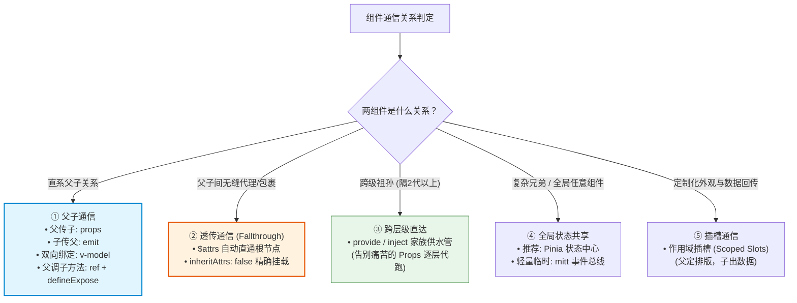
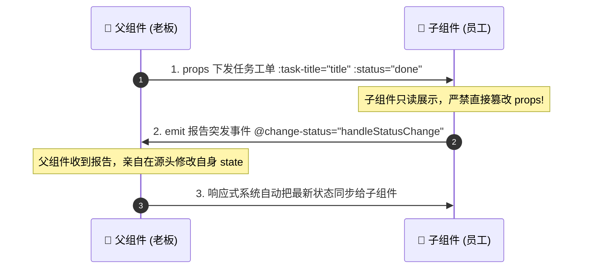
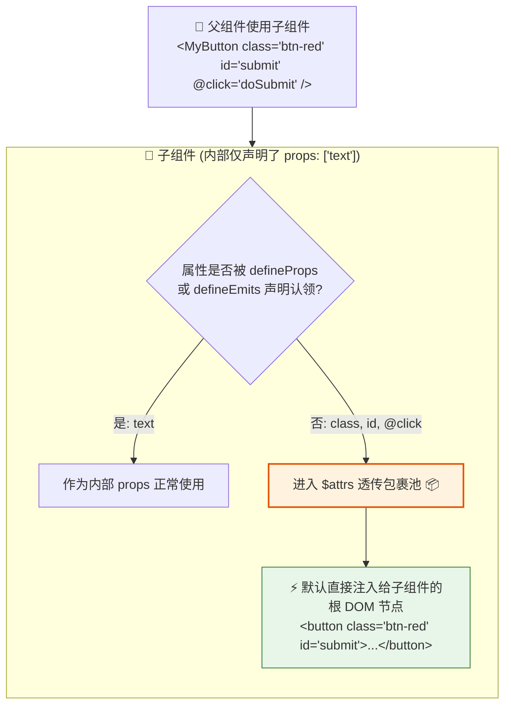
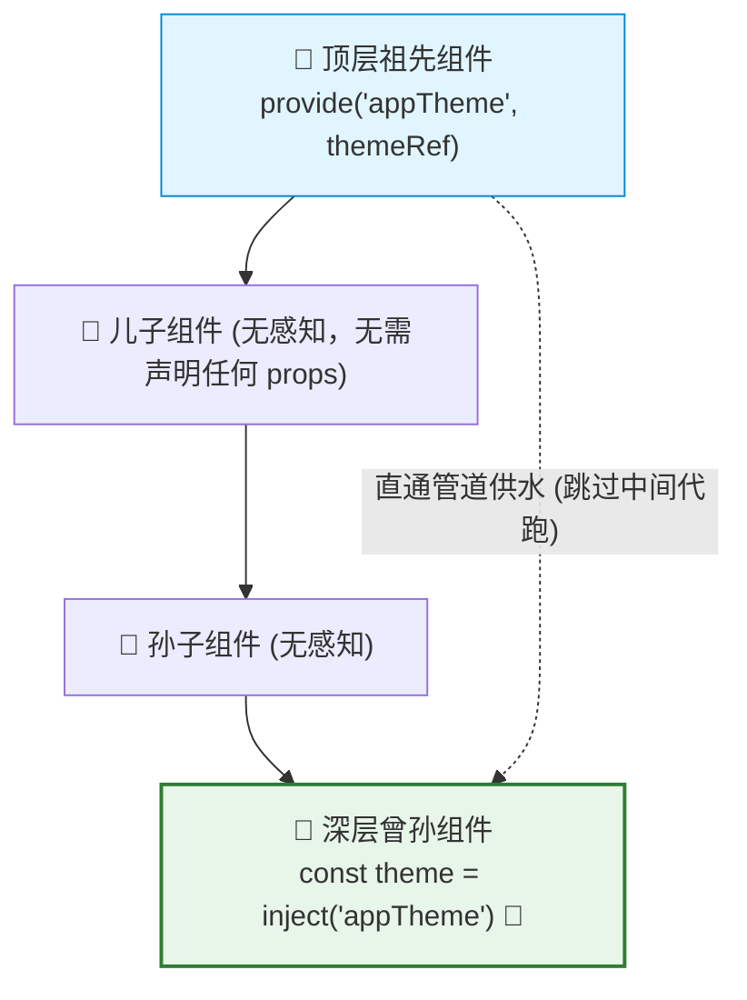

# 📡 Vue 3 组件通信全景指南：父子通信、透传通信与跨层实战

## 使用入口：先解决问题，再做验证

把页面拆成可组合组件并传递状态与事件。

**先做基本操作**：先用 props 传列表项，用 emit 上报编辑/删除，再验证取消编辑不污染父状态，最后按层级选择共享机制。完整前置实践见[基础入口](/doc/Vue/Vue组件与页面基本使用)。

**再逐步深入**：用途与基本 API → 场景与失败 → 原理/源码 → 取舍与验证。

> 💡 **核心目标**：抛弃枯燥零碎的 API 罗列！通过**通俗生活心智模型 + 架构拓扑图 + 真实避坑场景**，一次性彻底搞懂 Vue 3 组件间的所有通信手段，重点深度剖析大家最容易混淆的**父子通信、双向绑定与透传通信（Fallthrough Attributes）**。

---

## 🎯 一图看懂：Vue 组件通信选型雷达

组件之间的关系决定了最优雅的通信方案，切忌“杀鸡用牛刀”：



---

## 一、 直系父子通信：Props 下发与 Emit 上报

### 1. 通俗心智模型：领导派工单与打工人打报告

::: tip 🏢 通俗心智模型
* **父传子 `props` ＝【公司下达任务工单（单向数据流）】**：
  * 老板把客户需求打印成工单派发给员工（父传子）。
  * **单向铁律（只读）**：员工**绝不准私自用涂改液修改工单原件**！如果子组件擅自改 `props`，Vue 会在控制台大声报警并抛出警告！
* **子传父 `emit` ＝【打工人遇到状况打报告（事件驱动）】**：
  * 员工把活干完了、或者发现了问题，**按下对讲机向老板打报告**（触发自定义事件 `emit('update:status')`）。
  * 至于要不要改方案、怎么改，**由老板（父组件）在自己的办公室里亲自修改并重新下发**。
:::



---

### 2. Vue 3 标准代码实战（TypeScript 强类型）

#### 👷 子组件：`TaskItem.vue`
```vue
<script setup lang="ts">
// 1. 声明接收的 Props (只读工单)
interface Props {
  taskId: number
  title: string
  isDone?: boolean // 可选属性
}
const props = withDefaults(defineProps<Props>(), {
  isDone: false // 提供默认值
})

// 2. 声明上报的 Emits (事件报告)
const emit = defineEmits<{
  (e: 'toggleStatus', id: number, nextStatus: boolean): void
  (e: 'deleteTask', id: number): void
}>()

function handleClick() {
  // 触发事件通知父组件，切勿直接修改 props.isDone = true!
  emit('toggleStatus', props.taskId, !props.isDone)
}
</script>

<template>
  <div class="task-card" :class="{ completed: isDone }">
    <span>{{ title }}</span>
    <button @click="handleClick">切换状态</button>
    <button @click="emit('deleteTask', taskId)">删除</button>
  </div>
</template>
```

#### 👔 父组件：`TaskManager.vue`
```vue
<script setup lang="ts">
import { ref } from 'vue'
import TaskItem from './TaskItem.vue'

const currentTask = ref({ id: 101, title: '编写自动化测试用例', done: false })

function onToggle(id: number, nextStatus: boolean) {
  // 数据源头在此处安全变更
  currentTask.value.done = nextStatus
}
</script>

<template>
  <TaskItem
    :task-id="currentTask.id"
    :title="currentTask.title"
    :is-done="currentTask.done"
    @toggle-status="onToggle"
    @delete-task="(id) => console.log('删除任务', id)"
  />
</template>
```

---

### 3. `v-model` 双向绑定的本质剖析

很多初学者误以为 `v-model` 打破了单向数据流，其实它**完全是 `props + emit` 的极简语法糖**！

#### 语法糖拆解对照
```vue
<!-- 1. 简写形式 -->
<CustomInput v-model="searchText" />

<!-- 2. 完全等价的底层展开形式 (Vue 3 规范) -->
<CustomInput
  :modelValue="searchText"
  @update:modelValue="newValue => searchText = newValue"
/>
```

#### Vue 3 支持绑定多个 `v-model`
在 Vue 2 中一个组件只能有一个 `v-model`（其它靠 `.sync` 修饰符），而 Vue 3 彻底废弃了 `.sync`，允许随意定制多个双向参数：

```vue
<!-- 父组件同时双向绑定姓与名 -->
<UserNameEditor 
  v-model:first-name="userInfo.firstName"
  v-model:last-name="userInfo.lastName"
/>
```

---

## 二、 透传通信（Fallthrough Attributes 与 `$attrs`）

这是在**二次封装组件库（如基于 Element Plus / Ant Design 二次封装）、高阶包装组件**中最核心、却最常被忽略的通信能力！

### 1. 通俗心智模型：免安检直通车与转交包裹

::: tip 📦 通俗心智模型
* 想象你去丰巢快递柜寄包裹。
* 你随手在包裹外贴了条形码、防摔标签、写了备注（父组件传递了 `class="vip-btn"`, `style="margin: 10px"`, `id="main-btn"`, `@click="onClick"`）。
* **但是！** 子组件内部在 `defineProps` 和 `defineEmits` 里**完全没有声明接收它们**！
* 此时这些没被认领的“非 Props 属性”**不会丢失**，而是走**“免安检直通绿色通道”**：
  * Vue 默认会**自动将它们直接打包贴到子组件的最外层根 DOM 元素上**！
  * 这就叫**属性透传（Fallthrough Attributes）**。
:::



---

### 2. 经典透传特性与智能合并规则

当父组件传递了 `class` 或 `style`，而子组件根节点自身也写了 `class` 或 `style` 时，Vue 会**智能合并**，而不是简单粗暴覆盖：

```vue
<!-- 子组件 MyButton.vue -->
<template>
  <button class="base-btn">点击我</button>
</template>

<!-- 父组件引用 -->
<MyButton class="danger-btn" id="btn-1" @click="handleClick" />

<!-- 最终浏览器渲染的真实 HTML: -->
<!-- class 智能合并，id 自动挂载，点击事件自动绑定到根 button 上！ -->
<button class="base-btn danger-btn" id="btn-1">点击我</button>
```

---

### 3. 深度避坑：多根节点（Fragment）的警告灾难

Vue 3 允许 `<template>` 下拥有多个根节点，但此时透传机制会陷入迷茫：

```vue
<!-- ❌ 危险！多根节点组件 MultipleRoot.vue -->
<template>
  <header>头部导航</header>
  <main>主要内容</main>
</template>
```

如果父组件此时调用 `<MultipleRoot class="highlight" />`，Vue 根本不知道该把 `class="highlight"` 贴在 `<header>` 还是 `<main>` 上！控制台会立刻报出黄色警告：
> `[Vue warn]: Extraneous non-props attributes (class) were passed to component but could not be automatically inherited because component renders fragment or text root nodes.`

#### 解决方案：显式通过 `v-bind="$attrs"` 指定受体
```vue
<!-- ✅ 显式指定由 main 标签继承透传属性 -->
<template>
  <header>头部导航</header>
  <main v-bind="$attrs">主要内容</main>
</template>
```

---

### 4. 高阶实战：禁用默认透传（`inheritAttrs: false`）精准二次封装

#### 生产场景痛点
当你二次封装一个 `CustomInput` 组件，最外层需要一个带有图标和提示文字的 `<div>` 包裹层，而真正的输入框 `<input>` 隐藏在深层：

```vue
<!-- 默认情况下，父组件传的 class、id、v-model 会被错误贴在最外层 div 上！ -->
<div class="wrapper-box">
  <label>用户名</label>
  <input /> <!-- 我们其实希望属性贴在 input 上！ -->
</div>
```

#### 正确解决方案：关闭默认继承 + 精确转交
```vue
<!-- CustomInput.vue -->
<script setup lang="ts">
import { useAttrs } from 'vue'

// 1. 禁用 Vue 默认将 $attrs 贴在根节点的行为 (Vue 3.3+ 语法)
defineOptions({
  inheritAttrs: false
})

// 2. 如果在 JS 逻辑中需要读取透传属性，可以使用 useAttrs()
const attrs = useAttrs()
console.log('未被认领的透传参数:', attrs)
</script>

<template>
  <div class="custom-input-wrapper">
    <label>输入项</label>
    <!-- 3. 精准将所有透传的属性（placeholder、disabled、@change等）甩给内层 input -->
    <input class="real-input" v-bind="$attrs" />
  </div>
</template>
```

---

## 三、 跨层级直达通信：`provide` 与 `inject`

当组件层级深达 4~5 层（如 `Page` ➔ `Table` ➔ `TableHeader` ➔ `HeaderAction`）时，如果用 `props` 一层一层往下传，中间无辜的组件就成了痛苦的“人肉中继站”（业界俗称 **Props Drilling / 属性钻探**）。

### 1. 通俗心智模型：家族大厦的顶楼水塔

::: tip 🚰 通俗心智模型
* 祖先组件在楼顶安装了一个**公用储水塔**（`provide('theme', themeState)`）。
* 无论是中间的儿子、孙子、还是重孙子组件，**中间楼层压根不需要人工端着水盆往下送水**！
* 哪个深层子孙口渴了，只要在自己房间里**拧开专属水龙头**（`inject('theme')`），就能随时喝到水塔里的水！
:::



### 2. 生产实战规范：响应式传递与防篡改

#### 👴 顶层祖先组件（提供者）
```vue
<script setup lang="ts">
import { ref, provide, readonly } from 'vue'

const theme = ref<'light' | 'dark'>('light')

function toggleTheme() {
  theme.value = theme.value === 'light' ? 'dark' : 'light'
}

// 建议规范：传递 readonly 响应式数据，防止下层子孙组件随意污染全局状态！
// 若下层需要修改，同时提供一个官方修改方法
provide('themeConfig', {
  theme: readonly(theme),
  toggleTheme
})
</script>
```

#### 👶 深层子孙组件（消费者）
```vue
<script setup lang="ts">
import { inject } from 'vue'

// 第二个参数为兜底默认值
const { theme, toggleTheme } = inject('themeConfig', {
  theme: 'light',
  toggleTheme: () => {}
})
</script>

<template>
  <button :class="theme" @click="toggleTheme">
    当前主题: {{ theme }} (点击直接切换祖先主题)
  </button>
</template>
```

---

## 四、 父组件主动调用子组件：`ref` 与 `defineExpose`

### 1. 通俗心智模型：公司前台的对外展示窗口

::: tip 🏢 通俗心智模型
* 在 Vue 2 中，父组件只要通过 `this.$refs.child` 就能肆无忌惮地查看子组件内部所有的 `data` 变量与方法（没有隐私）。
* **Vue 3 `<script setup>` 革命性改变：默认完全封闭（Private by default）**！
* 父组件拿到了子组件的 `ref`，看到的也是一个空壳暗箱；
* 子组件必须像**银行柜台窗口**一样，使用 **`defineExpose()`** 明确摆上货架的几个公共方法（如 `openModal`、`resetForm`），父组件才有资格调用！
:::

```vue
<!-- 👷 子组件 UserDialog.vue -->
<script setup lang="ts">
import { ref } from 'vue'

const isVisible = ref(false)
const secretApiKey = ref('123456') // 私有变量，外界不可见

function show() {
  isVisible.value = true
}
function hide() {
  isVisible.value = false
}

// 显式向外公开的能力清单
defineExpose({
  openDialog: show,
  closeDialog: hide
})
</script>
```

```vue
<!-- 👔 父组件 App.vue -->
<script setup lang="ts">
import { useTemplateRef } from 'vue'
import UserDialog from './UserDialog.vue'

// Vue 3.5+ 推荐 useTemplateRef，或 ref<InstanceType<typeof UserDialog>>()
const dialogRef = useTemplateRef<InstanceType<typeof UserDialog>>('userDialogRef')

function handleOpen() {
  // 安全调用子组件暴露的方法
  dialogRef.value?.openDialog()
  // console.log(dialogRef.value?.secretApiKey) // ❌ undefined! 无法窃取私有变量
}
</script>

<template>
  <button @click="handleOpen">打开弹窗</button>
  <UserDialog ref="userDialogRef" />
</template>
```

---

## 五、 全场景组件通信大决战速查矩阵

| 通信方式 | 适用通信关系 | 核心机制与 API | 核心优势 | 潜在短板 / 适用界限 |
| :--- | :--- | :--- | :--- | :--- |
| **Props / Emit** | 严格直系父子 | `defineProps` / `defineEmits` | 单向数据流清晰，完全符合官方规范 | 层级过深时会导致钻探（Props Drilling） |
| **`v-model`** | 直系父子双向 | `modelValue` + `update:modelValue` | 极简语法糖，支持多参数绑定 | 仅适用于表单控件或值绑定受控组件 |
| **透传 `$attrs`** | 直系父子/高阶包装 | `useAttrs()` / `v-bind="$attrs"` | 二次封装组件零成本传递样式、属性与原生事件 | 多根节点时需要显式绑定，不可滥用 |
| **`provide / inject`** | 跨代祖孙 | `provide` / `inject` | 彻底跳过中间层，专为模块/上下文设计 | 状态追踪相对隐蔽，大型全局状态建议上 Pinia |
| **`ref + defineExpose`** | 父直接控子 | `ref()` + `defineExpose()` | 命令式调用子组件动作极度方便（如重置、弹窗） | 增加了父子强耦合，违背数据驱动思想 |
| **Pinia 全局状态** | 兄弟/全局任意组件 | `defineStore()` | 集中化管理、DevTools 完美时间旅行调试、高内聚 | 局部临时简单通信无需引入 Store |
| **作用域插槽 (Slots)** | 父子定制外观 | `<slot :row="item">` | 父组件掌控 UI 结构，子组件掌控数据源 | 仅适用于模板结构高度定制场景 |

---

## 🏁 终极避坑口诀

> 💡 **组件通信三十字口诀**：
> “父传子用 props，报告更新派 emit；
>  二次封装挂 attrs，多根节点手动指；
>  跨代祖孙水管连，全局复杂 Pinia 管！”
