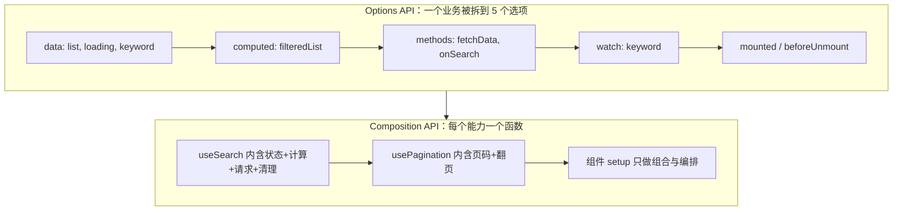
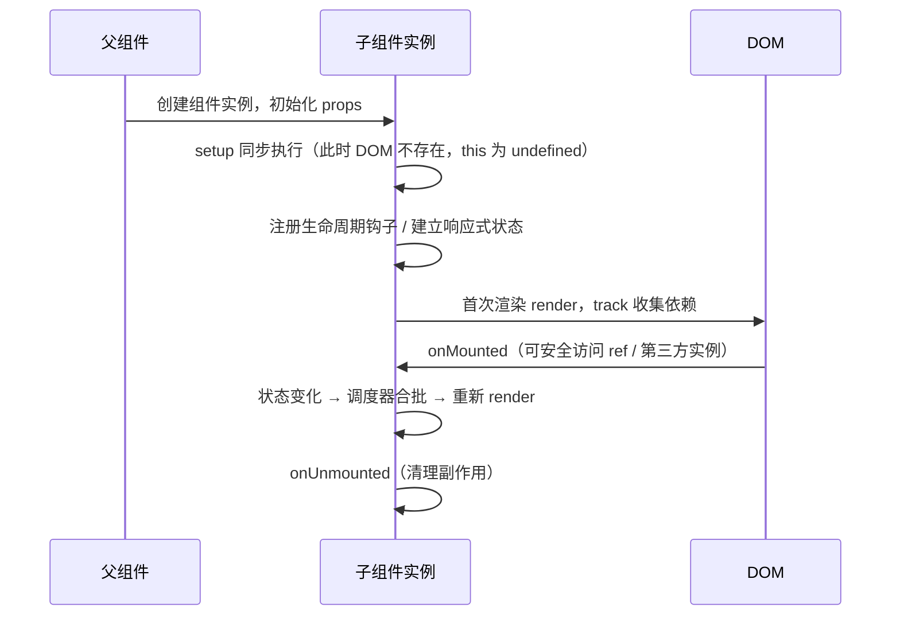

# 组合式 API 与实战解析

## 使用入口：先解决问题，再做验证

按业务组织状态和副作用并复用逻辑。

**先做基本操作**：先用 script setup 写页面，把稳定重复行为抽成 composable，验证清理与多个实例，再讲执行模型。初次学习可先完成[本模块基础实践](/doc/Vue/Vue组件与页面基本使用)。

**再逐步深入**：基本 API 与输入输出 → 常见失败和使用边界 → 场景排查与优化 → 本文机制分析与源码。面试先讲用途和自己的操作过程，再回答场景与原理追问。

> **一句话结论**：Composition API 不是「换一种写法」，而是把**逻辑复用的单位从「组件选项」变成「函数」**——同一个业务能力的状态、副作用、清理逻辑能收在一个 `useXxx` 里，从而可被任意组件组合、单独测试、完整类型推导。

## 30 秒速览

| 维度 | Options API | Composition API |
|---|---|---|
| 代码组织 | 按 `data`/`methods`/`computed` 横向切 | 按业务能力纵向聚合 |
| 逻辑复用 | mixin（命名冲突、来源不明） | composable 函数（显式导入、参数明确） |
| 类型推导 | `this` 难以推导，需 `Vue.extend` | 纯变量 + 泛型，TS 原生友好 |
| 压缩体积 | `this.xxx` 无法被压缩 | 局部变量可被 terser 改名 |
| 适用场景 | 小型、逻辑简单的组件 | 中大型、跨组件复用、TS 项目 |

## 一张图看懂逻辑关注点的变化



一个 500 行组件里，「搜索」「分页」「权限」「埋点」四块逻辑在 Options API 里交错分布在 5 个选项中，改一处要上下跳；Composition API 里它们是 4 个可独立阅读的函数。这才是核心收益，**不是为了少写几行代码**。

## 一、`setup` 与 `<script setup>` 的执行时机



`<script setup>` 是编译期语法糖，最终被编译成一个普通 `setup()` 函数：

```vue
<!-- 源码 -->
<script setup lang="ts">
import { ref } from 'vue'
const count = ref(0)
const inc = () => count.value++
</script>
<template><button @click="inc">{{ count }}</button></template>
```

```ts
// 编译产物（示意）：模板编译为 render 函数，与 setup 处于同一闭包 → 变量直接内联访问
export default {
  setup() {
    const count = ref(0)
    const inc = () => count.value++
    return (_ctx, _cache) => h('button', { onClick: inc }, toDisplayString(count.value))
  },
}
```

因为模板与 setup 在**同一闭包**，编译器能直接引用局部变量（无需 `this` 代理查找），还能做静态提升与 `patchFlag` 标记——这是 `<script setup>` 比普通 `setup()` 渲染更快的真实原因，不只是「写得少」。

## 二、逻辑复用三代方案对比

| 方案 | 做法 | 致命问题 |
|---|---|---|
| mixin | 把选项对象混入组件 | 命名冲突、隐式依赖、多 mixin 来源不可追溯、类型无法推导 |
| 作用域插槽 / HOC | 用组件承载逻辑 | 多一层组件实例，产生「组件嵌套地狱」与额外渲染开销 |
| composable | 返回 `ref` / 函数的普通函数 | 需在 setup 上下文调用（生命周期绑定当前实例） |

## 三、写对 composable 的四条规则（附生产级 `useRequest`）

1. **函数名 `useXxx`，返回响应式引用**——不要返回普通值快照；
2. **参数用 `MaybeRefOrGetter` + `toValue()`**——调用方传 `ref`、`getter`、字面量都能工作；
3. **副作用必须可清理**——`onScopeDispose` 里取消请求、清除定时器、解绑事件；
4. **生命周期钩子只能在 setup 同步调用栈里注册**——在 `setTimeout` / `await` 之后调用 `onMounted` 会丢失当前实例并告警。

```ts
// composables/useRequest.ts —— 覆盖竞态、防抖、取消、错误、清理
import { ref, shallowRef, watch, toValue, onScopeDispose, type MaybeRefOrGetter } from 'vue'

export function useRequest<T>(
  url: MaybeRefOrGetter<string>,
  opts: { immediate?: boolean; debounce?: number; timeout?: number } = {},
) {
  const data = shallowRef<T | null>(null)   // 接口对象不需深层代理，用 shallowRef
  const error = ref<Error | null>(null)
  const loading = ref(false)
  let controller: AbortController | null = null
  let timer: ReturnType<typeof setTimeout> | undefined
  let seq = 0                               // 请求序号，解决乱序覆盖

  async function execute() {
    const cur = ++seq
    controller?.abort()                     // 取消上一次未完成的请求
    controller = new AbortController()
    const timeoutId = setTimeout(() => controller?.abort(), opts.timeout ?? 10_000)
    loading.value = true
    error.value = null
    try {
      const res = await fetch(toValue(url), { signal: controller.signal })
      if (!res.ok) throw new Error(`HTTP ${res.status}`)
      const json = await res.json() as T
      if (cur === seq) data.value = json   // 只接受最新一次结果
    } catch (e) {
      if ((e as Error).name !== 'AbortError' && cur === seq) error.value = e as Error
    } finally {
      clearTimeout(timeoutId)
      if (cur === seq) loading.value = false
    }
  }

  function run() {
    clearTimeout(timer)
    if (opts.debounce) timer = setTimeout(execute, opts.debounce)
    else void execute()
  }

  watch(() => toValue(url), run, { immediate: opts.immediate ?? true })

  onScopeDispose(() => {                  // 组件卸载时统一回收
    controller?.abort()
    clearTimeout(timer)
  })

  return { data, error, loading, run, refresh: execute }
}
```

组件里只剩编排，一眼看懂：

```vue
<script setup lang="ts">
const keyword = ref('')
const url = computed(() => `/api/search?q=${encodeURIComponent(keyword.value)}`)
const { data, loading, error, refresh } = useRequest<Item[]>(url, { debounce: 300 })
</script>
<template>
  <input v-model="keyword" />
  <button :disabled="loading" @click="refresh">刷新</button>
  <p v-if="error">{{ error.message }}</p>
  <ul v-else><li v-for="i in data ?? []" :key="i.id">{{ i.name }}</li></ul>
</template>
```

## 四、六个高频反模式

| 反模式 | 后果 | 正确写法 |
|---|---|---|
| `const { id } = defineProps<{id:string}>()` | props 解构丢失响应（3.5 前） | `toRef(props,'id')` 或升级 3.5 响应式 props destructure |
| 在 `await` 后调用 `onMounted` | 当前实例已丢失，钩子不生效 | 钩子放在同步位置；异步结果用 `watch` 驱动 |
| composable 里返回 `state.count`（裸值） | 拿到的是快照，不更新 | 返回 `ref` 或用 `toRefs` |
| 把 `reactive` 整体替换为新对象 | 引用断开，视图不更新 | 用 `ref` 或 `Object.assign(state, next)` |
| 全局单例 `reactive` 在 SSR 中使用 | 跨请求状态串号（用户 A 看到 B 的数据） | 每个请求创建 `app` + `pinia` 新实例 |
| 一个 `useEverything` 塞 800 行 | 又回到「大杂烩」，无法测试 | 按能力拆分，`setup` 只做组合 |

## 五、与 React Hooks 的关键区别（跨框架常问）

| 维度 | Vue Composition API | React Hooks |
|---|---|---|
| 执行次数 | `setup` 只执行**一次** | 每次 render 都重新执行全部 hooks |
| 依赖数组 | 自动收集（`watchEffect` / `computed`） | 必须手写 `[dep]`，漏写导致闭包陷阱 |
| 状态载体 | `ref` 是稳定引用，跨渲染不变 | `useState` 每次返回新值快照 |
| 条件调用 | 生命周期钩子仍建议同步顶层调用，但 `computed`/`watch` 可在条件内 | 严禁在条件/循环中调用 hooks |
| 清理时机 | `onScopeDispose` / `onCleanup` | `useEffect` 返回函数，依赖变化时先清理再执行 |

一句话答法：**Vue 靠响应式依赖自动追踪，React 靠重新执行函数 + 依赖数组比对**，因此 Vue 没有 stale closure 问题，也不必记 `useCallback`/`useMemo` 那一套。

## 六、什么时候不该抽 composable

- 只用一次、且不足 20 行的逻辑：抽出去反而增加跳转成本；
- 纯展示型计算：一个 `computed` 就够，不必包装成 `useXxx`；
- 涉及模板结构复用：该抽的是**组件**，不是函数；
- 需要跨应用共享、且带持久化：交给 [Pinia](/doc/Vue/Pinia状态管理与实战解析)，composable 是组件级生命周期绑定的。

判断标准很简单：**「这段逻辑换一个页面还要不要？要不要单独测？」** 两个都是「要」才抽。

## 七、高频追问（含高分/低分特征）

| 追问 | 高分回答要点 | 低分回答 |
|---|---|---|
| Composition API 本质优势是什么？ | 逻辑复用单位变成函数、类型推导、无 `this`、便于 tree-shaking 与压缩 | 「写法更简洁」 |
| `<script setup>` 为什么性能更好？ | 模板与 setup 同闭包，变量直接内联 + 静态提升 + patchFlag | 「语法糖，性能一样」 |
| `setup` 里能访问 `this` 吗？ | 不能，实例尚未创建完成，`this` 为 undefined；用 `getCurrentInstance` 也仅限库开发 | 「可以，指向组件实例」 |
| 为什么 `watch` 回调里读的字段不算依赖？ | 依赖由「源 getter 执行期间的 track」决定，回调执行时 activeEffect 已置空 | 「Vue 自动识别所有用到的变量」 |
| 怎么给 composable 写单测？ | `effectScope` + 挂载一个空组件提供实例上下文，`onScopeDispose` 可断言清理 | 「必须启动整个页面」 |
| 老项目怎么迁移？ | 逐组件增量，Options 与 Composition 可共存；先抽无 UI 的逻辑，再改数据层 | 「全量重写」 |

**延伸阅读**：[响应式原理与实战解析](/doc/Vue/响应式原理与实战解析)、[生命周期与实战总结](/doc/Vue/生命周期与实战总结)、[TypeScript 工程实践与类型体操](/doc/Vue/TypeScript工程实践与类型体操)。
