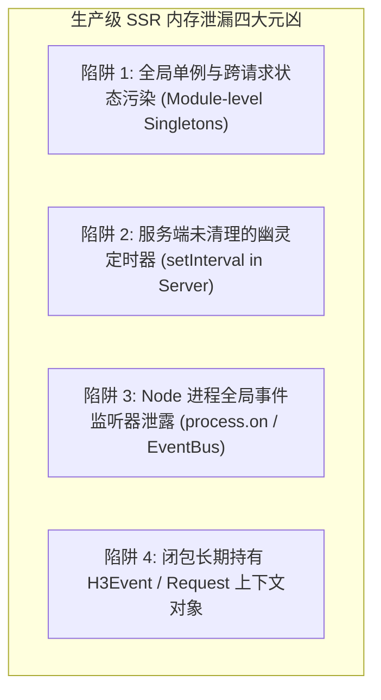

# Nuxt 3 同构状态管理 useAsyncData 去重序列化与 SSR 内存泄漏四大陷阱

在传统的 Vue 客户端单页应用中，数据拉取通常在 `onMounted` 钩子中通过 Axios 发起；但在以 Nuxt 3 为代表的 **同构渲染（Universal Rendering）架构** 中，同一份代码既需要在 Node.js 服务端跑一次以产出首屏 HTML，又需要在浏览器客户端跑一次以完成水合（Hydration）。如果处理不当，页面会发生**服务端请求一次、客户端水合又重复请求一次的“双倍流量雪崩（Double Fetching）”**；更严重的是，长期在 Node.js 服务端常驻运行的代码，极易遭遇**长周期隐蔽内存泄漏（Memory Leak）**，最终导致 Node 进程频繁 OOM 崩溃退出。本专题深入剖析其底层原理与工业排障方案。

---

## 核心设计哲学与数据脱水/水合链路

### 1. `useAsyncData` 如何物理消灭重复请求？（脱水与注水机制）

```mermaid
sequenceDiagram
    autonumber
    participant Node as Node.js 服务端 (Nitro 引擎)
    participant Payload as __NUXT_DATA__ 数据挂载区
    participant Client as 客户端浏览器 (NuxtApp)

    Node->>Node: 1. 执行 useAsyncData('user-info', () => fetchUser())
    Node->>Node: 2. 检查内部 payload 缓存未命中，发起真实内网网络请求
    Node->>Node: 3. 拿到数据，在 Node 内存中渲染 HTML
    Node->>Payload: 4. 【脱水 Dehydration】将数据通过 devalue 序列化写入 &lt;script id="__NUXT_DATA__"&gt;
    Node-->>Client: 返回拼装好的完整 HTML 报文
    Client->>Client: 5. 浏览器下载并执行客户端 JS，启动水合
    Client->>Client: 6. 再次执行到同一个 useAsyncData('user-info')
    Client->>Payload: 7. 【注水 Hydration】根据 key 'user-info' 直接读取 __NUXT_DATA__ 快照！
    alt 缓存命中
        Client->>Client: 8. 直接复用服务端快照数据！【绝对不向远程后端发起第二次网络请求！】
    else 客户端路由前端跳转 (SPA 模式)
        Client->>Client: 此时才会在客户端真正发起一次客户端 HTTP 请求获取新页面数据
    end
```

---

## 源码级/物理级底层推导

### 1. 为什么不用 `JSON.stringify` 而是必须使用 `devalue` 序列化？

在将 Node.js 服务端抓取到的数据写入 HTML `<script>` 标签时，原生的 `JSON.stringify` 存在两大致命缺陷：
1. **类型断层丢失**：`JSON.stringify` 会把 `Date` 对象暴力转化为普通字符串，把 `Map`、`Set`、`BigInt`、`undefined` 彻底抹除或抛错；客户端水合还原时无法恢复原始原型链；
2. **XSS 注入漏洞灾难**：如果接口返回的数据中恰好包含闭合标签 `</script><script>alert('xss')</script>`，直接使用 `JSON.stringify` 明文写入页面，浏览器 HTML 解析器会**无视字符串引号，强行把当前脚本块提前截断闭合**，直接触发反射型 XSS 漏洞！

#### Nuxt 3 采用 `devalue` 的物理保障
- **防 XSS 自动转义**：将所有的 `<` 字符自动转义为 `\u003C`，将 `>` 转义为 `\u003E`，确保绝对不会被 HTML 解析器误解析为闭合标签；
- **全类型与循环引用支持**：完美支持 `Date`、`RegExp`、`Map`、`Set`、`Infinity`、`NaN` 以及复杂图结构中的**自循环引用（Circular References）**。

---

### 2. `useAsyncData` 中 `key` 的底层去重物理规则

```typescript
// 函数签名
function useAsyncData<T>(
  key: string,
  handler: (nuxtApp?: NuxtApp) => Promise<T>,
  options?: AsyncDataOptions<T>
): AsyncData<T>
```
- **Nuxt 自动推导 Key 的机制**：若开发者省略了第一个 `key` 参数直接写 `useFetch('/api/users')`，Nuxt 编译器插件会在编译期根据该调用的**文件绝对路径 + 代码物理行号列号**自动生成一个唯一的 hash key（如 `user-profile-L24-C12`）；
- **自定义 Hook 封装中的翻车陷阱**：
  如果开发者将 `useFetch` 封装进了一个公共 Hook：
  ```typescript
  // ❌ 严重 Bug：公共封装未传入动态 key！
  export function useUserProfile(id: number) {
    // 编译器推导出的 key 永远是这行代码的行号（例如 'useUserProfile-L3'）
    return useFetch(`/api/user/${id}`)
  }
  ```
  **事故**：当页面同时展示用户 101 和用户 102 时，后调用的请求因为 key 相同，**直接误命中前者的缓存快照**！导致 102 的用户卡片展示出 101 的数据！
- **规约**：在自定义封装中，**必须显式提供动态的组合 key**：
  ```typescript
  // ✅ 正确规范：显式拼接唯一业务 key
  export function useUserProfile(id: Ref<number>) {
    return useFetch(() => `/api/user/${id.value}`, {
      key: `user-profile-${id.value}`
    })
  }
  ```

---

## Node.js 服务端内存泄漏四大高危陷阱

在客户端 SPA 中，刷新页面就相当于进程重启；但在 Node.js 服务端，单个 Node 进程可能连续运行数月，服务数百万次 HTTP 请求。一旦发生内存泄漏，累积到一定阈值就会触发系统级 OOM（Out of Memory）导致整站宕机！



### 陷阱 1：模块级单例变量跨请求累积
- **致命代码**：
  ```typescript
  // ❌ 极高危：文件顶层模块作用域下的数组
  const requestHistoryList = []

  export default defineEventHandler(async (event) => {
    // 每次用户请求到来，都向这个全局单例数组推入一条记录
    requestHistoryList.push({ ip: getRequestIP(event), time: Date.now() })
    // requestHistoryList 永远在内存中无法被 GC 回收，服务器运行 3 天后物理内存耗尽崩溃！
  })
  ```

### 陷阱 2：在组件的 `setup()` 中启动未清理的定时器
- **致命代码**：
  ```typescript
  <script setup>
  // ❌ 灾难：这段 setup() 在 Node.js 服务端执行了一次！
  // Node 端启动了一个后台 setInterval 定时器，由于服务端完全不执行 onUnmounted！
  // 这个定时器在 Node 进程中将永远运行下去！每来一次请求就多一个常驻后台定时器！
  setInterval(() => {
    console.log('心跳检测')
  }, 1000)
  </script>
  ```
- **规约**：任何定时器必须严格包裹在 `onMounted(() => { ... })` 中，确保仅在浏览器客户端执行！

### 陷阱 3：在每次请求时调用 `process.on()`
- **现象**：Node 控制台狂抛 `MaxListenersExceededWarning: Possible EventEmitter memory leak detected. 11 message listeners added`。
- **物理成因**：在接口处理函数中动态调用了全局 `process.on('message', ...)`，每来一个请求就追加一个未释放的闭包监听，直接打爆事件发射器内存。

### 陷阱 4：闭包长期持有请求级上下文 `event` / `req`
- **成因**：在处理异步长事务或把任务推入后台队列时，回调闭包引用了外层的 `event.node.req`。导致请求虽然已经向客户端响应完毕，但底层包含完整 TCP Socket 缓冲区的庞大 Request 对象却无法被 GC 回收。

---

## 社招高频硬核连环追问

### 追问 1：为什么在 Nuxt 3 中推荐使用 `useFetch` 而不是直接使用原生的 `axios` 或 `fetch`？底层有什么区别？

#### 深度剖析
1. **脱水/注水状态自动打通**：
   - 如果直接使用 `axios.get('/api/user')`：服务端渲染时跑了一遍 Axios；到了客户端水合时，客户端的 JS 没有任何机制去读取服务端的缓存，被迫又发了一次完全一模一样的网络请求，造成两次请求浪费；
   - `useFetch` 内部自动封装了 `useAsyncData`，天生具备脱水注水能力，客户端直接读取 `__NUXT_DATA__` 快照，实现 **0 冗余重复请求**；
2. **响应式 URL 自动联动监听**：
   - `useFetch(() => `/api/user/${userId.value}`)` 支持传入 Getter 函数。当 `userId` 改变时，`useFetch` 会自动重新发起请求刷新数据，类似自动集成了 `watch` 机制。

---

### 追问 2：Node.js 服务端发生 SSR 内存泄漏时，线上如何快速定位是哪个闭包或对象在泄露？

#### 深度剖析
1. **生产现场无损抓取堆快照（Heapdump）**：
   - 通过在启动参数中注入 `--inspect`，或者通过操作系统信号（`SIGUSR2`）触发 `v8.writeHeapSnapshot()` 生成当前时刻的 `.heapsnapshot` 二进制堆内存快照；
   - 间隔 15 分钟，分别在内存为 200MB 和 600MB 时抓取两份快照：`heap-1.heapsnapshot` 与 `heap-2.heapsnapshot`；
2. **Chrome DevTools 比对排障**：
   - 打开 Chrome 浏览器的 `chrome://inspect`，加载这两份快照，选择 **Comparison（对比模式）**；
   - 按照 **Alloc. Size（内存增量）** 倒序排序；
   - 重点检索 `(closure)`（闭包）、`Array`、`Object`；
   - 观察哪个类的对象实例数量在短时间内呈现数百倍的异常暴增；
   - 点击该对象查看 **Retainer（持有链）**，一路向上追踪是哪个全局变量（如某个全局 EventEmitter 或未清理的 Map 缓存）死死拽着它不放，精准定位到具体代码行数。

---

## 生产级避坑指南与排障 SOP

### 1. 严格使用 `useState` 替代 Vue 原生 `ref` 跨请求共享状态

在 Nuxt 3 中，如果需要定义跨组件共享的状态（如当前全局登录用户）：
```typescript
// ❌ 错误：普通的 ref 在服务端多请求间存在泄漏与污染风险
export const useGlobalUser = () => ref(null)

// ✅ 官方规范：useState 是 SSR 友好的同构状态容器，自动绑定当前请求的 nuxtApp 上下文
export const useGlobalUser = () => useState('global-user', () => null)
```

---

### 2. 规避在 `useAsyncData` 内部返回体积过大的无用字段

- **性能陷阱**：从后端接口拉取了一个包含 50 个字段的庞大文章对象，但界面上其实只需要展示 `title` 和 `content`。
- **物理代价**：整个 50 个字段的完整对象会被全量写入到 HTML 的 `<script id="__NUXT_DATA__">` 中，导致首屏 HTML 体积从 20KB 暴增到 500KB，大幅恶化 TTFB 与网络传输耗时。
- **解决方案：利用 `transform` 或 `pick` 剪裁数据**：
  ```typescript
  const { data: article } = await useFetch('/api/article/1', {
    // 仅保留必需字段，大幅缩减 HTML 脱水载荷
    pick: ['id', 'title', 'content']
  })
  ```
