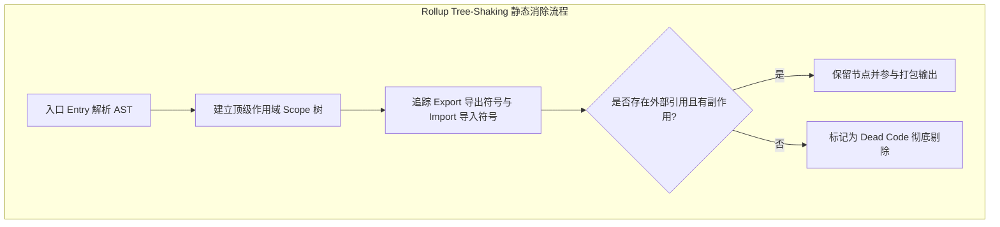
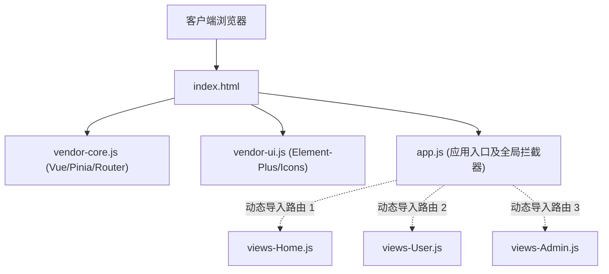

# 资深-Rollup打包优化Tree-Shaking物理条件与manualChunks分包SOP

在大型生产级 Vue 3 应用中，单页应用首屏加载体积（FCP / LCP 指标）直接决定了用户的留存率与交互体验。Vite 在生产构建阶段底层完全委托给 **Rollup**。深入理解 Rollup 的静态分析内核、**Tree-Shaking（摇树优化）** 的物理触发条件，以及基于 `manualChunks` 策略进行细粒度分包（Code Splitting），是前端技术专家（资深/架构岗）必须掌握的核心工程化内功。

---

## 一、核心底层机制与全景架构

### 1.1 DCE（死代码消除）与 ESM 静态 Tree-Shaking 物理对比

**DCE（Dead Code Elimination）** 是编译器领域的传统优化技术（如 UglifyJS / Terser 处理控制流不可达分支）。而 **Tree-Shaking** 则是以模块图谱为单位，剔除整个 JavaScript 依赖树中**未被导出、或导出后未被外部任何模块引用、且无副作用（No Side-Effects）**的代码块。

| 维度对比 | CommonJS 规范 (运行时动态加载) | ES Module 规范 (编译时静态分析) |
| :--- | :--- | :--- |
| **导入/导出语法** | `require(path)` / `module.exports` | `import ... from ...` / `export ...` |
| **执行时序确定性** | 动态求值，可以在 `if` 条件分支中引入 | 顶层静态声明，编译器解析 AST 阶段即可确定依赖图谱 |
| **模块引用映射** | 导出的是值的拷贝或通用对象引用 | 导出的是只读的符号**物理内存引用（Live Binding）** |
| **Tree-Shaking 可行性** | **物理上无法安全摇树**（可能包含动态属性挂载） | **天然支持静态 AST 依赖树摇剪** |



---

### 1.2 Rollup 细粒度分包（Code Splitting）全景架构

如果不做分包优化，生产环境往往会产生一个巨大的 `index.js`（包含 Vue 运行时、第三方库如 Element Plus、Pinia、Axios 以及全部业务逻辑），体积可高达 3MB~5MB。
通过 Rollup 的 `output.manualChunks`，我们可以实现**按变更频率分层、按业务维度隔离**的精细化分包策略：
1. **基础运行库（Vendor / Core）**：Vue、Pinia、Vue Router，变更频率极低，配置为长期强缓存（`Cache-Control: max-age=31536000, immutable`）。
2. **大型 UI 组件库（UI Library）**：Element Plus / Ant Design Vue，单独切片。
3. **异步按需路由包（Async Pages）**：基于 `import('./views/Home.vue')` 自动拆分为独立 chunk。
4. **高频公共业务组件（Common Utils）**：按业务模块按需聚合。



---

## 二、源码级/物理推导

### 2.1 Tree-Shaking 的物理触发三要素

一段代码能够在生产打包时被物理安全摇除，必须**同时满足**以下三个物理充要条件：

#### 条件 1：基于原生静态 ES Module 语法
源码必须全部采用 ES6 `import` / `export` 语法编写。如果通过 Babel 转译时过早将 ESM 转换为 CommonJS（如配置了 `@babel/preset-env` 且 `modules: "commonjs"`），Rollup 的 AST 静态遍历将无法追踪符号引用，Tree-Shaking 直接彻底失效。

#### 条件 2：`package.json` 声明 `sideEffects: false`
JavaScript 是一门高动态语言，顶层代码执行极易产生**副作用（Side Effects）**，例如修改全局对象、向 `window` 注入属性、执行 IIFE 立即执行函数等。

Rollup 默认必须假定未被显式引用的模块依然可能在执行时产生副作用（例如 `import './styles/reset.css'`，或者库内修改原型链）。
若开发者在第三方库或本地业务中显式声明：
```json
{
  "name": "my-utils-library",
  "version": "1.0.0",
  "sideEffects": false
}
```
Rollup 就会认定：**只要该包导出的符号未被当前应用直接消费，就可以跳过对整个文件 AST 的求值执行，直接整块剔除**。若存在 CSS 等副作用文件，应使用数组白名单形式：
```json
{
  "sideEffects": ["*.css", "*.scss", "src/polyfill.ts"]
}
```

#### 条件 3：纯函数注解 `/*#__PURE__*/`
当一个函数调用的返回值被赋给一个未被使用的变量时，Rollup 无法在静态阶段推断该函数是否包含网络请求或修改外部变量等隐式副作用。
```javascript
// 默认情况下：Rollup 无法判断 computeSomething 是否有副作用，不敢摇除该行
export const unusedValue = computeSomething(100)

// 纯函数注解：明确通知编译器该函数调用无副作用，若 unusedValue 未被使用，直接整行消除
export const safeUnusedValue = /*#__PURE__*/ computeSomething(100)
```
Vue 3 源码中大量采用了 `/*#__PURE__*/` 注解（如 `createVNode`、`defineComponent` 等），以保证未被使用的 Vue 内部辅助函数在打包时被完全剔除。

---

### 2.2 `manualChunks` 细粒度算法与避免循环依赖

Rollup 提供了两种 `manualChunks` 配置方式：**对象配置式**与**函数动态算法式**。
在现代复杂工程中，强烈推荐**函数动态算法式**，以实现基于文件物理路径的高精度切片。

#### 生产级 manualChunks 拆分算法实现
```typescript
// vite.config.ts / rollup.config.js
export function customManualChunks(id: string) {
  // id 为模块文件的绝对物理路径
  if (id.includes('node_modules')) {
    // 1. 核心框架运行时：Vue、Pinia、Vue Router 聚合为框架基座
    if (
      id.includes('/vue/') ||
      id.includes('/@vue/') ||
      id.includes('/pinia/') ||
      id.includes('/vue-router/')
    ) {
      return 'vendor-framework'
    }

    // 2. 大型 UI 组件库独立拆分
    if (id.includes('/element-plus/') || id.includes('/@element-plus/')) {
      return 'vendor-element-plus'
    }

    // 3. 通用大型工具库（如 lodash、axios、dayjs 等）
    if (
      id.includes('/lodash-es/') ||
      id.includes('/axios/') ||
      id.includes('/dayjs/')
    ) {
      return 'vendor-utils'
    }

    // 4. 重型图表/富文本库（按需隔离）
    if (id.includes('/echarts/') || id.includes('/zrender/')) {
      return 'vendor-echarts'
    }

    // 其余第三方依赖沉淀至通用 vendor
    return 'vendor-common'
  }
}
```

---

## 三、社招/阶段必考高频硬核连环追问

### 追问 1：为什么在 ES6 类（Class）中定义了一个未被调用的方法，Rollup 却无法通过 Tree-Shaking 把它摇除？
**标杆解答**：
1. **ES6 类的原型链物理机制**：ES6 的 `class MyClass { unusedMethod() {} }` 本质上是语法糖，编译器转译后等价于在构造函数的原型链上挂载属性：
   ```javascript
   function MyClass() {}
   MyClass.prototype.unusedMethod = function() {}
   ```
2. **原型修改属于对象突变（Object Mutation）**：向 `prototype` 挂载方法是一种典型的对象属性修改行为。Rollup 无法预测运行时是否会有反射（如 `Object.keys()`、`for...in`）、原型链继承扩展或动态属性访问（`instance[methodName]()`）依赖该方法。
3. **消除方案**：生产架构中如果需要极致 Tree-Shaking，应当遵循**面向函数编程（Functional Programming）**原则，将纯逻辑抽象为独立的具名导出函数（如 `export function unusedMethod() {}`），而非封装在包含大量未使用方法的厚重 Class 中。

---

### 追问 2：配置 `manualChunks` 时，如果把多个相互引用的模块错误拆分到不同 chunk，会导致什么致命问题？如何从根本上预防？
**标杆解答**：
1. **循环依赖物理死锁（Circular Dependency Deadlock）**：如果模块 A 导入模块 B，模块 B 又间接引入模块 A 的子导出；若开发者通过硬编码规则将 A 强行划分至 `chunk-a`，将 B 划分至 `chunk-b`，会导致生成的 JavaScript chunk 文件之间产生双向环形引用（`chunk-a.js -> chunk-b.js -> chunk-a.js`）。
2. **运行时初始化崩溃**：在浏览器或 Node.js 环境中执行时，其中一个模块在求值时其依赖的导出符号尚未初始化，直接抛出 `ReferenceError: Cannot access 'XXX' before initialization` 或 `undefined is not a function`。
3. **预防 SOP**：
   - 绝不要将具有高内聚业务耦合的代码块强行拆入不同的 manualChunk。
   - 规范分包原则：**只对 `node_modules` 内无环引用的第三方库做 manualChunk 拆分，业务代码交由 Rollup 自身的动态导入（`import()`）机制自动决策代码分割**。

---

### 追问 3：为什么有些基于 NPM 引用的第三方包明明白白写了 `export const a = 1; export const b = 2`，在项目中只用了 `a`，最终打包却依然把 `b` 打了进去？
**标杆解答**：
1. **未在 package.json 声明副作用白名单**：该 npm 包未在其根目录下的 `package.json` 中配置 `"sideEffects": false`，Rollup 必须保守地假设该文件顶层具有隐蔽的副作用操作。
2. **入口文件导出聚合（Index Re-export）的隐式陷阱**：该库的 `index.js` 统一汇聚了全部子模块：`export * from './b'`。若在子模块 `b.js` 中存在非纯函数的顶层立即执行代码（如 Polyfill 注入、操作原生原型、或赋值给未声明 `/*#__PURE__*/` 的函数调用），Rollup 会为了保证副作用被正常执行而保留整个 `b.js` 模块及其依赖。

---

## 四、生产级避坑指南与排障 SOP

### 4.1 避坑 1：通过可视化插件精准定位打包体积瓶颈

在未安装分析工具的情况下盲目配置分包极易“负优化”。必须集成 `rollup-plugin-visualizer` 生成体积热力图（Treemap）。

```bash
# 1. 安装可视化分析插件
npm install rollup-plugin-visualizer -D
```

```typescript
// vite.config.ts
import { defineConfig } from 'vite'
import vue from '@vitejs/plugin-vue'
import { visualizer } from 'rollup-plugin-visualizer'

export default defineConfig({
  plugins: [
    vue(),
    // 生产构建时生成 stats.html 交互式分析报告
    visualizer({
      open: true,
      filename: 'dist/stats.html',
      gzipSize: true,
      brotliSize: true
    })
  ]
})
```

---

### 4.2 避坑 2：开启 Gzip 与 Brotli 静态预压缩

现代生产环境 Web 服务器（如 Nginx）若对大文件进行实时 Gzip 压缩，会大量消耗 CPU 资源，导致反向代理并发能力下降。应当在前端构建阶段提前生成预压缩文件（`.gz` 与 `.br`）。

```bash
npm install vite-plugin-compression -D
```

```typescript
// vite.config.ts 生产压缩最佳实践
import viteCompression from 'vite-plugin-compression'

export default defineConfig({
  plugins: [
    // 1. 生成 Gzip 压缩产物
    viteCompression({
      verbose: true,
      disable: false,
      threshold: 10240, // 超过 10KB 的资源才进行压缩
      algorithm: 'gzip',
      ext: '.gz'
    }),
    // 2. 生成压缩率更高的 Brotli 产物
    viteCompression({
      verbose: true,
      threshold: 10240,
      algorithm: 'brotliCompress',
      ext: '.br'
    })
  ]
})
```

**Nginx 静态配合配置**：
```nginx
# 开启静态预压缩文件直接读取
gzip_static on;
brotli_static on;
```

---

### 4.3 生产构建全景参数配置模板（标准对标）

```typescript
// vite.config.ts 生产极致优化模板
import { defineConfig } from 'vite'
import vue from '@vitejs/plugin-vue'

export default defineConfig({
  plugins: [vue()],
  build: {
    target: 'es2015',
    minify: 'terser',
    terserOptions: {
      compress: {
        // 生产环境自动彻底剔除 console.log 与 debugger
        drop_console: true,
        drop_debugger: true
      }
    },
    rollupOptions: {
      output: {
        // 产物文件哈希指纹命名规范，最大化命中 CDN 强缓存
        chunkFileNames: 'static/js/[name]-[hash].js',
        entryFileNames: 'static/js/[name]-[hash].js',
        assetFileNames: 'static/[ext]/[name]-[hash].[ext]',
        manualChunks(id) {
          if (id.includes('node_modules')) {
            if (id.includes('/vue/') || id.includes('/@vue/') || id.includes('/vue-router/') || id.includes('/pinia/')) {
              return 'vendor-core'
            }
            if (id.includes('/element-plus/')) {
              return 'vendor-element'
            }
            return 'vendor-libs'
          }
        }
      }
    },
    // 单个 chunk 体积超出 1000KB 时在控制台输出告警
    chunkSizeWarningLimit: 1000
  }
})
```
