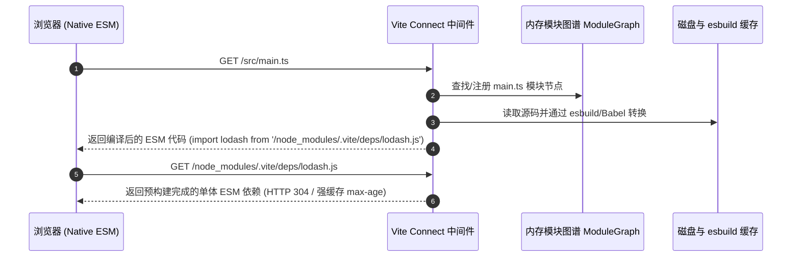
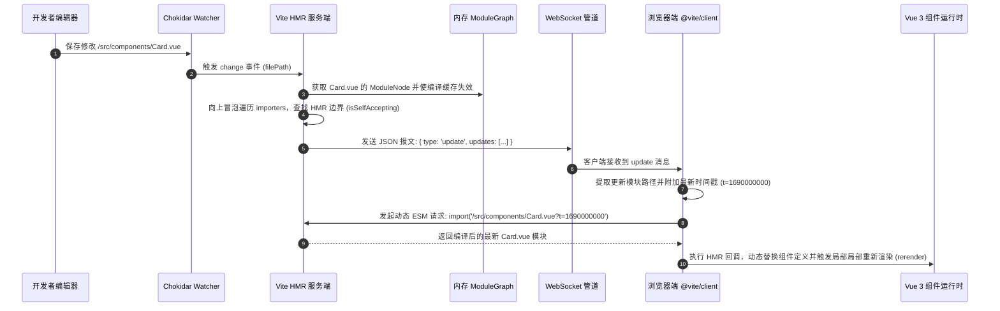

# 资深-Vite按需编译esbuild预构建与HMR热更新WebSocket协议

在现代化前端工程化体系中，Vite 彻底颠覆了以 Webpack、Rollup 为代表的传统打包构建工具（Bundle-based Dev Server）在本地开发阶段的体验。本篇专题从底层网络协议、模块图谱数据结构及源码执行时序出发，深入剖析 Vite 的按需编译机制、esbuild 依赖预构建底层物理原理，以及基于 WebSocket 的 HMR（Hot Module Replacement）热更新全链路通信协议与边界冒泡机制。

---

## 一、核心底层机制与全景架构

### 1.1 Bundle-based 与 No-Bundle 本地服务器架构物理对比

传统 Webpack 开发服务器在启动时必须先从 Entry 入口递归遍历整个项目的依赖图谱（AST 解析、Loader 转译、Plugin 处理），将所有模块打包成内存中的 Bundle（如 bundle.js），随后才能启动 HTTP 服务器监听端口。当项目模块规模达到数千个时，冷启动与全量重新构建往往耗时数十秒甚至数分钟。

Vite 采用了基于浏览器原生 ES 模块（Native ESM，即 `<script type="module">`）的 **No-Bundle** 架构：
1. **轻量冷启动**：Vite 启动时仅需初始化由 Node.js 内置 `http` 或 `connect` 中间件构成的轻量静态服务器，耗时通常在 100~300ms 级别。

```mermaid
flowchart TD
    subgraph Webpack_Bundle_Based["Webpack 传统打包模型 (Bundle-based)"]
        W_Entry["应用入口 Entry"] --> W_AST["递归 AST 解析所有模块"]
        W_AST --> W_Bundle["打包成内存 Bundle (全量耗时)"]
        W_Bundle --> W_Server["启动本地 HTTP Server"]
        W_Server --> W_Browser["浏览器加载执行整体 Bundle"]
    end

    subgraph Vite_No_Bundle["Vite 现代开发模型 (No-Bundle ESM)"]
        V_Server["快速启动 Connect HTTP Server (毫秒级)"] --> V_Browser["浏览器请求 Index.html"]
        V_Browser --> V_Req["浏览器原生发起 ESM 请求 (如 /src/App.vue)"]
        V_Req --> V_Inter["Connect 中间件实时按需拦截编译"]
        V_Inter --> V_Resp["返回编译后 ESM 模块并缓存"]
    end
```

2. **按需动态编译**：浏览器在解析 HTML 时遇到 `<script type="module" src="/src/main.ts">`，会向 Vite 开发服务器发起 HTTP 请求。Vite 中间件拦截该请求，仅在此时调用底层编译器（如 `@vitejs/plugin-vue`）对单文件模块进行实时编译，转换为浏览器可执行的合法 ESM 代码并返回。页面尚未加载或路由未激活的模块完全不参与编译。



---

### 1.2 esbuild 依赖预构建的双重使命

虽然现代浏览器全面支持原生 ESM，但本地业务代码所引用的第三方 npm 依赖包（如 `lodash`、`vue`、`element-plus`）依然存在两大痛点：
1. **模块格式多样性**：大部分 npm 包仍以 CommonJS（CJS）或 UMD 规范发布，浏览器通过原生 ESM 无法直接 `import` 识别 CJS 导出的 `module.exports`。
2. **海量网络请求风暴（HTTP Waterfall）**：以 `lodash-es` 为例，其内部细分了超过 600 个内部微模块相互嵌套引用。若直接交由浏览器原生 ESM 加载，浏览器会并行发送 600+ 个 HTTP 请求，导致浏览器网络栈连接排队阻塞，页面渲染严重白屏。

Vite 引入 **esbuild** 进行**依赖预构建（Dependency Pre-Bundling）**：
- **格式归一化**：将所有 CJS/UMD 依赖转换为标准 ESM 格式。
- **模块扁平化合并**：将拥有海量子模块的依赖打包合并为单一或少量几个 ESM 模块文件，写入磁盘的 `node_modules/.vite/deps` 缓存目录。
- **性能飞跃**：esbuild 使用 Go 语言编写，直接编译为本地机器码且全并发利用多核 CPU，预构建速度比基于 JavaScript 的 Webpack/Rollup 快 10~100 倍。



---

## 二、源码级/协议物理推导

### 2.1 Vite 开发服务器请求拦截与模块重写原理

当浏览器加载 `/src/main.ts` 时，若代码中存在裸模块导入（Bare Import）：
```typescript
// 源码
import { createApp } from 'vue'
import App from './App.vue'
```
根据浏览器 ESM 规范，裸导入（非 `/`、`./` 或 `../` 开头的模块路径）会直接抛出类型错误：`TypeError: Failed to resolve module specifier "vue"`。

Vite 的核心编译中间件（`vite:import-analysis` 插件）会对源代码执行词法分析与 AST 扫描，将裸导入路径强制重写为相对于根目录的特殊路径：
```typescript
// Vite 转换后输出给浏览器的代码
import { createApp } from '/node_modules/.vite/deps/vue.js?v=9d1a3c7f'
import App from '/src/App.vue'
```

#### Vite Connect 中间件请求拦截简化实现
```javascript
// vite/src/node/server/middlewares/transform.ts 简化原理
import { ModuleGraph } from '../moduleGraph'

export function transformMiddleware(server) {
  return async function (req, res, next) {
    if (req.method !== 'GET') return next()
    
    const url = cleanUrl(req.url)
    // 1. 判断是否属于 JS/TS/Vue 资源
    if (isJSRequest(url)) {
      try {
        // 2. 调用 PluginContainer 对资源进行 transform 处理
        const result = await server.transformRequest(url, server)
        if (result) {
          const type = 'js'
          res.setHeader('Content-Type', 'application/javascript')
          res.setHeader('ETag', result.etag)
          // 3. 检查协商缓存
          if (req.headers['if-none-match'] === result.etag) {
            res.statusCode = 304
            return res.end()
          }
          res.statusCode = 200
          return res.end(result.code)
        }
      } catch (err) {
        return next(err)
      }
    }
    next()
  }
}
```

---

### 2.2 内存模块图谱（ModuleGraph）数据结构

Vite 在内存中维护了一套双向有向无环图数据结构——`ModuleGraph`，用于精确追踪所有被加载模块的依赖关系、热更新边界以及 ETag 缓存指纹。

```typescript
// Vite 内部 ModuleNode 核心数据模型 (简化版)
export class ModuleNode {
  url: string                     // 浏览器请求的相对路径，如 "/src/components/Header.vue"
  id: string | null = null        // 磁盘真实物理路径，如 "/Users/.../src/components/Header.vue"
  file: string | null = null      // 物理文件路径（去除 query）
  type: 'js' | 'css'
  
  importers = new Set<ModuleNode>() // 引入当前模块的父模块集合（反向引用）
  importedModules = new Set<ModuleNode>() // 当前模块引入的子模块集合（正向引用）
  
  acceptedHmrDeps = new Set<ModuleNode>() // 当前模块显式接受更新的子模块
  isSelfAccepting?: boolean               // 当前模块是否接受自身的更新 (import.meta.hot.accept)
  
  transformResult: TransformResult | null = null // 编译缓存
  lastHMRTimestamp = 0                    // 最近一次 HMR 时间戳
}
```

---

### 2.3 HMR 热更新全链路通信协议与物理时序

Vite 的 HMR 机制由三大核心组件协同完成：
1. **文件监听器（File Watcher）**：基于 `chokidar` 监听本地源码目录文件的修改。
2. **服务端 HMR Engine**：根据变化文件在 `ModuleGraph` 中逆向检索受影响模块，判定热更新边界，生成 HMR Payload。
3. **客户端运行时（`@vite/client`）**：浏览器加载的首个脚本，与 Vite 服务端建立全双工 WebSocket 长连接，负责监听更新推送并通过原生 ESM 动态加载新模块。



#### WebSocket 通信协议报文格式
Vite 定义了严格的 HMR 报文规范（TypeScript 类型）：
```typescript
// 1. 建立连接确认
{ type: 'connected' }

// 2. 局部模块热替换更新
{
  type: 'update',
  updates: [
    {
      type: 'js-update', // 或 'css-update'
      path: '/src/components/Card.vue',
      acceptedPath: '/src/components/Card.vue',
      timestamp: 1716301234567
    }
  ]
}

// 3. 无法局部热更新时触发整页强制刷新
{
  type: 'full-reload',
  path: '/src/main.ts'
}

// 4. 编译错误提示浮层 (Error Overlay)
{
  type: 'error',
  err: {
    message: 'Expected ";", got "}"',
    frame: '3 |   const a = 1\n4 |   return\n5 | }',
    stack: '...'
  }
}
```

---

## 三、社招/阶段必考高频硬核连环追问

### 追问 1：Vite 依赖预构建中发现新依赖时，为什么会出现整个页面卡顿并强刷（Page Reload）？
**标杆解答**：
1. **触发物理诱因**：如果在代码中使用了动态导入语法（如某个深层按需加载逻辑或路由 `import('some-unbundled-dep')`），或者某个第三方依赖内部隐式引用了一个未在初次扫描中声明的 CommonJS 包，Vite 的初次静态扫描（`esbuild scan`）无法提前预测该依赖。
2. **重新预构建（Re-bundling）**：当浏览器在运行时发起对该裸模块的请求时，Vite 发现该模块不在 `node_modules/.vite/deps` 缓存列表中，被迫立即暂停当前请求，在后台重新启动 esbuild 对新依赖执行预构建，并更新 `_metadata.json` 散列指纹。
3. **强刷原因**：由于新依赖的合并打包可能导致之前已经打包完成的 chunk 文件的依赖索引或模块引用发生拓扑改变，浏览器已经执行的原生 ESM 缓存与新构建产物产生不可逆的不一致。为了保证绝对的运行正确性，Vite 会通过 WebSocket 向浏览器推送 `{ type: 'full-reload' }`，强制整页刷新。

---

### 追问 2：为什么修改一个普通的 `.ts` 工具函数文件时，常常导致整页重刷，而修改 `.vue` 单文件组件却能实现亚毫秒级无刷新更新？
**标杆解答**：
1. **Vue 单文件组件的自接受（Self-Accepting）**：`@vitejs/plugin-vue` 在编译 `.vue` 文件时，会在生成的 JS 代码末尾自动注入热更新声明代码：
   ```javascript
   _sfc_main.__hmrId = "xxxxxx"
   typeof __VUE_HMR_RUNTIME__ !== "undefined" && __VUE_HMR_RUNTIME__.createRecord(_sfc_main.__hmrId, _sfc_main)
   import.meta.hot.accept(mod => {
     // 局部触发 Vue 组件的 reload 或 rerender
     __VUE_HMR_RUNTIME__.reload(_sfc_main.__hmrId, mod.default)
   })
   ```
   因此，每个 `.vue` 模块在 `ModuleGraph` 中都被标记为 `isSelfAccepting = true`，变更冒泡在此处被成功阻截（Boundary）。
2. **纯 TS 模块的边界缺失**：普通的 `utils/math.ts` 通常只包含纯函数导出，**没有任何代码调用 `import.meta.hot.accept()`**。当修改 `math.ts` 时，Vite 在 `ModuleGraph` 中查找当前模块发现它不接受自更新，只能向上寻找其引用方（Importers）；如果所有的上层父模块、乃至根入口 `main.ts` 都未显式调用 `import.meta.hot.accept`，更新会一路冒泡穿透到根节点，最终判定无法局部更新，只能向浏览器发送 `full-reload` 进行整页重载。

---

### 追问 3：生产环境打包 Vite 为什么默认选用 Rollup 而不是直接使用构建极快的 esbuild？
**标杆解答**：
1. **Tree-Shaking 与死代码消除的深度**：esbuild 追求极致编译吞吐率，其 AST 静态分析和 Tree-Shaking 偏向快速保守，无法进行深度的跨模块副作用分析和高级控制流优化；而 Rollup 在 Tree-Shaking 算法（纯函数注解 `/*#__PURE__*/`、作用域扁平化、属性级摇树）上经过数年打磨，产物紧凑度与体积明显优于 esbuild。
2. **代码分割（Code Splitting）灵活性**：Rollup 支持精细化的动态分包配置（如 `manualChunks`、动态导入按需分离、CSS 提取与代码切片），对于复杂多页面（MPA）或大型单页面（SPA）应用具有强大的控制力。
3. **插件生态兼容性**：Rollup 拥有庞大成熟的打包插件生态（处理 Legacy 降级、复杂 CSS 预处理、图片压缩等），这些高级特性目前仍无法完全被底层基于 Go 实现的 esbuild 插件机制无缝替代。

---

## 四、生产级避坑指南与排障 SOP

### 4.1 避坑 1：动态路由导致预构建二次触发与页面闪烁白屏
在大型项目中，如果使用模板字符串动态拼接路由导入：
```typescript
// 危险做法：esbuild 静态扫描完全无法解析动态变量
const loadView = (view: string) => import(`./views/${view}.vue`)
```
**治理规范**：改用 Vite 原生提供的 `import.meta.glob` 明确告知编译器扫描范围：
```typescript
// 规范做法：静态匹配，生成确定性的模块映射表
const modules = import.meta.glob('./views/**/*.vue')
const loadView = (viewPath: string) => modules[`./views/${viewPath}.vue`]()
```

---

### 4.2 避坑 2：深层或动态 CommonJS 依赖强制提前声明
若项目中使用的某个第三方依赖（如某些富文本编辑器、图表库）内部存在动态 `require()`，开发环境初次访问时会报预构建缺失错误。

**排障 SOP 与配置修复**：
1. 打开 `vite.config.ts`；
2. 在 `optimizeDeps.include` 中显式指定需要强制预构建的模块名；
3. 执行 `npx vite --force` 清空 `.vite` 缓存并重新预构建：

```typescript
// vite.config.ts
import { defineConfig } from 'vite'
import vue from '@vitejs/plugin-vue'

export default defineConfig({
  plugins: [vue()],
  optimizeDeps: {
    // 强制 esbuild 在项目冷启动时直接扫描并预构建指定的 CJS 包
    include: [
      'lodash-es',
      'deep-equal',
      'element-plus/es/components/button/style/css'
    ],
    // 排除不需要构建的已标准化的本地包
    exclude: ['@my-company/native-esm-sdk']
  }
})
```

---

### 4.3 避坑 3：WebSocket 连接在 Nginx 反向代理下无法升级导致 HMR 失效
在微服务或云端开发环境（如容器化部署、Kubernetes Ingress、DevContainer）中，本地浏览器常通过 Nginx 反向代理访问 Vite。如果 Nginx 未配置 WebSocket 协议升级，终端虽然正常输出编译信息，但浏览器控制台报错 `WebSocket connection to 'ws://...' failed`，HMR 降级为手动刷新。

**Nginx 生产反代排障配置**：
```nginx
server {
    listen 80;
    server_name dev.local;

    location / {
        proxy_pass http://127.0.0.1:5173;
        proxy_http_version 1.1;
        # 必须显式传递 Upgrade 头与 Connection 头
        proxy_set_header Upgrade $http_upgrade;
        proxy_set_header Connection "upgrade";
        proxy_set_header Host $host;
    }
}
```
并在 `vite.config.ts` 中指定客户端连接的 WebSocket 端口及协议：
```typescript
server: {
  hmr: {
    protocol: 'ws',
    host: 'dev.local',
    port: 80
  }
}
```
