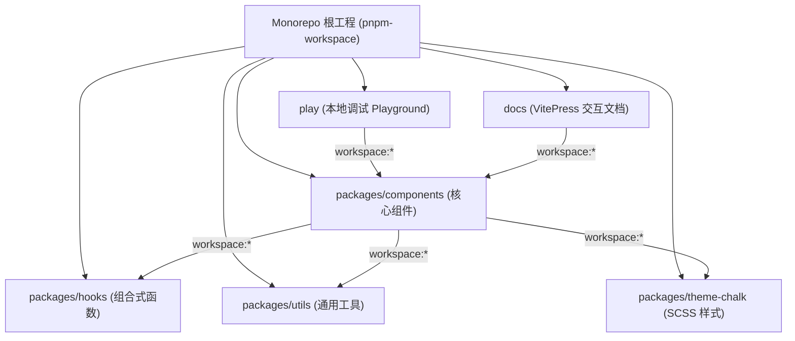
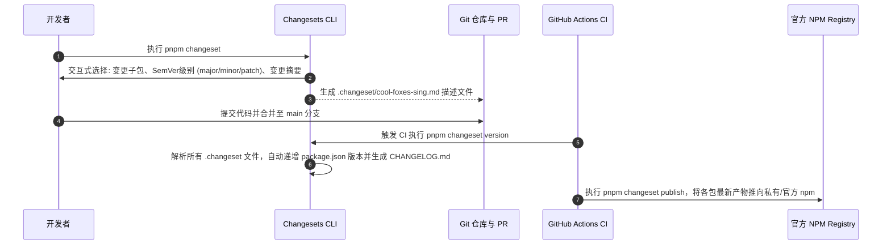

# 资深-企业级Monorepo组件库架构pnpm-workspace与Changesets

在大型互联网中台团队或企业级前端基础架构演进中，多包管理（Monorepo）已成为构建自研 Vue 3 组件库、中后台微前端共享基础库的核心标准方案。借助 **pnpm workspace** 的硬链接（Hard Link）/ 符号链接（Symlink）底层内容寻址存储（CAS），以及 **Changesets** 的语义化版本治理，可以彻底解决传统 Polyrepo 时代包依赖版本割裂、调试繁琐与幽灵依赖等痛点。

---

## 一、核心底层机制与全景架构

### 1.1 Monorepo 组件库多包架构拓扑

一个标准的企业级 Vue 3 组件库 Monorepo 通常划分为如下几个相互解耦、职责分明的子包：
1. **`@my-ui/components`**：核心 Vue 3 组件实现（Button、Table、Modal 等）。
2. **`@my-ui/hooks`**：通用的无 UI 逻辑组合式 API（useDraggable、useVirtualList 等）。
3. **`@my-ui/utils`**：底层工具函数（dom、is、error-handler 等）。
4. **`@my-ui/theme-chalk`**：SCSS / CSS 样式体系与 Design Token。
5. **`docs`**：基于 VitePress 的组件交互文档应用。
6. **`play`**：用于本地开发和单组件调试的 Vite 最小空壳沙箱应用。



---

### 1.2 pnpm 底层物理机制：CAS 内容寻址存储与网状链接

传统 npm / Yarn（v1）采用扁平化 `node_modules` 结构（Hoisting 提升），容易引发臭名昭著的**幽灵依赖（Phantom Dependencies）**与**依赖分身（NPM Doppelgangers）**。

pnpm 从底层文件系统 inode 层面颠覆了包管理逻辑：
1. **全局统一 CAS 存储（Content-addressable Store）**：同一台机器上所有项目安装的同一个版本的包，在全局只落盘一份物理文件，以内容哈希寻址。
2. **硬链接（Hard Links）**：项目根目录 `node_modules/.pnpm/` 下的文件直接通过系统底层硬链接指向全局 CAS 存储，极度节约磁盘且安装近乎瞬时完成。
3. **隔离符号链接（Symlinks）**：每个子包的 `node_modules` 仅通过软链接精确暴露自身 `package.json` 中明确声明的直接依赖，代码绝对无法越权 `import` 任何未声明的间接子依赖。

```mermaid
flowchart LR
    CAS["磁盘全局 CAS 存储 (~/.pnpm-store)"]
    
    subgraph Project_Node_Modules["项目本地 .pnpm 虚拟存储区"]
        StorePkgA["node_modules/.pnpm/vue@3.4.21/..."]
        StorePkgB["node_modules/.pnpm/axios@1.6.8/..."]
    end
    
    subgraph App_Node_Modules["组件库真实暴露的 node_modules"]
        PkgRefA["packages/components/node_modules/vue"]
    end

    CAS ===|文件系统硬链接 (Hardlink)| StorePkgA
    CAS ===|文件系统硬链接 (Hardlink)| StorePkgB
    StorePkgA -.->|符号软链接 (Symlink)| PkgRefA
```

---

## 二、源码级/架构物理推导

### 2.1 Workspace 协议与本地软链实时联动

在 Monorepo 体系中，子包之间若要在本地开发时修改即生效，而无需每次都 build 并发布到 npm，必须使用 `workspace:*` 依赖协议。

#### 1. 根目录 `pnpm-workspace.yaml` 配置
```yaml
packages:
  - 'packages/*'
  - 'docs'
  - 'play'
```

#### 2. 子包之间声明依赖 (`packages/components/package.json`)
```json
{
  "name": "@my-ui/components",
  "version": "1.0.0",
  "dependencies": {
    "@my-ui/hooks": "workspace:*",
    "@my-ui/utils": "workspace:*",
    "@my-ui/theme-chalk": "workspace:*"
  }
}
```
当执行 `pnpm install` 时，pnpm 会检测到当前工作区内存在匹配包名的子工程，自动创建指向本地 `packages/hooks` 的文件系统软链接，实现代码修改在 `play` 沙箱中亚毫秒级无缝热更新。在执行正式发布脚本（`pnpm publish`）时，pnpm 会自动将 `workspace:*` 动态转换为当前子包确定的真实 SemVer 语义化版本号（如 `^1.0.0`）。

---

### 2.2 TypeScript Project References 类型跨包联动

在 Monorepo 中，如果组件直接引用未编译为 `.d.ts` 的本地子包，IDE（VS Code）往往会提示类型找不到或需要先编译一次。通过配置 TypeScript 的 **Project References** 机制，可以实现跨包类型物理直通。

#### 根目录 `tsconfig.json` 配置
```json
{
  "compilerOptions": {
    "module": "ESNext",
    "moduleResolution": "node",
    "target": "ES2020",
    "composite": true,
    "declaration": true,
    "declarationMap": true
  },
  "references": [
    { "path": "./packages/utils" },
    { "path": "./packages/hooks" },
    { "path": "./packages/components" }
  ]
}
```

#### 子包路径别名映射 (`tsconfig.web.json`)
```json
{
  "compilerOptions": {
    "baseUrl": ".",
    "paths": {
      "@my-ui/hooks": ["packages/hooks/src"],
      "@my-ui/utils": ["packages/utils/src"],
      "@my-ui/components": ["packages/components/src"]
    }
  }
}
```

---

### 2.3 Changesets 语义化版本发布全生命周期

在多包项目中，当提交了一个底层工具函数的 Bugfix 时，哪些依赖该工具函数的组件需要升级版本？升级是 Patch 还是 Minor？手动修改各个 `package.json` 极易遗漏出错。**Changesets** 提供了基于 Git 暂存区文件的版本治理标准流：



---

## 三、社招/阶段必考高频硬核连环追问

### 追问 1：什么是“幽灵依赖（Phantom Dependencies）”？为什么在 npm/yarn 下容易在 CI 构建或生产环境突然报缺少依赖崩溃？
**标杆解答**：
1. **产生诱因**：npm v3+ 和 Yarn v1 引入扁平化目录（Hoisting），将子依赖（例如 A 依赖了 B）全部平铺提升到项目根目录的 `node_modules`。开发者在自己的代码中没有在 `package.json` 里显式声明依赖 B，却可以直接 `import B from 'B'` 成功运行，因为 Node 模块解析器会向上遍历查找到根目录的 B。
2. **生产崩溃机理**：这种依赖属于“幽灵依赖”。当未来的某一天，依赖 A 升级版本不再使用依赖 B，或者团队更换了包管理工具，根目录下的 B 消失。此时本地构建或 CI 机器在重新拉取依赖时直接报错：`Module not found: Can't resolve 'B'`，引发严重的生产级构建灾难。
3. **pnpm 彻底根除**：pnpm 的子包 `node_modules` 严格按照当前包的 `package.json` 建立符号链接。如果未在 `package.json` 显式写入该包名，在代码中写 `import` 会在本地直接报模块找不到，在开发期就彻底扼杀幽灵依赖。

---

### 追问 2：在组件库中，样式包（`theme-chalk`）为什么要与组件逻辑包（`components`）做严格物理拆离？
**标杆解答**：
1. **按需加载与 Tree-Shaking 最大化**：将组件 JS 与 CSS 解耦打包，使得业务方在使用组件库时，可以选择“全局引入完整 CSS”或通过插件（如 `unplugin-vue-components`）实现“用哪个组件才加载该组件对应的单独 CSS”，避免 JS 摇树成功但全部样式仍然全量打包进业务首屏。
2. **多主题动态切换能力（Theming）**：样式的物理独立使得组件库可以轻松支持多套主题包（如 `@my-ui/theme-dark`、`@my-ui/theme-classic`）。企业租户系统在构建或运行时仅需切换引入的样式包或覆盖 CSS 变量（CSS Variables / Design Tokens），完全无需对组件 JS 源码做二次构建。
3. **构建管线解耦**：JS/TS 组件通过 esbuild / Rollup 编译为 ESM/CJS，而样式体系通常依赖 PostCSS、Sass/Less、Autoprefixer。独立拆包可以各自配置最优的打包编译器与并行任务。

---

### 追问 3：多包 Monorepo 遇到两个子包相互依赖（A 依赖 B，B 也依赖 A）时，pnpm 和 TypeScript 会如何表现？怎么架构解耦？
**标杆解答**：
1. **构建死循环与类型解析失败**：在构建打包阶段，Rollup 或 `tsc --build` 会生成项目拓扑执行队列（Topological Order）。若存在循环引用，构建工具无法确定谁先谁后，直接抛出 `Cycle detected in project references` 或堆栈溢出。
2. **架构重构法则（Dependency Inversion / Leaf Module Extraction）**：
   - 提取公共叶子节点：如果 A（如 `Select` 组件）与 B（如 `Option` 组件）存在深度交叉依赖，应当将两者共同依赖的数据类型、Context 上下文或基类接口下沉提取到独立叶子包（如 `@my-ui/tokens` 或 `@my-ui/utils`）。
   - 让 A 与 B 共同依赖该叶子包，将原本的环形依赖转变为单向有向无环图（DAG），从而消除编译与运行死锁。

---

## 四、生产级避坑指南与排障 SOP

### 4.1 避坑 1：Changesets 自动化 CI/CD 流水线（GitHub Actions）

在 Monorepo 维护中，禁止开发者手动执行 `npm publish`，必须通过 CI 机器人在审查通过并合并分支后由凭证流水线自动发布。

```yaml
# .github/workflows/release.yml
name: Release Packages

on:
  push:
    branches:
      - main

concurrency: ${{ github.workflow }}-${{ github.ref }}

jobs:
  release:
    name: Release
    runs-on: ubuntu-latest
    steps:
      - name: Checkout Repo
        uses: actions/checkout@v4
        with:
          fetch-depth: 0

      - name: Setup pnpm
        uses: pnpm/action-setup@v3
        with:
          version: 8.15.0

      - name: Setup Node.js
        uses: actions/setup-node@v4
        with:
          node-version: 20
          cache: 'pnpm'

      - name: Install Dependencies
        run: pnpm install --frozen-lockfile

      - name: Build Packages
        run: pnpm run build

      - name: Create Release Pull Request or Publish
        id: changesets
        uses: changesets/action@v1
        with:
          # 当存在 changeset 时自动发起版本 PR，合入时自动推送到 NPM
          publish: pnpm changeset publish
          version: pnpm changeset version
          commit: 'chore(release): version packages'
          title: 'chore(release): version packages'
        env:
          GITHUB_TOKEN: ${{ secrets.GITHUB_TOKEN }}
          NPM_TOKEN: ${{ secrets.NPM_AUTH_TOKEN }}
```

---

### 4.2 避坑 2：组件库打包格式规范与 `package.json` 导出字段配置

现代组件库必须同时输出 **ESM（供 Vite/Webpack 生产 Tree-Shaking 打包）** 与 **CJS（供传统 Node/SSR 运行时使用）** 格式，并严格配置 `exports` 字段：

```json
{
  "name": "@my-ui/components",
  "version": "1.0.0",
  "main": "./dist/index.cjs.js",
  "module": "./dist/index.esm.js",
  "types": "./dist/index.d.ts",
  "exports": {
    ".": {
      "types": "./dist/index.d.ts",
      "import": "./dist/index.esm.js",
      "require": "./dist/index.cjs.js"
    },
    "./*": "./*"
  },
  "publishConfig": {
    "access": "public"
  }
}
```
通过标准化配置，确保无论是现代 No-Bundle 架构还是传统 SSR 运行环境，都能精准找到对应的目标模块与类型定义文件。
