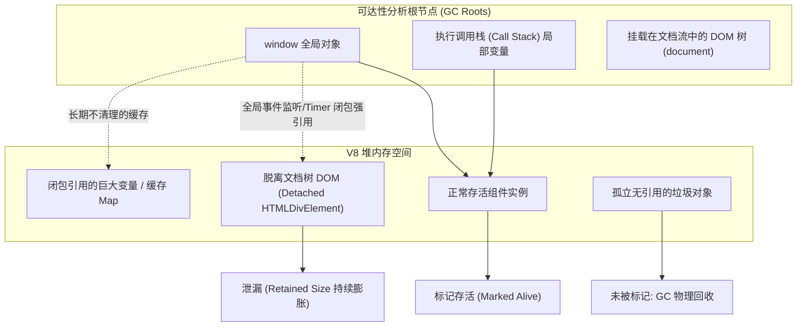
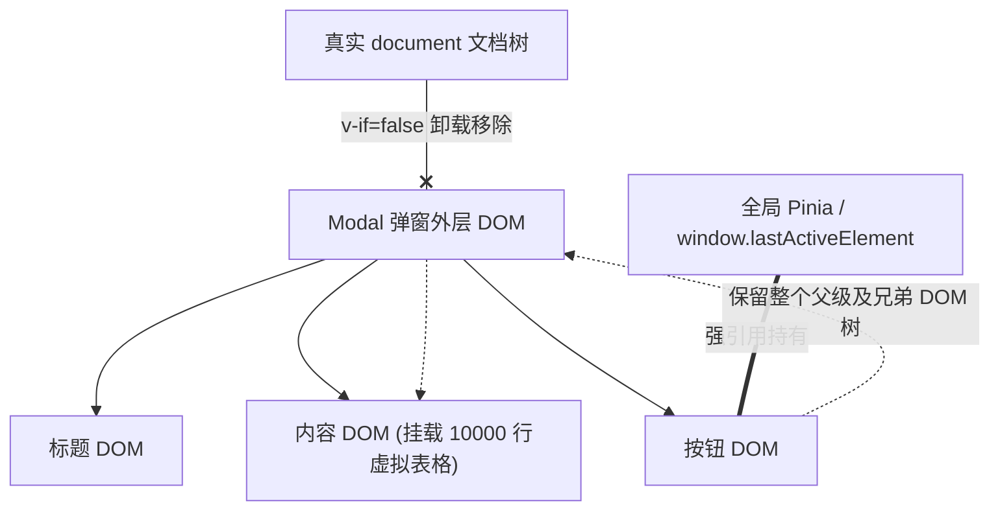

# 资深-前端内存泄露深度排查HeapSnapshot分析脱离DOM节点

在长时间运行的单页应用（SPA）、企业级数据大屏或复杂中后台系统中，**前端内存泄漏（Memory Leak）** 是一种极具隐蔽性且危害巨大的严重缺陷。用户在频繁切换路由或长时间操作页面后，浏览器可用内存被持续侵蚀，最终导致页面卡顿掉帧、交互无响应、甚至引发浏览器标签页崩溃（Aw, Snap! 报错，错误码 `Out of Memory`）。本篇专题从 V8 引擎底层垃圾回收算法出发，深入讲解 Chrome DevTools Heap Snapshot 的物理分析指标与脱离 DOM 节点的定位排查 SOP。

---

## 一、核心底层机制与全景架构

### 1.1 V8 垃圾回收（GC）物理模型与代际假说

现代浏览器 V8 引擎的垃圾回收基于**代际假说（Generational Hypothesis）**：绝大多数对象在内存中存活的时间极短，而存活时间久的对象往往会常驻内存。

Vite/Vue 3 运行在 V8 堆内存之上，堆区主要被划分为两大核心代区：
1. **新生代（Young Generation）**：
   - 空间较小（通常 1~64MB），由两块等大的半空间（Semi-space）构成的 `From` 空间与 `To` 空间。
   - 使用 **Scavenge 算法** 与 Cheney 复制算法，进行极其频繁且极快的垃圾回收。经历两次 GC 依然存活的对象晋升（Promotion）到老生代。
2. **老生代（Old Generation）**：
   - 空间巨大（通常几百兆至数吉字节）。
   - 采用 **标记-清除（Mark-Sweep）** 与 **标记-整理（Mark-Compact）** 算法。从全局根节点（GC Roots，如 `window`、全局变量、活动调用栈、活动 DOM 树）出发，对可达对象进行图遍历标记；随后清除不可达垃圾，并将存活对象向一端移动压缩碎片。



---

### 1.2 Heap Snapshot 核心物理指标：Shallow Size vs Retained Size

在 Chrome DevTools 的 Memory 面板导出的堆快照（Heap Snapshot）中，有两项最关键的物理内存尺寸：

| 内存指标 | 物理定义 | 实际含义举例 |
| :--- | :--- | :--- |
| **Shallow Size (自身大小)** | 对象本身直接占用的内存字节数（不包含其引用的外部对象） | 一个普通 JS Object 自身可能只占 32 字节，数组对象只占数十字节（用于维护结构体指针） |
| **Retained Size (保留大小)** | 当该对象被销毁回收后，能够连带被 GC 彻底释放掉的**全部内存总和** | 该对象作为支配树（Dominator Tree）的根，所引用的所有下游子对象、脱离 DOM 节点及其包含的大型数据的总和 |

> [!IMPORTANT]
> **排查内存泄漏的黄金法则**：在排查堆快照时，**必须按 Retained Size 从大到小降序排列**，寻找保留尺寸异常庞大、但 Shallow Size 很小的“带头大哥”对象。

---

## 二、源码级/排查物理推导

### 2.1 典型泄漏元凶：脱离文档树的 DOM 节点（Detached HTMLElement）

当一个 DOM 节点已经通过 `parentNode.removeChild()` 或 `v-if="false"` 从真实的浏览器的 `document` 文档树中物理移除，但 **JavaScript 代码中依然存在某个变量、全局数组、闭包或事件侦听器持有该节点的引用** 时，该节点就会变为 **脱离 DOM 节点（Detached DOM）**。

更可怕的是，**持有某个子节点的引用，会导致整棵脱离的 DOM 子树及绑定的所有上下文无法被垃圾回收**。



#### 典型 Vue 3 泄漏代码示例
```typescript
// 错误示范：组件销毁时未清理全局引用
<script setup>
import { onMounted, onBeforeUnmount } from 'vue'

let cachedButton: HTMLElement | null = null

onMounted(() => {
  cachedButton = document.getElementById('save-btn')
  // 将局部 DOM 节点挂载到了全局对象或外部闭包中
  window.lastClickedElement = cachedButton
  
  // 绑定在 window 上的监听器引用了组件内部的局部变量与 DOM
  window.addEventListener('resize', handleResize)
})

function handleResize() {
  console.log('Current btn width:', cachedButton?.offsetWidth)
}

// 忘记在 onBeforeUnmount 中注销监听与清空引用！
</script>
```

---

### 2.2 Vue 3 常见四大内存泄漏陷阱

#### 1. 全局事件监听器未注销（`window` / `document`）
在组件 `onMounted` 中向 `window`、`document` 或全局 EventBus 注册了事件监听，当组件卸载（Unmount）后，该监听器函数闭包仍然常驻在 `window` 的事件分发列表里，闭包捕获的组件内部响应式变量、大型数据对象及 DOM 全部无法释放。

#### 2. 定时器（`setInterval` / `setTimeout`）未清除
未在 `onBeforeUnmount` 中调用 `clearInterval`，定时器的回调函数会在后台无限期循环执行，强行维持其作用域链中的组件实例存活。

#### 3. 全局状态 Pinia 订阅未取消
通过 `$subscribe` 或 `$onAction` 订阅了 Pinia Store 的状态变化，若未保存取消函数并在组件卸载时调用，每次挂载都会新增一个订阅闭包，导致内存指数级递增。

#### 4. 第三方 SDK 实例未销毁（ECharts / Monaco Editor / 富文本）
在 `div` 容器上通过 `echarts.init(dom)` 实例化的图表对象，其内部持有大量的 Canvas 渲染上下文、ResizeObserver 监听与动画定时器。若组件销毁时未调用 `chart.dispose()`，整块底层图形内存与 DOM 节点彻底泄漏。

---

## 三、社招/阶段必考高频硬核连环追问

### 追问 1：在 Chrome DevTools Memory 面板中，如何通过“三次快照法（Three-Snapshot Technique）”精准定位泄漏对象？
**标杆解答**：
1. **基准快照（Snapshot 1）**：打开页面，完成初始渲染并保持静置，手动点击 DevTools 左上角的垃圾桶图标（Collect Garbage）触发强制垃圾回收，录制基准快照。
2. **操作与复原快照（Snapshot 2）**：执行目标业务流程（例如：打开大型表格弹窗、切换到新路由、加载 1000 条数据），然后关闭弹窗或切回原页面。重复该过程 3~5 次以放大内存增量。
3. **对照快照（Snapshot 3）**：再次手动点击垃圾桶图标强制 GC，录制第 3 次快照。
4. **差异分析（Comparison 视图）**：
   - 将 Snapshot 3 与 Snapshot 1 进行对比（选择 `Objects allocated between Snapshot 1 and Snapshot 2` 或直接对比视图）。
   - 在过滤器中搜索 `Detached`，若发现存在高亮黄色/红色的 `Detached HTMLDivElement`，展开其 **Retainers（保留者引用链）**。
   - 顺着引用链自下而上查找黄色标识的变量，即可一眼锁定是哪个全局变量或闭包函数抓住了该 DOM。

---

### 追问 2：WeakMap 和 WeakSet 为什么能防止内存泄漏？它们的底层物理机制是什么？
**标杆解答**：
1. **弱引用特性（Weak References）**：`WeakMap` 的键（Keys）必须是对象，且其对键对象的引用是**弱引用**；在 V8 引擎的可达性分析阶段，**垃圾回收器计算 GC Roots 可达路径时，会完全忽略 WeakMap 键所产生的引用关系**。
2. **自动回收与联动清理**：如果一个对象除了被 `WeakMap` 作为键引用之外，没有任何其他强引用路径可达，那么在下一次 GC 时，该对象会被垃圾回收器安全直接回收。随着对象的回收，该键值对会自动在物理内存中被抹除。
3. **应用场景**：Vue 3 响应式系统底层存储依赖图谱的 `targetMap` 就选用了 `WeakMap`。当被代理的原对象销毁时，其关联的属性依赖集合会自动被回收，绝不会发生内存泄漏。

---

### 追问 3：现代浏览器提供了哪些 API 可以在代码运行时感知和排查内存泄漏？
**标杆解答**：
1. **`performance.memory`（Chromium 特有）**：
   - 包含 `usedJSHeapSize`（当前实际使用堆大小）、`totalJSHeapSize`（分配的总堆空间）。可以在自动化测试（Puppeteer）中定时采样，若 `usedJSHeapSize` 呈现持续单调上升且不回落，触发告警。
2. **`FinalizationRegistry`（ES2021 原生规范）**：
   - 允许在某个对象被垃圾回收器真正物理回收后，执行一个清理回调函数。
   - 架构级监控常利用它来验证组件是否被成功销毁：在组件挂载时注册，如果路由切换 10 秒后回调仍未触发，断定该组件发生内存泄漏。

---

## 四、生产级避坑指南与排障 SOP

### 4.1 生产级组件资源清理 SOP 模板

```typescript
<script setup lang="ts">
import { ref, onMounted, onBeforeUnmount } from 'vue'
import * as echarts from 'echarts'
import { useUserStore } from '@/stores/user'

const chartDomRef = ref<HTMLDivElement | null>(null)
let chartInstance: echarts.ECharts | null = null
let timerId: number | null = null
let unsubscribeStore: (() => void) | null = null

const userStore = useUserStore()

onMounted(() => {
  // 1. 初始化 ECharts 实例
  if (chartDomRef.value) {
    chartInstance = echarts.init(chartDomRef.value)
    chartInstance.setOption({ /* ... */ })
  }

  // 2. 绑定 window 事件
  window.addEventListener('resize', handleWindowResize)

  // 3. 启动定时器
  timerId = window.setInterval(fetchRealtimeData, 5000)

  // 4. 订阅 Pinia
  unsubscribeStore = userStore.$subscribe((mutation, state) => {
    console.log('Store mutation:', mutation)
  })
})

function handleWindowResize() {
  chartInstance?.resize()
}

function fetchRealtimeData() {
  // 轮询业务
}

// 严谨的生产级释放清理 SOP
onBeforeUnmount(() => {
  // 1. 彻底销毁第三方 SDK 实例并置空
  if (chartInstance) {
    chartInstance.dispose()
    chartInstance = null
  }

  // 2. 注销全局事件监听器
  window.removeEventListener('resize', handleWindowResize)

  // 3. 清除定时器
  if (timerId !== null) {
    clearInterval(timerId)
    timerId = null
  }

  // 4. 取消全局状态订阅
  if (unsubscribeStore) {
    unsubscribeStore()
    unsubscribeStore = null
  }
})
</script>
```

---

### 4.2 基于 FinalizationRegistry 的自动化组件泄漏探测工具

```typescript
// utils/leak-detector.ts
// 仅在本地开发与 QA 灰度测试环境中开启
export class LeakDetector {
  private registry: FinalizationRegistry<string>

  constructor() {
    this.registry = new FinalizationRegistry((componentName: string) => {
      console.log(`%c[GC Success]: 组件 ${componentName} 已被 V8 成功回收`, 'color: green;')
    })
  }

  public watch(target: object, componentName: string) {
    this.registry.register(target, componentName)
    
    // 延迟 15 秒检查告警 (需配合手动点击 DevTools GC 触发)
    setTimeout(() => {
      // 若组件发生泄漏，控制台可输出排查建议
      console.debug(`[Leak Audit]: 请检查 ${componentName} 是否仍然存活在堆中`)
    }, 15000)
  }
}

export const leakDetector = new LeakDetector()
```
在组件中调用 `leakDetector.watch(instance, 'UserDashboard')`，结合路由切换，即可快速捕获未被回收的异常组件。
