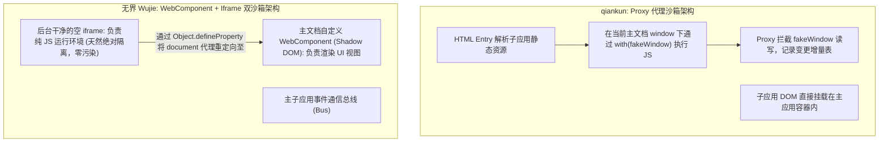

# 微前端架构 qiankun 与无界 Wujie 双沙箱机制与 Vue 3 多应用协同

在大型复杂企业级软件体系中，随着业务线扩张与历史技术债务累积，将庞大单一的“巨石前端应用（Monolithic Frontend）”拆分为多个独立开发、独立测试、独立部署的子应用，成为了大型前端团队的必经之路。从早期的 `iframe` 物理隔离，到基于 `single-spa` 深度封装的 **`qiankun`（乾坤）**，再到新一代基于 WebComponent + Iframe 双沙箱架构的 **`Wujie`（无界）**，微前端架构经历了多轮底层变革。本专题从 JS 沙箱物理隔离、样式穿透攻防到主子应用路由通信，全方位解析大厂微前端落地方案。

---

## 核心设计哲学与架构演进全景

### 1. 微前端三大主流派系底层物理对比

| 架构方案 | JS 沙箱隔离机制 | CSS 样式隔离机制 | 路由同步与保活机制 | 典型生产痛点 |
| :--- | :--- | :--- | :--- | :--- |
| **原生 iframe** | 原生浏览器窗口绝对隔离，天然无泄漏 | 物理文档隔离，样式绝对互不影响 | **极度割裂**。前进后退 URL 不同步，弹窗无法突破视口居中 | 内存开销巨大，每次切换重新全量加载，白屏时间长 |
| **qiankun (乾坤)** | **Proxy 沙箱**（单实例 `LegacySandbox` / 多实例 `ProxySandbox`）与快照沙箱 | 运行时动态打标 Scoped CSS 或 Shadow DOM 严格隔离 | 基于浏览器的 `popstate` / `hashchange` 事件拦截重写 | 弹窗（如 Element 挂载在 body 上）脱离沙箱无法应用样式，第三方库改全局 window 易逃逸 |
| **无界 (Wujie)** | **Iframe 沙箱**（在后台纯净 iframe 中执行 JS） | **Shadow DOM**（WebComponent 渲染真实界面） | **双向镜像同步**。路由状态直接代理同步，天然支持多应用无缝保活 | 架构较新，需处理跨 iframe 事件对象类型判断（`instanceof` 跨域窗口失效） |

---

### 2. qiankun vs 无界 双沙箱物理架构流转图



---

## 源码级/物理级底层推导

### 1. qiankun 多实例 `ProxySandbox` 源码级实现剖析

为了支持一个页面同时展示多个不同的微前端子应用，qiankun 为每个子应用创建了一个独立的虚拟全局对象 `fakeWindow`：

```typescript
export class ProxySandbox {
  // 记录子应用对全局 window 的新增、修改属性字典
  public updatedValueSet = new Set<PropertyKey>()
  // 代理对象实体
  public proxy: WindowProxy

  constructor(name: string) {
    const rawWindow = window
    // 1. 创建一块空内存作为假窗口
    const fakeWindow = Object.create(null) as Window

    // 2. 建立 Proxy 拦截器
    const proxy = new Proxy(fakeWindow, {
      set: (target: Window, p: PropertyKey, value: any): boolean => {
        // 核心：子应用写入全局变量时，只写入属于它自己的 fakeWindow，绝不污染宿主 rawWindow！
        target[p] = value
        this.updatedValueSet.add(p)
        return true
      },

      get: (target: Window, p: PropertyKey): any => {
        // 优先从自身假窗口中读取；若没有，回退到主应用的 rawWindow 中读取全局能力（如 Math, JSON）
        const value = p in target ? target[p] : (rawWindow as any)[p]
        
        // 核心防翻车：若读取的是 window 上的原生方法（如 addEventListener, alert），必须重绑定 this 到 rawWindow！
        if (typeof value === 'function' && !isConstructable(value)) {
          return value.bind(rawWindow)
        }
        return value
      }
    })

    this.proxy = proxy
  }

  // 子应用激活
  active() {
    // 激活状态标记
  }

  // 子应用卸载失活：瞬间切断代理并清空增量表，实现 0 内存污染
  inactive() {
    this.updatedValueSet.clear()
  }
}
```

---

### 2. 无界（Wujie）双沙箱的革命性重定向物理机制

无界之所以能彻底终结 qiankun 诸多难以排查的边界泄漏，核心在于它将 **“代码逻辑执行环境”** 与 **“视图渲染宿主”** 实施了物理拆分：

```typescript
// 伪代码解析无界核心连接器
function initWujieApp(id: string, url: string) {
  // 1. 在后台创建一个空白的 iframe（不带 src，零网络加载延迟）
  const iframe = createIframe()
  const iframeWindow = iframe.contentWindow!

  // 2. 在宿主页面创建自定义 WebComponent 容器，开启 Shadow DOM
  const customElement = document.createElement('wujie-app')
  const shadowRoot = customElement.attachShadow({ mode: 'open' })

  // 3. 核心黑魔法：重定向 document 拦截器！
  // 当子应用在 iframe 内部执行 document.querySelector、document.getElementById 时，
  // 拦截器将其全部劫持并重定向至当前子应用的 shadowRoot 内部！
  Object.defineProperty(iframeWindow, 'document', {
    get() {
      return shadowRoot
    }
  })

  // 4. 将子应用的 HTML/CSS 代码渲染进入 Shadow DOM，将 JS 代码推入 iframeWindow 中执行
  shadowRoot.innerHTML = subAppHtmlAndCss
  iframeWindow.eval(subAppJsCode)
}
```
- **带来的降维优势**：
  1. 子应用无论在全局变量上挂载什么（哪怕是把 `window.Vue` 彻底覆写），污染的仅仅是它自己的后台 `iframe`，主应用根本不可见；
  2. 子应用被切换销毁时，直接丢弃该子应用对应的 Shadow DOM，`iframe` 瞬间进入睡眠冻结态，恢复时纳秒级唤醒，**天然支持极其流畅的“多应用保活（KeepAlive）”**。

---

## 社招高频硬核连环追问

### 追问 1：在 qiankun 架构中，如果子应用引入了 Element Plus，其弹窗（`el-dialog`）和下拉菜单默认挂载在 `document.body` 顶层，为什么会导致样式丢失？如何彻底根治？

#### 深度剖析
1. **沙箱边界击穿成因**：
   - qiankun 为了样式隔离，通常会给子应用的根容器包裹一个前缀（如 `div[data-qiankun="sub-app"]`），并在此范围内注入子应用的作用域 CSS；
   - 但 Element Plus / Ant Design 的 `Dialog`、`Tooltip`、`Select Dropdown` 为了防止被父容器裁切，**默认使用 Teleport 将真实 DOM 传送到了最外层的 `document.body` 根节点上**！
   - 这块 DOM 彻底脱离了子应用的挂载容器，因此子组件库的样式选择器完全无法匹配到它，导致弹窗失去所有 CSS 样式，变成一片没有边框样式的难看透明裸字。
2. **生产根治 SOP（两大方案）**：
   - **方案 A（配置弹窗挂载锚点）**：
     在子组件库全局配置中，将弹窗挂载的目标容器从 `body` 改为子应用自身的根 DOM 节点（如 Element Plus 的 `ElConfigProvider :teleported="false"` 或配置 `appendTo` 到子应用内部）；
   - **方案 B（主应用共享基础样式表）**：
     将 Element Plus / Ant Design 的基础通用重置样式（Theme CSS）直接提升并加载到主应用顶层，实现全子应用基底样式共享。

---

### 追问 2：为什么微前端子应用中如果使用 `instanceof Array` 或 `instanceof Object` 进行类型判断，在无界等 Iframe 沙箱下极易误判为 `false`？

#### 深度剖析
- **跨窗口构造函数断层（Cross-realm Prototype Disconnect）**：
  - 在 JavaScript 规范中，**每个 iframe 都有属于它自己独立的一套全局内置对象原型（Built-in Prototypes）**！
  - 主应用持有的 `window.Array.prototype`，与子应用 iframe 中的 `iframeWindow.Array.prototype` 是两块完全不同的物理内存指针；
  - 如果主应用通过全局通信把一个在主应用创建的数组 `[1, 2]` 传给无界子应用消费：
    子应用执行 `arr instanceof Array` 时，比对的是 `arr.__proto__ === iframeWindow.Array.prototype`；
  - 判定结果必然为 **`false`**！
- **生产规约**：
  在微前端跨应用通信数据消费中，**严禁使用 `instanceof` 进行类型断言**，必须统一使用标准化的 **`Array.isArray(arr)`** 与 **`Object.prototype.toString.call(val) === '[object Object]'`** 进行类型判定。

---

## 生产级避坑指南与排障 SOP

### 1. 主子应用公共依赖（Vue / Pinia / Axios）去重分发策略

- **问题**：如果主应用打包了 Vue 3，5 个子应用也各自打包了一份完整的 Vue 3，会导致浏览器重复下载数兆无用代码，且初始化内存急剧攀升。
- **工业级 SOP（Webpack / Vite External + CDN 共享）**：
  1. 在子应用的 `vite.config.ts` 或 `vue.config.js` 中将公共库配置为 `externals: ['vue', 'vue-router', 'pinia']`；
  2. 主应用在顶层加载一次稳定版本的 Vue 运行时 CDN；
  3. 通过 `window.Vue` 挂载，或者结合 **模块联邦（Webpack 5 Module Federation）** 实现依赖的自动化协商与动态单例共享。

---

### 2. 微前端主子应用跨路由联动的死循环拦截

- **排查 SOP**：
  当主应用和子应用同时使用了基于 HTML5 History 模式的路由时，双方都在监听 `window.popstate`。
  子应用路由变动改变了 URL，触发了主应用路由监听；主应用根据 URL 尝试重新匹配路由，又反向向子应用下发跳转指令，极易诱发 **主子路由互相死循环跳转派发**。
  **治理原则**：为每个子应用划定**绝对唯一的路由基准前缀（Base Route）**，如主应用管理后台为 `/`，订单子应用严格前缀为 `/sub-order/`，用户子应用严格前缀为 `/sub-user/`，主应用路由守卫一旦检测到进入子应用前缀路径，立即移交控制权，坚决不进行内部深层拦截。
