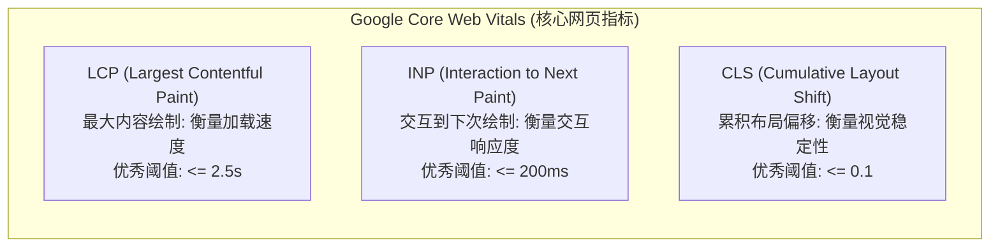
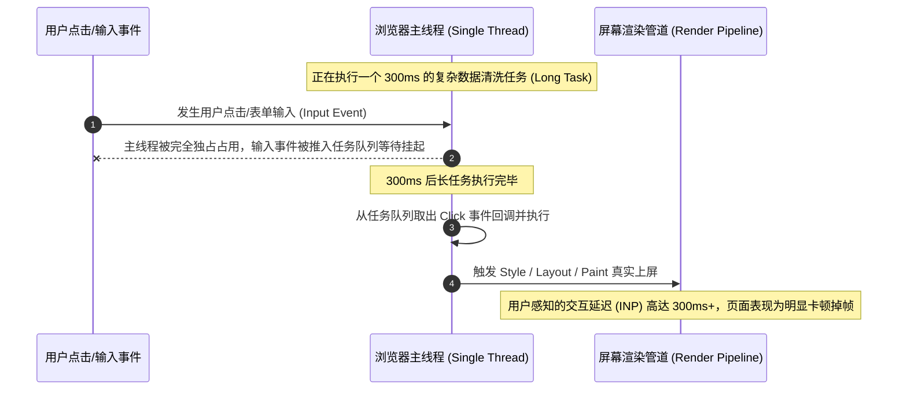
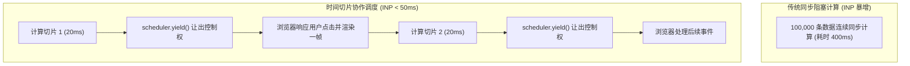

# 资深-核心性能指标Web-Vitals监控LCP-INP-CLS与长任务治理

在现代前端用户体验度量标准中，传统的 `DOMContentLoaded` 与 `window.onload` 已完全无法真实反映单页应用（SPA）的首屏速度与交互流畅度。Google 推出的 **Core Web Vitals（核心网页指标）** 已成为衡量网页健康度、SEO 权重和前端架构质量的工业界事实标准。深入理解 **LCP**、**INP**（全面替代 FID）、**CLS** 的物理判定条件，并对阻塞主线程的**长任务（Long Tasks）**实施时间切片治理，是前端资深工程师与架构师的核心硬核考点。

---

## 一、核心底层机制与全景架构

### 1.1 Core Web Vitals 三大金刚指标物理定义



| 指标名称 | 物理判定逻辑与度量对象 | 优秀标准 (Good) | 需要改进 (Needs Improvement) | 劣质 (Poor) |
| :--- | :--- | :--- | :--- | :--- |
| **LCP** | 视口内最大的可见图片、视频海报或大块文本节点完成绘制的时间戳 | `<= 2.5 秒` | `2.5s ~ 4.0s` | `> 4.0 秒` |
| **INP** (2024 年正式取代 FID) | 统计用户在页面整个生命周期内的所有点击、敲击和键盘交互中，从**触发交互**到**下一帧画面在屏幕上真实绘制**的最高延迟（98% 分位数） | `<= 200 毫秒` | `200ms ~ 500ms` | `> 500 毫秒` |
| **CLS** | 视口内任何可见元素在其生命周期中发生非预期几何位置位移的**不稳定分数值累加**（`影响分数 × 距离分数`） | `<= 0.1` | `0.1 ~ 0.25` | `> 0.25` |

---

### 1.2 浏览器事件循环（Event Loop）与长任务（Long Task）物理阻塞

浏览器主线程（Main Thread）承担了 JavaScript 代码执行、UI 样式计算、布局（Layout）、绘制（Paint）与用户输入事件派发的全部核心任务。

根据 W3C 规范，**任何在主线程连续占用 CPU 超过 50ms 的 JavaScript 执行单元都被定义为一个“长任务（Long Task）”**。



---

## 二、源码级/算法物理推导

### 2.1 基于 `PerformanceObserver` 采集核心指标底层原理

现代前端 APM 监控 SDK 不允许通过轮询方式采集指标，必须基于浏览器原生高性能 `PerformanceObserver` API 进行异步非阻塞捕获。

#### 1. 采集 LCP 底层推导代码
```typescript
// 监听最大内容绘制
const lcpObserver = new PerformanceObserver((entryList) => {
  const entries = entryList.getEntries()
  const lastEntry = entries[entries.length - 1] as PerformanceEntry & {
    element?: Element
    url?: string
    size: number
  }
  // 打印最后确定的最大元素及绘制时间戳
  console.log('[LCP Candidate]:', lastEntry.startTime, lastEntry.element)
})

lcpObserver.observe({ type: 'largest-contentful-paint', buffered: true })
```

#### 2. 采集 CLS 底层推导代码
```typescript
let clsScore = 0

const clsObserver = new PerformanceObserver((entryList) => {
  for (const entry of entryList.getEntries()) {
    // 排除由用户显式交互（如点击展开下拉框）引起的预期位移
    if (!(entry as any).hadRecentInput) {
      clsScore += (entry as any).value
      console.log('[CLS Shift]:', clsScore)
    }
  }
})

clsObserver.observe({ type: 'layout-shift', buffered: true })
```

---

### 2.2 长任务时间切片治理：`scheduler.yield()` 与异步降级调度

在数据大屏或复杂报表中，如果有一次性处理 100,000 条数据的重型计算逻辑，若直接单线程同步循环，会导致主线程持续阻塞数秒。

为了破解长任务，必须进行**时间切片（Time Slicing）**，让主线程在执行一小段计算后主动**让出控制权（Yield to Main Thread）**，让浏览器有机会处理用户点击事件和执行渲染帧。



#### 企业级时间切片调度算法（含兼容降级）
```typescript
// utils/time-slicing.ts

/**
 * 跨浏览器让出主线程控制权的纯协作式调度函数
 */
export async function yieldToMain(): Promise<void> {
  // 1. 优先使用现代原生调度器 API (Chrome 115+)
  if ('scheduler' in window && 'yield' in (window as any).scheduler) {
    return await (window as any).scheduler.yield()
  }

  // 2. 降级方案：使用 MessageChannel（比 setTimeout(fn, 0) 快且不受 4ms 嵌套钳制）
  return new Promise((resolve) => {
    const channel = new MessageChannel()
    channel.port1.onmessage = () => resolve()
    channel.port2.postMessage(null)
  })
}

/**
 * 时间切片安全执行器
 */
export async function processLargeDataset<T, R>(
  items: T[],
  processor: (item: T) => R,
  maxChunkTimeMs = 16 // 单个切片最多占用 16ms (一帧时长)
): Promise<R[]> {
  const results: R[] = []
  let lastYieldTime = performance.now()

  for (let i = 0; i < items.length; i++) {
    results.push(processor(items[i]))

    // 检查当前执行时间是否超出安全阈值
    if (performance.now() - lastYieldTime > maxChunkTimeMs) {
      await yieldToMain()
      lastYieldTime = performance.now() // 重置时钟
    }
  }

  return results
}
```

---

## 三、社招/阶段必考高频硬核连环追问

### 追问 1：为什么 Google 在 2024 年正式用 INP 全面淘汰了 FID（First Input Delay）？两者的物理度量差异是什么？
**标杆解答**：
1. **FID 的度量盲区**：
   - FID 只度量用户进入页面后的**第一次点击或输入**；
   - FID 只度量从“用户触发输入”到“浏览器主线程开始处理事件回调”之间的**等待排队延迟（Input Delay）**，它**完全不统计回调代码执行所耗费的时间，更不关心画面何时真正渲染上屏**。若代码执行耗时 1 秒，FID 可能依然显示为优秀的 10ms，掩盖了严重的真实卡顿。
2. **INP 的全生命周期覆盖与全链路度量**：
   - INP 贯穿用户在当前页面的**全部交互生命周期**（点击、键盘键入、轻触屏幕）；
   - INP 度量的是**完整全链路时延**：`输入延迟（Input Delay） + 事件处理耗时（Processing Time） + 浏览器重新布局渲染并呈现在屏幕上的绘制延迟（Presentation Delay）`。它能极其真实地反映整个应用的动态交互流畅程度。

---

### 追问 2：为什么使用 CSS `transform` 进行位移动画不会导致 CLS 劣化，而修改 `top` / `left` 会引发 CLS 暴增与重排？
**标杆解答**：
1. **渲染管道分层（Compositing）**：修改 `top` / `left` 会触发完整的渲染流水线重新执行：**JavaScript -> 重新计算样式（Recalculate Style） -> 重新布局（Layout / Reflow） -> 重新绘制（Paint） -> 合成（Composite）**。DOM 元素的几何尺寸和物理坐标发生改变，完全命中 CLS 的位移计算公式，导致分数飙升。
2. **GPU 合成层加速（Composite Layer）**：使用 `transform: translate3d(x, y, 0)` 时，浏览器会将该 DOM 提升为独立的**合成层（Composited Layer）**，所有的平移变换完全交给 GPU 纹理计算执行，**不需要触发布局（Layout）与绘制（Paint）流程**。
3. **CLS 规范规避**：根据 W3C Layout Instability API 规范，位于自身独立合成层且不影响主文档流其他元素几何位置的变换，**不计入 CLS 偏移分**。

---

### 追问 3：现代图片优化中，如何从根本上杜绝图片加载引起的 CLS 抖动？
**标杆解答**：
1. **必须显式设置 `width` 与 `height` 属性**：在 HTML `` 标签上声明固定宽高（如 ``）。现代浏览器会自动计算其 **纵横比（Aspect Ratio）**，在图片二进制文件下载完成前提前为该图片在布局树中占位留白，图片渲染瞬间不会挤压下方文本，CLS 保持为 0。
2. **CSS `aspect-ratio` 响应式占位**：对于自适应宽度的容器，配置 `aspect-ratio: 16 / 9`，确保未加载完时高度自动撑起。
3. **字体文件的 `font-display: optional` 优化**：避免自定义网络字体加载引发的 FOIT（无内容闪烁）或 FOUT（未样式化字体闪退引发的文字重排）。

---

## 四、生产级避坑指南与排障 SOP

### 4.1 生产级 Core Web Vitals 监控 SDK 封装与 APM 上报

推荐集成官方标准库 `web-vitals`，并结合 Beacon API 保证页面关闭时数据不丢失：

```typescript
// monitoring/vitals.ts
import { onLCP, onINP, onCLS, Metric } from 'web-vitals'

function reportMetric(metric: Metric) {
  const body = JSON.stringify({
    name: metric.name,
    value: metric.value,
    rating: metric.rating, // 'good' | 'needs-improvement' | 'poor'
    delta: metric.delta,
    id: metric.id,
    page: window.location.pathname,
    timestamp: Date.now()
  })

  // 优先采用 sendBeacon 进行后台异步离网传输，避免占用正常网络队列
  if (navigator.sendBeacon) {
    navigator.sendBeacon('/api/apm/vitals', body)
  } else {
    fetch('/api/apm/vitals', {
      body,
      method: 'POST',
      keepalive: true,
      headers: { 'Content-Type': 'application/json' }
    })
  }
}

// 统一开启核心三大指标监听
export function initWebVitals() {
  onLCP(reportMetric)
  onINP(reportMetric)
  onCLS(reportMetric)
}
```

---

### 4.2 长任务排查 SOP：Chrome DevTools Performance 面板定位

当线上告警显示某个页面的 INP 指标持续飘红时，架构师排查定位标准流程：

```
[步骤 1: 录制 Profile]
  打开 Chrome DevTools -> Performance 面板
  勾选 "Screenshots" 与 "Web Vitals" 复选框
  点击 Record 按钮，在页面触发卡顿的交互操作，随后点击 Stop

[步骤 2: 定位红色长条 (Long Task)]
  在 Main 主线程时间线中，寻找带有【红黑斜纹角标】的长矩形条 (Task > 50ms)
  观察 Interactions 时间线，此时对应的 PointerDown / Click 事件会展示超长的红色等待时长

[步骤 3: 下钻火焰图调用栈 (Bottom-Up / Call Tree)]
  选中该长任务，在底部的 "Bottom-Up" (自底向上) 标签中按 "Self Time" 降序排序
  锁定占用 CPU 耗时最高的顶层函数 (例如: 深度克隆 JSON.parse(JSON.stringify(largeObj)) 或复杂的递归计算)
  
[步骤 4: 针对性重构治理]
  - 若为海量渲染 -> 引入虚拟列表 (VirtualList) 或 分页渲染
  - 若为复杂算法 -> 迁移至 Web Worker 独立线程运行
  - 若必须在主线程计算 -> 引入 yieldToMain() 时间切片执行
```
