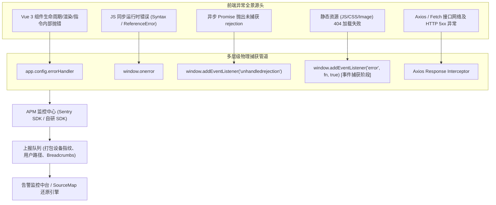
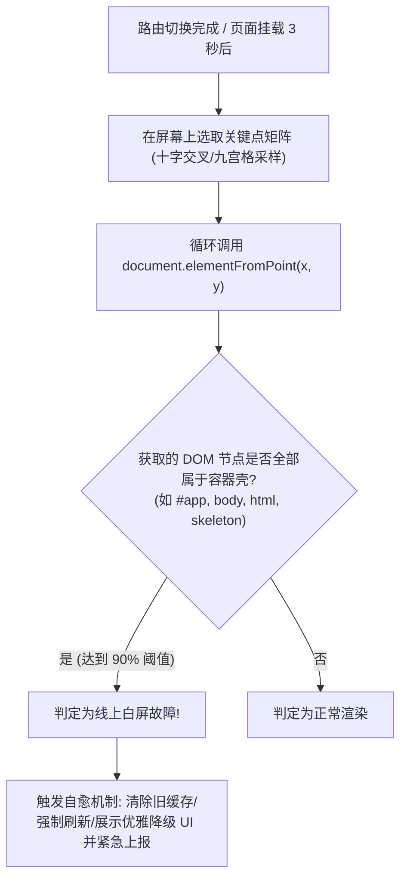

# 资深-线上异常监控Sentry集成SourceMap逆向还原与白屏治理

在单页应用（SPA）的现代生产环境中，“白屏”与“运行时异常”是直接导致用户流失的最高级别故障。生产环境交付的代码通常经过了 Terser 压缩、混淆（Uglify）与代码切片，控制台抛出的调用栈形如 `TypeError: Cannot read properties of undefined (reading 't') at e.fn (app-4a8b.js:1:3402)`，没有源码上下文几乎无法定位。建立完备的**线上全景异常捕获体系**、**SourceMap 逆向还原链路**与**白屏自愈检测机制**，是资深前端工程专家不可或缺的实战基石。

---

## 一、核心底层机制与全景架构

### 1.1 前端异常捕获全景拓扑



---

### 1.2 全景异常类型捕获矩阵

| 异常类型 | 物理触发条件 | 捕获 API | 是否能捕获同源/跨域 |
| :--- | :--- | :--- | :--- |
| **Vue 组件异常** | `setup()`、生命周期钩子、模板渲染、计算属性中抛错 | `app.config.errorHandler` | 统一接管 Vue 上下文 |
| **全局 JS 运行时错误** | 全局函数、DOM 原生事件回调中的语法/空指针错误 | `window.onerror` | 跨域脚本报 `Script error.`（需 CORS） |
| **异步 Promise 异常** | 未显式书写 `.catch()` 的 rejected Promise | `unhandledrejection` | 支持捕获异步调用链 |
| **资源加载错误** | `<script>`、`<link>`、`` 404 或网络阻断 | `window.addEventListener('error', fn, true)` | **必须在捕获阶段（useCapture=true）**，事件不冒泡 |
| **接口调用异常** | HTTP 状态码 4xx/5xx、超时、CORS 拦截 | Axios 响应拦截器 / 重写 `fetch` | 业务级统一处理 |

---

## 二、源码级/算法物理推导

### 2.1 Vue 3 内部错误分发链路（`callWithErrorHandling`）

Vue 3 内部在执行所有的用户自定义代码（如组件生命周期、watch 回调、事件处理函数）时，都会通过 `callWithErrorHandling` 或 `callWithAsyncErrorHandling` 工具函数进行物理安全包裹。

```typescript
// packages/runtime-core/src/errorHandling.ts (Vue 3 源码简化)
export function callWithErrorHandling(
  fn: Function,
  instance: ComponentInternalInstance | null,
  type: ErrorTypes,
  args?: unknown[]
) {
  let res
  try {
    res = args ? fn(...args) : fn()
  } catch (err) {
    handleError(err, instance, type)
  }
  return res
}

export function handleError(
  err: unknown,
  instance: ComponentInternalInstance | null,
  type: ErrorTypes
) {
  const contextVNode = instance ? instance.vnode : null
  if (instance) {
    // 1. 向上遍历父组件，检查是否存在 errorCaptured 钩子
    let cur = instance.parent
    const exposedInstance = instance.proxy
    while (cur) {
      const errorCapturedHooks = cur.ec
      if (errorCapturedHooks) {
        for (let i = 0; i < errorCapturedHooks.length; i++) {
          // 若子组件钩子返回 false，则阻断错误继续向上冒泡
          if (errorCapturedHooks[i](err, exposedInstance, type) === false) {
            return
          }
        }
      }
      cur = cur.parent
    }
  }

  // 2. 若未被组件树内部阻断，则抛给全局 errorHandler
  const appConfig = instance?.appContext.config
  const { errorHandler } = appConfig || {}
  if (errorHandler) {
    callWithErrorHandling(errorHandler, null, ErrorTypes.APP_ERROR_HANDLER, [
      err,
      instance?.proxy,
      type
    ])
    return
  }

  // 3. 最终兜底：抛向浏览器控制台
  console.error(err)
}
```

---

### 2.2 SourceMap 逆向映射物理原理（VLQ 编码与 Mappings）

在生产构建中生成的 `.map` 文件，本质上是一份包含源代码与混淆代码物理坐标映射的 JSON 规范：
```json
{
  "version": 3,
  "file": "app-4a8b.js",
  "sources": ["src/views/Home.vue"],
  "sourcesContent": ["<script setup>\nconst a = 1\n</script>"],
  "names": ["ref", "count"],
  "mappings": "AAAA,SAASA,GAAI,QAAO,KAApB..."
}
```

#### 逆向推导流程
1. **压缩代码坐标**：生产报错输出行号为 `1`，列号为 `3402`。
2. **VLQ（Variable-length quantity）解码**：`mappings` 字段由分号（`;` 代表混淆后代码的行）和逗号（`,` 代表分词片段 Segment）分隔。每个片段由 4~5 个 Base64 VLQ 字符表示：
   - 第 1 位：生成代码的列偏移量。
   - 第 2 位：源文件在 `sources` 数组中的索引。
   - 第 3 位：源代码的起始物理行号。
   - 第 4 位：源代码的起始物理列号。
   - 第 5 位（可选）：符号在 `names` 数组中的索引。
3. **坐标映射**：Sentry 服务端根据解码后的段位信息，通过二分查找快速命中定位到真实的源码文件 `src/views/Home.vue` 第 24 行、第 8 列，精准打印出错当行的上下文高亮代码。

---

### 2.3 白屏自愈检测算法：DOM 关键路径采样

前端发生严重 JS 崩溃或动态 Chunk 加载失败时，页面往往直接呈现为一片空白。传统前端脚本无法直接知晓“用户眼前是否为白屏”，需要运行**主动白屏采样探测算法**。



#### 企业级白屏采样检测算法实现
```typescript
// utils/white-screen-detector.ts
export function detectWhiteScreen(
  wrapperSelectors = ['#app', 'body', 'html', '.skeleton'],
  threshold = 0.9 // 空白率阈值
): boolean {
  const width = window.innerWidth
  const height = window.innerHeight

  // 选取十字交叉采样点 (共 17 个点)
  const samplePoints: [number, number][] = []
  for (let i = 1; i <= 9; i++) {
    samplePoints.push([(width * i) / 10, height / 2])
    samplePoints.push([width / 2, (height * i) / 10])
  }

  let emptyCount = 0

  for (const [x, y] of samplePoints) {
    const el = document.elementFromPoint(x, y)
    if (!el) {
      emptyCount++
      continue
    }

    // 检查元素是否只是顶层根容器或空骨架屏
    const isWrapper = wrapperSelectors.some(
      (selector) => el.matches(selector) || el.parentElement?.matches(selector)
    )
    if (isWrapper) {
      emptyCount++
    }
  }

  const emptyRatio = emptyCount / samplePoints.length
  return emptyRatio >= threshold
}
```

---

## 三、社招/阶段必考高频硬核连环追问

### 追问 1：为什么生产环境严禁将 `.map` 文件直接发布到 CDN 公网上？如何既保障源码私密性又实现 Sentry 异常还原？
**标杆解答**：
1. **安全合规风险**：`.map` 内部的 `sourcesContent` 完整携带了未经编译的项目所有原始代码（包含接口契约、鉴权加密逻辑、内部注释等）。如果暴露在 CDN 公网上，黑客只需在控制台 Sources 中即可一览无余地将整套系统逆向扒取，存在极高的信息安全与版权合规风险。
2. **私密闭环上传 SOP**：
   - 本地/CI 构建时开启 `sourcemap: true`，生成 `.map` 文件。
   - 在构建完成后，通过自动化流水线（如 `@sentry/vite-plugin`）将全部 `.map` 文件直接推送到私有部署的 Sentry 内部对象存储中，并与当前发布的 `release` 版本号严格绑定。
   - **上传完毕后，在 CI 阶段执行脚本将构建产物目录中的所有 `.map` 文件物理彻底删除**，然后再将纯净的 JS/CSS 推送至公共 CDN。

---

### 追问 2：为什么 `window.onerror` 在捕获 CDN 上加载的 JS 报错时，经常只能拿到 `Script error.` 且没有行列号？如何彻底解决？
**标杆解答**：
1. **浏览器同源安全策略（Cross-Origin Script Blocking）**：当加载的脚本来自于跨域 CDN 域名（如 `static.mycdn.com`），若该脚本抛出未捕获异常，出于防止跨域隐私信息泄露（例如不同域网站互相探测执行上下文）的目的，浏览器会自动屏蔽报错细节，将信息模糊化为统一的 `Script error.`，行号与列号强制置为 `0`。
2. **两步彻底根治方案**：
   - **第一步：服务端开启 CORS 响应头**：CDN 服务商必须在响应静态脚本资源时增加跨域响应头：
     ```http
     Access-Control-Allow-Origin: *
     ```
   - **第二步：客户端 Script 声明跨域属性**：在 HTML 引入脚本的 `<script>` 标签或打包工具中增加 `crossorigin="anonymous"` 属性（Vite 生产构建默认已注入该属性）。

---

### 追问 3：Sentry 监控中的“面包屑（Breadcrumbs）”物理原理是什么？它如何重现用户出错前的行为轨迹？
**标杆解答**：
1. **AOP 切面拦截（Monkey Patching / Hook）**：Sentry SDK 在初始化时，会深度拦截侵入浏览器底层的多个全局原生 API：
   - **DOM 点击事件**：重写 `EventTarget.prototype.addEventListener`，捕获所有 `click`、`input` 事件的目标选择器。
   - **网络请求**：重写 `XMLHttpRequest.prototype.open/send` 与 `window.fetch`，记录请求 URL、方法、状态码和耗时。
   - **路由变更**：重写 `history.pushState` / `replaceState` 及监听 `popstate` / `hashchange`。
   - **控制台输出**：重写 `console.log`、`console.warn`。
2. **内存环形缓冲区（Ring Buffer）**：将上述操作按时间戳存入一个固定容量（如最近 100 条）的内存环形队列中。当发生任何未捕获异常时，将当前保存的面包屑队列整体附带在异常报文中一并上传，让开发者能够清晰复盘出“用户点了 A 按钮 -> 发起 B 接口成功 -> 切换到 C 页面 -> 触发异常”的完整行为闭环。

---

## 四、生产级避坑指南与排障 SOP

### 4.1 Sentry Vite Plugin 生产级集成与 Map 自动清理配置

```typescript
// vite.config.ts
import { defineConfig } from 'vite'
import vue from '@vitejs/plugin-vue'
import { sentryVitePlugin } from '@sentry/vite-plugin'

export default defineConfig({
  build: {
    // 生产构建必须开启 sourcemap 生成以供上传
    sourcemap: true
  },
  plugins: [
    vue(),
    sentryVitePlugin({
      org: 'my-org',
      project: 'my-vue-project',
      authToken: process.env.SENTRY_AUTH_TOKEN,
      release: {
        name: process.env.VITE_APP_VERSION || 'v1.0.0'
      },
      sourcemaps: {
        // 指定扫描目录
        assets: './dist/**',
        // 上传成功后自动物理删除本地产物中的 .map 文件，杜绝泄漏至 CDN
        filesToDeleteAfterUpload: './dist/**/*.map'
      }
    })
  ]
})
```

---

### 4.2 Vue 3 全局异常监控与兜底自愈 SOP

```typescript
// main.ts
import { createApp } from 'vue'
import App from './App.vue'
import * as Sentry from '@sentry/vue'
import { detectWhiteScreen } from './utils/white-screen-detector'

const app = createApp(App)

// 1. 初始化 Sentry
Sentry.init({
  app,
  dsn: 'https://xxx@sentry.my-company.com/123',
  release: 'v1.0.0',
  integrations: [
    Sentry.browserTracingIntegration(),
    Sentry.replayIntegration()
  ],
  tracesSampleRate: 0.2
})

// 2. Vue 级全局错误捕获
app.config.errorHandler = (err, instance, info) => {
  console.error('[Global Vue Error]:', err, info)
  // 上报至 Sentry
  Sentry.captureException(err, {
    extra: {
      componentName: instance?.$options?.name,
      errorInfo: info
    }
  })
}

// 3. 动态 Chunk 加载失败（部署新版本旧资源 404）自愈
window.addEventListener('error', (event) => {
  const target = event.target as HTMLElement
  if (target && target.nodeName === 'SCRIPT') {
    const isChunkLoadFailed = event.message?.includes('Loading chunk') || target.getAttribute('src')?.includes('/assets/')
    if (isChunkLoadFailed) {
      console.warn('检测到静态资源版本漂移，自动执行一次强刷...')
      const hasReloaded = sessionStorage.getItem('chunk_reload_lock')
      if (!hasReloaded) {
        sessionStorage.setItem('chunk_reload_lock', 'true')
        window.location.reload()
      }
    }
  }
}, true)

// 4. 挂载后白屏巡检
app.mount('#app')

setTimeout(() => {
  sessionStorage.removeItem('chunk_reload_lock')
  if (detectWhiteScreen()) {
    console.error('检测到线上白屏，执行紧急上报与降级策略')
    Sentry.captureMessage('Fatal White Screen Detected', 'fatal')
  }
}, 4000)
```
