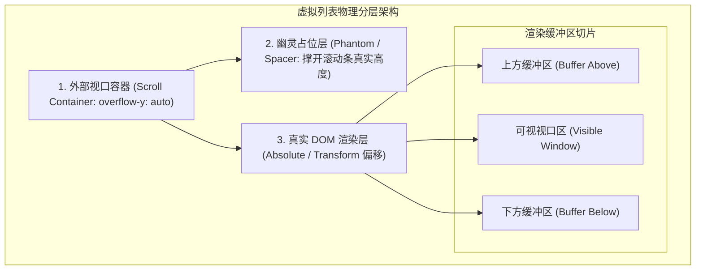
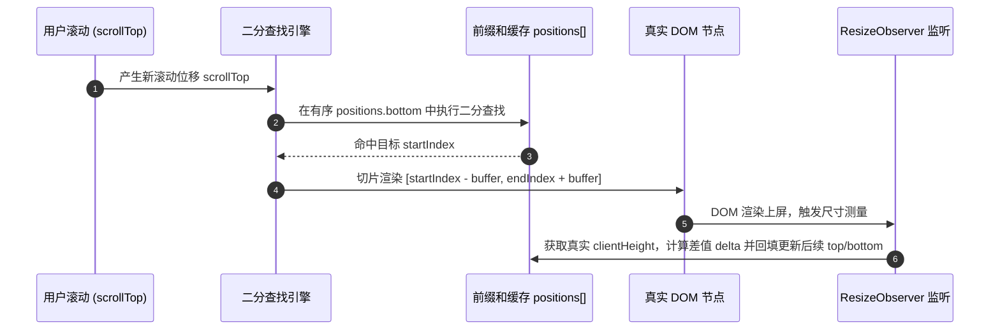

# 资深-虚拟列表VirtualList高性能无限滚动动态高度与二分查找

在现代企业级数据密集型 Web 应用（如日志监控中台、即时通讯聊天记录、电商长列表、金融高频交易盘口）中，一次性渲染成千上万条 DOM 节点会导致浏览器内存暴增、页面滚动严重卡顿甚至直接崩溃。**虚拟列表（Virtual List / Windowing）** 是一种以局部时间换取无限空间的高性能渲染技术。本篇专题深入剖析虚拟列表的底层空间物理映射、动态高度测量机制、基于前缀和的二分查找算法推导，并提供企业级工业实现。

---

## 一、核心底层机制与全景架构

### 1.1 传统全量渲染 vs 虚拟列表空间物理映射

当页面需要展示 100,000 条复杂图文卡片时：
- **传统全量渲染**：浏览器需要在内存中创建 100,000 个真实 DOM 节点及其数十万个子元素。这会导致庞大的 DOM 树内存开销（数百 MB）、极其缓慢的样式计算与回流重绘（数十秒），页面完全失去响应。
- **虚拟列表渲染**：无论数据总量有多大（1 万还是 100 万），**在物理 DOM 树中永远只保持渲染可见视口（Viewport）内的数十个 DOM 节点**。通过在滚动容器中动态计算滚动的偏移量，实现“视口滚动，DOM 循环复用”的假象。



---

### 1.2 核心物理几何参数对照表

| 几何参数 | 物理定义 | 计算公式 / 作用 |
| :--- | :--- | :--- |
| **`scrollTop`** | 视口当前滚动的垂直距离 | 监听容器 `scroll` 事件实时获取 `e.target.scrollTop` |
| **`viewportHeight`** | 视口可视高度 | 容器物理像素高 `containerRef.clientHeight` |
| **`totalHeight`** | 幽灵占位层总高度 | 所有数据项的高度总和（支撑浏览器原生原生滚动条） |
| **`startIndex`** | 当前真实渲染的第一条数据索引 | 基于 `scrollTop` 与各子项高度计算 |
| **`endIndex`** | 当前真实渲染的最后一条数据索引 | 基于 `startIndex`、视口高度及缓冲区大小计算 |
| **`startOffset`** | 渲染层距离容器顶部的位移偏移 | 使真实渲染层恰好处于当前视口中央，使用 `transform: translateY()` 驱动 |
| **`bufferSize`** | 视口上下预渲染的缓冲条数 | 预防快速滚动（Fling / Scroll）引发白屏的关键参数 |

---

## 二、源码级/算法物理推导

### 2.1 动态高度虚拟列表：预估高度与前缀和二分查找

如果每个列表项高度固定（如每项固定 50px），计算极其简单：`startIndex = Math.floor(scrollTop / 50)`。
但在真实业务中，**每个列表项的高度往往由内部文本字数、图文内容动态决定，呈现完全不规则的动态高度**。

#### 物理解决闭环：
1. **预估高度（Estimated Height）**：初始化时赋予每项一个预估高度（如 80px），生成初始的位置缓存数组 `positions`。
2. **前缀和（Prefix Sum）**：`positions` 中记录了每一项的 `height`、`top`（距顶部物理距离）和 `bottom`（距顶部最底端距离）。由于列表是从上至下排列的，其 `bottom` 严格保持**单调递增**。
3. **二分查找（Binary Search）**：当滚动发生获取到新的 `scrollTop` 时，由于 `positions` 的 `bottom` 是单调有序数组，可通过**二分查找以 $O(\log N)$ 的极速性能命中 `startIndex`**，杜绝遍历带来的 $O(N)$ 性能瓶颈。
4. **真实高度回填（ResizeObserver 修正）**：组件挂载渲染后，通过 `ResizeObserver` 采集该节点真实高度并修正 `positions`，更新后续所有节点的偏移量。



---

### 2.2 二分查找寻找起始索引源码推导

```typescript
interface ItemPosition {
  index: number
  height: number
  top: number
  bottom: number
}

/**
 * 在单调递增的 positions 数组中二分查找第一个 bottom > scrollTop 的项
 */
export function binarySearchStartIndex(
  positions: ItemPosition[],
  scrollTop: number
): number {
  let low = 0
  let high = positions.length - 1
  let resultIndex = 0

  while (low <= high) {
    const mid = Math.floor((low + high) / 2)
    const midBottom = positions[mid].bottom

    if (midBottom === scrollTop) {
      return mid + 1
    } else if (midBottom < scrollTop) {
      low = mid + 1
    } else {
      // 记录候选结果，并尝试在更左侧寻找更小的匹配项
      resultIndex = mid
      high = mid - 1
    }
  }

  return resultIndex
}
```

---

## 三、社招/阶段必考高频硬核连环追问

### 追问 1：为什么在快速猛烈滑动（Fling）虚拟列表时，偶尔会出现瞬间的白屏闪烁？如何彻底消除？
**标杆解答**：
1. **产生机理**：现代浏览器的滚动通常由独立的合成器线程（Compositor Thread）加速，滚动事件派发与主线程的 JS 执行是异步解耦的。在快速滚动时，合成器已经将视口移到了新位置，但主线程的 `onScroll` 回调才刚刚开始执行，Vue 的响应式更新、切片数据计算以及新 DOM 的创建与挂载尚未完成，导致视口暴露出了空白区域。
2. **根治方案**：
   - **引入动态缓冲区（Buffer Size）**：在视口上下方各预先多渲染一部分节点（例如上下各预渲染 1~2 屏的节点数量，如 `buffer = 10`），为快速滚动提供物理安全缓冲带。
   - **监听滚动速度并动态自适应 Buffer**：计算两次 `scroll` 事件之间的时间差与位移差（滚动速度 $v = \Delta y / \Delta t$），当检测到高速滑动时，瞬时动态扩大 Buffer 容量，待滚动停滞后回落，兼顾内存与流畅度。

---

### 追问 2：为什么虚拟列表中必须使用 CSS `transform: translateY(Ypx)` 驱动可视区偏移，而严禁使用绝对定位的 `top: Ypx`？
**标杆解答**：
1. **渲染流水线差异**：修改 `top` 会触发浏览器完整的样式计算（Recalculate Style）、回流布局（Layout / Reflow）与重新绘制（Paint），每滚动一次都会造成整屏像素的重新光栅化，在 120Hz 高刷屏上必然引发严重掉帧。
2. **GPU 硬件加速与复合层**：`transform` 是现代浏览器的 GPU 友好型属性。修改 `transform: translateY()` 不会破坏文档几何布局，浏览器会将其作为一个独立的合成层（Compositing Layer）交由 GPU 线程处理矩阵变换，**实现 0 回流、0 重绘的丝滑滚动**。

---

### 追问 3：如果虚拟列表中的数据项包含异步网络图片，图片加载完成后尺寸发生突变，会导致什么问题？如何解决？
**标杆解答**：
1. **物理灾难**：当初始估算高度为 80px 的卡片内部图片下载完成时，图片撑开导致卡片真实高度突变为 300px。如果不做处理，这会导致**已测量的高度缓存完全失效，后续所有节点的 `top` 与 `bottom` 物理坐标发生错位，滚动条剧烈跳动抖动，甚至产生死循环跳跃**。
2. **解决方案**：
   - **方案 A（最佳实践）**：服务端下发数据时附带图片的真实物理宽高比，前端在图片未加载完成前通过 CSS `aspect-ratio` 提前占位，杜绝图片加载引起的 DOM 尺寸突变。
   - **方案 B（动态尺寸捕获）**：使用 `ResizeObserver` 持续监听每一个正在渲染的列表项。当图片加载撑开容器触发 Resize 监听时，计算真实高度与当前缓存高度的差值 $\Delta d$，**仅将索引大于该项的后续所有缓存节点的 `top` 和 `bottom` 统一累加 $\Delta d$**，并动态刷新幽灵占位层总高度。

---

## 四、生产级避坑指南与排障 SOP

### 4.1 企业级 Vue 3 动态高度虚拟列表组件全景实现

```vue
<!-- components/VirtualList.vue -->
<template>
  <div
    ref="containerRef"
    class="virtual-list-container"
    @scroll.passive="handleScroll"
  >
    <!-- 幽灵占位层：撑开真实滚动条高度 -->
    <div class="virtual-phantom" :style="{ height: `${totalHeight}px` }"></div>

    <!-- 真实渲染视口层 -->
    <div
      class="virtual-render-list"
      :style="{ transform: `translate3d(0, ${startOffset}px, 0)` }"
    >
      <div
        v-for="item in visibleData"
        :key="item.id"
        :data-id="item.id"
        ref="itemsRef"
        class="virtual-item"
      >
        <slot :item="item">{{ item.content }}</slot>
      </div>
    </div>
  </div>
</template>

<script setup lang="ts" generic="T extends { id: string | number }">
import { ref, computed, onMounted, onUpdated, nextTick } from 'vue'

const props = withDefaults(
  defineProps<{
    listData: T[]
    estimatedItemHeight?: number // 预估项高度
    bufferSize?: number          // 缓冲视口倍数
  }>(),
  {
    estimatedItemHeight: 60,
    bufferSize: 5
  }
)

interface Position {
  index: number
  height: number
  top: number
  bottom: number
}

const containerRef = ref<HTMLDivElement | null>(null)
const itemsRef = ref<HTMLDivElement[]>([])

const scrollTop = ref(0)
const viewportHeight = ref(0)
const startIndex = ref(0)
const positions = ref<Position[]>([])

// 1. 初始化预估位置信息
function initPositions() {
  positions.value = props.listData.map((_, index) => ({
    index,
    height: props.estimatedItemHeight,
    top: index * props.estimatedItemHeight,
    bottom: (index + 1) * props.estimatedItemHeight
  }))
}
initPositions()

// 2. 占位层总高度 (最后一项的 bottom)
const totalHeight = computed(() => {
  const len = positions.value.length
  return len ? positions.value[len - 1].bottom : 0
})

// 3. 计算可视区域切片
const visibleCount = computed(() => {
  return Math.ceil(viewportHeight.value / props.estimatedItemHeight)
})

const finalStartIndex = computed(() => {
  return Math.max(0, startIndex.value - props.bufferSize)
})

const finalEndIndex = computed(() => {
  return Math.min(
    props.listData.length,
    startIndex.value + visibleCount.value + props.bufferSize
  )
})

const visibleData = computed(() => {
  return props.listData.slice(finalStartIndex.value, finalEndIndex.value)
})

// 4. 偏移量
const startOffset = computed(() => {
  if (finalStartIndex.value >= 1) {
    return positions.value[finalStartIndex.value - 1].bottom
  }
  return 0
})

// 5. 二分查找当前起始索引
function getStartIndex(scrollTopVal: number): number {
  let low = 0
  let high = positions.value.length - 1
  let res = 0

  while (low <= high) {
    const mid = Math.floor((low + high) / 2)
    const midBottom = positions.value[mid].bottom
    if (midBottom === scrollTopVal) {
      return mid + 1
    } else if (midBottom < scrollTopVal) {
      low = mid + 1
    } else {
      res = mid
      high = mid - 1
    }
  }
  return res
}

// 6. 滚动事件监听 (已开启 passive: true 保证丝滑)
function handleScroll(e: Event) {
  const target = e.target as HTMLDivElement
  scrollTop.value = target.scrollTop
  startIndex.value = getStartIndex(scrollTop.value)
}

// 7. DOM 真实高度回填与修正
function updatePositions() {
  if (!itemsRef.value || itemsRef.value.length === 0) return

  itemsRef.value.forEach((node) => {
    if (!node) return
    const rect = node.getBoundingClientRect()
    const id = node.dataset.id
    const index = props.listData.findIndex((item) => String(item.id) === id)
    if (index === -1) return

    const oldHeight = positions.value[index].height
    const dValue = rect.height - oldHeight

    if (dValue !== 0) {
      // 存在高度偏差，动态回填
      positions.value[index].height = rect.height
      positions.value[index].bottom += dValue

      // 级联更新后续所有项的 top 和 bottom
      for (let k = index + 1; k < positions.value.length; k++) {
        positions.value[k].top = positions.value[k - 1].bottom
        positions.value[k].bottom += dValue
      }
    }
  })
}

onMounted(() => {
  if (containerRef.value) {
    viewportHeight.value = containerRef.value.clientHeight
  }
})

onUpdated(() => {
  nextTick(() => {
    updatePositions()
  })
})
</script>

<style scoped>
.virtual-list-container {
  position: relative;
  width: 100%;
  height: 100%;
  overflow-y: auto;
  -webkit-overflow-scrolling: touch;
}

.virtual-phantom {
  position: absolute;
  top: 0;
  left: 0;
  right: 0;
  z-index: -1;
}

.virtual-render-list {
  position: absolute;
  top: 0;
  left: 0;
  right: 0;
  will-change: transform;
}
</style>
```
