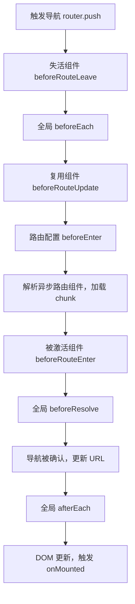

# 路由权限守卫与实战

## 使用入口：先解决问题，再做验证

组织登录跳转和前端页面权限。

**先做基本操作**：先完成匿名白名单、登录与返回原页面，测试权限变化/失效；服务端独立授权，再深入守卫时序。初次学习可先完成[本模块基础实践](/doc/Vue/Vue组件与页面基本使用)。

**再逐步深入**：基本 API 与输入输出 → 常见失败和使用边界 → 场景排查与优化 → 本文机制分析与源码。面试先讲用途和自己的操作过程，再回答场景与原理追问。

> **一句话结论**：前端权限只解决「体验与流程」，真正的安全边界在后端；工程上最容易翻车的不是 `beforeEach` 写法，而是**动态路由注册时机、异步守卫的并发跳转、以及重定向死循环**。

## 30 秒速览

| 守卫 | 触发时机 | 能否阻止导航 | 典型用途 |
|---|---|---|---|
| `beforeEach` (全局) | 导航确认前，**最先**执行 | ✅ return false / 新 location | 登录校验、动态路由注入、进度条 |
| `beforeEnter` (路由独享) | 仅该路由记录，父级切换不触发 | ✅ | 单页面特殊校验 |
| `beforeRouteEnter` / `Update` / `Leave` (组件内) | 组件解析后 / 复用时 / 离开前 | ✅（Enter 需 next 回调） | 未保存草稿提示 |
| `beforeResolve` (全局) | 所有组件内守卫与异步组件解析完成后 | ✅ | 导航前最后拉数据、确认所有资源就绪 |
| `afterEach` (全局) | 导航已完成 | ❌ | 埋点、改标题、关进度条 |

## 一张图看懂守卫执行顺序



**关键点**：异步路由组件（懒加载 chunk）是在 `beforeEnter` 之后、`beforeResolve` 之前解析的。所以动态路由必须**在 `beforeEach` 里 `addRoute` 完成**，否则第一次跳转会直接落到 404。

## 二、完整生产级守卫（含动态路由、白名单、防死循环）

```ts
// router/guard.ts
import type { Router } from 'vue-router'

const WHITE_LIST = ['/login', '/403', '/404']

export function setupGuard(router: Router) {
  const user = useUserStore()
  const perm = usePermissionStore()
  let routesAdded = false          // 防止每次跳转都重新 addRoute

  router.beforeEach(async (to) => {
    NProgress.start()

    // 1. 白名单直接放行（务必放在最前，否则 /login 会被自己拦截形成死循环）
    if (WHITE_LIST.includes(to.path)) return true

    // 2. 未登录：带 redirect 回跳
    if (!user.token) {
      return { path: '/login', query: { redirect: to.fullPath } }
    }

    // 3. 已登录但路由表未构建：拉权限 → 过滤路由 → addRoute
    if (!routesAdded) {
      try {
        const menus = await perm.fetchMenus()             // 只请求一次
        perm.buildRoutes(menus).forEach(r => router.addRoute(r))
        // 关键：addRoute 后当前导航的匹配结果已过期，必须重新导航一次
        routesAdded = true
        return to.fullPath                                // 触发重进，且保留 query/hash
      } catch (e) {
        user.logout()                                     // 权限接口失败要清 token
        return { path: '/login', query: { redirect: to.fullPath } }
      }
    }

    // 4. 角色/权限校验（菜单级由动态路由保证，这里兜底 meta）
    if (to.meta.roles && !to.meta.roles.some(r => perm.roles.includes(r))) {
      return { path: '/403' }
    }

    // 5. 兜底：刷新后访问不存在的路径
    if (to.matched.length === 0) return { path: '/404' }
    return true
  })

  router.afterEach((to, _from, failure) => {
    NProgress.done()
    if (failure) return                                  // 导航失败不要误报 PV
    document.title = `${to.meta.title ?? '控制台'} - 萌植托管局`
    reportPV(to.fullPath)
  })
}
```

```ts
// 登录成功后回跳，且防止 redirect 指向外部地址造成开放重定向
const redirect = (route.query.redirect as string) || '/'
const safe = redirect.startsWith('/') && !redirect.startsWith('//') ? redirect : '/'
await router.replace(safe)
```

## 三、动态路由四个必踩的坑

| 坑 | 现象 | 解法 |
|---|---|---|
| `addRoute` 后不重新导航 | 首次进入白屏或直接 404 | `return to.fullPath` 重进一次 |
| 404 路由静态写在最前 | 刷新任意动态路由都被 404 拦截 | 把 `path: '/:pathMatch(.*)*'` 的通配路由**放到动态路由注入之后**再 addRoute |
| `addRoute` 重复执行 | 路由 name 冲突、菜单重复 | 用 `routesAdded` 标志位，或 `router.hasRoute(name)` 判断 |
| 退出登录不清理路由 | 换账号后仍能看到上个账号的菜单 | `logout` 时移除动态路由（`router.removeRoute(name)`）并重置标志位 |

```ts
// 动态路由过滤：后端返回菜单标识，前端按 meta.perms 过滤本地路由表
export function filterRoutes(asyncRoutes: RouteRecordRaw[], perms: string[]) {
  return asyncRoutes
    .filter(r => !r.meta?.perm || perms.includes(r.meta.perm as string))
    .map(r => ({ ...r, children: r.children ? filterRoutes(r.children, perms) : undefined }))
}
```

## 四、异步守卫的风险与控制

守卫里 `await` 会**阻塞整个导航**，而用户可能连点两个链接：

| 风险 | 表现 | 处理 |
|---|---|---|
| 慢接口导致白屏 | 页面停在上一个视图，无反馈 | 加 NProgress / 骨架屏；接口设 3~5s 超时并降级 |
| 并发导航竞态 | 先发的请求后返回，覆盖新导航 | Vue Router 4 会丢弃过期导航结果；业务侧用 `AbortController` |
| 权限接口失败 | 守卫抛异常，导航卡死无提示 | `try/catch` 兜底到登录页，清 token |
| 无限重定向 | A→B→A 循环，控制台报 Detected an infinite redirection | 白名单最优先判断；避免 `next('/login')` 与 `beforeEach` 互相触发 |
| URL 上的 redirect 被篡改 | 开放重定向钓鱼 | 校验 `startsWith('/') && !startsWith('//')` |

> Vue Router 4 推荐**用 `return` 值**替代 `next()`：返回值语义明确（true / false / 路由对象），且不会因「调用两次 next」或「忘记调用」导致导航悬挂。

## 五、三层权限模型（别把按钮权限也塞进路由守卫）

| 层级 | 控制对象 | 实现位置 | 后端是否必须校验 |
|---|---|---|---|
| 页面/菜单级 | 路由是否注册、菜单是否显示 | `beforeEach` + 动态路由 + meta | ✅ 接口按角色鉴权 |
| 按钮/操作级 | 增删改按钮是否可见 | 自定义指令 `v-perm` 或 `hasPerm()` | ✅ 接口必须再校验 |
| 数据级 | 只能看自己部门/自己创建的数据 | 请求参数 + 后端行级过滤 | ✅ 唯一真正边界 |

```ts
// directives/perm.ts —— 按钮级权限，仅做显隐，不承担安全
export const vPerm = {
  mounted(el: HTMLElement, binding: DirectiveBinding<string>) {
    if (!usePermissionStore().hasPerm(binding.value)) el.remove()
  },
}
```

一句话答面试：**前端权限 = 体验层，后端鉴权 = 安全层**。任何「前端隐藏了按钮所以安全」的说法都是错的，抓包改参数就能绕过。

## 六、与 keep-alive / 数据刷新的配合

- 页面被 `<keep-alive>` 缓存后，再次进入**不触发** `onMounted` 与 `beforeRouteEnter` 的完整流程（会触发 `onActivated`），需要刷新数据时用 `onActivated` 或 `beforeRouteUpdate`；
- 列表页 → 详情页 → 返回，用 `beforeRouteLeave` 记录滚动位置，配合 `scrollBehavior` 恢复；
- `beforeRouteLeave` 里做「未保存草稿」拦截时，注意 `router.push` 被取消也要重置 loading 状态。

## 七、高频追问（含高分/低分特征）

| 追问 | 高分回答要点 | 低分回答 |
|---|---|---|
| 前端权限能保证安全吗？ | 不能，仅体验层；后端每个接口必须鉴权 + 数据行级过滤 | 「meta 配好就安全了」 |
| 刷新动态路由页面为什么 404？ | 路由表存在内存里，刷新丢失；需在 beforeEach 重新 addRoute 并重导航 | 「把路由写成静态的」 |
| `addRoute` 后为什么要 `return to.fullPath`？ | 当前导航的 matcher 结果在 addRoute 前已计算，必须重新匹配一次 | 「不写也行」 |
| `next()` 与 return 的区别？ | Vue Router 4 推荐 return，避免多次调用 / 遗漏导致悬挂，`next` 已标记废弃语义 | 「一样的」 |
| 守卫里做异步请求有什么风险？ | 阻塞导航、竞态、超时无反馈、异常卡死；需进度条 + 超时 + catch 兜底 | 「加 await 就行」 |
| 怎么防重定向死循环？ | 白名单最优先、登录页不参与鉴权、检查 redirect 合法性 | 「加个 if 判断」 |

**延伸阅读**：[VueRouter 原理与实战](/doc/Vue/VueRouter原理与实战)、[Pinia 状态管理与架构实战](/doc/Vue/Pinia状态管理与实战解析)、[接口防刷与全栈安全攻防实战](/doc/Fullstack/接口防刷与全栈安全攻防实战)。
