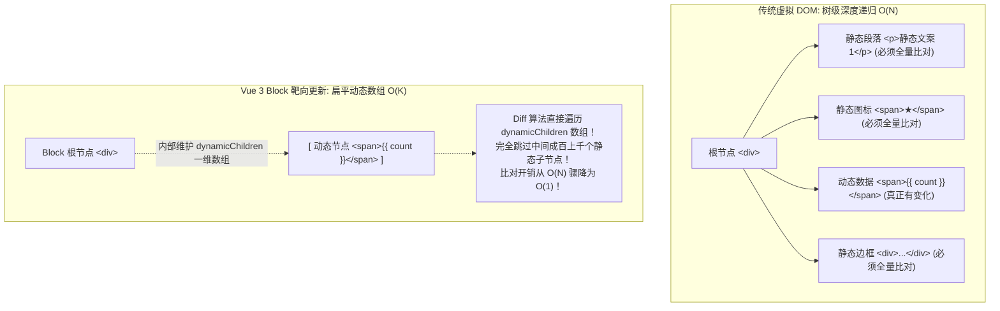

# BlockTree 靶向更新 PatchFlags 位掩码与静态提升优化

在传统的虚拟 DOM（Virtual DOM）架构（如 Vue 2 与 React 15~18）中，当组件内部某一个微小的数据发生改变时，框架的比对更新开销与**模板中的总 DOM 节点数（$N$）成绝对正比**。哪怕一个包含 1000 个静态节点的复杂页面里仅仅只有一行数字变动，Diff 算法也必须机械、盲目地对整棵虚拟树进行自顶向下的深度递归遍历。Vue 3 凭借 **Block Tree 靶向更新**、**PatchFlags 二进制位掩码** 以及 **静态节点提升（Static Hoisting）**，在虚拟 DOM 领域完成了一场革命性的降维打击。

---

## 核心底层机制与全景架构

### 1. 传统全量 Diff 困境 vs Block Tree 扁平化靶向更新



### 2. 静态提升（HoistStatic）与静态内容预字符串化

在传统的渲染函数中，每次组件重新渲染时，静态节点都会被无谓地重复调用 `_createElementVNode()` 重新生成一遍全新的 VNode 对象。
- **静态提升（Static Hoisting）**：Vue 编译器在编译期检测到没有任何响应式变量依赖的静态 VNode 时，**直接将其提升到 `render` 函数体外部**！该静态节点在内存中仅被初始化创建一次，后续任意次数的重新渲染直接复用同一个内存指针；
- **预字符串化（Static Stringification）**：当检测到连续存在大量静态标签（例如 20 个以上的静态 HTML 节点）时，编译器甚至不再为它们生成独立的 VNode 对象树，而是直接将它们压缩为一段原生的 HTML 大字符串，生成 `_createStaticVNode('<div class="x">...</div>', 20)`，在运行时直接调用底层 `innerHTML` 一次性暴力插入，大幅减少内存占用。

---

## 源码级/物理级底层推导

### 1. PatchFlags 二进制位掩码全景物理推导

在虚拟 DOM 比对时，即便找到了动态节点，如果对该节点的 `class`、`style`、`id`、`event` 全量比对一遍依然消耗算力。Vue 3 为每个动态节点分配了一个 32 位的整型位掩码 **`PatchFlag`**：

| 枚举常量名 | 二进制位掩码值 | 十进制值 | 运行时的精准比对指令 |
| :--- | :--- | :--- | :--- |
| **`TEXT`** | `1 << 0` | `1` | 该节点仅包含动态文本内容，只比对文本 `node.nodeValue` |
| **`CLASS`** | `1 << 1` | `2` | 该节点仅动态绑定了类名，只比对 `el.className` |
| **`STYLE`** | `1 << 2` | `4` | 该节点仅动态绑定了样式，只比对内联 `style` |
| **`PROPS`** | `1 << 3` | `8` | 动态属性，仅比对 `dynamicProps` 数组中指定的特定属性名 |
| **`FULL_PROPS`** | `1 << 4` | `16` | 动态 Key 属性（如 `:[key]="val"`），必须全量比对 Props |
| **`HYDRATE_EVENTS`** | `1 << 5` | `32` | 带有事件监听器（专供 SSR 服务端水合使用） |
| **`STABLE_FRAGMENT`** | `1 << 6` | `64` | 子节点顺序永不改变的无根片段（如静态模板片段） |
| **`KEYED_FRAGMENT`** | `1 << 7` | `128` | 子节点带有明确 Key 的 `v-for` 片段，进入完整快速 Diff |
| **`UNKEYED_FRAGMENT`** | `1 << 8` | `256` | 子节点未配置 Key 的 `v-for` 片段 |
| **`NEED_PATCH`** | `1 << 9` | `512` | 带有 ref 或指令生命周期钩子，必须执行比对 |
| **`DYNAMIC_SLOTS`** | `1 << 10` | `1024` | 作用域插槽或动态插槽 |
| **`HOISTED`** | `-1` | `-1` | 该节点为已被静态提升的常量节点，跳过任何比对 |
| **`BAIL`** | `-2` | `-2` | 动态性不可预测，退出 Block 优化，回退到全量递归 Diff |

#### 极速位运算比对物理代码（`patchElement` 源码）
```typescript
// 利用位运算与（&）在单个 CPU 时钟周期内完成属性判定
const { patchFlag, dynamicProps } = n2

if (patchFlag > 0) {
  // 1. 是否只需要更新 class？
  if (patchFlag & PatchFlags.CLASS) {
    if (oldProps.class !== newProps.class) {
      hostSetClassName(el, newProps.class)
    }
  }

  // 2. 是否只需要更新 style？
  if (patchFlag & PatchFlags.STYLE) {
    hostPatchStyle(el, oldProps.style, newProps.style)
  }

  // 3. 是否只需要更新几个特定动态属性？
  if (patchFlag & PatchFlags.PROPS) {
    for (let i = 0; i < dynamicProps!.length; i++) {
      const key = dynamicProps![i]
      const prev = oldProps[key]
      const next = newProps[key]
      if (next !== prev) {
        hostPatchProp(el, key, prev, next)
      }
    }
  }

  // 4. 是否只需要更新文本内容？
  if (patchFlag & PatchFlags.TEXT) {
    if (n1.children !== n2.children) {
      hostSetElementText(el, n2.children as string)
    }
  }
}
```

---

### 2. Block 动态收集栈物理过程（`openBlock` 与 `createBlock`）

编译器在生成渲染代码时，会在 Block 节点首尾包裹 `_openBlock()` 和 `_createElementBlock()`：

```typescript
// 全局 Block 收集栈（用于支持嵌套 Block）
export const blockStack: (VNode[] | null)[] = []
export let currentBlock: VNode[] | null = null

// 1. 开启一个全新的 Block 收集容器
export function openBlock() {
  blockStack.push((currentBlock = []))
}

// 2. 在创建每一个子 VNode 时，如果是动态节点，自动推入当前 Block 的容器中
export function createVNode(tag, props, children, patchFlag) {
  const vnode = { ... }
  
  // 核心机理：只要该节点携带了有效的 patchFlag，自动被父级 Block 捕获为动态子节点！
  if (patchFlag > 0 && currentBlock) {
    currentBlock.push(vnode)
  }
  return vnode
}

// 3. 闭合 Block 并产出带有 dynamicChildren 的根 VNode
export function createElementBlock(tag, props, children, patchFlag, dynamicProps) {
  const vnode = createVNode(tag, props, children, patchFlag, dynamicProps)
  // 将收集到的扁平动态数组绑定到自身身上
  vnode.dynamicChildren = currentBlock
  // 出栈恢复上一级 Block 上下文
  blockStack.pop()
  currentBlock = blockStack[blockStack.length - 1] || null
  return vnode
}
```

---

## 社招高频硬核连环追问

### 追问 1：为什么 `v-if` 和 `v-for` 标签必须被视为一个独立的 Block 嵌套分支？如果它们不作为独立的 Block，会导致什么灾难？

#### 深度剖析
1. **树结构破坏难题**：
   - Block Tree 成立的数学假设是：**“当前 Block 内部的所有动态节点在 `dynamicChildren` 中的物理索引位置（Index）是绝对恒定不变的！”**
   - 如果一个 Block 内部包含了一个 `v-if="flag"` 节点，当 `flag` 为 true 时，该节点进入动态数组；当 `flag` 变为 false 时，该节点在物理上凭空消失了！
   - 这会导致后续所有的动态子节点在数组中的索引全部发生整体偏移错位，Diff 算法在按数组顺序复用比对时会彻底产生**节点张冠李戴的大灾难**！
2. **嵌套 Block 状态树隔离**：
   - Vue 规定：**任何带有 `v-if`、`v-else` 或 `v-for` 的节点，必须自身作为一个独立的子 Block！**
   - 父级 Block 仅仅把这个 `v-if` 的子 Block 整体当作一个单独的动态单元看待；当 `v-if` 条件变化时，父级直接针对整个子 Block 执行整体的挂载或卸载，从而保证了父 Block 动态数组索引的绝对稳定。

---

### 追问 2：PatchFlags 为什么全部使用二进制移位运算（如 `1 << 0`, `1 << 1`, `1 << 2`）来定义数值？

#### 深度剖析
1. **位运算高并发性能极高**：二进制位运算（按位与 `&`、按位或 `|`）直接映射到底层 CPU 寄存器的原生硬件机器指令，执行开销仅需 **0.1 纳秒（单个时钟周期）**，远快于任何字符串比对或对象属性检索；
2. **正交复合状态组合**：一个节点可能既有动态 class，又有动态 text，此时只需通过按位或：
   `const flag = PatchFlags.TEXT | PatchFlags.CLASS`（即二进制 `00000011`）；
3. **极简权限判定**：运行时只需执行 `if (flag & PatchFlags.CLASS)`，若结果大于 0，说明该节点必然包含动态类名。单次运算即可完成多重状态解析。

---

## 生产级避坑指南与排障 SOP

### 1. 警惕在手写渲染函数（JSX/TSX）中滥用复杂内联表达式导致静态提升失效

- **现象**：很多从 React 转过来的工程师习惯在 Vue 中全量使用 JSX，结果发现 Vue 3 的性能提升并没有官方宣称的那么惊艳。
- **物理成因**：
  在 JSX/TSX 模式下，代码跳过了 Vue 专用的模板编译器（Template Compiler），直接由 Babel/Babel-plugin-jsx 处理。这导致 **静态提升（HoistStatic）、BlockTree 动态子节点收集、PatchFlags 二进制优化全部被物理架空失效**！渲染函数每次执行都会完整重新创建全部 VNode 对象，回退为类似 React 的全量 Diff 模式。
- **生产准则**：
  在追求极致渲染性能的高频交互页面、复杂大屏、海量数据列表中，**强制使用原生 SFC `<template>` 语法**，尽情享受编译期优化的红利。
