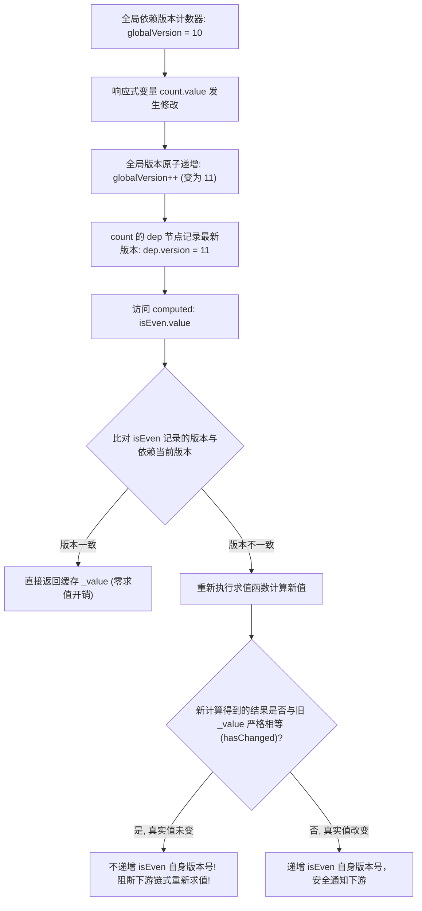

# Computed 与 Watch 底层机制版本号演进与竞态取消

在 Vue 3 的响应式体系中，`computed` 与 `watch` 共同构建了从“状态变动”到“衍生值重算与异步副作用”的桥梁。然而，在面对高并发、复杂深层衍生计算以及高频异步请求时，早期版本的性能开销与竞态缺陷逐渐显露。Vue 3.4 彻底颠覆了沿用数年的 `_dirty` 脏标记机制，引入了革命性的 **依赖版本号双向链表系统（Dependency Versioning）**；同时，`watch` 提供的 **`onCleanup` 闭包清除协议** 为解决前端经典的网络异步竞态（Race Conditions）提供了确定性的工业解法。

---

## 核心底层机制与全景架构

### 1. Vue 3.0~3.3 的 `_dirty` 布尔标记困境

在 Vue 3.4 之前，`ComputedRefImpl` 内部维护一个 `_dirty = true` 布尔变量：
1. 首次读取时，`_dirty` 为 true，执行求值并把结果缓存到 `_value`，随后将 `_dirty` 置为 false；
2. 当依赖发生变动时，依赖触发其调度器将 `_dirty` 重新拨回 true；
3. **性能致命缺陷（过度求值）**：
   考虑链式计算场景：
   ```typescript
   const count = ref(0)
   const isEven = computed(() => count.value % 2 === 0)
   const message = computed(() => isEven.value ? '偶数' : '奇数')
   ```
   当 `count` 从 `0` 变为 `2` 时：
   - `count` 变了，导致 `isEven` 的 `_dirty` 被置为 true；
   - 进而导致依赖 `isEven` 的 `message` 的 `_dirty` 也被强制置为 true；
   - 但事实上，`isEven` 的真实值依然是 `true`，**根本没有发生实质改变**！可 `message` 却被迫在下一次访问时完整重新执行了一遍求值函数，造成严重的链式无效计算。

---

### 2. Vue 3.4+ 全新版本号（Dependency Versioning）架构

Vue 3.4 彻底重构了 `@vue/reactivity`，通过全局递增的版本号（`globalVersion`）与节点局部的 `dep.version` 建立数学比对：



这一演进使得链式计算属性在中间值未变时，**下游所有关联计算属性能够被瞬间 $O(1)$ 短路阻断**，内存占用削减 50% 以上，大型项目重渲染效率飞跃。

---

## 源码级/物理级底层推导

### 1. `ComputedRefImpl` 源码核心实现（Vue 3.4+）

```typescript
export class ComputedRefImpl<T> {
  public dep?: Dep = undefined
  private _value!: T
  public readonly __v_isRef = true
  public readonly __v_isReadonly: boolean

  public readonly effect: ReactiveEffect<T>
  // 记录上次求值时全局依赖的版本快照
  public globalVersion: number = globalVersion - 1

  constructor(
    getter: ComputedGetter<T>,
    private readonly _setter: ComputedSetter<T>,
    isReadonly: boolean
  ) {
    this.effect = new ReactiveEffect(
      () => getter(this._value),
      () => {
        // 调度器触发：仅当真正被下游订阅时才触发派发
        triggerRefValue(this, this)
      }
    )
    this.effect.computed = this
    this.__v_isReadonly = isReadonly
  }

  get value() {
    // 1. 收集读取此 computed 的外部依赖 (如组件渲染 effect)
    trackRefValue(this)
    
    // 2. 核心数学比对：如果全局版本未变，说明系统内任何依赖均未发生修改，直接取缓存！
    // 即使全局版本变了，进入 refreshComputed 逐层检查具体依赖版本，若值未变直接短路
    if (this.globalVersion !== globalVersion) {
      this.globalVersion = globalVersion
      const prevValue = this._value
      // 重新求值
      this._value = this.effect.run()!
      // 若真实值确实发生了变化，才将自身的 dep 标记为已更新
      if (hasChanged(this._value, prevValue)) {
        triggerRefValue(this)
      }
    }
    return this._value
  }

  set value(newValue: T) {
    this._setter(newValue)
  }
}
```

---

### 2. `watch` 异步网络竞态（Race Condition）与 `onCleanup` 物理破局

#### 经典网络竞态 Bug 场景
用户在搜索框中快速连续输入两个关键词：“苹果（Apple）” 与 “香蕉（Banana）”：
1. 输入“苹果”，触发请求 A（由于后端负载高，耗时 2000ms 返回）；
2. 300ms 后用户迅速改成“香蕉”，触发请求 B（网络极速，耗时 200ms 返回）；
3. **灾难发生**：请求 B 在第 500ms 时率先返回，页面渲染出“香蕉”的搜索结果；而在第 2000ms 时，迟到的请求 A 终于返回，**旧的“苹果”数据直接将最新的“香蕉”结果残忍覆盖！** 导致用户界面错乱。

#### `onCleanup` 源码级闭包消除原理
Vue 的 `watch` 回调提供了第三个入参 `onCleanup`：

```typescript
watch(searchKeyword, (newKeyword, oldKeyword, onCleanup) => {
  // 创建一个原生浏览器请求取消控制器
  const controller = new AbortController()

  // 核心机制：注册清除闭包
  onCleanup(() => {
    // 只要下一次当前 watch 回调重新触发前，或者当前组件即将被销毁时
    // 该清除闭包会被 Vue 运行时必定优先同步执行！
    console.log('>>> [竞态中断] 取消上一次未完成的陈旧网络请求:', oldKeyword)
    controller.abort() // 物理中断底层 TCP/HTTP 请求
  })

  // 发起携带 signal 的真实请求
  fetch(`/api/search?q=${newKeyword}`, { signal: controller.signal })
    .then(res => res.json())
    .then(data => {
      searchResult.value = data
    })
    .catch(err => {
      if (err.name === 'AbortError') {
        console.log('陈旧请求已被安全抛弃')
      }
    })
})
```

---

## 社招高频硬核连环追问

### 追问 1：`watch` 的 `flush: 'pre'`、`'post'` 与 `'sync'` 在底层执行调度队列中有何物理区别？

#### 深度剖析
Vue 内部维护着多个不同优先级的执行队列：

| `flush` 模式 | 调度执行时机 | 底层队列位置 | 物理访问能力 |
| :--- | :--- | :--- | :--- |
| **`pre`（默认模式）** | **在组件 DOM 重新渲染更新之前** 执行 | 推入主更新队列的前置区间（Pre-flush Jobs） | 无法访问更新后的最新 DOM，访问的是当前旧 DOM |
| **`post`（等价于 `watchPostEffect`）** | **在组件 DOM 重新渲染更新完毕之后** 执行 | 推入后置队列（Post-flush Jobs） | **能够安全获取最新的真实 DOM** 节点属性与尺寸 |
| **`sync`（极端同步模式）** | **数据被修改的瞬间直接同步执行** | **绕过任何微任务队列**，直接同步调用 | 极度危险！若高频修改数据会导致回调瞬间执行千次，丧失批处理能力，仅用于特殊底层调试 |

---

### 追问 2：为什么说在 `computed` 的 getter 里执行 `console.log` 会产生副作用欺骗？何谓“惰性求值陷阱”？

#### 深度剖析
很多开发者在 `computed` 内部打印日志调试：
```typescript
const total = computed(() => {
  console.log('total 被计算了') // 调试打印
  return a.value + b.value
})
```
- **欺骗现象**：代码修改了 `a.value++`，控制台却**静悄悄的没有任何日志输出**！开发者误以为响应式系统坏了；
- **物理成因**：`computed` 是**绝对惰性（Lazy）**的。当它的依赖 `a` 改变时，系统只是将其版本标记为过期，**并不会立即去执行 getter 函数**；只有当下游的模板渲染函数或者某段 JS 代码真正执行了 `total.value` 的读取动作时，求值函数才会被唤醒执行。如果没有被任何地方消费，该计算属性永远不会执行！

---

## 生产级避坑指南与排障 SOP

### 1. 深度监听大对象时必须警惕 `deep: true` 引发的 CPU 假死

- **线上事故**：某后台系统监听了一个包含 10000 条复杂树形节点的对象：
  ```typescript
  watch(() => bigTreeData, (val) => { ... }, { deep: true })
  ```
  每次只要修改树中某一个小节点的名称，浏览器标签页直接卡死 800ms。
- **物理成因**：
  开启 `deep: true` 后，Vue 的 `traverse` 函数会**递归深度遍历该对象的所有层级属性**，强制读取每一个深层字段以触发 `track` 依赖收集。万级对象递归寻址消耗数亿次 CPU 周期。
- **排障 SOP**：
  绝大多数业务只需要监听树形对象中的**某个特定层级或特定字段**，使用精准 Getter 函数替代盲目全量深度监听：
  ```typescript
  // ✅ 极致优化：只精准监听需要感知的具体字段，杜绝 deep 全量遍历
  watch(() => bigTreeData.selectedId, (newId) => {
    // 耗时从 800ms 骤降至 0.1ms
  })
  ```

---

### 2. 避免在 `watch` 回调中对监听目标执行无边界修改

- **故障特征**：控制台瞬间抛出 `Maximum recursive updates exceeded` 栈溢出。
- **排查 SOP**：
  检查所有 `watch` 的回调函数。如果回调内部必须调用某个可能改变源数据的函数，必须加上**严格的前置判等守护逻辑（Guard Check）**：
  ```typescript
  watch(score, (newScore) => {
    // 必须加判等防御，若数值已满足要求则绝不再次触发写入
    if (newScore > 100) {
      score.value = 100
    }
  })
  ```
