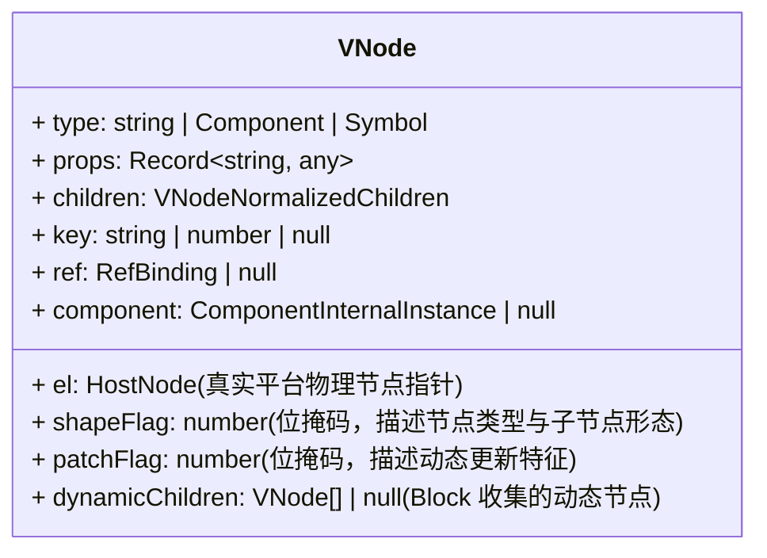

# VNode 数据结构 ShapeFlags 位运算与 createRenderer 自定义渲染器

虚拟 DOM（Virtual DOM）之所以能让 Vue 具备跨浏览器、跨平台（小程序、Weex 原生应用、Canvas 图形渲染、Node 终端控制台）的底层能力，核心在于它在宿主平台物理节点之上抽象出了一层 **纯粹的 JavaScript 描述符对象（VNode, Virtual Node）**。Vue 3 通过精密的 **`ShapeFlags` 二进制位掩码体系** 实现了对 VNode 类型的极速识别；同时将核心 Diff 比对引擎与平台原生 DOM 操作彻底解耦，暴露出极度灵活的 **`createRenderer` 自定义渲染器 API**。本专题从底层内存结构到手写跨端渲染器展开全景实战。

---

## 核心底层机制与全景架构

### 1. VNode 运行时核心物理数据结构

在 `@vue/runtime-core` 中，每一个 VNode 是一个纯 JavaScript 扁平对象：



- **`el` 属性**：极其关键的物理锚点。当虚拟节点被真正渲染为原生真实节点（如浏览器 HTML `<div>`）后，`vnode.el` 会直接持有该原生真实 DOM 的内存引用，后续无论如何更新与复用，直接通过 `vnode.el` 操作真实元素；
- **`shapeFlag`**：记录“我自己是什么节点”以及“我的子节点（children）是什么形态”的整型数值。

---

### 2. `ShapeFlags` 经典二进制位掩码体系

在渲染器进行分流判断时（例如：当前节点是一个带数组子节点的组件，还是一个带纯文本子节点的 HTML 原生元素），如果通过一堆 `if-else` 或字符串比对，运行时性能损耗严重。Vue 3 将所有类型映射为正交的二进制位：

| 枚举常量名 | 二进制位掩码值 | 十进制值 | 物理含义解释 |
| :--- | :--- | :--- | :--- |
| **`ELEMENT`** | `1 << 0` | `1` | 原生 HTML 宿主元素（如 `div`、`span`） |
| **`FUNCTIONAL_COMPONENT`** | `1 << 1` | `2` | 函数式组件 |
| **`STATEFUL_COMPONENT`** | `1 << 2` | `4` | 拥有独立响应式状态的有状态组件（常规 SFC 组件） |
| **`TEXT_CHILDREN`** | `1 << 3` | `8` | 子节点是纯文本（字符串或数字） |
| **`ARRAY_CHILDREN`** | `1 << 4` | `16` | 子节点是一个由多个子 VNode 组成的数组 |
| **`SLOTS_CHILDREN`** | `1 << 5` | `32` | 子节点是插槽结构 |
| **`TELEPORT`** | `1 << 6` | `64` | 内置 Teleport 传送门组件 |
| **`SUSPENSE`** | `1 << 7` | `128` | 内置 Suspense 异步协调组件 |
| **`COMPONENT`** | `STATEFUL \| FUNCTIONAL` | `6` | 广义组件（有状态组件与函数式组件的复合标记） |

#### 快速类型识别与复合状态
```typescript
// 假设创建了一个普通 div，里面包含了一组子元素列表：
// shapeFlag = ShapeFlags.ELEMENT | ShapeFlags.ARRAY_CHILDREN (即 1 | 16 = 17)

// 运行时判断：当前节点是否是元素？
if (vnode.shapeFlag & ShapeFlags.ELEMENT) {
  // 是普通元素，进入 mountElement
}

// 运行时判断：它的子节点是不是数组？
if (vnode.shapeFlag & ShapeFlags.ARRAY_CHILDREN) {
  // 遍历子节点递归挂载 mountChildren
}
```

---

## 源码级/工程级实战：开发一个 Canvas 2D 自定义渲染器

Vue 3 官方通过 `@vue/runtime-core` 导出了 **`createRenderer`**。只要我们向其提供一套针对特定平台的底层增删改查节点操作接口（`nodeOps`），Vue 就能瞬间将响应式组件直接渲染到对应的非 Web 平台上！

### 完整手写 Canvas 跨端渲染器（`src/renderers/canvasRenderer.ts`）

```typescript
import { createRenderer, h, reactive } from 'vue'

// 1. 定义 Canvas 中的虚拟图形节点结构
export interface CanvasNode {
  type: 'rect' | 'circle' | 'text'
  x: number
  y: number
  width?: number
  height?: number
  radius?: number
  fill: string
  text?: string
  children: CanvasNode[]
}

// 2. 实现针对 Canvas 平台的底层节点操作集 (nodeOps)
const canvasNodeOps = {
  // 创建元素
  createElement(tag: string): CanvasNode {
    return {
      type: tag as any,
      x: 0,
      y: 0,
      fill: '#000000',
      children: []
    }
  },
  
  // 插入元素
  insert(child: CanvasNode, parent: CanvasNode) {
    parent.children.push(child)
  },

  // 移除元素
  remove(child: CanvasNode) {
    // 从父节点移除
  },

  // 属性更新打补丁 (Patch Prop)
  patchProp(el: CanvasNode, key: string, prevValue: any, nextValue: any) {
    el[key as keyof CanvasNode] = nextValue
  },

  // 文本处理（Canvas 视作无独立文本节点）
  createText: () => ({} as any),
  setText: () => {},
  setElementText: () => {},
  parentNode: () => null,
  nextSibling: () => null
}

// 3. 利用 createRenderer 实例化属于 Canvas 平台的渲染器！
const { render: baseCanvasRender, createApp: createBaseCanvasApp } = createRenderer(canvasNodeOps)

// 4. 实现最终将 CanvasNode 树在 HTML5 Canvas 上绘制出来的光栅化函数
export function drawCanvasTree(ctx: CanvasRenderingContext2D, node: CanvasNode) {
  ctx.fillStyle = node.fill

  if (node.type === 'rect') {
    ctx.fillRect(node.x, node.y, node.width || 50, node.height || 50)
  } else if (node.type === 'circle') {
    ctx.beginPath()
    ctx.arc(node.x, node.y, node.radius || 20, 0, Math.PI * 2)
    ctx.fill()
  } else if (node.type === 'text') {
    ctx.font = '14px sans-serif'
    ctx.fillText(node.text || '', node.x, node.y)
  }

  // 递归绘制子节点
  if (node.children && node.children.length) {
    node.children.forEach(child => drawCanvasTree(ctx, child))
  }
}
```

---

## 社招高频硬核连环追问

### 追问 1：既然虚拟 DOM 本质上就是一个普通的 JS 对象，那么它一定比原生直接操作 DOM 更快吗？这背后的架构真相是什么？

#### 深度剖析
1. **这是面试中流传最广的认知误区**：
   **虚拟 DOM 在任何纯计算场景下，绝对不可能比“极致优化的手动原生 DOM 操作”更快！**
   - 原生操作：`div.textContent = 'hello'`（耗时接近 0 毫秒）；
   - 虚拟 DOM 操作：分配创建全新 VNode 对象 → 触发 Diff 算法比对新旧 VNode 属性 → 计算差异 → 最终依然调用 `div.textContent = 'hello'`。中间多出了昂贵的 JS 运算开销；
2. **虚拟 DOM 真正的不可替代价值**：
   - **研发效能与心智模型飞跃**：开发者可以彻底摆脱手动查找 DOM、拼接 HTML 字符串、手动注销监听的泥潭，享受声明式“数据驱动视图”的现代化开发体验；
   - **跨平台运行时抽象（Cross-platform Abstraction）**：VNode 使得 Vue 的核心逻辑与浏览器 DOM 强解耦，通过 `createRenderer` 可以极其廉价地输出到 Native 原生、小程序、WebGL、服务端 SSR 等任意物理载体；
   - **保证“性能下限”**：在业务极其庞大、初中级程序员随手写代码的真实项目中，手动操作 DOM 极易引发高频全量页面重排重绘；而虚拟 DOM 结合批处理与 Diff 算法，能以可控的算力开销保证任何复杂页面都维持在 60 帧以上的良好交互下限。

---

### 追问 2：`ShapeFlags` 为什么能在一个整型变量中同时描述“节点本身类型”与“子节点类型”？

#### 深度剖析
- 依托于二进制位的独立性与正交性：
  - 低 3 位（`1`, `2`, `4`）分配给“节点自身类型（元素、函数式组件、有状态组件）”；
  - 高 3 位（`8`, `16`, `32`）分配给“子节点的形态（文本子节点、数组子节点、插槽）”；
- 双方在数值上完全不重叠（互不影响独立位）。无论两者如何通过按位或（`|`）组合，通过按位与（`&`）检索特定位时，其余位全部被置零过滤，实现了“一个 32 位整数承载多重正交分类数据”的极致紧凑内存结构。

---

## 生产级避坑指南与排障 SOP

### 1. 规避在手写渲染函数 `h()` 时产生无意义的空 VNode 树

- **现象**：在封装低代码渲染引擎时，开发者通过递归遍历树形 JSON 动态调用 `h()`，若遇到不满足渲染条件的项返回了 `h('div', { style: 'display:none' })`。
- **排障 SOP**：
  若某个节点在条件不满足时不需要渲染，**直接返回 `null` 或使用布尔条件短路**：
  ```typescript
  // ✅ 正确做法：直接返回 null，Vue 运行时会将其编译为注释占位节点（Comment VNode），开销极低
  return isShow ? h('div', '内容') : null
  ```

---

### 2. 避免在 VNode 的 `key` 中传递对象引用

- **成因**：`key` 在底层会被直接作为 Map 的键名进行检索（`keyToOldIndexMap`）。如果在 `key` 上直接绑定了一个复杂对象字面量（如 `:key="{ id: item.id }"`），每次组件渲染该对象都会生成全新的内存指针，导致 Diff 算法每次都判定为全新节点，引起全量真实 DOM 暴力销毁与重建！
- **铁律**：**`key` 必须且只能传递原始基础类型（`string` 或 `number`）**。
