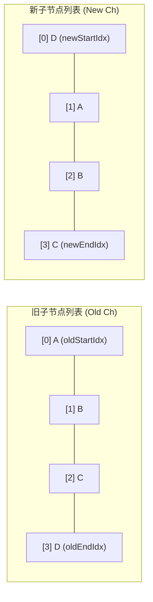
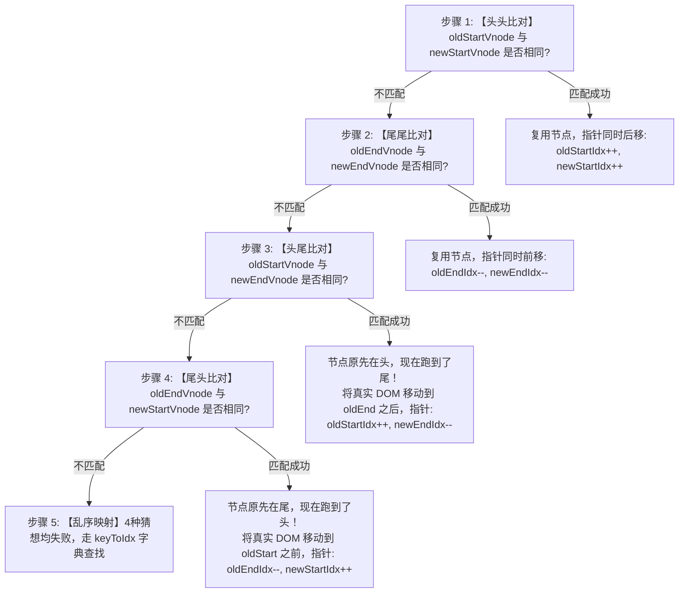

# Vue 2 双端 Diff 算法 4 指针演进推导与 key 物理作用

在前端虚拟 DOM 技术演进史上，如何用**最少次数的原生 DOM 物理操作（插入、删除、移动）**完成视图从旧状态（Old VNodes）到新状态（New VNodes）的迁移，是衡量渲染引擎性能的终极标尺。Vue 2 借鉴并重构了开源库 `snabbdom` 的经典 **双端比对算法（Double-Ended Diff Algorithm）**。本专题通过 4 指针时序推导图、核心源码逐行剖析与数学证明，彻底拆解其物理运行本质。

---

## 核心底层机制与全景架构

### 1. 双端比对 4 个指针的初始物理状态

假设有两组同层级的子虚拟节点列表，双端比对在旧列表与新列表的首尾分别设立两个指针：



- **`oldStartIdx`**：指向旧列表的起始未处理节点；
- **`oldEndIdx`**：指向旧列表的末尾未处理节点；
- **`newStartIdx`**：指向新列表的起始未处理节点；
- **`newEndIdx`**：指向新列表的末尾未处理节点。

---

### 2. 四大猜想比对策略（顺时针匹配）

算法在 `while (oldStartIdx <= oldEndIdx && newStartIdx <= newEndIdx)` 循环中，按照固定顺序执行 4 种快速猜想：



---

## 源码级/算法物理推导

### 1. `updateChildren` 核心源码逐行解析

```typescript
function updateChildren(parentElm, oldCh, newCh) {
  let oldStartIdx = 0
  let newStartIdx = 0
  let oldEndIdx = oldCh.length - 1
  let oldStartVnode = oldCh[0]
  let oldEndVnode = oldCh[oldEndIdx]
  let newEndIdx = newCh.length - 1
  let newStartVnode = newCh[0]
  let newEndVnode = newCh[newEndIdx]
  let oldKeyToIdx, idxInOld, vnodeToMove

  while (oldStartIdx <= oldEndIdx && newStartIdx <= newEndIdx) {
    // 过滤由于乱序移动被置为 undefined 的旧占位节点
    if (!oldStartVnode) {
      oldStartVnode = oldCh[++oldStartIdx]
    } else if (!oldEndVnode) {
      oldEndVnode = oldCh[--oldEndIdx]
    } 
    // 1. 头头比对
    else if (sameVnode(oldStartVnode, newStartVnode)) {
      patchVnode(oldStartVnode, newStartVnode)
      oldStartVnode = oldCh[++oldStartIdx]
      newStartVnode = newCh[++newStartIdx]
    } 
    // 2. 尾尾比对
    else if (sameVnode(oldEndVnode, newEndVnode)) {
      patchVnode(oldEndVnode, newEndVnode)
      oldEndVnode = oldCh[--oldEndIdx]
      newEndVnode = newCh[--newEndIdx]
    } 
    // 3. 头尾比对 (旧头对应新尾)
    else if (sameVnode(oldStartVnode, newEndVnode)) {
      patchVnode(oldStartVnode, newEndVnode)
      // 物理移动 DOM: 把真实的 oldStartVnode.elm 移动到当前 oldEndVnode.elm 的下一个兄弟节点之前
      nodeOps.insertBefore(parentElm, oldStartVnode.elm, nodeOps.nextSibling(oldEndVnode.elm))
      oldStartVnode = oldCh[++oldStartIdx]
      newEndVnode = newCh[--newEndIdx]
    } 
    // 4. 尾头比对 (旧尾对应新头)
    else if (sameVnode(oldEndVnode, newStartVnode)) {
      patchVnode(oldEndVnode, newStartVnode)
      // 物理移动 DOM: 把真实的 oldEndVnode.elm 移动到当前 oldStartVnode.elm 的正前方
      nodeOps.insertBefore(parentElm, oldEndVnode.elm, oldStartVnode.elm)
      oldEndVnode = oldCh[--oldEndIdx]
      newStartVnode = newCh[++newStartIdx]
    } 
    // 5. 四种猜想全军覆没：执行基于 Key 的哈希表查找
    else {
      if (!oldKeyToIdx) {
        // 构建旧节点的 key -> index 快速检索字典
        oldKeyToIdx = createKeyToOldIdx(oldCh, oldStartIdx, oldEndIdx)
      }
      idxInOld = newStartVnode.key ? oldKeyToIdx[newStartVnode.key] : findIdxInOld(newStartVnode, oldCh, oldStartIdx, oldEndIdx)
      
      if (!idxInOld) {
        // 旧列表中完全没有该 key，说明是全新的节点：创建并插入真实 DOM
        createElm(newStartVnode, parentElm, oldStartVnode.elm)
      } else {
        // 在旧列表中找到了该 key 对应的旧节点
        vnodeToMove = oldCh[idxInOld]
        if (sameVnode(vnodeToMove, newStartVnode)) {
          patchVnode(vnodeToMove, newStartVnode)
          // 旧列表对应位置掏空置为 undefined，防止后续重复访问
          oldCh[idxInOld] = undefined
          // 将真实 DOM 节点移动到当前 oldStartVnode.elm 的正前方
          nodeOps.insertBefore(parentElm, vnodeToMove.elm, oldStartVnode.elm)
        } else {
          // 相同 key 但 tag 改变了，当作新节点重建
          createElm(newStartVnode, parentElm, oldStartVnode.elm)
        }
      }
      newStartVnode = newCh[++newStartIdx]
    }
  }

  // 循环结束后的收尾处理
  if (oldStartIdx > oldEndIdx) {
    // 旧节点先遍历完毕，新列表中还有剩余项：批量物理创建并插入剩余新节点
    addVnodes(parentElm, newCh, newStartIdx, newEndIdx)
  } else if (newStartIdx > newEndIdx) {
    // 新节点先遍历完毕，旧列表中还有剩余无用项：批量物理删除残留旧节点
    removeVnodes(parentElm, oldCh, oldStartIdx, oldEndIdx)
  }
}
```

---

### 2. 节点判等核心函数：`sameVnode`

Diff 算法判定两个虚拟节点是否属于“同一个节点”的数学准则：
```typescript
function sameVnode(a, b) {
  return (
    a.key === b.key &&               // 1. key 必须严格完全相等！
    a.asyncFactory === b.asyncFactory &&
    ((a.tag === b.tag &&             // 2. 标签名必须完全相等 (如都是 div)
      a.isComment === b.isComment && // 3. 是否是注释节点标志一致
      isDef(a.data) === isDef(b.data) &&
      sameInputType(a, b)) ||        // 4. 若是 input，type 必须一致 (text 不等于 checkbox)
      (isTrue(a.isAsyncPlaceholder) && isUndef(b.asyncFactory)))
  )
}
```

---

## 社招高频硬核连环追问

### 追问 1：为什么在 `v-for` 中如果使用 `index` 作为 `key`，双端 Diff 算法会发生“就地复用灾难”？从指针演进角度给出证明。

#### 数学推导与指针演进
假设原有旧列表为 3 项：`[ { id: 'A' }, { id: 'B' }, { id: 'C' } ]`。
若使用 `index` 作为 key，则旧虚拟节点的 key 映射为：`A(key:0), B(key:1), C(key:2)`。

现在用户执行操作：**在列表头部插入新项 `D`**！
新列表变为：`[ D, A, B, C ]`。
新虚拟节点的 key 映射为：`D(key:0), A(key:1), B(key:2), C(key:3)`。

**Diff 算法第一轮头头比对发生**：
1. 取 `oldStartVnode`：`A(key:0)`；
2. 取 `newStartVnode`：`D(key:0)`；
3. 执行 `sameVnode(A, D)`：
   - 因为 `key` 都是 `0`，且标签都是 `li`，**`sameVnode` 强行判定为“相同节点，可以复用！”**；
4. 真实 DOM 复用：系统把原本渲染 A 的真实 DOM 节点留在了原地，只是把内容强行改成了 D 的文本；
5. 第二轮、第三轮比对全线溃败：原本完全不需要动的 A、B、C 节点，全部被判定为“相同节点被就地修改”，**触发了连续 4 次无谓的 DOM 文本擦除与重写！**
6. 如果每个 `li` 内部包含一个带有未受控输入内容的 `<input>`，输入框里的临时文本因为 DOM 被就地复用，全部错位停留在错误的位置上，造成重大业务事故！

---

### 追问 2：双端 Diff 的 4 种快速猜想设计，基于了现实业务中的什么心理学与统计学假设？

#### 深度剖析
双端 Diff 之所以能做到接近 $O(N)$ 的高效执行，完全建立在对用户交互心理的统计学假设上：
1. **列表首部操作极其高频**：如移动端下拉刷新在顶部追加数据、瀑布流在顶部插入新动态（头头比对命中了 `sameVnode(oldStart, newStart)`）；
2. **列表尾部操作极其高频**：如上拉加载更多、在末尾追加项（尾尾比对命中了 `sameVnode(oldEnd, newEnd)`）；
3. **列表反转或首尾调换极其高频**：如对表格按升序/降序颠倒排序（头尾和尾头比对直接命中）；
4. 通过这 4 种常数时间的简单指针探测，**80% 以上的日常列表变更直接在 4 种猜想中被 $O(1)$ 瞬间消费化解**，避免了代价高昂的哈希表创建与全量线性扫描。

---

## 生产级避坑指南与排障 SOP

### 1. 规避在 `v-for` 中省略 `key` 导致的更新回退

- **现象**：当没有提供 `key` 时，`vnode.key` 为 `undefined`。
- **物理后果**：
  若两个节点的标签名相同（如都是 `<div>`），由于 `undefined === undefined` 恒成立，Diff 算法会退化为**全量就地复用（In-place Patch）**。当列表发生复杂的乱序重排时，虽然节省了 DOM 移动，但极易引发带有子组件状态或选中态的复选框状态彻底错乱。

---

### 2. 避免在复杂列表中使用随机数（如 `Math.random()`）作为 `key`

- **生产事故**：开发者为了图省事，写了 `:key="Math.random()"`。
- **物理成因**：
  每次组件发生任何微小的数据变动重新渲染时，`Math.random()` 都会产出一个全新的浮点数。
  `sameVnode` 判定时，新旧 key 永远不相等！
  导致页面上的所有列表项被**瞬间全量从页面物理拔除销毁（Destroy），再全量重新创建（Create）**！引发极其严重的闪烁、输入法被强行收起以及页面掉帧卡死。
