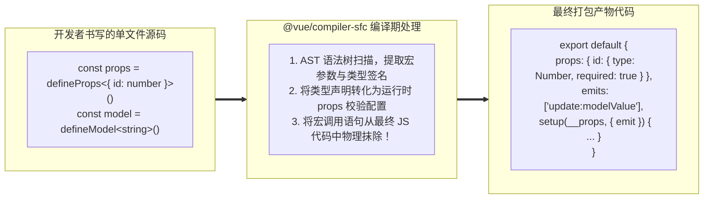
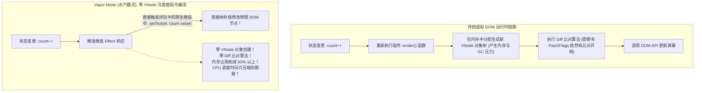

# Vue 3.4+ 新特性 VaporMode 无虚拟 DOM 模式与宏展开底层剖析

随着前端架构对首屏加载速度、内存占用以及长任务调度（INP/FID）要求的进一步严苛，传统虚拟 DOM（Virtual DOM）在每次状态更新时分配的大量 JavaScript 内存对象以及垃圾回收（GC）开销，成为了进一步追求极限性能的物理天花板。Vue 官方在保持原有模板心智模型的前提下，引入了革命性的 **Vapor Mode（水汽模式，无虚拟 DOM 架构）**，并对 `<script setup>` 编译器宏（Compiler Macros）体系实施了深度重构。本专题从底层宏展开时序到 Vapor Mode 原生 DOM 编译黑魔法展开全景剖析。

---

## 核心设计哲学与架构演进

### 1. 编译宏（Compiler Macros）与传统运行时的本质区别

很多初学者容易将 `defineProps`、`defineEmits`、`defineModel` 误当作普通的 JavaScript 运行期函数：



> **核心本质**：
> 编译器宏是**纯静态的“代码生成指令”**。它们在浏览器真实运行时**压根不存在**，既不占用运行期函数调用栈，也无需从 `vue` 库中执行任何实际代码引入。

---

### 2. Vapor Mode：彻底告别虚拟 DOM 的降维打击

受 Solid.js 与 Svelte 的启发，Vue 官方推出了 **Vapor Mode**：



---

## 源码级/物理级底层推导

### 1. `defineModel()` 宏展开源码级实现推导

在 Vue 3.4 中，我们在 `<script setup>` 中写下一行：
```typescript
const count = defineModel<number>({ default: 0 })
```

#### `@vue/compiler-sfc` 编译期 AST 转换物理过程
编译器在解析该宏时，会自动执行以下三部曲重构：
1. **注入运行时 Props 声明**：
   在组件配置对象中自动追加 `modelValue` 属性：
   ```javascript
   props: {
     modelValue: { type: Number, default: 0 }
   }
   ```
2. **注入运行时 Emits 声明**：
   在组件配置对象中自动追加 `update:modelValue` 事件：
   ```javascript
   emits: ['update:modelValue']
   ```
3. **将该变量替换为一个自定义可写 Ref（`useModel`）**：
   ```javascript
   import { useModel as _useModel } from 'vue'
   
   // 编译后的真实 setup 代码
   const count = _useModel(__props, 'modelValue')
   ```

`useModel` 的底层物理简要实现：
```typescript
export function useModel(props: any, name: string) {
  const i = getCurrentInstance()!
  return customRef((track, trigger) => {
    return {
      get() {
        track()
        return props[name] // 读时依赖注入
      },
      set(val) {
        // 写时绝不改动只读的 props，而是自动触发 emit 派发！
        i.emit(`update:${name}`, val)
      }
    }
  })
}
```

---

### 2. Vapor Mode 模板编译产物逐行推导

假设有如下模板：
```html
<div class="counter">
  <button @click="count++">增加: {{ count }}</button>
</div>
```

#### 传统 VDOM 模式编译产物：
生成 `_createElementVNode("div", ... _createVNode("button", ...))`。

#### Vapor Mode 编译产物（完全脱离 VDOM）：
```javascript
import { template as _template, on as _on, setText as _setText, renderEffect as _renderEffect } from 'vue/vapor'

// 1. 在顶层预编译静态 HTML 模板片段
const t0 = _template('<div class="counter"><button>增加: </button></div>')

export function render(_ctx) {
  // 2. 利用原生 DOM 的 cloneNode 一次性极速复制物理骨架（性能远超逐个 createElement）
  const el0 = t0()
  const el1 = el0.firstChild // 获取 button 真实物理节点

  // 3. 原生绑定事件监听
  _on(el1, "click", () => _ctx.count++)

  // 4. 精准建立细粒度响应式副作用（Fine-grained Reactivity）
  // 该闭包仅绑定 count 与 button 内部的文本节点，count 变化时直接修改原生文本！
  _renderEffect(() => {
    _setText(el1.lastChild, _ctx.count)
  })

  // 直接返回真实 DOM 元素
  return el0
}
```

---

## 社招高频硬核连环追问

### 追问 1：既然 Vapor Mode 性能如此极致，为什么 Vue 不直接废除虚拟 DOM，全面彻底拥抱 Vapor Mode？

#### 深度剖析
1. **庞大生态兼容性（Backward Compatibility）**：
   - 过去数年间，基于虚拟 DOM 构建的庞大生态（Element Plus、Ant Design Vue、各类成熟的自定义 JSX/TSX 业务库）沉淀深厚；
   - 虚拟 DOM 是一个与宿主平台完全解耦的**中间抽象层（Intermediate Representation）**，使得跨端渲染（如 Weex、UniApp 小程序原生编译、Canvas 图形渲染器）极其简单。如果强行直接废除 VDOM，现存数十万企业级项目将遭遇断崖式破坏；
2. **渐进式双模共存架构（Progressive Strategy）**：
   - Vue 采取了**组件级渐进启用（Component-Level Opt-in）**策略：
     允许开发者在普通的 VDOM 应用中，针对某几个性能极其敏感、包含海量高频渲染的极端页面，单独通过 `<script setup vapor>` 开启水汽模式，两者在同一个项目中可以完美混用无缝互通。

---

### 追问 2：为什么编译宏（如 `defineProps`）中不能引用外部在当前文件作用域定义的非全局普通局部变量？

#### 深度剖析
- **经典错误**：
  ```typescript
  const defaultList = [1, 2, 3]
  
  // ❌ 报错：defineProps reference a local variable
  const props = withDefaults(defineProps<{ list: number[] }>(), {
    list: () => defaultList
  })
  ```
- **物理成因**：
  `defineProps` 的处理是在预编译期（Pre-compile）由 Babel/SFC 编译器通过 AST 静态分析完成的。编译器在生成外层组件对象的 `props` 描述符时，会将这些参数**搬移提升到组件对象作用域之外**！在那个时候，外部的 JavaScript 局部变量尚未完成初始化求值，因此编译器明令禁止在宏参数中隐式闭包引用局部变量。

---

## 生产级避坑指南与排障 SOP

### 1. 避免在宏声明外手动添加无意义的 `import` 引用

- **反模式**：
  ```typescript
  import { defineProps, defineEmits } from 'vue' // ❌ 完全多余的导入！
  ```
- **排障 SOP**：
  在配置了 `@vue/compiler-sfc` 的 Vite / Webpack 项目中，编译器在扫描到此类导入时会直接报出黄色警告。所有的编译宏在 `<script setup>` 作用域中是**第一公民级全局可用**的，直接裸用即可。

---

### 2. Vue 3.4+ `defineModel` 在父子组件同时携带默认值时的优先级法则

- **边界场景**：
  父组件写了 `v-model="parentVal"`（此时 `parentVal` 初始值为 `undefined`），而子组件写了 `defineModel({ default: '默认文案' })`。
- **物理法则**：
  当父组件传进来的值为 `undefined` 时，子组件内部的 `defineModel` 会触发默认值生效，**并会自动在初始化时向父组件发射一次 `update:modelValue` 将父组件的变量同步填充为该默认文案**，避免前后端数据不同步。
