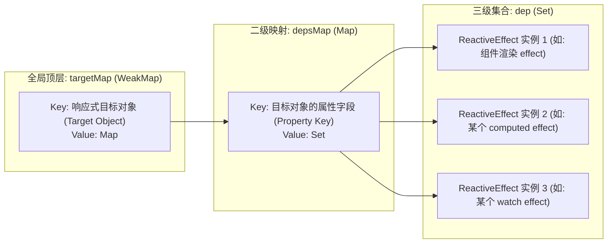

# Vue 3 响应式内核底层架构 WeakMap 依赖图谱与 effect 源码解密

Vue 3 的响应式内核彻底抛弃了 Vue 2 时代饱受诟病的 `Object.defineProperty`，全面基于现代 ES6 **`Proxy`** 和 **`Reflect`** 重构。在整个 `@vue/reactivity` 模块中，核心灵魂正是由 **`WeakMap` 支撑的全局依赖图谱（`targetMap`）** 以及作为依赖执行实体的 **`ReactiveEffect` 调度器**。本专题从底层物理内存拓扑、C++/V8 垃圾回收机制、分支切换清理算法到核心源码，逐行展开深度推导。

---

## 核心底层机制与全景架构

### 1. 全局依赖收集拓扑架构（`targetMap` 三级物理映射）

在 Vue 3 运行时内存中，所有响应式对象与其属性的订阅者构筑在一张精密的树状依赖图谱中：



### 2. 为什么顶层容器必须是 `WeakMap` 而非普通 `Map`？

这是大厂社招高频追问的 V8 物理机制核心：
1. **弱引用特性（Weak References）**：`WeakMap` 对其 Key（必须是对象）持有的是**弱引用**。垃圾回收器（GC）在执行标记清除（Mark-Sweep）时，如果一个对象除了 `WeakMap` 的 Key 之外，在全应用中已经没有任何外部强引用，V8 会立即在下一次 GC 周期中将其物理内存彻底回收释放；
2. **防内存泄漏根治**：如果使用普通 `Map`，即便某个页面或组件已被彻底销毁，只要 `targetMap` 中还缓存着该对象的依赖关系，`Map` 就会作为 GC Root 的强引用链死死拽住该对象，导致整个对象与其关联的闭包无法被释放，造成持续且不可解的全局内存泄漏！

---

## 源码级/物理级底层推导

### 1. Proxy + Reflect 为什么缺一不可？`receiver` 的数学级推导

许多人误以为 `Reflect` 只是把 `target[key]` 换了种高级写法，实际上，**缺少 `receiver` 会直接导致原型链继承场景下的依赖收集彻底丢失！**

#### 经典反例推导
```typescript
const parent = {
  name: '父类',
  get title() {
    // 关键点：这里的 this 究竟指向谁？
    return `[${this.name}] 的专属标题`
  }
}

const child = {
  name: '子类'
}

// 让 child 继承 parent
Object.setPrototypeOf(child, parent)

// 对子类建立 Proxy 代理
const proxyChild = new Proxy(child, {
  get(target, key, receiver) {
    track(target, key) // 收集依赖
    // ❌ 错误写法：不传 receiver，直接 return target[key]
    return target[key]
  }
})
```

- **物理断层过程**：
  1. 当我们访问 `proxyChild.title` 时，由于 `child` 自身没有 `title` 属性，JS 引擎沿着原型链找到了 `parent.title` 的 getter；
  2. 如果写的是 `return target[key]`，getter 内部的 `this` 将被**硬编码绑定为原始未代理对象 `child`**！
  3. 当 getter 内部读取 `this.name` 时，它访问的是原生的 `child.name`，**完全没有经过 Proxy 的 get 拦截器**！导致 `name` 属性的依赖收集彻底落空；
- **Reflect.get 的救赎**：
  ```typescript
  // ✅ 正确写法：传入 receiver
  return Reflect.get(target, key, receiver)
  ```
  `Reflect.get(target, key, receiver)` 的底层规范规定：将访问器属性（getter）调用时的 **`this` 强制重定向绑定为 `receiver`（即当前的 Proxy 代理对象本身）**！此时访问 `this.name` 重新穿透回 Proxy，依赖收集完整闭环。

---

### 2. `track` 与 `trigger` 核心源码逐行解析

#### 依赖收集：`track(target, key)`
```typescript
// 记录当前正在全局执行的 ReactiveEffect 实例
let activeEffect: ReactiveEffect | undefined = undefined
// 是否允许依赖收集的全局开关
let shouldTrack = true

export function track(target: object, key: unknown) {
  // 1. 若当前没有正在运行的 effect，或处于暂停收集状态，直接退出
  if (!shouldTrack || activeEffect === undefined) {
    return
  }

  // 2. 从全局 targetMap 中获取当前对象的 depsMap
  let depsMap = targetMap.get(target)
  if (!depsMap) {
    targetMap.set(target, (depsMap = new Map()))
  }

  // 3. 从 depsMap 中获取当前属性对应的 dep 集合 (Set<ReactiveEffect>)
  let dep = depsMap.get(key)
  if (!dep) {
    depsMap.set(key, (dep = new Set()))
  }

  // 4. 双向建立关联：把当前 activeEffect 加入属性的订阅集合中
  trackEffects(dep)
}

export function trackEffects(dep: Set<ReactiveEffect>) {
  if (!dep.has(activeEffect!)) {
    dep.add(activeEffect!)
    // 核心优化：让 effect 自己也反向记录它订阅了哪些 dep，用于后续分支切换时彻底清理
    activeEffect!.deps.push(dep)
  }
}
```

#### 派发更新：`trigger(target, key, newValue, oldValue)`
```typescript
export function trigger(target: object, key: unknown, newValue?: unknown) {
  const depsMap = targetMap.get(target)
  if (!depsMap) {
    // 该对象从未被任何地方读取过，没有任何依赖，直接返回
    return
  }

  // 待执行的 effect 集合
  const effectsToRun = new Set<ReactiveEffect>()

  // 1. 提取当前属性绑定的所有 effect
  if (key !== undefined) {
    const dep = depsMap.get(key)
    if (dep) {
      dep.forEach(effect => {
        // 防止无限死循环：若触发更新的 effect 正是当前正在执行的 activeEffect，则跳过
        if (effect !== activeEffect) {
          effectsToRun.add(effect)
        }
      })
    }
  }

  // 2. 依次调度执行
  effectsToRun.forEach(effect => {
    if (effect.scheduler) {
      // 若配置了自定义调度器（如组件异步更新队列 queueJob），走调度器
      effect.scheduler()
    } else {
      // 否则直接同步执行
      effect.run()
    }
  })
}
```

---

### 3. `ReactiveEffect` 类与分支切换清理算法（`cleanupEffect`）

#### 经典分支切换死依赖难题
```typescript
const state = reactive({ flag: true, text: 'hello' })

effect(() => {
  // 当 state.flag 为 true 时，收集了 flag 和 text 两个依赖
  // 但当 state.flag 变为 false 时，模板永远只展示 'other'，text 已经不需要了！
  document.body.innerText = state.flag ? state.text : 'other'
})
```
若不清理依赖，后续哪怕 `flag` 已经是 `false`，外部修改 `state.text = 'world'` 时，该 effect 依然会被毫无意义地重新执行，造成**性能严重浪费与幽灵依赖**！

#### Vue 3 的清理实现源码
```typescript
export class ReactiveEffect {
  active = true
  // 反向存储所有包含了此 effect 的 dep 集合列表
  deps: Set<ReactiveEffect>[] = []
  
  constructor(
    public fn: () => any,
    public scheduler: (() => void) | null = null
  ) {}

  run() {
    if (!this.active) {
      return this.fn()
    }

    try {
      // 1. 全局 activeEffect 指针指向自身
      activeEffect = this
      shouldTrack = true
      
      // 2. 每次重新执行前，先斩断自身在之前所有 dep 中的引用关系（清理旧依赖）
      cleanupEffect(this)
      
      // 3. 执行包装的业务函数，在运行中重新收集真正需要的最新依赖！
      return this.fn()
    } finally {
      // 4. 执行完毕，重置指针
      activeEffect = undefined
    }
  }

  stop() {
    if (this.active) {
      cleanupEffect(this)
      this.active = false
    }
  }
}

function cleanupEffect(effect: ReactiveEffect) {
  const { deps } = effect
  if (deps.length) {
    for (let i = 0; i < deps.length; i++) {
      // 从依赖集合中将自己物理移除
      deps[i].delete(effect)
    }
    deps.length = 0
  }
}
```

---

## 社招高频硬核连环追问

### 追问 1：Vue 3 在 `trigger` 时为什么要复制一份 `new Set(effectsToRun)` 而不是直接遍历原有的 `dep` 集合？

#### 深度剖析
若直接遍历原集合：
```typescript
// ❌ 灾难死循环代码
dep.forEach(effect => effect.run())
```
在执行 `effect.run()` 时：
1. 内部触发 `cleanupEffect`，从 `dep` 中将自身**删除（`delete`）**；
2. 紧接着执行 `fn()` 重新读取属性，触发 `track`，又将自身**添加（`add`）回 `dep`**；
3. 根据 ECMAScript 规范：**在一个正在被 `forEach` 遍历的 `Set` 集合中，如果先删除一个元素再重新添加，遍历器会把该元素当作全新元素再次访问！**
4. 导致 `forEach` 陷入**不可解的同步死循环（Infinite Loop）**，浏览器直接崩溃。
因此在 `trigger` 内部必须先构造一个全新且独立的集合副本进行安全迭代。

---

### 追问 2：为什么调用 `pauseTracking()` 和 `resetTracking()` 在数组方法执行时至关重要？

#### 深度剖析
当调用 `arr.push(item)` 或 `arr.pop()` 时：
- `push` 操作在内部不仅会向数组末尾写入元素，**更会隐式读取并修改数组的 `length` 属性**；
- 如果两个独立的组件都在某个事件循环中调用 `push`：
  - 第一个组件的 `push` 读取了 `length`，把它自己注册成了 `length` 的订阅者；
  - 第二个组件的 `push` 改变了 `length`，触发了 `trigger(arr, 'length')`，导致第一个组件被迫重新执行；
  - 引发严重的死锁冲突与栈溢出。
- **解法**：Vue 3 在重写数组 7 个方法（`push`, `pop`, `shift`, `unshift`, `splice`, `indexOf`, `includes`）时，在执行前强制调用 `pauseTracking()` 暂停全局依赖收集，执行完毕后再通过 `resetTracking()` 恢复，彻底隔离了内部隐式 `length` 寻址。

---

## 生产级避坑指南与排障 SOP

### 1. 杜绝在响应式数据中存放大体积非展示型实例

- **现象**：前端在进行富文本、Canvas 游戏引擎或三方 SDK 交互时，将包含庞大树形引用的对象放入 `ref`：
  ```typescript
  const engine = ref(new ComplexGameEngine())
  ```
  引发内存飙升 500MB，浏览器帧率暴跌至个位数。
- **排障 SOP**：
  任何仅用于调用业务方法、无需在 HTML 模板中响应式渲染的复杂实例，使用 **`markRaw`** 彻底阻止代理拦截：
  ```typescript
  import { markRaw } from 'vue'
  const engine = markRaw(new ComplexGameEngine())
  ```
  `markRaw` 会在该对象身上打上不可枚举标记 `__v_skip: true`，Vue 的 `reactive` 遇到该标记时会直接跳过代理，保持原生裸指针运行。

---

### 2. 避免在无依赖的纯函数中被意外收集导致泄露

- **排查 SOP**：
  如果一个底层工具函数需要读取某个响应式数据，但**坚决不希望自身被该响应式数据捕获为依赖**（例如仅记录一次上报打点），使用 Vue 提供的底层 API **`toRaw(state)`** 提取原始对象后再执行读取，彻底消除依赖绑定。
