# 模板编译器 AST 解析 transform 与代码生成 Codegen 逐行推导

Vue 区别于纯运行时框架（如早期的 React）最显著的优势，在于其拥有极其强大的 **编译期优化体系（Compile-Time Optimizations）**。开发者编写的高内聚 HTML 模板，并非直接交给浏览器解析，而是由 `@vue/compiler-core` 与 `@vue/compiler-sfc` 经过严密的 **分词词法解析（Parse）**、**语义转换（Transform）** 与 **代码生成（Codegen）** 三大物理流水线，最终转化为极致精简的高性能 JavaScript 渲染函数（`render`）。本专题逐行揭秘编译器全流程黑魔法。

---

## 编译全流程管线全景架构

```mermaid
flowchart TD
    subgraph Phase1["阶段一: Parse 词法与语法解析 (模板 -> 模板 AST)"]
        A["输入原始模板字符串: &lt;div :id='myId'&gt;&#123;&#123; msg &#125;&#125;&lt;/div&gt;"]
        B["有限状态机 (FSM) 与 Tokenizer 词法扫描"]
        C["构建基础模板 AST (抽象语法树，包含 ElementNode, DirectiveNode, InterpolationNode)"]
        A --> B --> C
    end

    subgraph Phase2["阶段二: Transform 语义分析与优化 (模板 AST -> JavaScript AST)"]
        D["遍历 AST 节点树 (深度优先遍历 DFS)"]
        E["NodeTransforms: 静态节点标记、动态属性收集、表达式提升"]
        F["DirectiveTransforms: 解析 v-if, v-for, v-on, v-model 语法糖"]
        G["构建中间态 JavaScript AST (描述函数调用树与 VNode 参数)"]
        C --> D --> E --> F --> G
    end

    subgraph Phase3["阶段三: Codegen 目标代码生成 (JS AST -> Render Function)"]
        H["CodegenContext 代码生成上下文环境 (维护缩进、符号导入与字符缓存)"]
        I["递归生成 JS 代码字符串 (包含 _createVNode, _toDisplayString, _openBlock)"]
        J["输出最终可执行的 render(ctx) 纯函数代码"]
        G --> H --> I --> J
    end
```



---

## 源码级/算法物理推导

### 1. 词法扫描与有限状态机（FSM）物理机制

在 `baseParse` 函数中，编译器从左向右逐字符扫描模板字符串，内部维护一个状态指针：
- **状态 1（初始状态 DATA）**：遇到普通字符，持续收集为文本节点；
- **状态 2（标签开始 TagOpen）**：遇到 `<` 字符且后紧跟合法字符，状态切换为读取标签名；
- **状态 3（属性名与属性值）**：遇到空白字符后开始读取属性名；遇到 `=` 和引号读取属性值；若遇到 `:` 或 `@` 则解析为指令节点；
- **状态 4（插值表达式 Interpolation）**：遇到 <code>&#123;&#123;</code> 定界符，状态切换为读取表达式内容，直到遇到 <code>&#125;&#125;</code> 闭合。

#### 核心 AST 节点物理接口定义
```typescript
export interface ElementNode {
  type: NodeTypes.ELEMENT
  tag: string
  isSelfClosing: boolean
  props: Array<AttributeNode | DirectiveNode>
  children: TemplateChildNode[]
  loc: SourceLocation // 源码行列号物理定位（用于精准报错）
}

export interface DirectiveNode {
  type: NodeTypes.DIRECTIVE
  name: string     // 如 "bind", "on", "model"
  exp?: ExpressionNode // 表达式对象
  arg?: ExpressionNode // 参数对象 (如 ":id" 中的 "id")
  modifiers: string[]  // 修饰符列表 (如 ".stop", ".prevent")
}
```

---

### 2. Transform 阶段的“洋葱模型”回调机制

Transform 负责将面向标记语言的“模板 AST”转换为面向运行时的“JavaScript AST”。为了保证父节点能够感知所有子节点的静态特征，Vue 采用了经典的 **洋葱模型（Onion Architecture）**：

```typescript
export function traverseNode(
  node: RootNode | TemplateChildNode,
  context: TransformContext
) {
  context.currentNode = node
  // 1. 节点转换插件列表
  const { nodeTransforms } = context
  const exitFns: Array<() => void> = []

  // 2. 进入阶段（Enter Phase）：自顶向下执行各转换插件
  for (let i = 0; i < nodeTransforms.length; i++) {
    const onExit = nodeTransforms[i](node, context)
    if (onExit) {
      // 收集插件返回的退出函数
      exitFns.push(onExit)
    }
  }

  // 3. 递归遍历所有子节点
  traverseChildren(node, context)

  // 4. 退出阶段（Exit Phase）：自底向上逆向执行收集到的退出函数
  // 此时当前节点的所有子节点已经全部处理完毕，可以安全执行动态标记与静态提升推导！
  let i = exitFns.length
  while (i--) {
    exitFns[i]()
  }
}
```

---

### 3. Codegen 代码生成上下文逐行实操推导

假设输入模板如下：
```html
<div class="box" :id="dynamicId">{{ message }}</div>
```

#### Codegen 拼接代码物理全过程
Codegen 模块内部维护一个 `CodegenContext` 结构体：
```typescript
interface CodegenContext {
  source: string      // 最终拼接出的 JS 代码大字符串
  indent: number      // 当前代码缩进级别
  push(code: string): void // 代码追加工具函数
  indent(): void      // 缩进增加
  deindent(): void    // 缩进减少
  helper(key: symbol): string // 自动注入并别名化导入运行时辅助函数
}
```

1. **导入依赖声明**：识别到需要使用 `_createElementBlock`、`_toDisplayString`、`_normalizeClass`，生成开头的 `import` 引用；
2. **函数签名包装**：生成 `export function render(_ctx, _cache) { return (`；
3. **节点创建拼接**：
   - 检查该 `div` 是否包含动态子节点；
   - 提取属性：静态 class `"box"`，动态 id 绑定 `_ctx.dynamicId`；
   - 插值处理：将 <code>&#123;&#123; message &#125;&#125;</code> 转换为 `_toDisplayString(_ctx.message)`；
   - **PatchFlag 标记注入**：计算得出当前节点仅 `id` 是动态属性，位掩码标记为 `8 /* PROPS */`，并追加动态属性名清单 `["id"]`；
4. **输出最终代码字符串**：
   ```javascript
   import { toDisplayString as _toDisplayString, createElementVNode as _createElementVNode, openBlock as _openBlock, createElementBlock as _createElementBlock } from "vue"

   export function render(_ctx, _cache) {
     return (_openBlock(), _createElementBlock("div", {
       class: "box",
       id: _ctx.dynamicId
     }, _toDisplayString(_ctx.message), 9 /* TEXT, PROPS */, ["id"]))
   }
   ```

---

## 社招高频硬核连环追问

### 追问 1：为什么 Vue 能够做到在编译期实现如此激进的性能优化，而 React 却极其困难？

#### 深度剖析
1. **模板语法（Template）与 JSX 的设计哲学差异**：
   - **Vue 的 Template 是受限的静态 DSL**：HTML 标签、指令语法、属性绑定具有高度确定性的静态语法结构。编译器在 AST 分析期，能够极其轻松、100% 确定地辨别出：“哪一个节点是永不改变的静态节点”、“哪一个属性是动态响应式属性”、“哪一个文本是动态插值”；
   - **React 的 JSX 是图灵完备的自由 JavaScript 表达式**：`<div>{list.map(fn)}</div>`，JSX 本质上只是 `React.createElement` 的函数调用语法糖。在 JS 语言层面，函数内部可以包含任意动态变量、外部状态修改与分支判断。在不执行代码的前提下，编译器根本无法静态证明该 JSX 节点下一次渲染时会不会凭空多出一个子节点，因此无法在编译期做静态推导；
2. **架构收敛红利**：
   Vue 恰恰是利用了“模板语法虽然限制了部分自由度，但赋予了编译器超强确定性”的物理红利，构建了 Block Tree 靶向更新体系。

---

### 追问 2：模板编译生成的 `_ctx` 前缀究竟起到了什么物理作用？为什么在 setup 中定义的变量必须挂在 `_ctx` 下访问？

#### 深度剖析
- 在 Vue 编译生成的渲染函数中，所有变量访问都被统一重写为 `_ctx.xxx`（如 `_ctx.dynamicId`）；
- **执行上下文绑定**：`render` 函数在真正被执行时，Vue 运行时会将组件实例的 **渲染上下文代理（`instance.proxy`）** 注入作为 `_ctx` 的实参；
- **作用域寻址穿透**：当访问 `_ctx.xxx` 时，底层的 Proxy 拦截器会按照严格的优先级顺序寻址：
  1. 先去组件的 `setup()` 返回的响应式状态（`setupState`）中检索；
  2. 若找不到，去 `data` 中检索；
  3. 若找不到，去 `props` 中检索；
  4. 若找不到，去全局注册的属性（`app.config.globalProperties`）中检索。
  从而使模板能够以统一透明的语法读取不同作用域的数据。

---

## 生产级避坑指南与排障 SOP

### 1. 规避在运行时编译（Runtime Compilation）引发的首屏性能暴跌

- **反模式操作**：
  在生产打包时引入了完整的包含编译器的 Vue 构建包（`vue/dist/vue.esm-bundler.js`），并在业务中频繁使用字符串模板：
  ```javascript
  // ❌ 极度消耗性能的反模式写法
  const MyDynamicComp = {
    template: '<div>' + dynamicHtmlString + '</div>'
  }
  ```
- **物理成因**：
  将原本应该在 Vite/Webpack 构建期通过 Node.js 高性能完成的 Tokenizer 分词、AST 构建与代码生成，硬生生推迟到了用户的低端手机端浏览器在运行时消耗主线程 CPU 同步执行！直接引发几百毫秒的严重主线程卡顿，且打包体积白白多出 40KB+ 编译器代码。
- **排障 SOP**：
  生产发布严禁依赖运行时模板编译，所有组件强制使用 **单文件组件（SFC `.vue`）** 或 **预编译 JSX**，仅打包纯运行时（Runtime Only）构建包。
