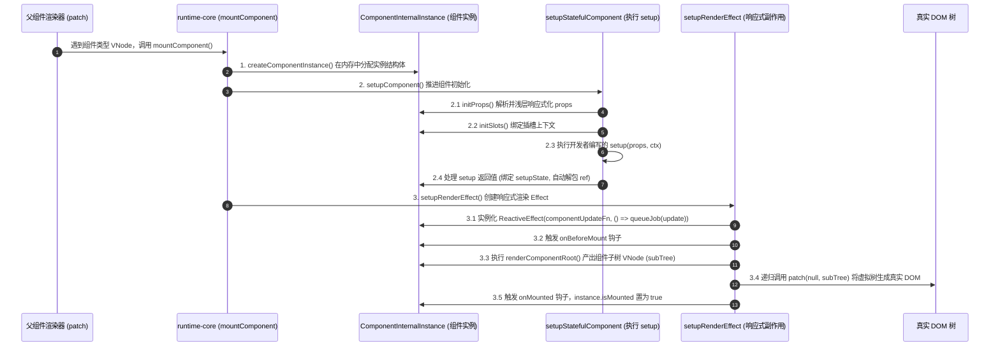

# 组件实例化全时序 setupStatefulComponent 与 renderEffect

在 Vue 3 运行时架构中，从根组件挂载（`app.mount`）或父组件渲染出一个子组件标签开始，Vue 是如何在内存中创建该组件的实例？`setup()` 函数究竟在什么时刻被调用？Props 和 Slots 是如何被挂载到上下文中的？为什么数据变动后组件会自动重新渲染？这一切的底层枢纽，正是 `@vue/runtime-core` 中的 **组件实例化流水线（`createComponentInstance` / `setupStatefulComponent`）** 与 **响应式渲染副作用绑定（`setupRenderEffect`）**。本专题逐行揭秘组件在运行时的完整生命时序。

---

## 架构图谱与实例化全流程时序



---

## 源码级/物理级底层推导

### 1. `createComponentInstance`：内存实例分配

```typescript
export function createComponentInstance(
  vnode: VNode,
  parent: ComponentInternalInstance | null,
  suspense: SuspenseBoundary | null
): ComponentInternalInstance {
  const type = vnode.type as ConcreteComponent
  const appContext = (parent ? parent.appContext : vnode.appContext) || emptyAppContext

  // 构建一个包含数十个核心属性的庞大内部实例上下文
  const instance: ComponentInternalInstance = {
    uid: uid++,
    vnode,
    type,
    parent,
    appContext,
    root: null!,
    next: null,
    subTree: null!,      // 组件内部真正渲染的子树 VNode
    update: null!,       // 关联的 ReactiveEffect 调度更新函数
    scope: new EffectScope(true /* detached */), // 统一的作用域销毁管理
    render: null,        // 编译或手写的 render 渲染函数
    proxy: null,         // 渲染上下文代理 (即模板中的 _ctx)
    
    // 数据上下文
    ctx: EMPTY_OBJ,
    data: EMPTY_OBJ,
    props: EMPTY_OBJ,
    attrs: EMPTY_OBJ,
    slots: EMPTY_OBJ,
    setupState: EMPTY_OBJ, // 开发者 setup() 返回的响应式变量集合
    
    // 生命周期钩子数组链表
    bm: null, // beforeMount
    m: null,  // mounted
    bu: null, // beforeUpdate
    u: null,  // updated
    bum: null,// beforeUnmount
    um: null, // unmounted

    isMounted: false,
    isUnmounted: false,
    isDeactivated: false
  }

  instance.root = parent ? parent.root : instance
  return instance
}
```

---

### 2. `setupStatefulComponent`：执行 `setup()` 核心逻辑

```typescript
function setupStatefulComponent(
  instance: ComponentInternalInstance,
  isSSR: boolean
) {
  const Component = instance.type as ComponentOptions

  // 1. 创建渲染代理上下文 (instance.proxy)，拦截模板中对 this / _ctx 的访问
  instance.proxy = markRaw(new Proxy(instance.ctx, PublicInstanceProxyHandlers))

  // 2. 提取 setup 函数
  const { setup } = Component
  if (setup) {
    // 构造 setup 的第二个入参 SetupContext ({ attrs, slots, emit, expose })
    const setupContext = (instance.setupContext =
      setup.length > 1 ? createSetupContext(instance) : null)

    // 3. 全局设置当前活动实例指针，确保 onMounted() 等生命周期能精准绑定到当前实例！
    setCurrentInstance(instance)
    pauseTracking() // 暂停依赖收集，防止在 setup 执行期间意外收集全局依赖

    // 4. 正式调用开发者的 setup 函数！
    const setupResult = callWithErrorHandling(
      setup,
      instance,
      ErrorCodes.SETUP_FUNCTION,
      [shallowReadonly(instance.props), setupContext]
    )

    resetTracking()
    unsetCurrentInstance()

    // 5. 处理 setup 的返回结果
    handleSetupResult(instance, setupResult)
  } else {
    // 兼容 Vue 2 Options API 的 finishComponentSetup...
  }
}
```

#### `handleSetupResult` 的关键动作：
- 如果 `setupResult` 是一个函数，Vue 判定开发者直接手写了内联渲染函数：`instance.render = setupResult`；
- 如果 `setupResult` 是一个对象，调用 **`proxyRefs(setupResult)`**：
  将对象包装为一个代理，使得模板在访问该对象内部的 `ref` 变量时，**能够自动解包（Unwrap），无需写 `.value`！**

---

### 3. `setupRenderEffect`：响应式驱动视图更新的核心动力源

```typescript
const setupRenderEffect: SetupRenderEffectFn = (
  instance,
  initialVNode,
  container,
  anchor,
  parentSuspense,
  isSVG,
  optimized
) => {
  // 定义核心组件更新函数
  const componentUpdateFn = () => {
    // ================= 首次挂载阶段 (Mounting) =================
    if (!instance.isMounted) {
      const { bm, m } = instance

      // 1. 执行 onBeforeMount 钩子列表
      if (bm) {
        invokeArrayFns(bm)
      }

      // 2. 调用 render 函数生成真实的子树 VNode
      // 在此过程中，render 函数读取了响应式数据，自动将当前的 ReactiveEffect 注册为这些数据的订阅者！
      const subTree = (instance.subTree = renderComponentRoot(instance))

      // 3. 调用底层的 patch 函数，将 VNode 树真正挂载到原生 DOM 上
      patch(null, subTree, container, anchor, instance, parentSuspense, isSVG)
      
      // 真实 DOM 挂载完毕，物理元素指针反向注入到当前组件 VNode 身上
      initialVNode.el = subTree.el

      // 4. 执行 onMounted 钩子列表
      if (m) {
        queuePostRenderEffect(m, parentSuspense)
      }

      instance.isMounted = true
    } 
    // ================= 后续更新阶段 (Updating) =================
    else {
      let { next, bu, u, vnode } = instance

      // 1. 执行 onBeforeUpdate 钩子列表
      if (bu) {
        invokeArrayFns(bu)
      }

      // 2. 重新调用 render 函数产出全新的子树 VNode
      const nextTree = renderComponentRoot(instance)
      const prevTree = instance.subTree
      instance.subTree = nextTree

      // 3. 核心 Diff 比对：对比旧 subTree 与新 nextTree，实施物理 DOM 最小化 Patch 更新！
      patch(prevTree, nextTree, hostParentNode(prevTree.el!)!, hostNextSibling(prevTree.el!)!, instance, parentSuspense, isSVG)

      next ? (next.el = nextTree.el) : (vnode.el = nextTree.el)

      // 4. 执行 onUpdated 钩子列表
      if (u) {
        queuePostRenderEffect(u, parentSuspense)
      }
    }
  }

  // 4. 创建响应式渲染 Effect！绑定调度器 queueJob，将更新任务推入微任务队列合批！
  const effect = (instance.effect = new ReactiveEffect(
    componentUpdateFn,
    () => queueJob(update),
    instance.scope // 关联销毁作用域
  ))

  const update: SchedulerJob = (instance.update = () => effect.run())
  update.id = instance.uid

  // 首次立即同步执行一次，驱动组件挂载！
  update()
}
```

---

## 社招高频硬核连环追问

### 追问 1：为什么生命周期钩子（如 `onMounted`）必须同步写在 `setup()` 顶层？如果写在 `setTimeout` 或异步 `await` 之后会发生什么？

#### 深度剖析
1. **全局单例指针机制（`currentInstance`）**：
   - 当 Vue 调用开发者的 `setup()` 时，它首先在全局执行 `setCurrentInstance(instance)`；
   - 当我们在代码中调用 `onMounted(callback)` 时，`onMounted` 内部做的事情仅仅是：
     ```typescript
     const instance = getCurrentInstance()
     if (instance) {
       instance.m.push(callback) // 把钩子推入当前活动实例的数组中
     } else {
       console.warn('onMounted() 只能在 setup() 内部被调用！')
     }
     ```
   - 当 `setup()` 函数同步执行结束的瞬间，Vue 立即执行 `unsetCurrentInstance()` 将全局指针清空！
2. **异步断层物理根因**：
   - 如果把 `onMounted` 写在 `setTimeout` 或 `await` 之后，当定时器或 Promise 决议恢复执行时，**同步的 `setup()` 早已执行完毕，全局的 `currentInstance` 早已被置为 `null`！**
   - 导致 `onMounted` 根本不知道这个钩子属于哪一个具体的组件实例，直接静默失效并抛出警告。

---

### 追问 2：为什么 Vue 3 组件更新调度队列（`queueJob`）在执行前，必须对所有的 Job 按照 `job.id` 实施升序排序？

#### 深度剖析
在 `flushJobs()` 源码中：
```typescript
queue.sort((a, b) => getId(a) - getId(b))
```
- **核心物理保障（父先子后）**：
  1. 组件的 `uid` 是自增分配的，**父组件必定先于子组件被实例化，因此父组件的 `uid` 一定小于子组件的 `uid`**；
  2. 按照 `id` 从小到大排序，**能够绝对保证父组件先于子组件执行重新渲染更新**；
  3. **消灭死循环与多余更新**：如果父组件重新渲染后，发现子组件已经被销毁（例如父组件根据数据将子组件的 `v-if` 变成了 false），那么排在后面的该子组件更新 Job 可以被直接跳过丢弃，避免了子组件在即将被销毁前还毫无意义地重新渲染一次的资源浪费。

---

## 生产级避坑指南与排障 SOP

### 1. 规避在 `setup()` 中直接执行耗时巨大的同步计算阻塞主线程

- **现象**：在 `<script setup>` 顶层直接解析一个拥有 10 万条记录的本地复杂 JSON 数据。
- **物理成因**：
  `setup()` 的执行是**绝对同步卡死在主线程（Main Thread）中**的。在 `setup()` 执行结束之前，`setupRenderEffect` 根本没有机会被创建，浏览器完全无法进入 DOM 挂载阶段，首屏直接白屏挂死。
- **排障 SOP**：
  大运算量的数据清洗或解析，使用 **Web Worker** 分流到后台线程计算，或者拆分为多个微任务通过时间切片分批加载。
