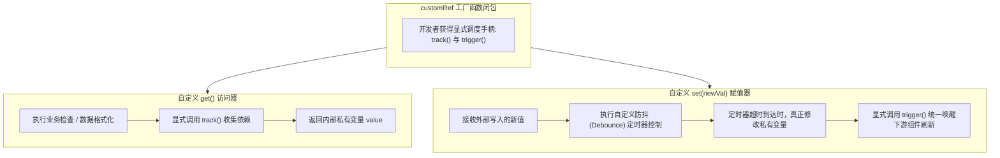
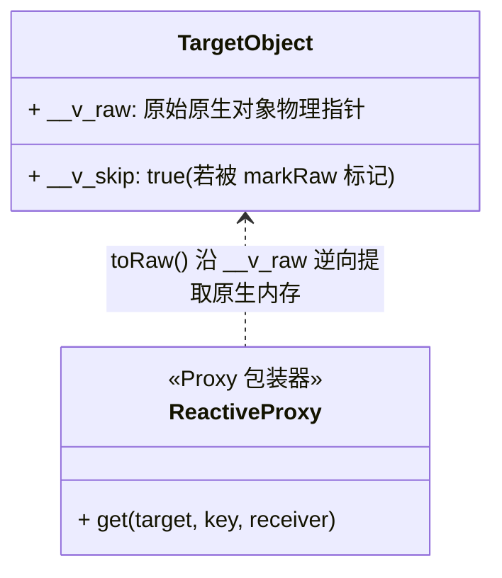

# 自定义响应式 customRef 与 toRaw-markRaw 防御代理

在现代前端复杂工业级开发中，Vue 3 默认开箱即用的深度响应式虽然极大降低了普通业务的心智负担，但在面对“高频输入防抖/节流”、“大型三方类库实例集成（ECharts、Three.js、Monaco Editor）”以及“脱离响应式追踪的高性能运算”时，盲目依赖默认的深度 Proxy 代理极易引发严重的性能雪崩甚至调用栈溢出。Vue 3 提供了 **`customRef` 自定义劫持契约**，以及 **`toRaw` / `markRaw` 代理防御机制**。本专题从底层源码原理到高阶实战展开深度剖析。

---

## 核心底层机制与全景架构

### 1. `customRef`：将依赖收集与派发控制权完全交给开发者

普通 `ref` 严格遵循“读即收集，写即派发”的默认物理时序；而 `customRef` 允许开发者向工厂函数传入一个包含 `track` 和 `trigger` 控制权的回调：



---

### 2. `toRaw` 与 `markRaw` 的物理内存标识系统

Vue 内部通过一套隐式的 Symbol 属性标记（`ReactiveFlags`）来识别对象的代理状态：



- **`toRaw(proxy)`**：沿着代理对象内部私有的 `ReactiveFlags.RAW`（即 `__v_raw`）属性**逆向回溯提取原始对象的物理指针**。对其进行的任何读写操作，完全绕过 Proxy 拦截器，绝不触发任何 `track` 或 `trigger`；
- **`markRaw(obj)`**：在原生对象身上通过 `Object.defineProperty` 注入一个不可枚举属性 `ReactiveFlags.SKIP: true`（即 `__v_skip: true`）。Vue 的 `reactive()` 在尝试代理对象时，一旦读取到该标识，**坚决跳过代理流程，原样直接返回原始对象**。

---

## 源码级/物理级底层推导

### 1. `customRef` 生产级实现：通用防抖 Ref（`useDebouncedRef`）

在搜索建议、表单校验等高频触发场景下，使用防抖 Ref 可以直接在响应式源头杜绝高频触发：

```typescript
import { customRef } from 'vue'

export function useDebouncedRef<T>(initialValue: T, delay: number = 300) {
  let timeoutId: ReturnType<typeof setTimeout> | null = null
  let value = initialValue

  return customRef<T>((track, trigger) => {
    return {
      get() {
        // 显式在读取时收集依赖
        track()
        return value
      },
      set(newValue: T) {
        // 清除上一次尚未到期的定时器
        if (timeoutId) {
          clearTimeout(timeoutId)
        }

        // 延迟触发派发
        timeoutId = setTimeout(() => {
          value = newValue
          // 时间窗口到达，执行真正的 trigger 派发更新
          trigger()
        }, delay)
      }
    }
  })
}
```

---

### 2. `toRaw` 核心源码逐行解析

```typescript
// @vue/reactivity/src/reactive.ts
export const enum ReactiveFlags {
  SKIP = '__v_skip',
  IS_REACTIVE = '__v_isReactive',
  IS_READONLY = '__v_isReadonly',
  RAW = '__v_raw'
}

export function toRaw<T>(observed: T): T {
  // 1. 读取目标对象身上的 __v_raw 标记
  const raw = observed && (observed as any)[ReactiveFlags.RAW]
  // 2. 递归回溯：如果当前对象被多层 Proxy 代理（如 readonly(reactive(obj))），递归脱壳提取真正的底层对象
  return raw ? toRaw(raw) : observed
}
```

#### 关键机制分析
在 `reactive` 的 Proxy 拦截器 `get` 中：
```typescript
function get(target: object, key: string | symbol, receiver: object) {
  if (key === ReactiveFlags.RAW) {
    // 拦截到 __v_raw 访问，直接返回底层的原始 target！
    return target
  }
  // 正常属性访问...
  track(target, key)
  return Reflect.get(target, key, receiver)
}
```

---

### 3. `markRaw` 核心源码逐行解析

```typescript
export function markRaw<T extends object>(value: T): T {
  // 定义不可枚举、不可删除的 __v_skip 属性
  def(value, ReactiveFlags.SKIP, true)
  return value
}

export function def(obj: object, key: string | symbol, value: any) {
  Object.defineProperty(obj, key, {
    configurable: true,
    enumerable: false, // 保证不会被 for...in 或 Object.keys 泄露
    value
  })
}
```

在 `createReactiveObject` 源码中：
```typescript
function createReactiveObject(...) {
  // 如果对象被打上了 __v_skip 标记，或者不是可扩展对象，直接拒绝代理！
  if (target[ReactiveFlags.SKIP] || !Object.isExtensible(target)) {
    return target
  }
  // 创建 Proxy...
}
```

---

## 社招高频硬核连环追问

### 追问 1：为什么将 ECharts、Three.js 或 Leaflet 地图实例存入 `ref` / `reactive` 会导致控制台狂抛 `Maximum call stack size exceeded` 甚至界面卡死？

#### 深度剖析
1. **深度递归代理灾难**：
   - ECharts / Three.js 实例是拥有庞大私有状态、内部事件总线及原型链绑定的复杂 C++/JS 混合类对象；
   - Vue 3 的 `reactive` 和 `ref` 默认是**深度递归响应式**：只要访问某个属性返回的是对象，Vue 就会对其再次套上一层 `Proxy` 代理；
   - 复杂实例内部常常存在**自循环引用（Circular References）**与深度对象嵌套，导致递归代理陷入死循环，引发调用栈溢出（Stack Overflow）；
2. **`this` 物理指向偏离**：
   - 三方库内部方法大量依赖原生私有字段或特定内部符号，一旦被 Proxy 拦截并改变了调用上下文的 `this`，会导致三方库内部断言失败（如 `TypeError: Cannot read private member from an object whose class did not declare it`）。

#### 终极解法
必须使用 **`shallowRef`** 或 **`markRaw`**：
```typescript
// 方案 A: 使用 shallowRef（只代理外层引用）
const chartInstance = shallowRef<echarts.ECharts | null>(null)

// 方案 B: 使用 markRaw 永久豁免响应式代理
const chart = markRaw(echarts.init(domRef.value))
```

---

### 追问 2：既然 `toRaw` 能够拿到原始对象，那直接修改 `toRaw(state).name = 'xxx'` 会发生什么？会有什么生产隐患？

#### 深度剖析
- **物理现象**：
  内存中的数据确实被修改为了 `'xxx'`，**但是页面绝不会产生任何刷新渲染！**
- **底层成因**：
  因为修改直接发生在原始对象物理内存块上，完全绕过了 Proxy 的 `set` 拦截器，`trigger` 根本没有被触发，订阅了该属性的任何组件更新 Effect 都无法被唤醒；
- **生产隐患（状态静默漂移）**：
  这种修改属于“幽灵篡改”。虽然当前界面没动，但下一次当页面因为其他无关变量变动而触发重绘时，这个被偷改的值会突然出现在界面上，导致排查 Bug 极其困难。
- **正规用途**：
  `toRaw` 应该严格用于**只读消费**（如把数据序列化后发送给后端埋点上报、与第三方不兼容 Proxy 的库进行安全数据交互）。

---

## 生产级避坑指南与排障 SOP

### 1. 规避在 `markRaw` 对象内部嵌套响应式数据引发的“假响应式”

- **陷阱场景**：
  ```typescript
  const rawParent = markRaw({
    child: { count: 0 } // 此时整个外层被标记为不可代理
  })
  
  const state = reactive(rawParent) // state 直接返回 rawParent 原生对象
  state.child.count++ // ❌ 页面毫无反应！
  ```
- **排障 SOP**：
  `markRaw` 是**浅层标记**：它阻止了当前对象被 Proxy 代理。如果其内部属性也必须响应式，严禁将外层容器标记为 `markRaw`，应当仅针对末端复杂子节点单独打上 `markRaw`。

---

### 2. 利用 `customRef` 实现持久化双向绑定防抖存储

```typescript
// 自动防抖并同步至 localStorage 的生产级 Hook
export function useStorageDebouncedRef<T>(key: string, defaultValue: T, delay = 400) {
  let timer: ReturnType<typeof setTimeout> | null = null
  
  // 初始化时从本地缓存读取
  const stored = localStorage.getItem(key)
  let value: T = stored ? JSON.parse(stored) : defaultValue

  return customRef<T>((track, trigger) => ({
    get() {
      track()
      return value
    },
    set(newVal) {
      if (timer) clearTimeout(timer)
      timer = setTimeout(() => {
        value = newVal
        localStorage.setItem(key, JSON.stringify(newVal))
        trigger()
      }, delay)
    }
  }))
}
```
