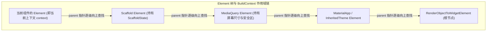
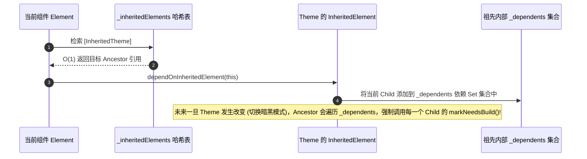

# 中级-BuildContext本质作用域链与Theme-MediaQuery查找机制

在 Flutter 的各种组件构建函数中，`build(BuildContext context)` 是最核心、出现频率最高的签名。但绝大多数初学者对 `BuildContext` 的认知仅停留在“一个普通的上下文参数”。事实上，**`BuildContext` 的物理本质就是 `Element` 树上的节点本身**。深入理解其作用域向上查找机制、`InheritedElement` 依赖注册表，以及 `MediaQuery.of(context)` 引发的重绘灾难与 Flutter 3.7+ 细粒度局部切片治理，是跨入中高级 Flutter 架构的核心分水岭。

---

## 一、核心底层机制与全景架构

### 1.1 `BuildContext` 的物理本质：即 `Element` 接口本身

在 Flutter 框架源码中，`BuildContext` 并不是一个独立存在的实体对象，而是一个**对外部暴露的抽象接口（Abstract Class）**：

```dart
// 源码: packages/flutter/lib/src/widgets/framework.dart
abstract class BuildContext {
  Widget get widget;
  BuildOwner? get owner;
  bool get mounted;
  ...
}

// Element 抽象类直接实现了 BuildContext!
abstract class Element extends DiagnosticableTree implements BuildContext {
  ...
}
```

- **物理结论**：在运行时，开发者拿到的任何 `context`，**本质上就是一个活生生的 `Element` 实例**（例如 `StatelessElement`、`StatefulElement`）。
- **作用域拓扑**：每一个 `Element` 都持有一个指向其父节点的内存指针 `_parent`。因此，通过 `context` 可以无限制地沿着树结构由下而上回溯，查找任意祖先节点的数据、状态或主题。



---

### 1.2 两种树查找 API 的底层物理本质差异

在通过 `context` 查找祖先时，Flutter 提供了两组核心方法，其内部机制与性能表现有着天壤之别：

| 方法签名 | 物理查找机制 | 是否建立响应式依赖？ | 性能与重绘影响 |
| :--- | :--- | :--- | :--- |
| **`findAncestorWidgetOfExactType<T>()`** / `findAncestorStateOfType<T>()` | 从当前 Element 开始，顺着 `_parent` 指针以 $O(N)$ 向上线性遍历，直到找到匹配类型节点 | **否（单次单向读取）**。祖先发生变化时，**绝对不会**通知当前组件重新构建 | 遍历耗时极低，常用于一次性读取父级状态或调用父级方法（如打开抽屉） |
| **`dependOnInheritedWidgetOfExactType<T>()`**（如 `Theme.of(context)` / `MediaQuery.of(context)`） | 直接从当前 Element 内部维护的 `_inheritedElements` 哈希表中以 **$O(1)$** 极速命中目标 `InheritedElement` | **是（注册双向依赖关系）**。祖先 `InheritedWidget` 数据变更时，**必定强制触发当前组件的 `build()` 重新执行** | 频繁滥用会导致海量不相关的子组件被无意义级联全量重绘！ |

---

## 二、源码级/算法物理推导

### 2.1 `dependOnInheritedWidgetOfExactType` 依赖注册时序

当在组件中执行 `Theme.of(context)` 时，底层执行了严格的依赖收集：

```dart
// packages/flutter/lib/src/widgets/framework.dart
T? dependOnInheritedWidgetOfExactType<T extends InheritedWidget>({Object? aspect}) {
  // 1. 从当前 Element 快速哈希检索目标 InheritedElement
  final InheritedElement? ancestor = _inheritedElements?[T];
  if (ancestor != null) {
    // 2. 将当前 Element 注册到祖先的依赖观察者列表集合中!
    return dependOnInheritedElement(ancestor, aspect: aspect) as T;
  }
  return null;
}
```



---

### 2.2 `MediaQuery.of(context)` 重绘灾难与 Flutter 3.7+ 细粒度局部切片

在旧版 Flutter 中，只要在组件中书写了 `final size = MediaQuery.of(context).size;`：
- 当前组件不仅对“屏幕宽高”建立了依赖；
- 更致命的是，它对整个庞大的 `MediaQueryData` 建立了**全量无差别依赖**！
- **重绘风暴**：当用户在手机底部弹起软键盘（`viewInsets.bottom` 发生改变），哪怕当前页面的物理屏幕宽度 `size.width` **完全没有发生一丁点改变**，所有使用了 `MediaQuery.of(context)` 的组件都会被强制全量 `rebuild()`，引发严重的键盘弹起卡顿！

#### Flutter 3.7+ 细粒度属性切片（Aspects API）源码革命
为了根治该痛点，Flutter 官方重构了 `MediaQuery`，引入了局部切片 API：

```dart
// 传统大锅饭写法: 依赖整个 MediaQueryData，任何细微变化 (键盘、旋转、安全区) 均触发整树重绘!
final width = MediaQuery.of(context).size.width;

// ✅ 现代生产级细粒度切片: 仅当屏幕 size 物理改变时才触发当前组件重绘!
final width = MediaQuery.sizeOf(context).width;

// ✅ 仅监听软键盘高度改变:
final keyboardHeight = MediaQuery.viewInsetsOf(context).bottom;

// ✅ 仅监听刘海屏安全区域改变:
final padding = MediaQuery.paddingOf(context);
```

---

## 三、社招高频硬核连环追问

### 追问 1：为什么说 `BuildContext` 绝对不能在跨越了 `await` 异步等待的代码段后直接盲目使用？怎么彻底防御？
**标杆解答**：
1. **脱钩与生命周期失效（Deactivated Context）**：
   - 用户发起了一个耗时 2 秒的异步请求：`final user = await api.login();`；
   - 在等待期间，用户关闭了当前页面，当前 `Element` 触发 `unmount()` 并被从整棵 UI 树中彻底移除；
   - 异步任务完成后，代码直接执行：`Navigator.of(context).pushNamed(...)` 或 `ScaffoldMessenger.of(context).showSnackBar(...)`；
   - 此时捕获的 `context`（即那个已死的 Element）已经脱钩，其 `_parent` 为空，向上寻址完全找不到 Navigator，直接抛出未捕获异常：`Looking up a deactivated widget's ancestor is unsafe.`。
2. **彻底防御规范（Flutter 3.7+ 原生支持）**：
   - 异步恢复后，**必须第一行显式校验 `if (!context.mounted) return;`**：
     ```dart
     Future<void> submit() async {
       await api.doHeavyTask();
       // 关键防护: 校验当前上下文是否仍然存活在树上
       if (!context.mounted) return;
       Navigator.of(context).pop();
     }
     ```

---

### 追问 2：为什么有时候在 `Scaffold` 内部通过 `Scaffold.of(context)` 查找父级会抛出异常，而封装成一个子组件或使用 `Builder` 后就正常了？
**标杆解答**：
1. **作用域起点物理偏差（Scope Starting Point）**：
   - 观察如下错误代码：
     ```dart
     Widget build(BuildContext context) {
       return Scaffold(
         body: ElevatedButton(
           onPressed: () => Scaffold.of(context).openDrawer(), // ❌ 抛错！
           child: const Text('打开'),
         ),
       );
     }
     ```
   - 此时传入给 `Scaffold.of(context)` 的 `context` 是当前页面 `build(context)` 处的上下文；
   - 从该 `context` 对应的 Element 顺着 `_parent` 向上查找时，由于当前 Element 处于 `Scaffold` 的上方或同级，**根本找不到下方刚刚初始化的 `ScaffoldElement`**！
2. **`Builder` 的物理作用**：
   - `Builder` 组件在底层并没有复杂的逻辑，它唯一的物理职责就是**在 Element 树中插入一个新的子节点，并将其自身的子级 `BuildContext` 抛给回调函数**：
     ```dart
     body: Builder(
       builder: (scaffoldContext) {
         // 这里的 scaffoldContext 位于 Scaffold 节点下方，向上查找 100% 成功！
         return ElevatedButton(
           onPressed: () => Scaffold.of(scaffoldContext).openDrawer(),
           child: const Text('打开'),
         );
       },
     )
     ```

---

### 追问 3：`findAncestorStateOfType` 和 `findAncestorWidgetOfExactType` 在性能和安全性上有何本质差异？
**标杆解答**：
1. **获取的目标对象类型不同**：
   - `findAncestorWidgetOfExactType<T>`：获取的是不可变的 **`Widget` 配置对象**；
   - `findAncestorStateOfType<T>`：获取的是长期常驻内存的 **`State` 状态逻辑实例**。
2. **安全性与架构破局**：
   - 直接读取并调用祖先 `State` 的公开方法（如 `parentState.updateUser()`）虽然方便，但属于典型的**高内聚强耦合反模式**，容易破坏单向数据流；
   - 生产环境中，跨组件方法调用应当优先通过回调函数（Callbacks）、状态管理（Bloc / Riverpod）或通知模型（`NotificationListener`）解耦。

---

## 四、生产级避坑指南与排障 SOP

### 4.1 生产级响应式屏幕自适应卡片（基于细粒度 `MediaQuery.sizeOf` 优化）

在构建响应式网格布局时，避免使用旧版 `MediaQuery.of(context)`，全面拥抱细粒度切片以杜绝软键盘弹起引起的冗余重绘：

```dart
import 'package:flutter/material.dart';

class ResponsiveMetricCard extends StatelessWidget {
  final String title;
  final String value;

  const ResponsiveMetricCard({
    super.key,
    required this.title,
    required this.value,
  });

  @override
  Widget build(BuildContext context) {
    // 关键优化: 仅当屏幕宽度物理发生改变时，本组件才重新 build
    // 键盘弹起、通知栏缩放完全不会引起此处的冗余重绘!
    final screenWidth = MediaQuery.sizeOf(context).width;
    final isTablet = screenWidth > 600;

    return Container(
      padding: EdgeInsets.all(isTablet ? 24.0 : 16.0),
      decoration: BoxDecoration(
        color: Colors.white,
        borderRadius: BorderRadius.circular(12.0),
        boxShadow: [
          BoxShadow(
            color: Colors.black.withOpacity(0.05),
            blurRadius: 10,
            offset: const Offset(0, 4),
          ),
        ],
      ),
      child: Column(
        crossAxisAlignment: CrossAxisAlignment.start,
        children: [
          Text(
            title,
            style: TextStyle(
              fontSize: isTablet ? 16 : 13,
              color: const Color(0xFF64748B),
              fontWeight: FontWeight.w500,
            ),
          ),
          const SizedBox(height: 8),
          Text(
            value,
            style: TextStyle(
              fontSize: isTablet ? 32 : 24,
              color: const Color(0xFF0F172A),
              fontWeight: FontWeight.bold,
            ),
          ),
        ],
      ),
    );
  }
}
```
