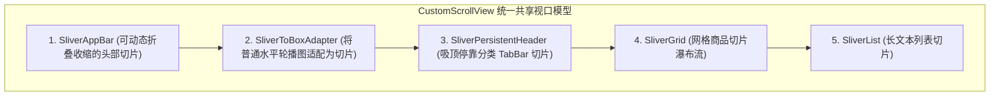
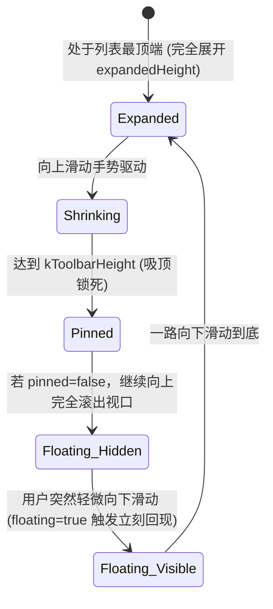

# 中级-CustomScrollView与Sliver视口系统高级折叠滑动实战

在移动端高品质应用（如高德地图个人主页、美团外卖商家页、小红书个人中心）中，头部背景图随下拉视差放大、向上滑动渐隐并吸顶折叠、中间紧跟分类 TabBar 吸顶停靠、下方联动无缝分页列表的复杂滑动交互比比皆是。如果使用传统的 `SingleChildScrollView` 或普通的 `ListView`，完全无法实现跨区域的无缝动量传递与吸顶交互。Flutter 引入了底层基于切片视口协议的 **`CustomScrollView`** 与 **`Sliver` 体系**。本篇专题深入剖析 Sliver 视口物理约束协议、`SliverAppBar` 状态机，以及 `NestedScrollView` 嵌套滑动协调机制。

---

## 一、核心底层机制与全景架构

### 1.1 什么是 Sliver？单一共享视口（Viewport）全景模型

在 Flutter 中，“普通 Box 组件（如 Container、Padding）”与“Sliver 组件”属于完全不同的两个几何渲染世界：
- **普通 RenderBox 协议**：基于笛卡尔二维坐标系（接收 `BoxConstraints`，输出确定性的 `Size` 宽高）；
- **Sliver 协议（切片流协议）**：专门针对滚动视口设计。Sliver 不再关注整体长宽，而是关注**滚动切片（Slices）**：接收视口传递的 **`SliverConstraints`（包含当前滚动偏移量 `scrollOffset`、剩余可见区域 `remainingPaintExtent`）**，并返回 **`SliverGeometry`（包含当前切片的真实排版长度、绘制长度与滚动消耗量）**。

`CustomScrollView` 将所有的 Sliver 统一纳入**单一共同的视口（Viewport）**中，所有子切片共享同一套滚动动量（Velocity）与偏移量，从而实现无缝平滑连贯的复杂物理滚动。



---

### 1.2 核心 Sliver 组件家族对照表

| Sliver 组件 | 物理职责与特性 | 典型业务场景 |
| :--- | :--- | :--- |
| **`SliverAppBar`** | 具备高度伸缩、视差背景、吸顶停靠能力的超级头部 | 个人主页、视频详情页、动态详情页大图展开展平 |
| **`SliverToBoxAdapter`** | **桥接适配器**。将一个普通的二维 `RenderBox`（如 Container）安全包裹转为一个符合切片协议的 Sliver | 在切片流中插入单体普通的广告横幅（Banner）或搜索栏 |
| **`SliverList`** | 类似 `ListView.builder` 的切片版本，支持虚拟化懒加载 | 切片流中的主纵向信息流列表 |
| **`SliverGrid`** | 类似 `GridView.builder` 的切片版本，支持按需网格排版 | 电商双列商品推荐卡片 |
| **`SliverPersistentHeader`** | 允许开发者完全自定义常驻/吸顶效果的通用切片容器 | 页面滑动到中间时，Tab 栏到达顶部瞬间**死死吸附在屏幕最上端** |

---

## 二、源码级/算法物理推导

### 2.1 `SliverAppBar` 核心参数状态机矩阵推导

`SliverAppBar` 的动态表现由三大布尔标志位进行微观物理控制：

| 参数配置组合 | 物理行为与表现 | 交互手感与视觉状态机 |
| :--- | :--- | :--- |
| **`pinned: true`** | **吸顶锁定** | 向上滑动时，内容滚过，但 AppBar 缩减到 `kToolbarHeight`（标准高度 56px）后，**永远常驻在视口最顶部，绝不滚出屏幕** |
| **`floating: true`** | **浮动响应** | 列表即使已经滚到了第 1000 行，**只要用户手指向下拉动 1 像素，AppBar 立刻立刻从顶部浮现滑出**（无需一路滑回顶部） |
| **`floating: true` + `snap: true`** | **瞬时抽风吸附** | 结合 `floating`，用户往下拉动轻微距离，AppBar 不再随手指线性移动，而是**以轻快的弹性动画整块瞬间全部展开** |



---

### 2.2 `NestedScrollView` 双视口手势协调器（Coordinator）原理

当在一个带有复杂头部的页面中，下方需要嵌套一个包含多个 Tab（例如：收藏、动态、喜欢）且每个 Tab 内部都是独立 `ListView` 的 `TabBarView` 时，普通的 `CustomScrollView` 无法嵌套，必须采用 **`NestedScrollView`**。

#### 底层物理机制
`NestedScrollView` 在内部实例化了一个强大的控制器——**`_NestedScrollCoordinator`**，它同时管理两套独立的视口：
1. **Outer ScrollView（外层视口）**：负责管理包含 `SliverAppBar` 和吸顶 `TabBar` 的外层框架；
2. **Inner ScrollView（内层视口）**：负责管理当前激活 Tab 内部的真实列表数据滚动；
3. **动量连贯传递**：当用户手指在屏幕上快速滑动时，协调器会优先将滚动位移消耗在 Outer 视口（先把头部折叠收起）；当头部完全折叠达到临界点后，协调器会将剩余未消耗的动量瞬间**无缝注入内层 Inner 视口**继续滚动子列表，反向同理。

---

## 三、社招高频硬核连环追问

### 追问 1：为什么把一个普通的 `Container` 或 `Padding` 直接放进 `CustomScrollView.slivers` 数组中会直接报致命红屏崩溃？底层原因是什么？
**标杆解答**：
1. **渲染协议不兼容（RenderProtocol Violation）**：
   - `CustomScrollView` 底层对应的渲染对象是 `RenderViewport`，其内部的 `visitChildren` 和 `performLayout` 强制要求所有的直接子节点必须是 **`RenderSliver`**（实现 Sliver 布局协议）；
   - 普通的 `Container` 底层对应的是 `RenderDecoratedBox` 或 `RenderPadding`，它们只实现了 `RenderBox` 布局协议；
   - 框架在断言阶段直接崩溃：`A RenderBox was placed in a position where a RenderSliver was expected.`。
2. **正确解法**：
   - 必须使用适配器将其转换包裹：
     ```dart
     SliverToBoxAdapter(
       child: Container(height: 100, color: Colors.blue),
     )
     ```

---

### 追问 2：在 `NestedScrollView` 内部，当子页面的 `ListView` 向上滚动时，为什么有时候头部折叠了但 Tab 栏却发生“两头扯皮、滑动断层卡死”的手势冲突？怎么规范治理？
**标杆解答**：
1. **未通知外层协调器的物理陷阱**：
   - 每个子 Tab 内部的 `ListView` 默认都会自带一个独立的 `PrimaryScrollController`；
   - 如果开发者没有将内层列表与外层协调器连接起来，内层列表会认为自己独占了全部手势，开始抢夺滑动事件，导致外层头部无法感知滚动，产生严重抽搐。
2. **规范治理 SOP**：
   - 子列表**绝对严禁**自己创建独立的 `controller`；
   - 子列表必须使用外部环境提供的通知链条，或者显式指定内层列表的上下文不截断冒泡；最推荐在 `NestedScrollView` 的 `body` 中使用官方推荐的标准结构配合 `SliverOverlapAbsorber` 与 `SliverOverlapInjector` 处理尺寸补偿。

---

### 追问 3：`SliverPersistentHeader` 的 `pinned` 与 `floating` 模式下，自定义 Delegate 中 `maxExtent` 和 `minExtent` 扮演了什么几何物理角色？
**标杆解答**：
1. **高度约束上下界（Extent Bounds）**：
   - `maxExtent`：切片处于完全展开状态时的最大物理高度（如 200px）；
   - `minExtent`：切片被压缩折叠到极限后的最小常驻高度（如 56px）。
2. **动态插值因子 `shrinkOffset`**：
   - 在 Delegate 的 `build(context, shrinkOffset, overlapsContent)` 回调中：
     - `shrinkOffset` 代表当前切片已经被向上压缩收缩了多少物理像素（范围：`0.0 ~ (maxExtent - minExtent)`）；
     - 开发者可以利用 `shrinkOffset / (maxExtent - minExtent)` 计算出平滑的归一化百分比 `progress (0.0 ~ 1.0)`，进而轻松实现**标题从无到有的渐显透明度（Opacity）、背景图片的高斯模糊度（Blur）或头像从大到小的缩放动画**。

---

## 四、生产级避坑指南与排障 SOP

### 4.1 生产级电商详情页高级实战：视差大图折叠 + 标题吸顶 + 混排瀑布流

```dart
import 'package:flutter/material.dart';

class ParallaxStoreProfileScreen extends StatelessWidget {
  const ParallaxStoreProfileScreen({super.key});

  @override
  Widget build(BuildContext context) {
    return Scaffold(
      body: CustomScrollView(
        physics: const BouncingScrollPhysics(), // 弹性触底回弹
        slivers: [
          // 1. 高级伸缩折叠头部 SliverAppBar
          SliverAppBar(
            pinned: true,             // 向上滑动后吸顶停靠
            expandedHeight: 240.0,    // 展开时的最大物理高度
            backgroundColor: const Color(0xFF1E293B),
            leading: IconButton(
              icon: const Icon(Icons.arrow_back_ios_new, color: Colors.white),
              onPressed: () {},
            ),
            actions: [
              IconButton(
                icon: const Icon(Icons.share, color: Colors.white),
                onPressed: () {},
              ),
            ],
            // 视差伸缩内容
            flexibleSpace: FlexibleSpaceBar(
              title: const Text(
                '超级旗舰数码店',
                style: TextStyle(
                  color: Colors.white,
                  fontWeight: FontWeight.bold,
                  fontSize: 16.0,
                ),
              ),
              centerTitle: true,
              background: Stack(
                fit: StackFit.expand,
                children: [
                  // 背景大图
                  Image.network(
                    'https://images.unsplash.com/photo-1550745165-9bc0b252726f?w=800',
                    fit: BoxFit.cover,
                  ),
                  // 暗色防吃色渐变蒙层
                  DecoratedBox(
                    decoration: BoxDecoration(
                      gradient: LinearGradient(
                        begin: Alignment.topCenter,
                        end: Alignment.bottomCenter,
                        colors: [
                          Colors.black.withOpacity(0.4),
                          Colors.black.withOpacity(0.8),
                        ],
                      ),
                    ),
                  ),
                ],
              ),
            ),
          ),

          // 2. 普通二维组件通过适配器嵌入切片流 (店铺统计面板)
          SliverToBoxAdapter(
            child: Container(
              padding: const EdgeInsets.all(16.0),
              margin: const EdgeInsets.all(16.0),
              decoration: BoxDecoration(
                color: Colors.white,
                borderRadius: BorderRadius.circular(12.0),
                boxShadow: [
                  BoxShadow(
                    color: Colors.black.withOpacity(0.04),
                    blurRadius: 10,
                  ),
                ],
              ),
              child: const Row(
                mainAxisAlignment: MainAxisAlignment.spaceAround,
                children: [
                  _MetricItem(label: '商品总数', value: '1,280'),
                  _MetricItem(label: '月销量', value: '5.8 万'),
                  _MetricItem(label: '粉丝数', value: '24.6 万'),
                  _MetricItem(label: '好评率', value: '99.8%'),
                ],
              ),
            ),
          ),

          // 3. 切片网格热卖商品瀑布流 (SliverGrid)
          SliverPadding(
            padding: const EdgeInsets.symmetric(horizontal: 16.0),
            sliver: SliverGrid(
              gridDelegate: const SliverGridDelegateWithFixedCrossAxisCount(
                crossAxisCount: 2,        // 双列商品
                mainAxisSpacing: 12.0,
                crossAxisSpacing: 12.0,
                childAspectRatio: 0.75,   // 宽高比
              ),
              delegate: SliverChildBuilderDelegate(
                (context, index) {
                  return Container(
                    decoration: BoxDecoration(
                      color: Colors.white,
                      borderRadius: BorderRadius.circular(8.0),
                      border: Border.all(color: const Color(0xFFE2E8F0)),
                    ),
                    child: Column(
                      crossAxisAlignment: CrossAxisAlignment.start,
                      children: [
                        Expanded(
                          child: Container(
                            decoration: BoxDecoration(
                              color: Colors.grey.shade100,
                              borderRadius: const BorderRadius.vertical(top: Radius.circular(8)),
                            ),
                            child: const Center(child: Icon(Icons.laptop_chromebook, size: 40)),
                          ),
                        ),
                        Padding(
                          padding: const EdgeInsets.all(8.0),
                          child: Column(
                            crossAxisAlignment: CrossAxisAlignment.start,
                            children: [
                              Text('精品高端数码商品 #$index', maxLines: 1, overflow: TextOverflow.ellipsis),
                              const SizedBox(height: 4),
                              Text('¥${(index + 1) * 199}', style: const TextStyle(color: Colors.red, fontWeight: FontWeight.bold)),
                            ],
                          ),
                        ),
                      ],
                    ),
                  );
                },
                childCount: 20, // 20 件商品
              ),
            ),
          ),

          // 底部留白垫高
          const SliverToBoxAdapter(child: SizedBox(height: 32)),
        ],
      ),
    );
  }
}

class _MetricItem extends StatelessWidget {
  final String label;
  final String value;
  const _MetricItem({required this.label, required this.value});

  @override
  Widget build(BuildContext context) {
    return Column(
      children: [
        Text(value, style: const TextStyle(fontWeight: FontWeight.bold, fontSize: 16)),
        const SizedBox(height: 4),
        Text(label, style: const TextStyle(color: Colors.grey, fontSize: 11)),
      ],
    );
  }
}
```
