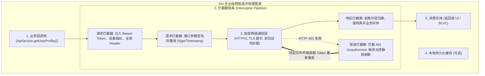
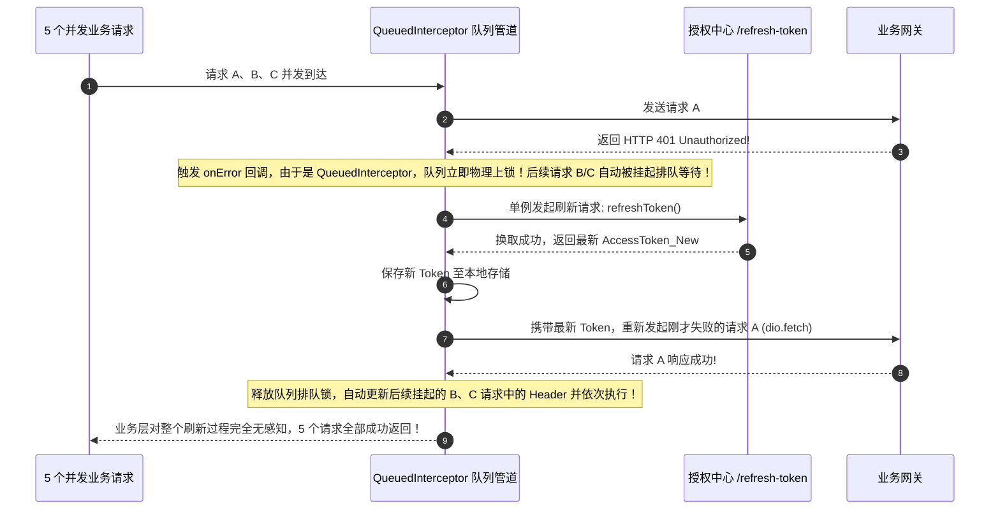

# 中级-Dio企业级网络层封装拦截器Token无感刷新与取消请求

在移动端高并发与弱网环境下，HTTP 网络请求层是直接决定应用可用性、数据安全性与用户交互稳定性的中枢神经系统。虽然 Dart 原生提供了 `dart:io` 的 `HttpClient`，但其缺乏拦截器扩展、请求重试、取消机制与统一序列化能力。**`Dio`** 已成为 Flutter 跨平台开发的工业界标准网络库。本篇专题深入剖析三级拦截器物理流水线、基于 `QueuedInterceptor` 的 JWT 双 Token 无感刷新状态机，以及 `CancelToken` 绑定生命周期防错实战。

---

## 一、核心底层机制与全景架构

### 1.1 企业级网络客户端分层架构全景



---

### 1.2 普通 `Interceptor` vs `QueuedInterceptor` 物理差异

在处理 Token 过期刷新时，初学者最常犯的错误就是使用普通的 `Interceptor`，导致灾难性的“Token 击穿”：

| 拦截器类型 | 并发请求处理机理 | 适用场景 |
| :--- | :--- | :--- |
| **`Interceptor`** (普通拦截器) | **全并发无阻断**。所有请求和响应各自独立穿透，拦截器无法锁死队列 | 常规日志打印、参数添加、普通业务状态码转换 |
| **`QueuedInterceptor`** (队列化互斥拦截器) | **原子化队列排队锁**。当其中一个请求触发了刷新操作时，**底层会自动阻断并挂起后续所有并发请求**，直到刷新完成释放锁后才依次批量重发 | **JWT 双 Token 无感静默刷新、全局密钥动态交换的必备唯一选择** |

---

## 二、源码级/算法物理推导

### 2.1 JWT 双 Token 无感刷新与请求重发状态机

当客户端同时并发向服务端发起了 5 个网络请求（如进入首页同时拉取轮播图、用户信息、推荐列表、未读通知、配置字典）：
- 此时用户本地的 Access Token 恰好过期（服务端返回 HTTP 401）；
- **如果使用普通拦截器**：5 个请求会同时检测到 401，导致客户端同时向授权中心并发调用 5 次 `/refresh-token` 换 Token 接口，造成服务端鉴权锁竞争与 Token 覆盖失效！
- **基于 `QueuedInterceptor` 的状态机流转**：



---

### 2.2 `CancelToken` 绑定组件生命周期底层机理

在移动端，当用户打开一个耗时页面发起了一个大请求，随即点击退出返回上一页：
- 如果没有主动取消网络请求，底层 Socket 连接会持续传输数据，浪费带宽；
- 异步数据返回后，页面可能已执行 `dispose()`，甚至引发未捕获异常。

#### `CancelToken` 物理实现
`CancelToken` 内部维护了一个 `Completer<DioException>`：
```dart
class CancelToken {
  Completer<DioException>? _completer;
  
  void cancel([Object? reason]) {
    _completer?.complete(DioException(type: DioExceptionType.cancel, ...));
  }
}
```
当调用 `cancelToken.cancel()` 时，Dio 底层会直接**强制关闭当前 HTTP 请求的底座 Socket 管道，立即释放底层网络通道与内存缓冲区**。

---

## 三、社招高频硬核连环追问

### 追问 1：在开发与联调阶段，如何让 Flutter 的 Dio 成功通过 Charles 或 Fiddler 进行 HTTP/HTTPS 抓包？
**标杆解答**：
1. **Flutter 不走系统代理的物理诱因**：
   - 与原生 Android/iOS 不同，Flutter 的底层网络请求基于 Dart 运行时的 `HttpClient`；
   - **Dart VM 默认完全忽略操作系统设置的 Wi-Fi HTTP 代理配置**，因此直接配置手机代理在抓包软件中空空如也。
2. **两步工业级抓包配置 SOP**：
   - **第一步：在底层 `HttpClientAdapter` 中手动设置代理物理 IP 与端口**；
   - **第二步：配置 `badCertificateCallback` 信任抓包软件的自签名根证书（仅在 Debug 模式开启）**：
   ```dart
   if (kDebugMode) {
     final adapter = dio.httpClientAdapter as IOHttpClientAdapter;
     adapter.createHttpClient = () {
       final client = HttpClient();
       // 1. 强制走电脑端抓包代理
       client.findProxy = (uri) => 'PROXY 192.168.1.100:8888';
       // 2. 信任 Charles / Fiddler 伪造的中间人 HTTPS 证书
       client.badCertificateCallback = (cert, host, port) => true;
       return client;
     };
   }
   ```

---

### 追问 2：为什么生产环境严禁将 `client.badCertificateCallback = (cert, host, port) => true;` 发布上线？怎么彻底防御中间人攻击？
**标杆解答**：
1. **中间人攻击（MITM Attack）致命漏洞**：
   - 如果在线上代码中无条件信任所有证书，黑客只需在公共 Wi-Fi 环境中部署伪造的代理服务器，即可零成本解密并篡改当前 App 与服务端交互的全部报文（明文窃取银行卡、密码与 Token）；
2. **彻底防御规范**：
   - 抓包信任逻辑**必须使用 `kDebugMode` 宏严格隔离**；
   - 高安全要求金融类应用，必须采用 **SSL/TLS 证书物理锁定（Certificate Pinning）**：在本地资产中内置服务端的公钥证书哈希（SHA-256），每次 TLS 握手时强制比对公钥指纹，不一致直接熔断连接。

---

## 四、生产级避坑指南与排障 SOP

### 4.1 企业级 Dio 网络请求客户端单例全景实战代码

包含单例工厂、全局超时、日志拦截器、基于 `QueuedInterceptor` 的双 Token 无感静默刷新完整闭环：

```dart
import 'package:dio/dio.dart';
import 'package:flutter/foundation.dart';

// 统一业务返回数据模型
class ApiResponse<T> {
  final int code;
  final String message;
  final T? data;
  final bool isSuccess;

  const ApiResponse({
    required this.code,
    required this.message,
    this.data,
    required this.isSuccess,
  });
}

class HttpService {
  // 单例模式
  static final HttpService _instance = HttpService._internal();
  factory HttpService() => _instance;

  late final Dio _dio;

  HttpService._internal() {
    _dio = Dio(
      BaseOptions(
        baseUrl: 'https://api.mycompany.com/v1',
        connectTimeout: const Duration(seconds: 10),
        receiveTimeout: const Duration(seconds: 10),
        sendTimeout: const Duration(seconds: 10),
        headers: {'Content-Type': 'application/json'},
      ),
    );

    // 注入拦截器
    _dio.interceptors.add(_AuthAndTokenRefreshInterceptor(_dio));

    if (kDebugMode) {
      _dio.interceptors.add(
        LogInterceptor(requestBody: true, responseBody: true),
      );
    }
  }

  Dio get client => _dio;
}

// 核心: 生产级 QueuedInterceptor 实现双 Token 无感静默刷新
class _AuthAndTokenRefreshInterceptor extends QueuedInterceptor {
  final Dio dio;
  _AuthAndTokenRefreshInterceptor(this.dio);

  String? _accessToken = 'expired_mock_token';
  String? _refreshToken = 'valid_refresh_token_123';

  @override
  void onRequest(RequestOptions options, RequestInterceptorHandler handler) {
    // 1. 请求发出前注入最新的 Access Token
    if (_accessToken != null) {
      options.headers['Authorization'] = 'Bearer $_accessToken';
    }
    handler.next(options);
  }

  @override
  Future<void> onError(DioException err, ErrorInterceptorHandler handler) async {
    // 2. 拦截 HTTP 401 Unauthorized
    if (err.response?.statusCode == 401 && _refreshToken != null) {
      debugPrint('[Auth]: 检测到 Access Token 过期，队列已上锁，正在执行无感静默刷新...');

      try {
        // 创建独立的无拦截器 Dio 实例，防止循环拦截
        final tokenDio = Dio(BaseOptions(baseUrl: dio.options.baseUrl));
        
        final response = await tokenDio.post(
          '/auth/refresh',
          data: {'refreshToken': _refreshToken},
        );

        if (response.statusCode == 200) {
          // 3. 换取成功，持久化更新内存与本地
          _accessToken = response.data['accessToken'];
          _refreshToken = response.data['refreshToken'];

          // 4. 更新原请求的 Header
          final originOptions = err.requestOptions;
          originOptions.headers['Authorization'] = 'Bearer $_accessToken';

          // 5. 重新发起原请求并返回成功响应
          final retryResponse = await dio.fetch(originOptions);
          debugPrint('[Auth]: 无感刷新重发成功！');
          return handler.resolve(retryResponse);
        }
      } catch (refreshErr) {
        debugPrint('[Auth]: Refresh Token 也已过期失效，强制清空登录态并跳转登录页！');
        _accessToken = null;
        _refreshToken = null;
        // 触发全局登出事件
      }
    }

    // 其它错误正常透传
    handler.next(err);
  }
}
```
