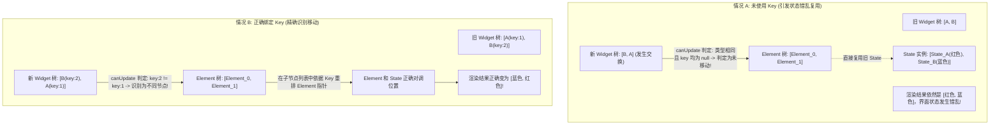
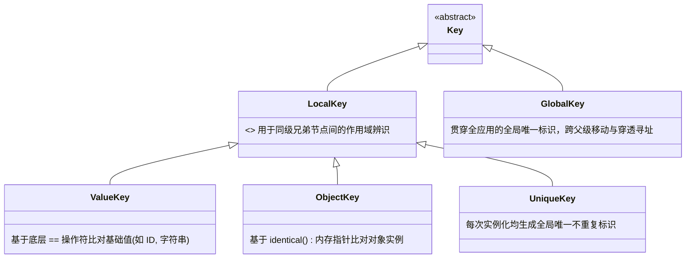

# 中级-Flutter中的Key机制ValueKey-ObjectKey与GlobalKey物理应用

在 Flutter 的声明式 UI 架构中，初学者在做静态展示页面时，几乎感受不到 `Key` 的存在；但一旦进入动态列表（如拖拽排序、滑动删除、表单交换），未正确使用 Key 就会引发灾难性的**“状态张冠李戴”错乱 Bug**（例如：删除了第一行的待办事项，结果第一行的输入框文字依然留在屏幕上，第三行的复选框反而被勾选）。本篇专题深入剖析 `Widget.canUpdate` 底层比对算法、局部 Key 与全局 Key 的物理分类，以及利用 `GlobalKey` 测量全局物理坐标的高级实战。

---

## 一、核心底层机制与全景架构

### 1.1 为什么需要 Key？状态错位物理机理推导

当一个父容器内部包含多个**同级、同类型**的 `StatefulWidget` 时：
- **无 Key 的悲剧**：
  假设列表中有两个有状态组件 `[ItemA(色块:红), ItemB(色块:蓝)]`，每个组件内部的 `State` 维护了一个自己的颜色。
  当点击按钮将两项位置对调，变为 `[ItemB, ItemA]` 并调用 `setState()`；
  Element 树在对比新旧 Widget 树时，调用静态方法：
  ```dart
  static bool canUpdate(Widget oldWidget, Widget newWidget) {
    return oldWidget.runtimeType == newWidget.runtimeType && oldWidget.key == newWidget.key;
  }
  ```
  此时由于两者都没有 Key（`key == null`），且类型完全相同（`ItemWidget == ItemWidget`），Element 树会**误判为节点未发生改变，直接原地复用现有的 Element 和旧的 State 实例**！结果屏幕上的颜色完全没有对调，数据与界面产生严重脱节！



---

### 1.2 Key 的完整继承体系与分类



---

## 二、源码级/算法物理推导

### 2.1 局部 Key（LocalKey）三大核心选型物理推导

#### 1. `ValueKey<T>`
- **比对机制**：基于 `operator ==` 对传入的值进行比对。
- **最佳场景**：列表项拥有**确定性且唯一的业务主键**（如用户的 `userId`、订单的 `orderNo`、数据库行记录的主键 ID）：
  ```dart
  ItemWidget(key: ValueKey(item.id))
  ```

#### 2. `ObjectKey`
- **比对机制**：基于对象的身份引用进行比对（类似于 `identical(a, b)`）。
- **最佳场景**：数据模型没有显式的独立 ID，但对象本身的物理内存地址在当前列表内唯一。

#### 3. `UniqueKey`
- **比对机制**：每一次调用 `UniqueKey()`，内部都会创建一个完全不等于任何历史对象的全新唯一实例。
- **注意禁忌**：**绝对严禁直接在 `build()` 方法内部执行 `key: UniqueKey()`**！因为每次重新构建都会生成新的 Key，导致该组件的 Element 和 State 在每一次刷新时被强制全部销毁并重新初始化，造成性能灾难与内部状态丢失。

---

### 2.2 `GlobalKey` 底层注册表与跨父级 Element 复用

`GlobalKey` 是整个 Flutter 框架中开销最大、能力最强悍的 Key。

#### 底层物理机制
1. **全局单例注册表（GlobalKey Registry）**：
   在全局构建调度器 `BuildOwner` 中，维护了一个全局哈希表 `Map<GlobalKey, Element> _globalKeyRegistry`；
2. **跨父级无损移动（Reparenting）**：
   普通组件若从父容器 A 移动到父容器 B，旧 Element 会被彻底销毁，新父级重新创建新 Element；
   若组件绑定了 `GlobalKey`，当它在当前帧被从父容器 A 移除时，框架会**将其现存的 Element 缓存在全局注册表中，随后直接将其整体平移并无缝嫁接到父容器 B 的子节点列表下**，其内部持有的 `State` 和所有子树完全保留，不触发任何重新创建！

---

## 三、社招高频硬核连环追问

### 追问 1：为什么纯 `StatelessWidget` 即使在列表中做增删、排序，通常不传 Key 界面也能正确刷新，而 `StatefulWidget` 却必须传 Key？
**标杆解答**：
1. **状态存在位置的物理本质差异**：
   - `StatelessWidget` **内部没有任何 `State` 对象**。它所展现的一切内容完全来源于外部传入的不可变配置字段；
   - 即使旧的 Element 原地复用了，它也会调用 `element.update(newWidget)`，直接读取新 Widget 上的最新属性（如 `newWidget.title`）进行重新绘制，因此界面展示看起来依然是正确的。
2. **`StatefulWidget` 的状态在 Element/State 侧持久化**：
   - `StatefulWidget` 内部的动态交互状态（如输入框文字、复选框选中态、动效进度）是持久保存在 `State` 实例内部的；
   - 如果没有 Key，Element 原地复用导致旧的 `State` 继续存活，而 `State` 并没有自动去将自身内部的局部变量与新 Widget 做属性同步映射，从而直接暴露严重的视觉错乱。

---

### 追问 2：为什么架构规范中明确严禁在大型长列表（如海量数据 ListView）的每一项中滥用 `GlobalKey`？
**标杆解答**：
1. **构建期注册表哈希碰撞与冲突检查开销**：
   - 每一个 `GlobalKey` 都必须在全局 `BuildOwner` 中注册，并在每次构建遍历时校验全局唯一性（若存在两个相同 GlobalKey 会直接抛出断言崩溃）；
2. **阻断局部更新与垃圾回收（GC Leak）**：
   - `GlobalKey` 导致底层 Element 无法被当前局部视口轻量级回收，破坏了 `ListView.builder` 的虚拟化流式复用机制；
3. **选型法则**：列表项内部必须严格使用轻量级的 **`ValueKey`**，全局 Key 仅用于页面根控制器、弹窗根容器或极少数跨层级测量的特定单例组件。

---

### 追问 3：在 Flutter 中，如何利用 `GlobalKey` 极其精准地获取一个组件在屏幕上的绝对物理坐标（X/Y 像素）与真实几何宽高？
**标杆解答**：
- **基于 `findRenderObject()` 与坐标变换的标准四步法**：
  1. 为目标组件声明并绑定 `final _boxKey = GlobalKey();`；
  2. 确保在首帧渲染完成后（`addPostFrameCallback`）执行测量；
  3. 获取其底层渲染对象并强转为 `RenderBox`：
     ```dart
     final renderBox = _boxKey.currentContext?.findRenderObject() as RenderBox?;
     ```
  4. 读取尺寸并利用 `localToGlobal(Offset.zero)` 转换全局坐标：
     ```dart
     final size = renderBox!.size; // 获取组件自身的宽和高
     final globalOffset = renderBox.localToGlobal(Offset.zero); // 获取距离屏幕左上角的绝对物理坐标 (dx, dy)
     ```

---

## 四、生产级避坑指南与排障 SOP

### 4.1 生产级实战案例：利用 GlobalKey 精准定位实现“新手引导高亮气泡”

在 App 新版本发布时，通常需要在一个按钮旁边弹出悬浮气泡引导用户点击。标准工业实现：

```dart
import 'package:flutter/material.dart';

class FeatureIntroScreen extends StatefulWidget {
  const FeatureIntroScreen({super.key});

  @override
  State<FeatureIntroScreen> createState() => _FeatureIntroScreenState();
}

class _FeatureIntroScreenState extends State<FeatureIntroScreen> {
  // 1. 创建目标组件的 GlobalKey
  final GlobalKey _targetButtonKey = GlobalKey();

  @override
  void initState() {
    super.initState();
    // 2. 关键时序: 必须等待当前页面首帧渲染并布局完毕后，才能测量其物理位置
    WidgetsBinding.instance.addPostFrameCallback((_) {
      _showTargetGuideBubble();
    });
  }

  void _showTargetGuideBubble() {
    // 3. 从 GlobalKey 提取 RenderBox
    final renderBox =
        _targetButtonKey.currentContext?.findRenderObject() as RenderBox?;
    if (renderBox == null || !mounted) return;

    // 4. 测量物理尺寸与屏幕绝对坐标
    final size = renderBox.size;
    final position = renderBox.localToGlobal(Offset.zero);

    debugPrint('[Guide]: 目标按钮物理尺寸: ${size.width} x ${size.height}');
    debugPrint('[Guide]: 目标按钮绝对坐标: X=${position.dx}, Y=${position.dy}');

    // 5. 将引导气泡插入 Overlay 浮层
    final overlay = Overlay.of(context);
    late OverlayEntry entry;
    
    entry = OverlayEntry(
      builder: (context) => Stack(
        children: [
          // 半透明遮罩，点击消失
          GestureDetector(
            onTap: () => entry.remove(),
            child: Container(color: Colors.black.withOpacity(0.5)),
          ),
          // 定位在目标按钮下方的引导气泡
          Positioned(
            left: position.dx,
            top: position.dy + size.height + 10, // 按钮底端下方 10px
            child: Material(
              color: Colors.transparent,
              child: Container(
                padding: const EdgeInsets.symmetric(horizontal: 14, vertical: 8),
                decoration: BoxDecoration(
                  color: const Color(0xFF2563EB),
                  borderRadius: BorderRadius.circular(8),
                ),
                child: const Text(
                  '👉 点击这里开启新特性！',
                  style: TextStyle(color: Colors.white, fontSize: 13),
                ),
              ),
            ),
          ),
        ],
      ),
    );

    overlay.insert(entry);
  }

  @override
  Widget build(BuildContext context) {
    return Scaffold(
      appBar: AppBar(title: const Text('新手引导定位')),
      body: Center(
        child: ElevatedButton(
          // 绑定 GlobalKey
          key: _targetButtonKey,
          onPressed: () {},
          child: const Text('核心业务操作'),
        ),
      ),
    );
  }
}
```
