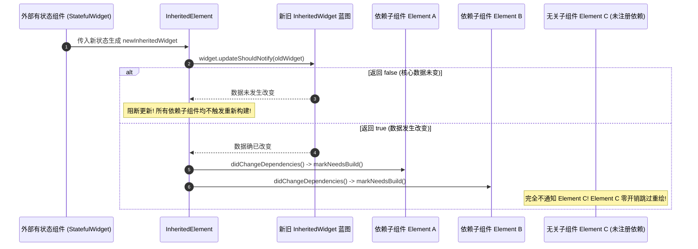

# 中级-InheritedWidget底层数据共享机制与updateShouldNotify

在 Flutter 的跨层级数据共享与状态管理版图中，无论是官方提供的 `Theme`、`MediaQuery`、`Directionality`，还是广为流传的经典三方库 `Provider`，其底层无一例外都是建立在 **`InheritedWidget`（数据继承组件）** 这块坚硬的物理基石之上的。初学者往往直接使用封装好的库，却对其底层为何能实现 **$O(1)$ 极速寻址**、`updateShouldNotify` 脏检查更新机制，以及如何精准控制局部子树重建缺乏底层认知。本篇专题深度推导 `InheritedWidget` 的内核物理机理。

---

## 一、核心底层机制与全景架构

### 1.1 为什么需要 InheritedWidget？属性钻取（Prop Drilling）之痛

在传统的父子组件通信中，若祖先节点想要将一个数据（如用户登录 Token）传递给位于第 10 层深处的孙子节点：
- **属性钻取的痛苦**：中间的所有 8 层无关组件，都必须在自己的构造函数中声明该参数，并层层向下强行透传。这会导致中间组件与业务数据产生极度恶劣的强耦合；
- **InheritedWidget 降维打击**：祖先直接提供一个 `InheritedWidget`，任意深度的子孙节点只需一行代码 `MyInherited.of(context)`，即可**直接跨越任意层级穿透读取数据**，且中间的无关组件对该数据完全无感知、零侵入、不参与任何无意义的重绘。

```mermaid
graph TD
    subgraph Traditional_Drilling["传统模式: 繁琐的层层属性透传 (Prop Drilling)"]
        Root1["祖先: UserState"] --> C1["子组件 1 (被迫传参)"]
        C1 --> C2["子组件 2 (被迫传参)"]
        C2 --> C3["子组件 3 (被迫传参)"]
        C3 --> Leaf1["叶子节点: 读取 UserState"]
    end

    subgraph Inherited_Model["InheritedWidget 模式: O(1) 跨层级穿透与响应式绑定"]
        InheritedNode["祖先: InheritedWidget (提供全局数据)"]
        Mid1["中间组件 A (纯纯静态UI，完全不被重绘影响)"]
        Mid2["中间组件 B (纯纯静态UI)"]
        Leaf2["深层叶子组件: dependOnInheritedWidgetOfExactType"]

        InheritedNode --> Mid1 --> Mid2 --> Leaf2
        Leaf2 -.->|O(1) 跨越中间节点直接建立双向依赖| InheritedNode
    end
```

---

### 1.2 `_inheritedElements` 哈希表：$O(1)$ 寻址的物理秘密

许多人误以为在深层子组件中执行 `MyInherited.of(context)` 时，Flutter 是从当前节点开始，一层一层顺着父级指针向上线性递归遍历整个 Element 树来寻找目标（若是如此，复杂度将高达 $O(N)$）。

**真相是：寻址时间复杂度是严格的 $O(1)$！**

#### 底层哈希表继承机理
在 `Element` 基类源码中，每个 Element 节点在内部都维护了一个私有的字典指针：
```dart
// 源码: packages/flutter/lib/src/widgets/framework.dart
PersistentHashMap<Type, InheritedElement>? _inheritedElements;
```
1. 当一个 `InheritedElement` 挂载到树上时，它会复制其父级的 `_inheritedElements` 哈希表，并**将自己以自身的 `Type` 作为 Key、自身作为 Value 注入进该哈希表中**；
2. 当它创建任何子 Element 时，它会直接将这个最新的哈希表指针**向下透传赋予所有的子代 Element**；
3. **物理结果**：任何一个子孙 Element 在其诞生那一刻，**它的内部就直接已经持有了整条祖先链路中所有不同类型 `InheritedElement` 的绝对内存指针字典**！读取时只需一次字典查找，耗时仅几纳秒！

---

## 二、源码级/算法物理推导

### 2.1 `updateShouldNotify` 脏检查与依赖分发时序

`InheritedWidget` 本身是不可变的（其所有字段都是 `final`）。当父级触发重新构建并传入一个新的 `InheritedWidget` 实例时，底层的 `InheritedElement` 会执行精准的更新判断：

```dart
// 源码: packages/flutter/lib/src/widgets/framework.dart
class InheritedElement extends ComponentElement {
  // 维护当前正在依赖当前 InheritedWidget 的全部子组件 Element 集合
  final Set<Element> _dependents = HashSet<Element>();

  @override
  void updated(InheritedWidget oldWidget) {
    super.updated(oldWidget);
    // 1. 调用开发者重写的 updateShouldNotify 进行脏检查
    if (widget.updateShouldNotify(oldWidget)) {
      // 2. 若返回 true，遍历通知全部依赖者进行精准局部重绘!
      notifyClients(oldWidget);
    }
  }

  @override
  void notifyClients(InheritedWidget oldWidget) {
    for (final Element dependent in _dependents) {
      assert(dependent._inheritedElements!.containsKey(widget.runtimeType));
      // 通知依赖者其依赖发生改变，并将其标记为脏节点准备下一帧 build
      notifyDependent(oldWidget, dependent);
    }
  }
}
```



---

### 2.2 细粒度局部切片模型：`InheritedModel` 与 `aspect`

如果一个 `InheritedWidget` 同时持有了 `user`（包含用户名、头像、积分）与 `themeColor` 两个属性。如果只是积分变了，依赖了 `themeColor` 的组件也会被强制重绘吗？
- 默认的 `InheritedWidget` 是**大颗粒度全量通知**的。
- 官方提供了高级抽象子类 **`InheritedModel`**：允许子组件在依赖时附带一个具体的切片标识（`aspect`，如 `MyModel.of(context, 'themeColor')`）。
- 在 `InheritedModel.updateShouldNotifyDependent` 源码中，只有当改变的属性与子组件注册的 `aspect` 产生交集时才通知该子组件，从而实现极致的局部性能隔离。

---

## 三、社招高频硬核连环追问

### 追问 1：为什么说 `InheritedWidget` 自身的数据必须是 `final` 不可变的？既然不可变，整个应用又该如何动态修改全局状态？
**标杆解答**：
1. **Widget 不可变的架构铁律**：
   - 所有的 Widget 本质上只是轻量级的不可变配置蓝图，必须遵循 `final` 规范；
2. **“StatefulWidget + InheritedWidget”组合拳（动态驱动引擎）**：
   - 动态修改数据依靠的是外层的 **`StatefulWidget`**；
   - 在外层的 `State` 中持有真实的可变数据字段（如 `_currentUser`），并提供修改方法；
   - 当调用 `setState(() { _currentUser = newUser; })` 时，外层组件的 `build()` 重新执行，**它会以最新的数据创建一个全新的 `InheritedWidget` 蓝图塞给子树**；
   - 底层的 `InheritedElement` 依然长久存活，它会对比新旧 Widget 的属性，触发 `updateShouldNotify` 并通知下游所有依赖它的叶子节点更新。

---

### 追问 2：为什么有时候在深层组件里写了 `Theme.of(context)`，全局主题切换时该组件正常刷新；但如果改成 `context.findAncestorWidgetOfExactType<Theme>()`，主题切换后该组件却死活不刷新了？
**标杆解答**：
1. **底层物理职责的本质区别**：
   - `Theme.of(context)` 底层执行的是 `context.dependOnInheritedWidgetOfExactType<InheritedTheme>()`；
   - 这个方法的核心动作是：**不仅读取数据，更重要的是将当前组件的 Element 注册进祖先的 `_dependents` 依赖监听集合中**！未来 Theme 变化时，祖先会主动通知它刷新。
2. **`findAncestorWidgetOfExactType` 不建立依赖**：
   - 该方法仅仅是顺着树单向读取了一次数据，**完全不会在祖先的 `_dependents` 集合中登记当前组件的引用**；
   - 因此当 Theme 发生物理改变调用 `notifyClients` 时，由于当前组件不在依赖集合里，它完全收不到任何更新脉冲，界面保持死态。

---

### 追问 3：在手写自定义 `InheritedWidget` 时，`updateShouldNotify` 如果直接无脑返回 `true`，会导致什么性能灾难？
**标杆解答**：
1. **局部脏检查失效（Cache Invalidation Disaster）**：
   - 假设当前应用每次发生无关的网络数据刷新或父级由于动效触发了 `build()`；
   - 若 `updateShouldNotify` 恒为 `true`，框架会认为数据时刻都在改变，**导致所有依赖该全局状态的子孙叶子组件（可能高达数百个）每一帧都被强制全部 `markNeedsBuild()` 并全量重新构建**；
2. **性能守则**：
   - 必须执行严谨的值相等性比对：
     ```dart
     @override
     bool updateShouldNotify(covariant AppConfigInherited oldWidget) {
       // 仅当核心业务数据真正发生值改变时，才允许返回 true
       return config != oldWidget.config;
     }
     ```

---

## 四、生产级避坑指南与排障 SOP

### 4.1 生产级手写响应式全局状态树实战模板

不依赖任何三方库，仅利用原生组件构建一个完整的全局用户状态管理器（带状态提升、方法透传与精准局部响应）：

```dart
import 'package:flutter/material.dart';

// 1. 业务用户实体模型
class UserInfo {
  final String name;
  final int level;
  const UserInfo({required this.name, required this.level});

  @override
  bool operator ==(Object other) =>
      identical(this, other) ||
      other is UserInfo &&
          runtimeType == other.runtimeType &&
          name == other.name &&
          level == other.level;

  @override
  int get hashCode => name.hashCode ^ level.hashCode;
}

// 2. 底层不可变 InheritedWidget (负责数据下发与依赖收集)
class _InheritedUserProvider extends InheritedWidget {
  final UserInfo? user;
  final _UserScopeState scopeState; // 持有外层 State 的引用以透传方法

  const _InheritedUserProvider({
    required this.user,
    required this.scopeState,
    required super.child,
  });

  @override
  bool updateShouldNotify(covariant _InheritedUserProvider oldWidget) {
    // 严格值比对: 仅当用户信息真正发生值变更时，才通知下游子组件更新
    return user != oldWidget.user;
  }
}

// 3. 外层有状态包装容器 (负责持有可变数据并提供业务方法)
class UserScope extends StatefulWidget {
  final Widget child;
  const UserScope({super.key, required this.child});

  /// 供子孙节点调用的公共静态 of 方法
  static UserInfo? userOf(BuildContext context) {
    return context
        .dependOnInheritedWidgetOfExactType<_InheritedUserProvider>()
        ?.user;
  }

  /// 供子孙节点修改状态的方法 (不注册依赖，仅做单向方法调用)
  static _UserScopeState of(BuildContext context) {
    final provider = context.findAncestorWidgetOfExactType<_InheritedUserProvider>();
    assert(provider != null, '未在当前上下文祖先中找到 UserScope！');
    return provider!.scopeState;
  }

  @override
  State<UserScope> createState() => _UserScopeState();
}

class _UserScopeState extends State<UserScope> {
  UserInfo? _currentUser = const UserInfo(name: '访客用户', level: 1);

  // 对外暴露的业务更新方法
  void updateUserInfo(String newName, int newLevel) {
    setState(() {
      _currentUser = UserInfo(name: newName, level: newLevel);
    });
  }

  @override
  Widget build(BuildContext context) {
    return _InheritedUserProvider(
      user: _currentUser,
      scopeState: this,
      child: widget.child,
    );
  }
}

// 4. 业务消费演示
class UserProfileWidget extends StatelessWidget {
  const UserProfileWidget({super.key});

  @override
  Widget build(BuildContext context) {
    // 自动建立依赖，当用户改变时本组件秒级局部重绘!
    final user = UserScope.userOf(context);

    return Column(
      mainAxisSize: MainAxisSize.min,
      children: [
        Text('用户名: ${user?.name ?? "未登录"}', style: const TextStyle(fontSize: 18)),
        Text('会员等级: Lv.${user?.level ?? 0}'),
        const SizedBox(height: 16),
        ElevatedButton(
          onPressed: () {
            // 调用父级方法修改全局状态
            UserScope.of(context).updateUserInfo('高级黄金会员', 9);
          },
          child: const Text('升级会员'),
        ),
      ],
    );
  }
}
```
