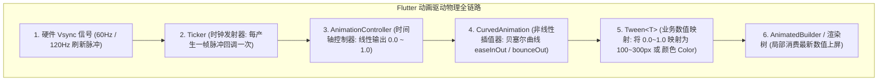

# 中级-动画体系核心AnimationController-Tween与CurvedAnimation

在移动端高品质人机交互中，生动丝滑的动效（如按钮点赞微动效、卡片展开折叠、页面切换 Hero 飞行过渡）是打造极致用户体验的灵魂。Flutter 拥有一套极其强大、直接对接 GPU 硬件刷新脉冲（Vsync）的动画驱动体系。深入掌握 **`AnimationController`（时钟控制器）**、**`Tween`（补间插值器）**、**`CurvedAnimation`（非线性曲线）**，以及利用 **`AnimatedBuilder`** 实现 0 冗余重绘的局部性能优化，是进阶高级开发的必修内功。

---

## 一、核心底层机制与全景架构

### 1.1 Flutter 动画分层三剑客架构全景



---

### 1.2 隐式动画（Implicit）vs 显式动画（Explicit）选型矩阵

| 评估维度 | 隐式动画 (Implicit Animations) | 显式动画 (Explicit Animations) |
| :--- | :--- | :--- |
| **典型组件** | `AnimatedContainer`、`AnimatedOpacity`、`AnimatedPositioned`、`AnimatedDefaultTextStyle` | 自定义 `AnimationController` + `AnimatedBuilder` / `ScaleTransition` |
| **控制粒度** | **全自动**。只需要在组件上改变属性（如 `width: isExpand ? 200 : 50`），框架内部自动在指定时长内平滑插值过渡 | **完全自主可控**。支持手动调用 `forward()`（正向播放）、`reverse()`（反向播放）、`repeat()`（无限循环循环）、`stop()`（暂停） |
| **生命周期管理** | **极度省心**。无需手动创建和管理 Controller，框架自动负责 Ticker 的销毁与释放 | **必须手动严格管理**。必须在 `StatefulWidget` 中混入 `SingleTickerProviderStateMixin` 并在 `dispose()` 中注销 |
| **适用场景** | 简单的 UI 样式渐变、点击后卡片尺寸/颜色平滑切换 | 复杂多段交织动画（Staggered）、无限循环旋转/脉冲动画、复杂的下拉刷新手势联动 |

---

## 二、源码级/执行时序物理推导

### 2.1 `SingleTickerProviderStateMixin` 与硬件 Vsync 信号物理绑定

在创建 `AnimationController` 时，必须传入一个 `vsync: this` 参数：
```dart
class _HeartAnimationState extends State<HeartAnimation>
    with SingleTickerProviderStateMixin {
  late final AnimationController _controller;

  @override
  void initState() {
    super.initState();
    _controller = AnimationController(
      vsync: this, // 绑定 TickerProvider
      duration: const Duration(milliseconds: 600),
    );
  }
}
```

#### 为什么必须传入 `vsync: this`？（底层节能保护）
1. `SingleTickerProviderStateMixin` 会创建一个 `Ticker` 对象；
2. 这个 `Ticker` 会直接注册到 Flutter 引擎层的调度器（`SchedulerBinding`）中，**严格跟随当前手机屏幕真实的硬件刷新频率（如 60Hz 每 16.6ms、120Hz 每 8.3ms）跳动触发回调**；
3. **防止屏幕外无意义动画（Offscreen Throttling）**：如果当前页面被其他全屏页面覆盖（压入栈底不可见时），`TickerProvider` 会自动静默休眠当前动画，**绝对不会在用户看不见的后台疯狂消耗 CPU/GPU 算力与电池电量**！

---

### 2.2 `AnimatedBuilder` 的 `child` 缓存参数：阻断多余重绘的数学原理

很多初学者在使用 `AnimatedBuilder` 时，常写出如下极度消耗性能的反模式代码：

```dart
// ❌ 极度消耗性能的错误写法：每一帧（1秒60次）都在重复创建整个复杂卡片！
AnimatedBuilder(
  animation: _animation,
  builder: (context, _) {
    return Transform.scale(
      scale: _animation.value,
      // 这里的 HeavyComplexCard() 包含几百个子组件和图片，每一帧都被迫完全重新实例化与 Diff！
      child: const HeavyComplexCard(), 
    );
  },
);

// ✅ 官方标准优化：利用外部 child 缓存参数进行物理隔离
AnimatedBuilder(
  animation: _animation,
  // 1. 将不需要重复构建的静态厚重子树作为 child 传入 (仅在初始构建一次)
  child: const HeavyComplexCard(),
  builder: (context, cachedChild) {
    return Transform.scale(
      scale: _animation.value,
      // 2. 这里的 cachedChild 是直接复用的同一个内存指针，子树完全不参与任何重复 build!
      child: cachedChild,
    );
  },
);
```

---

## 三、社招高频硬核连环追问

### 追问 1：为什么没有在 `dispose()` 中调用 `controller.dispose()` 会导致严重的 Ticker 泄漏？
**标杆解答**：
1. **未取消全局帧监听注册（Leaked Frame Callback）**：
   - `AnimationController` 启动后，其底层的 `Ticker` 保持与全局单例 `SchedulerBinding` 的注册连接；
   - 只要动画仍在播放或处于等待状态，全局调度器每一帧都会向该 `Ticker` 分发时钟脉冲；
2. **内存与 CPU 双重灾难**：
   - 即使包含该动画的页面已经被 `Navigator.pop()` 弹出，如果漏写了 `_controller.dispose()`，**全局引擎仍然在每一帧持续唤醒并执行该控制器的回调函数**；
   - 控制器强引用了 `State` 实例，导致整座页面内存堆彻底泄漏，且后台 CPU 占用率居高不下，手机发热严重。

---

### 追问 2：多段交织动画（Staggered Animation）如何实现？`Interval` 时间区间的数学映射公式是什么？
**标杆解答**：
1. **单一 Controller 驱动多个不同步的动画切片**：
   - 如果一个卡片展开过程：**前 30% 时间做透明度淡入，中间 50% 时间做宽度展开，后 20% 时间做文字向上滑出**；
   - 绝对不需要创建 3 个独立的 Controller！只需一个总时长为 1000ms 的全局 Controller。
2. **`Interval(start, end, curve)` 数学物理映射**：
   - `Interval` 会在指定的局部时间切片区间内，将 Controller 的全局 `[0.0, 1.0]` 重新线性映射并归一化为局部的时间流：
     ```dart
     // 1. 透明度动画: 仅在全局进度的 0.0 ~ 0.3 区间内执行
     final opacityAnimation = Tween<double>(begin: 0.0, end: 1.0).animate(
       CurvedAnimation(
         parent: _controller,
         curve: const Interval(0.0, 0.3, curve: Curves.easeIn),
       ),
     );

     // 2. 宽度展开动画: 紧随其后，在 0.3 ~ 0.8 区间内执行
     final widthAnimation = Tween<double>(begin: 50.0, end: 300.0).animate(
       CurvedAnimation(
         parent: _controller,
         curve: const Interval(0.3, 0.8, curve: Curves.fastOutSlowIn),
       ),
     );
     ```

---

### 追问 3：Hero 跨页面神奇共享元素转场动画的底层物理渲染机制是什么？
**标杆解答**：
1. **虚拟飞行动画脱离页面栈（Escape from Local Tree）**：
   - 在页面 A 跳转到页面 B 时，两个页面的 `Hero(tag: 'avatar')` 声明了相同的 Tag；
   - `Navigator` 会检测到这一对匹配的 Hero 组件；
   - **在转场动画执行期间，Flutter 渲染器并不会在页面 A 或页面 B 内部直接缩放该组件**！
2. **借用全局最高层级 `Overlay` 独立图层飞行**：
   - 框架会临时隐藏原页面上的 Hero 组件；
   - 在应用的全局最顶层容器 **`Overlay`**（悬浮在所有路由页面之上的专用画布）中，动态创建一个临时的飞行动画节点；
   - 根据源页面和目标页面计算出的绝对物理几何坐标，在转场动画时长内（通常 300ms），让该节点在 `Overlay` 图层中由小到大平滑移动缩放；
   - 动画结束后，将临时飞行节点从 `Overlay` 中销毁移除，同时让目标页面 B 上的真实 Hero 组件无缝显现上屏。

---

## 四、生产级避坑指南与排障 SOP

### 4.1 生产级点赞红心缩放粒子微动效（Scale + Color 弹性交互）

```dart
import 'package:flutter/material.dart';

class FavoriteHeartButton extends StatefulWidget {
  final bool initialFav;
  final ValueChanged<bool>? onFavChanged;

  const FavoriteHeartButton({
    super.key,
    this.initialFav = false,
    this.onFavChanged,
  });

  @override
  State<FavoriteHeartButton> createState() => _FavoriteHeartButtonState();
}

class _FavoriteHeartButtonState extends State<FavoriteHeartButton>
    with SingleTickerProviderStateMixin {
  late bool _isFav;
  late final AnimationController _controller;
  late final Animation<double> _scaleAnimation;
  late final Animation<Color?> _colorAnimation;

  @override
  void initState() {
    super.initState();
    _isFav = widget.initialFav;

    // 1. 初始化控制器 (时长 350ms)
    _controller = AnimationController(
      vsync: this,
      duration: const Duration(milliseconds: 350),
    );

    // 2. 弹性缩放曲线 (先放大到 1.3 倍，再迅速回弹到 1.0)
    _scaleAnimation = TweenSequence<double>([
      TweenSequenceItem(
        tween: Tween<double>(begin: 1.0, end: 1.35)
            .chain(CurveTween(curve: Curves.easeOut)),
        weight: 50,
      ),
      TweenSequenceItem(
        tween: Tween<double>(begin: 1.35, end: 1.0)
            .chain(CurveTween(curve: Curves.elasticOut)),
        weight: 50,
      ),
    ]).animate(_controller);

    // 3. 颜色过渡补间
    _colorAnimation = ColorTween(
      begin: const Color(0xFF94A3B8), // 默认浅灰色
      end: const Color(0xFFE11D48),   // 激活红色
    ).animate(_controller);

    if (_isFav) {
      _controller.value = 1.0; // 初始为激活态
    }
  }

  void _handleTap() {
    setState(() {
      _isFav = !_isFav;
    });

    if (_isFav) {
      // 重置并正向播放点赞动画
      _controller.forward(from: 0.0);
    } else {
      // 取消点赞反向退回
      _controller.reverse();
    }

    widget.onFavChanged?.call(_isFav);
  }

  @override
  Widget build(BuildContext context) {
    return GestureDetector(
      onTap: _handleTap,
      behavior: HitTestBehavior.opaque,
      child: Padding(
        padding: const EdgeInsets.all(8.0),
        child: AnimatedBuilder(
          animation: _controller,
          builder: (context, _) {
            // 利用 Transform.scale 驱动 GPU 硬件缩放，不触发布局排版计算!
            return Transform.scale(
              scale: _scaleAnimation.value,
              child: Icon(
                _isFav ? Icons.favorite : Icons.favorite_border,
                color: _colorAnimation.value,
                size: 28,
              ),
            );
          },
        ),
      ),
    );
  }

  @override
  void dispose() {
    // 关键生产规范: 销毁控制器释放 Ticker，防严重内存与 CPU 泄漏
    _controller.dispose();
    super.dispose();
  }
}
```
