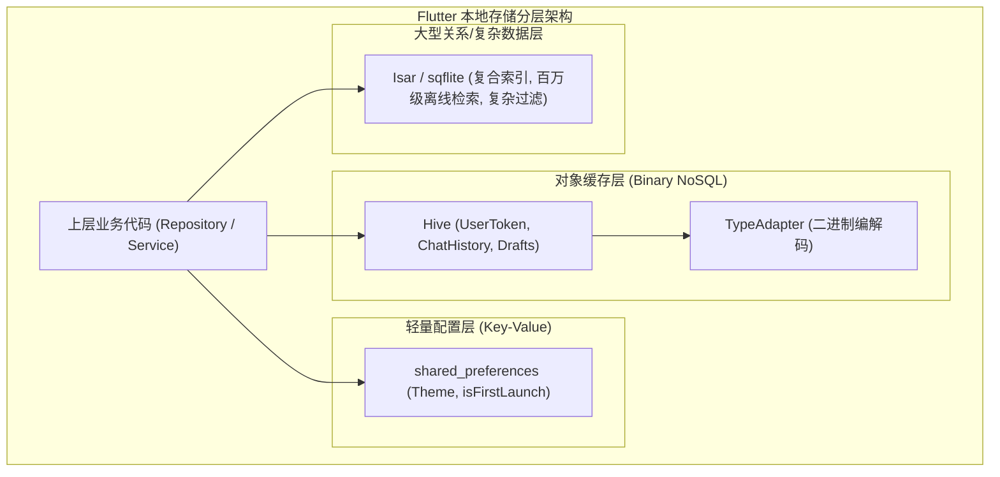

# 中级-本地数据持久化Hive与SharedPreferences及Isar选型实战

在移动端离线缓存、用户登录凭证持久化、配置项记录以及本地大型数据检索场景中，**本地数据存储（Local Persistence）** 是构建离线可用 App 的核心基石。Flutter 生态经历了从官方基于原生平台通道的 **`shared_preferences`**、传统关系型数据库 **`sqflite`**，到新一代纯 Dart 高性能 NoSQL 数据库 **`Hive`** 与极致性能嵌入式数据库 **`Isar`** 的全面演进。本篇专题深度剖析底层存储物理介质、读写性能差距成因，以及数据迁移防崩溃 SOP。

---

## 一、核心底层机制与全景架构

### 1.1 三大主流本地存储技术横向对比矩阵

| 评估维度 | `shared_preferences` (基础轻量型) | `Hive` (纯 Dart 二进制型) | `Isar` (新一代嵌入式超高性能型) |
| :--- | :--- | :--- | :--- |
| **底层实现介质** | 依赖原生系统通道：Android 采用 `SharedPreferences`（XML 文件），iOS 采用 `NSUserDefaults`（Plist 文件） | **100% 纯 Dart 编写**。零 Native 平台通道开销，直接读写本地二进制 Box 文件 | 基于 Rust / C++ 内核绑定，采用 **LMDB（Lightning Memory-Mapped Database）** 内存映射技术 |
| **跨端通道通信开销** | **高昂**。每次读写都必须经历 Platform Channel 的数据序列化、跨线程切换与原生异步回调 | **零（Zero Overhead）**。直接在 Dart Isolate 内存堆中操作，速度快到不可思议 | **极低**。通过 Dart FFI 零拷贝物理指针直接与 C++ 数据库内核交互 |
| **查询能力** | 仅支持简单的单一 Key-Value 键值对，完全不支持条件索引或复杂查询 | 支持 Key-Value 键值对，支持自定义对象存储，但复杂条件过滤性能受限 | **极其强悍**。支持复合索引、多条件链式查询、全文搜索、一对多/多对多外键关联与异步事务 |
| **加密支持** | 原生无内置加密（明文保存） | 原生内置 **AES-256 位强加密**（`HiveAesCipher`） | 原生支持透明加密 |
| **适用边界** | 仅用于记录 10~20 个轻量级开关状态（如“是否初次打开”、“主题色模式”） | **中小型实体对象、聊天消息历史、离线草稿箱、Token 凭证（几千至数万条数据）** | **企业级离线数据库、复杂报表、百万级离线搜索与多表关联（十万至数百万条数据）** |

---

### 1.2 数据存储分层架构拓扑



---

## 二、源码级/性能物理推导

### 2.1 为什么 `shared_preferences` 频繁写入会导致 Android 端严重卡顿甚至 ANR？

在 Android 端，`shared_preferences` 底层映射为应用沙盒目录下的单一 XML 文件（如 `app_preferences.xml`）：
1. **全量解析与全量覆写（Full File Rewriting）**：
   - 只要调用了一次修改操作，Android 底层的 `SharedPreferencesImpl` 就会把**整个 XML 文件中的全部键值对重新格式化并在磁盘上全量覆写一次**；
2. **`commit()` vs `apply()` 物理主线程阻塞陷阱**：
   - 在早期的插件实现中，跨端通信若触发同步等待，原生主线程执行磁盘 I/O，直接引发丢帧；
   - 更隐蔽的陷阱：在 Activity 暂停（`onPause`）或销毁（`onStop`）时，Android 系统的 `QueuedWork` 队列会**强制等待后台所有未完成的 SharedPreferences 磁盘写入操作彻底同步落盘完毕**，如果此时磁盘 I/O 拥堵，主线程直接被死死挂起超过 5 秒，引发致命的 **ANR（Application Not Responding）**！

---

### 2.2 Hive 为什么在读写性能上比传统 SQLite 快数倍？

在针对 10,000 条复杂实体对象的读写基准测试中，Hive 的性能往往比传统 `sqflite` 快 5~10 倍：
1. **零 Platform Channel 损耗**：
   - `sqflite` 每次执行 SQL 查询，都必须把 SQL 字符串打包为二进制，通过 MethodChannel 跨越跨线程边界传递给 Java/ObjC 层的原生 SQLite 驱动，原生查询完毕后再打包为 JSON 结果集跨桥传回 Dart 侧进行二次反序列化，**跨桥序列化开销往往占了整体耗时的 70%**；
   - Hive 是 100% 运行在当前 Dart 虚拟机内存中的，**完全没有跨语言、跨进程或跨平台通信损耗**。
2. **追加写入日志文件（Append-only Log）**：
   - Hive 的持久化机制采用类似 LSM-Tree 的追加写入模式，所有数据的写入只是直接在二进制 Box 文件末尾追加新的字节流，**完全省去了传统数据库维护复杂的 B-Tree 索引分裂与 WAL 日志锁竞争开销**。

---

## 三、社招高频硬核连环追问

### 追问 1：在 Hive 中使用 `TypeAdapter` 序列化自定义数据模型时，模型字段增删（Schema Migration）最容易引发致命崩溃的误区是什么？
**标杆解答**：
1. **FieldId 顺序绝不可篡改（Field ID Immutability）**：
   - 在为模型标注 `@HiveField(index)` 时，Hive 在底层**完全不依赖变量名称进行序列化，而是严格依赖这个整型 `index` 作为二进制字段标识符**；
   - **致命反模式**：某天开发者在旧模型中间插拔了一个新字段，或者修改了已有的 `@HiveField(0)` 为 `@HiveField(1)`；
   - **后果**：用户从应用商店升级新版本后，本地已经存储的历史二进制数据与新的 FieldId 发生坐标错乱，强行读取直接报类型转换崩溃或 `HiveError`，导致大量老用户历史数据全毁！
2. **规范准则**：
   - **已有字段的 `@HiveField(index)` 绝对严禁修改其数字！**
   - 若废弃某个旧字段，只允许将其在代码中废弃或置为可空，新增字段的 index 必须严格单调向上递增（如新增字段必须是 `@HiveField(nextIndex)`）。

---

### 追问 2：如何在本地使用 Hive 安全持久化存储用户的银行卡号、登录密码等极度敏感数据？
**标杆解答**：
1. **纯明文存储的风险**：默认情况下，手机如果被 Root 或越狱，攻击者可以直接打开应用沙盒目录读取 `.hive` 二进制文件，提取明文数据。
2. **AES-256 位加密存储 SOP**：
   - 第一步：生成一个 256 位的加密密钥（`Hive.generateSecureKey()`）；
   - 第二步：利用系统的硬件级安全芯片存储该密钥（Android 端存入 `KeyStore`，iOS 端存入 `Keychain`，通过 `flutter_secure_storage` 实现）；
   - 第三步：打开 Box 时传入 `HiveAesCipher` 进行物理扇区透明加解密：
     ```dart
     final secureBox = await Hive.openBox(
       'sensitive_user_box',
       encryptionCipher: HiveAesCipher(secretEncryptionKey),
     );
     ```

---

## 四、生产级避坑指南与排障 SOP

### 4.1 企业级 Hive 本地安全缓存管理完整实战代码

包含加密凭据存储、自定义对象序列化注册、Box 优雅单例管理：

```dart
import 'dart:convert';
import 'package:flutter/foundation.dart';
import 'package:hive_flutter/hive_flutter.dart';

// 1. 业务用户实体类
class UserProfile {
  final String userId;
  final String nickname;
  final String token;

  const UserProfile({
    required this.userId,
    required this.nickname,
    required this.token,
  });

  // 手写简易序列化 (或利用 build_runner 自动生成 TypeAdapter)
  Map<String, dynamic> toMap() => {
        'userId': userId,
        'nickname': nickname,
        'token': token,
      };

  factory UserProfile.fromMap(Map<dynamic, dynamic> map) => UserProfile(
        userId: map['userId'] as String,
        nickname: map['nickname'] as String,
        token: map['token'] as String,
      );
}

// 2. 企业级本地存储单例服务
class LocalStorageService {
  static final LocalStorageService _instance = LocalStorageService._internal();
  factory LocalStorageService() => _instance;
  LocalStorageService._internal();

  static const String _userBoxName = 'user_secure_box';
  Box? _userBox;

  /// 全局初始化 (必须在 main() 函数中且在 runApp 前执行)
  Future<void> init() async {
    // 初始化 Hive 存储路径
    await Hive.initFlutter();

    // 生产级安全密钥 (实际应从 flutter_secure_storage 读取)
    // 此处为固定 32 字节 (256-bit) 示例
    final encryptionKey = utf8.encode('12345678901234567890123456789012');

    // 打开加密存储 Box
    _userBox = await Hive.openBox(
      _userBoxName,
      encryptionCipher: HiveAesCipher(encryptionKey),
    );
    debugPrint('[Hive]: 本地安全加密存储库初始化完毕！');
  }

  /// 保存用户信息
  Future<void> saveUserProfile(UserProfile user) async {
    assert(_userBox != null, 'Hive 未初始化！');
    await _userBox!.put('current_user', user.toMap());
  }

  /// 读取当前用户信息
  UserProfile? getUserProfile() {
    assert(_userBox != null, 'Hive 未初始化！');
    final rawData = _userBox!.get('current_user');
    if (rawData == null) return null;
    return UserProfile.fromMap(rawData as Map);
  }

  /// 用户退出登录清空凭证
  Future<void> clearAuth() async {
    assert(_userBox != null, 'Hive 未初始化！');
    await _userBox!.delete('current_user');
  }

  /// 应用退出时安全关闭
  Future<void> close() async {
    await _userBox?.close();
  }
}
```
