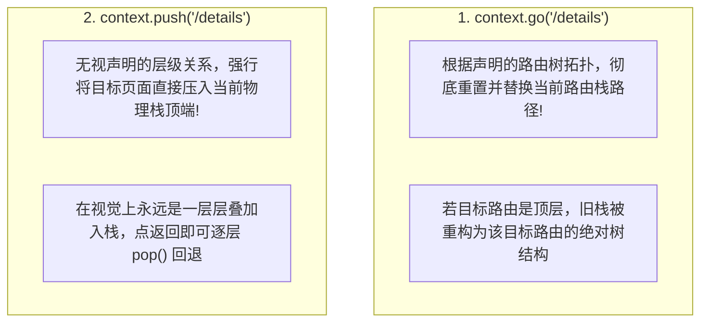

# 中级-路由体系Navigator1.0对比Navigator2.0与go_router实战

在移动端与全平台（Web/桌面端）架构中，页面导航与路由管理直接影响着应用的模块解耦、深层链接（Deep Linking）、状态恢复以及登录权限守卫。Flutter 经历了从早期的命令式 **Navigator 1.0** 到声明式 **Navigator 2.0（Router API）** 的重大演进。为了解决 Navigator 2.0 样板代码晦涩庞大的痛点，官方主导推出了工业界事实标准——**`go_router`**。本篇专题深度剖析路由栈底层物理演进、URL 模式匹配，以及企业级鉴权与嵌套路由架构。

---

## 一、核心底层机制与全景架构

### 1.1 命令式 Navigator 1.0 vs 声明式 Navigator 2.0 物理对比

| 架构维度 | Navigator 1.0 (命令式栈管理) | Navigator 2.0 (声明式状态驱动) |
| :--- | :--- | :--- |
| **控制理念** | **命令式（Imperative）**：通过代码显式调用 `push()`、`pop()`、`pushNamed()` 手动修改底层路由物理栈 | **声明式（Declarative）**：路由栈是状态的映射表达，通过修改 `pages` 数组状态来同步驱动当前展示的页面栈 |
| **状态回溯与同步** | 无法直接将底层的物理路由栈与上层业务数据状态做严格的双向绑定 | 路由状态与数据模型 100% 同构，数据变更自动映射为路由树 |
| **Web 与 Deep Linking** | **先天性缺陷**。浏览器地址栏 URL 改变、前进后退按钮无法精准同步到 Flutter 内部复杂的栈结构中 | **天然原生支持**。完美双向解析操作系统或 Web 浏览器传入的 URL 字符串 |
| **开发样板代码** | 极其简单直观，但无法胜任复杂跨端项目 | **极其晦涩繁琐**。需手写实现 Delegate、Parser、Provider 等多达 4 个底层类 |

```mermaid
flowchart LR
    subgraph Nav_1["Navigator 1.0 命令式模型"]
        A1["业务逻辑"] -->|调用 push()| Stack1["直接操作 Overlay 路由栈入栈"]
        A1 -->|调用 pop()| Stack1
    end

    subgraph Nav_2["Navigator 2.0 声明式模型 (go_router)"]
        URL["操作系统 URL / 浏览器地址栏 / 业务事件"] --> Parser["RouteInformationParser (解析 URL)"]
        Parser --> State["RouterDelegate (维护全局路由状态)"]
        State --> Pages["List&lt;Page&gt; 映射生成的页面栈"]
        Pages --> Navigator["底层 Navigator 渲染上屏"]
    end
```

---

### 1.2 官方推荐标准 `go_router` 核心物理分层

`go_router` 是 Google 官方团队打造的轻量级包，它以极其优雅、贴合现代 Web 与 App 开发习惯的声明式 API（声明路由表），在底层完全封装屏蔽了 Navigator 2.0 的繁琐底层实现：
1. **模式匹配（Pattern Matching）**：支持 `/users/:id` 动态参数提取；
2. **鉴权拦截器（Redirect Guard）**：全局与单路由维度的动态重定向；
3. **嵌套骨架路由（ShellRoute）**：让底部固定导航栏（BottomNavigationBar）在切换 Tab 时**保持常驻且完全不重建**。

---

## 二、源码级/架构物理推导

### 2.1 `context.go()` vs `context.push()` 底层物理栈差异

在 `go_router` 中，导航跳转提供了两个最核心的方法，其在底层路由栈中的物理表现完全不同：



- **`context.go(path)`**：**声明式跳转**。它会根据你在路由表中配置的嵌套结构（URI 路径），将整个路由栈直接替换对齐为该路径所代表的唯一结构。
- **`context.push(path)`**：**命令式压栈**。它只是单纯地将一个新页面无脑压在当前页面的上方。

---

### 2.2 路由传参的三种物理载体对比

| 传参方式 | 代码语法 | 物理本质与限制 | 深度链接（Web/外部唤醒）支持度 |
| :--- | :--- | :--- | :--- |
| **路径参数 (Path Parameters)** | `/users/:id` -> `state.pathParameters['id']` | 拼装在 URL 路径物理段中（如 `/users/1024`） | **100% 支持**。任何外部链接唤醒均能保真提取 |
| **查询参数 (Query Parameters)** | `/search?keyword=flutter` -> `state.uri.queryParameters['keyword']` | 拼装在 URL 查询字符串中 | **100% 支持**。浏览器刷新或分享链接完全保留 |
| **附加对象 (Extra Object)** | `context.push('/order', extra: myOrderModel)` -> `state.extra as OrderModel` | **仅存在于当前内存堆中的 Dart 强类型对象引用** | **不支持外部唤醒**！若在 Web 刷新页面或从外部推送点击冷启动进入，`state.extra` 物理上为 `null`！ |

---

### 2.3 鉴权拦截状态机（Redirect）死循环破局推导

在 `go_router` 中，通过 `redirect: (BuildContext context, GoRouterState state)` 可以实现全局登录拦截。

#### 致命的无限死循环重定向机理
```dart
// ❌ 错误示范：导致浏览器或客户端报死循环堆栈溢出！
redirect: (context, state) {
  final isLoggedIn = authService.isLoggedIn;
  if (!isLoggedIn) {
    return '/login'; // 致命错误: 无论当前在哪，未登录均无条件重定向到 /login!
  }
  return null;
}
```
**死循环物理时序**：用户访问主页 -> 拦截器检测到未登录 -> 重定向进入 `/login` -> 触发进入新路由 -> 再次执行拦截器 -> 检测到未登录 -> 再次重定向进入 `/login` -> 无限循环直至崩溃！

#### 正确的防死锁状态机判断逻辑
```dart
// ✅ 正确规范：必须显式排除自身目标路由！
redirect: (context, state) {
  final bool isLoggedIn = authService.isLoggedIn;
  final bool isGoingToLogin = state.matchedLocation == '/login';

  // 1. 未登录且目标不是登录页 -> 强行拦截至登录页
  if (!isLoggedIn && !isGoingToLogin) {
    return '/login';
  }

  // 2. 已登录但用户试图再次访问登录页 -> 强制送回首页
  if (isLoggedIn && isGoingToLogin) {
    return '/';
  }

  // 3. 其余情况放行
  return null;
}
```

---

## 三、社招高频硬核连环追问

### 追问 1：为什么在跨平台项目中，严禁完全依赖 `state.extra` 传递页面的核心业务参数（如订单详情的 `orderId`）？
**标杆解答**：
1. **Web 端刷新与状态丢失（Page Refresh Amnesia）**：
   - 在 Web 平台、或者桌面端开启多窗口时，用户随时可能按下 `F5` 刷新页面；
   - 刷新时，浏览器只向 Flutter 发送当前地址栏的 URL 字符串（如 `https://app.com/order-detail`）；
   - 由于 `extra` 纯粹是内存指针传递，并不体现在 URL 中，刷新后 `state.extra` 为 `null`，导致页面直接报空指针异常白屏崩溃。
2. **Deep Linking 与 App 杀死后冷启动失效**：
   - 用户收到一条营销短信推送，点击链接 `myapp://order-detail` 唤醒 App；
   - 系统冷启动直接解析该 URL，此时内存中根本不存在任何预先传入的 `extra` 实例。
3. **架构规范**：
   - **核心凭证 ID 必须作为 Path 参数声明**（如 `/order-detail/:orderId`）；
   - 页面挂载时根据 `orderId` 重新发起接口请求或从本地数据库拉取数据；`extra` 仅可作为本地平滑过渡的“可选性能优化缓存”，绝不能作为唯一数据源！

---

### 追问 2：什么是 `ShellRoute`？它相比传统的在主页使用 `IndexedStack` 结合底部导航栏有什么决定性优势？
**标杆解答**：
1. **传统 `IndexedStack` 的物理局限**：
   - 传统模式将多个 Tab 页面全量挂载在 `IndexedStack` 中，导致每个 Tab 内的路由跳转无法在 URL 地址栏中体现；
   - 用户在某个子页面点击返回时，容易引发直接退出整个应用，或者难以做深层子路由精准分享。
2. **`ShellRoute` 的嵌套宿主架构**：
   - `ShellRoute` 允许在路由树中定义一个公共的**“外壳容器组件（Shell Container）”**（提供常驻顶部的 AppBar、左侧 Drawer 或底部的 BottomNavigationBar）；
   - 当用户在 `/home`、`/message`、`/profile` 之间切换时，**底部的外壳组件不会触发任何卸载与重新创建，只有中间的子路由展示区被无缝动态替换**；
   - 同时每个 Tab 页面的完整子路径都完美同步在路由栈和 URL 地址中，兼顾了原生流畅度与现代路由规范。

---

## 四、生产级避坑指南与排障 SOP

### 4.1 企业级 `go_router` 完整路由表配置模板

包含全局鉴权重定向、ShellRoute 嵌套底部导航栏、动态传参及 404 兜底页面的标准工业配置：

```dart
import 'package:flutter/material.dart';
import 'package:go_router/go_router.dart';

// 模拟全局认证状态
class AuthService extends ChangeNotifier {
  bool _isLoggedIn = false;
  bool get isLoggedIn => _isLoggedIn;

  void login() {
    _isLoggedIn = true;
    notifyListeners();
  }

  void logout() {
    _isLoggedIn = false;
    notifyListeners();
  }
}

final authService = AuthService();

// 全局路由表配置
final GoRouter appRouter = GoRouter(
  initialLocation: '/',
  refreshListenable: authService, // 监听登录态改变，自动重新触发重定向判定
  
  // 1. 全局防死锁重定向守卫
  redirect: (BuildContext context, GoRouterState state) {
    final bool loggedIn = authService.isLoggedIn;
    final bool loggingIn = state.matchedLocation == '/login';

    if (!loggedIn && !loggingIn) return '/login';
    if (loggedIn && loggingIn) return '/';
    return null;
  },

  routes: [
    // 独立全屏路由: 登录页
    GoRoute(
      path: '/login',
      builder: (context, state) => const LoginScreen(),
    ),

    // 2. 嵌套外壳路由 ShellRoute: 底部导航栏全局常驻
    ShellRoute(
      builder: (context, state, child) {
        return ScaffoldWithNavBar(child: child);
      },
      routes: [
        GoRoute(
          path: '/',
          builder: (context, state) => const HomeScreen(),
          routes: [
            // 嵌套动态详情页 (Path 参数)
            GoRoute(
              path: 'detail/:id',
              builder: (context, state) {
                final id = state.pathParameters['id'] ?? '0';
                return DetailScreen(itemId: id);
              },
            ),
          ],
        ),
        GoRoute(
          path: '/profile',
          builder: (context, state) => const ProfileScreen(),
        ),
      ],
    ),
  ],

  // 3. 404 兜底页面
  errorBuilder: (context, state) => Scaffold(
    appBar: AppBar(title: const Text('404 页面丢失')),
    body: Center(
      child: Text('找不到页面: ${state.uri}'),
    ),
  ),
);

// 嵌套底部导航栏外壳组件
class ScaffoldWithNavBar extends StatelessWidget {
  final Widget child;
  const ScaffoldWithNavBar({super.key, required this.child});

  @override
  Widget build(BuildContext context) {
    return Scaffold(
      body: child, // 动态渲染当前激活的子路由页面
      bottomNavigationBar: NavigationBar(
        selectedIndex: _calculateSelectedIndex(context),
        onDestinationSelected: (int index) {
          if (index == 0) context.go('/');
          if (index == 1) context.go('/profile');
        },
        destinations: const [
          NavigationDestination(icon: Icon(Icons.home), label: '首页'),
          NavigationDestination(icon: Icon(Icons.person), label: '我的'),
        ],
      ),
    );
  }

  int _calculateSelectedIndex(BuildContext context) {
    final String location = GoRouterState.of(context).matchedLocation;
    if (location.startsWith('/profile')) return 1;
    return 0;
  }
}

// 占位演示页面
class LoginScreen extends StatelessWidget {
  const LoginScreen({super.key});
  @override
  Widget build(BuildContext context) {
    return Scaffold(
      appBar: AppBar(title: const Text('登录')),
      body: Center(
        child: ElevatedButton(
          onPressed: () => authService.login(),
          child: const Text('模拟登录成功'),
        ),
      ),
    );
  }
}

class HomeScreen extends StatelessWidget {
  const HomeScreen({super.key});
  @override
  Widget build(BuildContext context) {
    return Scaffold(
      appBar: AppBar(title: const Text('首页')),
      body: Center(
        child: ElevatedButton(
          onPressed: () => context.go('/detail/10086'),
          child: const Text('进入商品 10086 详情'),
        ),
      ),
    );
  }
}

class DetailScreen extends StatelessWidget {
  final String itemId;
  const DetailScreen({super.key, required this.itemId});
  @override
  Widget build(BuildContext context) {
    return Scaffold(
      appBar: AppBar(title: Text('详情 ID: $itemId')),
      body: Center(child: Text('商品数据: $itemId')),
    );
  }
}

class ProfileScreen extends StatelessWidget {
  const ProfileScreen({super.key});
  @override
  Widget build(BuildContext context) {
    return Scaffold(
      appBar: AppBar(title: const Text('个人中心')),
      body: Center(
        child: ElevatedButton(
          onPressed: () => authService.logout(),
          child: const Text('退出登录'),
        ),
      ),
    );
  }
}
```
