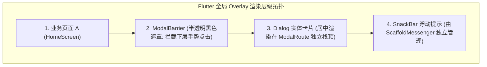

# 中级-通用弹窗体系Dialog-BottomSheet与SnackBars优雅封装

在移动端交互设计中，业务确认对话框（Dialog）、底部筛选抽屉（BottomSheet）以及轻量浮动操作反馈（SnackBar / Toast）是高频不可或缺的模态提示组件。初学者常因**弹窗内部调用 `setState` 界面死活不刷新**、**软键盘弹起遮挡底部弹窗输入框**，或**在没有 `BuildContext` 的网络拦截器中无法弹出登录失效提示**而陷入困境。本篇专题深度剖析弹窗底层 `ModalRoute` 与 `Overlay` 路由架构、`StatefulBuilder` 局部状态机，并提供企业级无 Context 弹窗封装实战。

---

## 一、核心底层机制与全景架构

### 1.1 弹窗在 Flutter 渲染树中的真实物理位置

很多人误以为弹窗只是当前页面内部的一个普通层叠 Widget。

**物理真相是：弹窗是一个独立的路由（`PopupRoute` / `ModalRoute`）！**
- 当调用 `showDialog(context: context, ...)` 时，框架底层执行了 **`Navigator.of(context).push(DialogRoute(...))`**；
- 弹窗被作为一个全新的全屏透明路由页面，压入了当前路由栈的最顶端；
- 它渲染在全局最顶层的 **`Overlay`** 画布之上，并在视觉上自带一层半透明的黑色阴影阻断层（`ModalBarrier`），用于拦截并吞噬所有下层页面的手势点击。



---

### 1.2 三大模态体系核心机制对比

| 模态类型 | 底层实现协议 | 渲染层级与特征 | 典型业务场景 |
| :--- | :--- | :--- | :--- |
| **`showDialog`** | `DialogRoute<T>` (继承自 `PopupRoute`) | 屏幕正中央居中弹出，支持点击外部半透明遮罩关闭（`barrierDismissible`） | 二次确认删除、版本强制升级更新、权限申请授权 |
| **`showModalBottomSheet`** | `ModalBottomSheetRoute<T>` | 从屏幕最底端向上滑出，支持手势向下滑动拖拽关闭 | 商品规格选择（SKU 面板）、分享菜单面板、单选/多选筛选器 |
| **`ScaffoldMessenger.showSnackBar`** | 由当前最近的 `ScaffoldMessenger` 统一排队调度 | 附着在当前页面的底部，不阻断用户对上层内容的点击操作 | “已复制到剪贴板”、“操作撤销”等轻量非阻塞反馈 |

---

## 二、源码级/架构物理推导

### 2.1 为什么弹窗内部调用 `setState()` 界面完全不刷新？

这是初学者最常遇到的经典困惑：

```dart
// ❌ 错误示范：在弹窗内部调用外层页面的 setState，弹窗内容死活不变！
showDialog(
  context: context,
  builder: (dialogContext) {
    int counter = 0;
    return AlertDialog(
      title: Text('当前计数: $counter'),
      actions: [
        ElevatedButton(
          onPressed: () {
            counter++; // 即使数值变了
            setState(() {}); // ❌ 刷新的是外层页面的 State，弹窗完全不在外层的 build 流程中！
          },
          child: const Text('+1'),
        ),
      ],
    );
  },
);
```

#### 物理成因推导
1. 弹窗位于独立的 `DialogRoute` 内部，它的 `build()` 是由路由栈调度的；
2. 外层页面的 `setState()` 仅仅是将外层页面的 Element 标记为脏节点；
3. 处于独立路由树上的弹窗 Element **压根没有被标记为脏节点**，因此弹窗绝不会重新执行构建，界面保持死态。

#### 官方标准解法：使用 `StatefulBuilder` 局部状态机
`StatefulBuilder` 会在其内部创建一个微型的局部 `StatefulElement`，并把专属于它自己的局部 `setState` 抛给开发者：

```dart
// ✅ 正确做法：利用 StatefulBuilder 提供的局部 setDialogState 刷新弹窗自身
showDialog(
  context: context,
  builder: (dialogContext) {
    int counter = 0;
    return StatefulBuilder(
      builder: (context, setDialogState) {
        return AlertDialog(
          title: Text('当前计数: $counter'),
          actions: [
            ElevatedButton(
              onPressed: () {
                setDialogState(() {
                  counter++; // 局部更新，弹窗界面秒级刷新!
                });
              },
              child: const Text('+1'),
            ),
          ],
        );
      },
    );
  },
);
```

---

### 2.2 底部弹窗 `BottomSheet` 软键盘避让与圆角实现机理

在使用 `showModalBottomSheet` 时，如果弹窗内包含输入框：
1. **默认会被软键盘彻底挡住**：因为 BottomSheet 默认在底部固定高度展示；
2. **根治规范两步走**：
   - 配置 **`isScrollControlled: true`**：允许弹窗自适应突破半屏高度上限；
   - 内部利用 `Padding(padding: EdgeInsets.only(bottom: MediaQuery.viewInsetsOf(context).bottom))` 精准监听软键盘弹起高度，将弹窗内容在垂直方向上顶起避让！

---

## 三、社招高频硬核连环追问

### 追问 1：在网络拦截器（Dio Interceptor）或业务 Service 中，当检测到 Token 过期时需要弹出登录提示，但此时根本拿不到当前页面的 `BuildContext`，怎么优雅实现“无 Context 全局弹窗”？
**标杆解答**：
1. **`navigatorKey` 全局路由锚点**：
   - 在应用入口的 `MaterialApp`（或 `go_router`）上绑定一个全局单例的 `GlobalKey<NavigatorState>`：
     ```dart
     final GlobalKey<NavigatorState> rootNavigatorKey = GlobalKey<NavigatorState>();
     
     MaterialApp(
       navigatorKey: rootNavigatorKey,
       ...
     )
     ```
2. **穿透提取全局 Context**：
   - 在任何没有 Context 的纯 Dart 单例类、工具类或拦截器中，直接通过全局 Key 读取当前活动栈顶的上下文：
     ```dart
     final currentContext = rootNavigatorKey.currentContext;
     if (currentContext != null) {
       showDialog(
         context: currentContext,
         builder: (_) => const TokenExpiredDialog(),
       );
     }
     ```

---

### 追问 2：`showDialog` 关闭时，如何向打开弹窗的源页面回传用户的选择结果？
**标杆解答**：
1. **`showDialog` 是一个异步 `Future<T>`**：
   - 它的泛型返回值 `T` 就是弹窗关闭时回传的数据类型；
2. **利用 `Navigator.pop(context, result)` 回传**：
   ```dart
   // 1. 打开弹窗并等待结果
   final bool? isConfirmed = await showDialog<bool>(
     context: context,
     builder: (context) => AlertDialog(
       title: const Text('确认删除?'),
       actions: [
         TextButton(onPressed: () => Navigator.pop(context, false), child: const Text('取消')),
         TextButton(onPressed: () => Navigator.pop(context, true), child: const Text('确定')),
       ],
     ),
   );

   // 2. 消费返回值
   if (isConfirmed == true) {
     executeDelete();
   }
   ```

---

## 四、生产级避坑指南与排障 SOP

### 4.1 企业级通用弹窗管理服务（DialogHelper）封装实战

统一管理加载中遮罩（Loading）、确认对话框与带输入框的圆角底部弹窗：

```dart
import 'package:flutter/material.dart';

class DialogHelper {
  /// 1. 显示全局防穿透 Loading 遮罩
  static void showLoading(BuildContext context, {String message = '加载中...'}) {
    showDialog(
      context: context,
      barrierDismissible: false, // 禁止点击外部关闭
      builder: (context) => WillPopScope(
        onWillPop: () async => false, // 拦截物理返回键
        child: Material(
          color: Colors.transparent,
          child: Center(
            child: Container(
              padding: const EdgeInsets.symmetric(horizontal: 24, vertical: 16),
              decoration: BoxDecoration(
                color: Colors.black.withOpacity(0.8),
                borderRadius: BorderRadius.circular(12),
              ),
              child: Column(
                mainAxisSize: MainAxisSize.min,
                children: [
                  const CircularProgressIndicator(color: Colors.white, strokeWidth: 3),
                  const SizedBox(height: 12),
                  Text(message, style: const TextStyle(color: Colors.white, fontSize: 13)),
                ],
              ),
            ),
          ),
        ),
      ),
    );
  }

  /// 关闭当前弹窗
  static void hide(BuildContext context) {
    if (Navigator.of(context).canPop()) {
      Navigator.of(context).pop();
    }
  }

  /// 2. 生产级底部输入评论弹窗 (完美支持圆角 + 软键盘高度自适应避让)
  static Future<String?> showCommentBottomSheet(BuildContext context) {
    return showModalBottomSheet<String>(
      context: context,
      isScrollControlled: true, // 允许弹窗随键盘高度自适应延伸
      backgroundColor: Colors.transparent,
      builder: (context) {
        final textController = TextEditingController();
        // 关键点: 实时监听软键盘弹起高度
        final keyboardHeight = MediaQuery.viewInsetsOf(context).bottom;

        return Padding(
          padding: EdgeInsets.only(bottom: keyboardHeight),
          child: Container(
            decoration: const BoxDecoration(
              color: Colors.white,
              borderRadius: BorderRadius.vertical(top: Radius.circular(16.0)),
            ),
            padding: const EdgeInsets.all(16.0),
            child: Column(
              mainAxisSize: MainAxisSize.min,
              children: [
                Row(
                  mainAxisAlignment: MainAxisAlignment.spaceBetween,
                  children: [
                    const Text('发表评论', style: TextStyle(fontWeight: FontWeight.bold, fontSize: 16)),
                    IconButton(icon: const Icon(Icons.close), onPressed: () => Navigator.pop(context)),
                  ],
                ),
                TextField(
                  controller: textController,
                  autofocus: true, // 自动唤起键盘
                  maxLines: 3,
                  decoration: const InputDecoration(
                    hintText: '请输入友善的评论内容...',
                    border: OutlineInputBorder(),
                  ),
                ),
                const SizedBox(height: 12),
                Align(
                  alignment: Alignment.centerRight,
                  child: ElevatedButton(
                    onPressed: () => Navigator.pop(context, textController.text),
                    child: const Text('发送'),
                  ),
                ),
              ],
            ),
          ),
        );
      },
    );
  }
}
```
