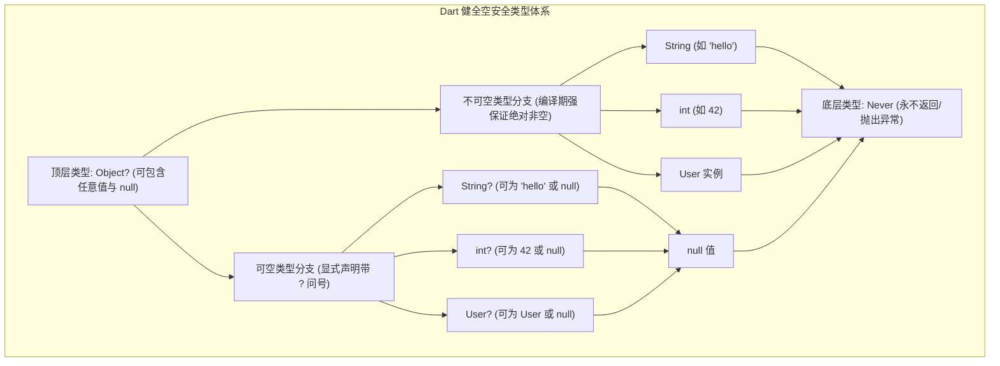
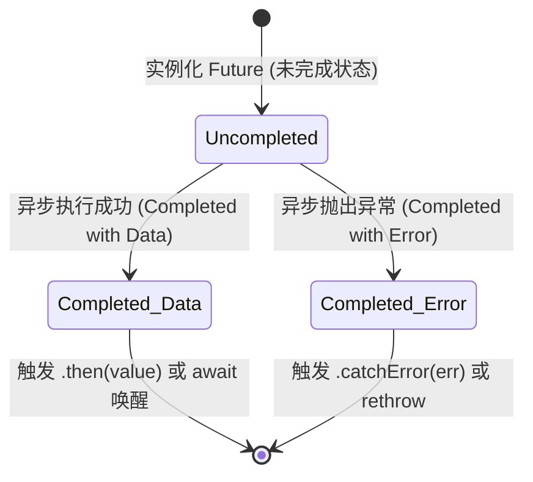

# 初级-Dart基础核心语法空安全与异步编程Future-Stream

作为 Google 为全平台客户端打造的高性能现代编程语言，Dart 是掌握 Flutter 开发的基石。在 Dart 3+ 时代，语言已全面升级为 100% 健全的空安全体系（Sound Null Safety），并具备独特的单线程事件循环（Event Loop）与响应式异步流（Stream）机制。本篇专题从零起步，深度剖析 Dart 的基础核心语法、空安全物理机制、微任务队列（Microtask）与事件队列（Event Queue）时序，帮助初学者筑牢内功。

---

## 一、核心底层机制与全景架构

### 1.1 Sound Null Safety 健全空安全物理拓扑

在传统语言中，`NullPointerException`（空指针异常 NPE）是客户端最常见的致命崩溃。Dart 3 引入了 **健全空安全（Sound Null Safety）**：
- **编译期物理隔离**：类型系统在静态分析阶段将所有类型严格划分为**不可空类型（Non-nullable）**与**可空类型（Nullable）**。
- **运行期零空指针保证**：不可空变量在物理内存中绝对不可能被赋值为 `null`，编译器会通过控制流分析（Flow Analysis）消除冗余的空检查，并在 AOT 编译为机器码时剔除空防护代码，实现安全与性能的双重飞跃。



---

### 1.2 Dart 单线程模型与事件循环（Event Loop）物理时序

与 Java / C++ 默认的多线程共享内存并发模型不同，Dart 采用**单线程执行上下文（Single-threaded Isolate）**。一个 Dart 线程内部维护了一个永不停歇的 **事件循环（Event Loop）** 与两个先进先出（FIFO）的任务队列：
1. **微任务队列（Microtask Queue）**：优先级最高。通常由内部框架或 `scheduleMicrotask()` 生成，用于非常紧急且轻量的快速回调。
2. **事件队列（Event Queue）**：用于处理外部 I/O、计时器（Timer）、用户手势点击、绘制帧信号以及通过 `Future` 派发的异步任务。

```mermaid
sequenceDiagram
    autonumber
    participant Main as Dart 主同步调用栈 (Call Stack)
    participant Micro as 微任务队列 (Microtask Queue)
    participant Event as 事件队列 (Event Queue)
    participant Loop as 事件循环引擎 (Event Loop)

    Main->>Main: 执行 main() 中所有同步代码 (阻塞式执行直到栈清空)
    Loop->>Micro: 检查微任务队列是否为空?
    alt 微任务队列非空
        Loop->>Micro: 依次取出微任务执行，直到清空所有微任务
    else 微任务队列已清空
        Loop->>Event: 从事件队列取出一个 Event 任务执行
        Event->>Main: 执行该任务中的同步回调代码
        Main-->>Loop: 执行完毕，重新优先轮询 Microtask Queue!
    end
```

> [!IMPORTANT]
> **事件循环调度法则**：每次从“事件队列”中取出一个任务执行完毕后，Dart 事件循环都会**立刻回头检查微任务队列**。只要微任务队列中有未完成的任务，它必须**优先把所有微任务全部抽干执行完毕**，才会回到事件队列处理下一个事件。

---

## 二、源码级/算法物理推导

### 2.1 空安全四大核心操作符物理语义

#### 1. 可空声明操作符 `?`
在类型后附加 `?`，告知编译器该变量可能在某一时刻为 `null`：
```dart
String? optionalName; // 初始默认物理值为 null
optionalName = "Alice";
```

#### 2. 安全调用操作符 `?.`
在调用方法或访问属性时，若左侧对象为 `null`，则短路返回 `null`，绝不抛出崩溃：
```dart
int? length = optionalName?.length; // 若 optionalName 为 null，则 length 为 null
```

#### 3. 空合并操作符 `??` 与复合赋值 `??=`
提供备选默认值，或在变量为 `null` 时执行就地初始化：
```dart
String displayName = optionalName ?? "匿名用户";
optionalName ??= "默认值"; // 若当前为 null 则赋值，否则保持不变
```

#### 4. 强制解包断言操作符 `!`（Bangs Operator）
向编译器发誓断言该变量在当前代码位置绝对不为 `null`。若运行时实际为 `null`，会立即抛出致命的 `TypeError`。生产环境除非有前置判断兜底，否则严禁滥用。

#### 5. 延迟初始化关键字 `late`
告知编译器：“该变量虽然不可空，但我无法在构造函数或声明时立刻赋值，我承诺会在第一次读取前完成初始化”：
```dart
class UserController {
  late final String apiSecret;

  void initialize(String secret) {
    apiSecret = secret; // 承诺在读取前初始化
  }

  void printSecret() {
    print(apiSecret); // 若未调用 initialize 先执行此处，抛出 LateInitializationError!
  }
}
```

---

### 2.2 Future 异步编程与状态机机理

`Future<T>` 是 Dart 中表示“未来某个时刻会产生计算结果（成功或失败）”的容器对象。

#### Future 物理状态流转


#### 同步代码与异步 Event Loop 执行顺序推导试题
```dart
void testEventLoop() {
  print('1 - main start');

  Future(() {
    print('2 - Event Queue: Future 1');
  });

  Future.microtask(() {
    print('3 - Microtask Queue 1');
  });

  scheduleMicrotask(() {
    print('4 - Microtask Queue 2');
  });

  Future(() {
    print('5 - Event Queue: Future 2');
    scheduleMicrotask(() {
      print('6 - Microtask inside Future 2');
    });
  });

  print('7 - main end');
}
```

**物理输出推导过程**：
1. 首先执行主调用栈上的全部同步代码：打印 `1 - main start` 与 `7 - main end`；
2. 此时微任务队列中有：`[任务3, 任务4]`；事件队列中有：`[任务2, 任务5]`；
3. 清空微任务队列：依次打印 `3 - Microtask Queue 1`、`4 - Microtask Queue 2`；
4. 微任务队列已空，从事件队列取出第一个任务：打印 `2 - Event Queue: Future 1`；
5. 从事件队列取出第二个任务：打印 `5 - Event Queue: Future 2`，此时代码动态向微任务队列插入了 `任务6`；
6. 当前事件处理完毕，Loop 立刻优先检查微任务队列，发现 `任务6`，立即打印 `6 - Microtask inside Future 2`！
7. **最终确定性输出**：`1 -> 7 -> 3 -> 4 -> 2 -> 5 -> 6`。

---

### 2.3 Stream 响应式流物理模型

如果说 `Future` 代表单次异步结果，那么 `Stream` 就代表**一系列随时间推移陆续到达的异步数据流**。
- **单订阅流（Single-subscription Stream）**：默认类型。在整个生命周期内只允许存在一个监听者（`listen`），常用于大文件下载、网络请求读流；
- **广播流（Broadcast Stream）**：允许多个监听者同时订阅（如用户位置变更、全局即时通讯聊天消息）。

```dart
// 生产级 StreamController 最佳实践
import 'dart:async';

class CounterBloc {
  int _count = 0;
  // 创建广播流控制器
  final _controller = StreamController<int>.broadcast();

  // 对外暴露纯只读 Stream
  Stream<int> get counterStream => _controller.stream;

  void increment() {
    _count++;
    _controller.sink.add(_count); // 生产数据推入管道
  }

  // 必须在组件卸载时关闭，否则引发严重的内存泄漏
  void dispose() {
    _controller.close();
  }
}
```

---

## 三、社招高频硬核连环追问

### 追问 1：为什么 Dart 选择单线程模型配合事件循环，而不是像 Java 一样默认采用多线程共享内存？
**标杆解答**：
1. **彻底消除锁竞争与死锁（Zero Locking Overhead）**：在传统多线程共享内存模型中，为了防止多线程并发读写同一块内存引发数据错乱，必须引入互斥锁（Mutex）、读写锁、同步块（`synchronized`）以及复杂的 CAS 无锁机制，这不仅开发复杂度极高，而且锁开销与死锁排查极具风险；
2. **极致贴合客户端 UI 渲染管道**：移动端 UI 界面是天然单线程事件驱动的（如主线程负责布局、事件分发与绘制）。单线程 + 事件循环模型杜绝了线程上下文切换（Context Switch）的内核态开销，能够保证高帧率下的平滑调度；
3. **计算密集型任务通过物理隔离的 Isolate 解决**：当遇到复杂数据加密、大型 JSON 解析等重任务时，Dart 提供了内存独立隔离的 `Isolate`，既享受多核并行，又从物理层面杜绝了共享内存并发竞争。

---

### 追问 2：声明变量时，`final` 和 `const` 有什么底层物理区别？为什么 Flutter 极度提倡在 Widget 构造函数前加 `const`？
**标杆解答**：
1. **物理生命周期与初始化时机不同**：
   - `final`：**运行时常量（Runtime Constant）**。变量只能被赋值一次，但初始化的具体值可以是在程序运行时动态计算出来的（例如：`final time = DateTime.now();`）；
   - `const`：**编译期常量（Compile-Time Constant）**。变量的值必须在编译器编译 AST 阶段就完全确定，且必须由纯常量字面量构造。
2. **内存分配与规范化（Canonicalization）**：
   - 所有的 `const` 对象在编译期会被放入常量池（Constant Pool）。无论在代码中创建了多少次 `const Text('Hello')`，**在内存中永远只分配一份唯一的物理内存地址**。
3. **Flutter 性能收益（Rebuild 跳过）**：
   - 当父 Widget 执行 `setState()` 触发全子树重新 `build()` 时，带有 `const` 构造函数的 Widget 会被 Element 树直接判定为物理内存地址完全相同（`identical(oldWidget, newWidget) == true`），**直接跳过对该子组件及其全部后代的重新创建与 Diff**，从而大幅减少 CPU 消耗与 GC 压力。

---

### 追问 3：在什么情况下使用 `late` 关键字会导致程序在运行时直接崩溃？如何优雅检测 `late` 是否已完成初始化？
**标杆解答**：
1. **崩溃诱因**：如果一个不可空字段被声明为 `late String config`，但在某些异步分支或条件判断遗漏的情况下，尚未执行初始化代码就读取了 `config`，Dart VM 会立即抛出未捕获的 `LateInitializationError: Field 'config' has not been initialized` 导致 Crash。
2. **无法直接通过 `if (config == null)` 检测**：尝试读取 `config` 来与 `null` 做比较的行为本身就会立刻触发该崩溃。
3. **优雅防御 SOP**：
   - **方案 A（最佳实践）**：声明为可空类型 `String? config`，通过安全的 `if (config != null)` 做判空分支控制；
   - **方案 B**：利用 `late` 的惰性求值（Lazy Evaluation）特性，在声明时直接绑定初始化器：`late final String config = _loadConfigSync();`，该函数会在初次读取时且仅在初次读取时同步触发。

---

## 四、生产级避坑指南与排障 SOP

### 4.1 避坑 1：异步代码中的未捕获异常导致应用悄然崩溃
在处理异步 `Future` 时，如果仅书写了 `await` 但没有包裹 `try-catch`，一旦网络断开或服务端抛出 500，异常会一路击穿冒泡：

```dart
// 危险做法：未捕获的异步异常直接抛到全局，引发未定义行为
Future<void> fetchUserData() async {
  final user = await api.getUser(); // 若失败，直接导致整个异步链路崩溃挂起
  updateUI(user);
}

// 规范工程 SOP：完备的异步错误处理闭环
Future<void> safeFetchUserData() async {
  try {
    final user = await api.getUser();
    updateUI(user);
  } on SocketException catch (e) {
    showToast('网络连接中断，请检查 Wi-Fi/移动数据');
  } on FormatException catch (e) {
    showToast('服务端数据契约解析失败');
  } catch (e, stackTrace) {
    // 捕获未预期的兜底错误并上报 APM 监控中台
    reportErrorToSentry(e, stackTrace);
  }
}
```

---

### 4.2 避坑 2：Stream 订阅未在生命周期结束时手动注销（内存泄漏）
当在 `StatefulWidget` 中订阅了一个全局 Stream 或单例消息通道：
```dart
// 错误示范：组件销毁后，订阅关系依然常驻内存
class _ChatViewState extends State<ChatView> {
  @override
  void initState() {
    super.initState();
    chatService.messageStream.listen((msg) {
      // 这里的闭包强引用了 State 实例，导致页面 pop 返回后整个 Widget 树与 DOM 内存彻底无法释放！
      setState(() { /* ... */ });
    });
  }
}
```

**生产级清理 SOP**：必须显式持有 `StreamSubscription` 句柄并在 `dispose()` 中关闭：
```dart
class _ChatViewState extends State<ChatView> {
  StreamSubscription<Message>? _messageSub;

  @override
  void initState() {
    super.initState();
    _messageSub = chatService.messageStream.listen((msg) {
      if (!mounted) return; // 防御性检查组件挂载状态
      setState(() { /* ... */ });
    });
  }

  @override
  void dispose() {
    // 必须调用 cancel 释放流监听
    _messageSub?.cancel();
    _messageSub = null;
    super.dispose();
  }
}
```
