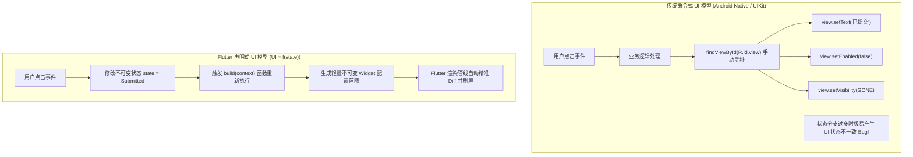
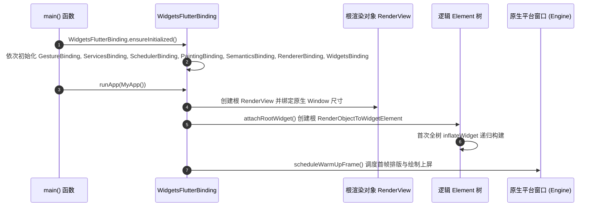

# 初级-Flutter工程目录结构与Widget声明式UI编程思想

在跨平台 UI 架构演进中，Flutter 彻底颠覆了以 Android XML、iOS Storyboard/UIKit 以及早期的 React Native（桥接原生组件）为代表的“命令式（Imperative）”UI 编程传统。深入理解 Flutter 的**声明式 UI（Declarative UI）**心智模型、“一切皆 Widget”的组合设计哲学，以及规范化的工程物理目录分层，是每一位 Flutter 开发者走向专业化的关键第一步。

---

## 一、核心底层机制与全景架构

### 1.1 命令式 UI vs 声明式 UI 物理机制对比

传统客户端开发（如 Android 原生 `findViewById` / `setText()`）属于典型的**命令式编程**：
- 开发者必须通过一系列细粒度的命令步骤，去手动查询特定 UI 节点，并在特定事件发生时手动修改其内部属性（如 `button.setEnabled(false)`）。这种模式在业务复杂时极易造成 UI 状态与底层数据状态的不同步。

Flutter 采用纯粹的**声明式 UI 架构**：
- 核心公式：$$\text{UI} = f(\text{state})$$
- 视图仅仅是当前业务状态在某一时间切片下的**纯函数映射表现**。开发者无需手动调用命令去突变修改现有控件，而是在状态（State）发生改变时，触发框架重新执行构建函数，由 Flutter 框架自行比对并高效更新屏幕渲染。



---

### 1.2 Flutter 标准工程物理目录结构剖析

一个标准的企业级 Flutter 跨平台项目在磁盘上的物理拓扑如下：

```
my_flutter_app/
├── android/            # Android 原生宿主工程 (Gradle 配置、MainActivity、AndroidManifest)
├── ios/                # iOS 原生宿主工程 (Xcode 工程、Podfile、Info.plist、Runner)
├── web/                # Web 平台宿主工程 (index.html、manifest.json)
├── macos/ / windows/   # 桌面端原生宿主工程
├── lib/                # 核心 Dart 业务代码目录 (开发者 95% 时间工作的区域)
│   ├── main.dart       # 应用唯一执行入口 (包含 main() 函数与 runApp())
│   ├── core/           # 全局核心基建 (网络封装、路由定义、本地存储、主题与常量)
│   ├── features/       # 业务特性模块 (按业务维度垂直分层: login, home, profile)
│   └── shared/         # 跨模块共享 (通用基础组件 UI、通用 Hooks、工具函数)
├── assets/             # 静态资产目录 (图片、SVG 图标、自定义字体、离线 JSON)
│   ├── images/
│   │   ├── logo.png    # 1.0x 基准图
│   │   ├── 2.0x/logo.png # 2.0x 视网膜高清图
│   │   └── 3.0x/logo.png # 3.0x 超高清图
├── test/               # 自动化单元测试与 Widget 仿真测试
├── pubspec.yaml        # 项目核心包依赖管理与资源配置清单 (类似 package.json / pom.xml)
└── pubspec.lock        # 确定的依赖物理版本锁定文件
```

---

## 二、源码级/架构物理推导

### 2.1 应用入口 `main()` 与 `runApp()` 的底层时序

每一个 Flutter 应用都从 `lib/main.dart` 中的 `main()` 函数启动。调用 `runApp(Widget app)` 并非仅仅挂载视图，而是启动了整套底层跨平台渲染引擎与生命周期管理服务：

```dart
// 源码: packages/flutter/lib/src/widgets/binding.dart
void runApp(Widget app) {
  final WidgetsBinding binding = WidgetsFlutterBinding.ensureInitialized();
  assert(binding != null);
  binding
    ..scheduleAttachRootWidget(app)
    ..scheduleWarmUpFrame();
}
```



---

### 2.2 MaterialApp 与 ThemeData 主题基座

在 Flutter 中，`MaterialApp`（或 iOS 风格的 `CupertinoApp`）是整个应用的最顶层容器 Widget。它在内部封装了核心的三大基础设施：
1. **全局导航器（Navigator）**：管理页面的出入栈路由管理；
2. **主题体系（Theme / ThemeData）**：集中定义全应用的色彩体系、字体规则、组件默认样式；
3. **国际化与媒体查询（MediaQuery / Localizations）**：负责监听系统深色模式、屏幕物理分辨率（DPI）、安全区域插槽（SafeArea）以及语言环境。

```dart
// main.dart 标准企业级入口模板
import 'package:flutter/material.dart';

void main() {
  // 生产级规范：执行任何异步初始化前必须确保 Binding 准备完毕
  WidgetsFlutterBinding.ensureInitialized();
  runApp(const MainApp());
}

class MainApp extends StatelessWidget {
  const MainApp({super.key});

  @override
  Widget build(BuildContext context) {
    return MaterialApp(
      title: 'Enterprise App',
      debugShowCheckedModeBanner: false, // 隐藏右上角 Debug 标签
      themeMode: ThemeMode.system,       // 跟随系统自动切换深色主题
      
      // 亮色主题
      theme: ThemeData(
        useMaterial3: true,
        colorScheme: ColorScheme.fromSeed(
          seedColor: const Color(0xFF2563EB),
          brightness: Brightness.light,
        ),
        scaffoldBackgroundColor: const Color(0xFFF8FAFC),
      ),
      
      // 暗色主题
      darkTheme: ThemeData(
        useMaterial3: true,
        colorScheme: ColorScheme.fromSeed(
          seedColor: const Color(0xFF2563EB),
          brightness: Brightness.dark,
        ),
        scaffoldBackgroundColor: const Color(0xFF0F172A),
      ),
      
      home: const HomeScreen(),
    );
  }
}
```

---

## 三、社招高频硬核连环追问

### 追问 1：为什么 Flutter 不像 React Native 那样直接将组件映射为原生控件（Native Views）？它的自渲染机制带来了什么根本优势与代价？
**标杆解答**：
1. **React Native 的“原生桥接”瓶颈**：
   - RN 的 JS 代码运行在独立的 JavaScriptCore / Hermes 引擎中。当需要更新一个按钮时，必须将指令序列化为 JSON，通过 C++ Bridge 跨线程异步传递给原生端主线程（UI Thread），再由原生系统（Android UI / iOS UIKit）创建真实的 `android.widget.Button` 或 `UIButton`。
   - 这导致两大不可逆痛点：**频繁跨桥通信引发严重卡顿（Bridge Traffic）**，以及**两端系统原生控件样式与行为难以做到 100% 像素级一致（如圆角、阴影、滑动物理阻尼差异）**。
2. **Flutter 的自渲染架构（Self-Rendering Engine）**：
   - Flutter 彻底废弃了原生系统的 UI 控件体系。Flutter 仅向原生系统索取一个纯净的原生画布（Android 端的 `SurfaceView` / iOS 端的 `CAMetalLayer`）；
   - 所有的排版、文本测量、点击事件分发、动画与像素光栅化，**完全由 Flutter 自身的 C++ 渲染引擎（Skia / Impeller）直接调用 GPU 绘制上屏**。
3. **根本优势与代价**：
   - **优势**：多端达到 100% 像素级一致（绝对没有平台分裂现象）；60/120Hz 极致丝滑的高刷动画；全平台（iOS/Android/Web/macOS/Windows）逻辑与视图高复用。
   - **代价**：初始包体积较大（必须内嵌完整的 C++ 渲染引擎与 Dart VM 运行时，通常增加 4MB~8MB 基础体积）。

---

### 追问 2：在声明式 UI 中，当调用 `setState()` 触发重绘时，是否真的会把整棵庞大的 UI 树彻底销毁并重新创建？为什么性能依然极高？
**标杆解答**：
1. **Widget 树只是轻量级“配置蓝图（Configuration Blueprint）”**：
   - Widget 本身并不是真实的屏幕渲染对象，它只是一个极其轻量、不可变（Immutable）的纯 Dart 配置对象；
   - 创建一个普通的 Widget 实例仅仅是在内存堆中分配数十个字节的内存指针，耗时通常仅为数十纳秒，**其创建与 GC 销毁成本微乎其微**。
2. **真正厚重的是底层 RenderObject 树**：
   - 真正负责计算几何尺寸、执行复杂布局排版和调用 GPU 画布的是厚重的 `RenderObject` 实例对象。
   - **Flutter 拥有三棵树架构（Widget 树 -> Element 树 -> RenderObject 树）**：当 Widget 重新 `build()` 时，中间层的 `Element` 树会调用 `Widget.canUpdate(oldWidget, newWidget)` 执行智能 Diff 比对。如果新旧 Widget 的 `runtimeType` 和 `key` 保持一致，**底层的 RenderObject 对象绝对不会被销毁重建，仅仅是将新的属性传递给现有的 RenderObject 进行局部更新**，从而保证了极其高昂的原生渲染性能。

---

### 追问 3：为什么在 `main()` 函数中执行异步初始化（如 Firebase、本地数据库迁移）前，必须显式调用 `WidgetsFlutterBinding.ensureInitialized()`？
**标杆解答**：
1. **Binding 单例的初始化物理契约**：
   - `WidgetsFlutterBinding` 是连接 Flutter Framework 纯 Dart 逻辑层与底层的 C++ 引擎层（Engine）的全局核心纽带。
   - 它必须在内部初始化 `ServicesBinding`（负责 Platform Channel 原生通信通道）和 `BinaryMessenger`（二进制消息管道）。
2. **未初始化的致命崩溃机理**：
   - 默认情况下，`runApp()` 内部第一行才会去触发 `ensureInitialized()`；
   - 如果开发者在调用 `runApp()` 之前，在 `main()` 中提前书写了异步代码，例如：
     ```dart
     void main() async {
       // 未调用 ensureInitialized!
       await SharedPreferences.getInstance(); // 底层通过 MethodChannel 调用原生代码
       runApp(const MyApp());
     }
     ```
     此时底层原生的 `BinaryMessenger` 管道尚未完成注册和内存绑定，跨端通信直接抛出致命未捕获异常：`AssertionError: ServicesBinding.defaultBinaryMessenger was accessed before the binding was initialized.`。

---

## 四、生产级避坑指南与排障 SOP

### 4.1 避坑 1：`pubspec.yaml` 资产路径配置格式错误导致构建打包遗漏

在 Flutter 中引入图片资源时，`pubspec.yaml` 采用严格的 YAML 缩进规范：

```yaml
# 错误示范 1: 缺少缩进或直接书写文件名
flutter:
assets: # ❌ 缩进错误，必须比上一级缩进两个空格
  - assets/images/logo.png

# 正规配置 SOP (支持目录级自动扫描与 2.0x/3.0x 多倍图自适应)
flutter:
  uses-material-design: true

  # 只要声明到目录斜杠结尾，Flutter 打包构建时会自动打包该目录下的全部静态资产
  assets:
    - assets/images/
    - assets/icons/
    - assets/mock/
```
> [!TIP]
> **多倍图自动适配规范**：在 `assets/images/` 目录下放置 `avatar.png`（基准图），并在同级创建子目录 `2.0x/avatar.png` 和 `3.0x/avatar.png`。在 `pubspec.yaml` 中**只需要声明主目录 `- assets/images/`**，Flutter 底层图片解析器在加载 `Image.asset('assets/images/avatar.png')` 时，会自动根据设备屏幕物理像素比（`devicePixelRatio`）精准加载最清晰的高清图。

---

### 4.2 避坑 2：依赖包版本号符号语义陷阱引发生产打包漂移

在 `pubspec.yaml` 中引入三方开源包时：

```yaml
dependencies:
  # 危险做法: 符号 ^ 表示允许更新至不破坏 API 的最高 minor 版本
  # 若库作者失误发布了破坏性改动的版本，流水线重新拉取时将直接导致生产构建暴雷!
  dio: ^5.4.0 
```

**工程化版本锁死 SOP**：
1. **生产级依赖必须固定版本**：对于核心基础库，推荐去掉 `^` 符号固定版本，或严格使用 `pubspec.lock`；
2. **强制推行 `flutter pub get --offline` 与 CI 依赖锁定**：在持续集成 CI/CD 流水线上，使用 `flutter pub get` 后检查 `git diff pubspec.lock`，禁止依赖包无序静默升级。
