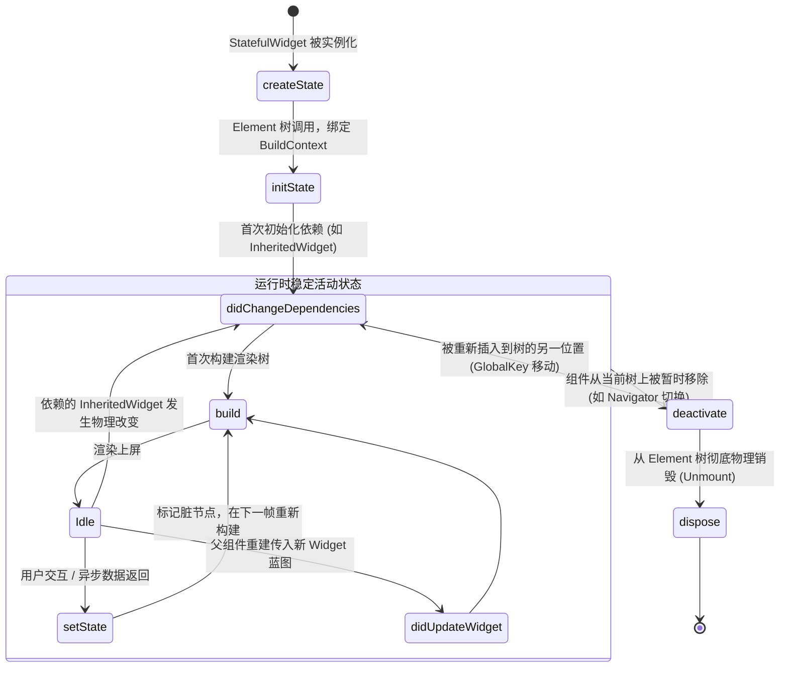

# 初级-StatelessWidget与StatefulWidget核心生命周期与setState

在 Flutter 声明式 UI 体系中，组件被划分为无状态的 **`StatelessWidget`** 与有状态的 **`StatefulWidget`**。深入掌握 `State` 对象的完整生命周期流转、`setState()` 在框架底层触发脏节点标记的微观执行时序，以及 `mounted` 状态的物理防御机制，是杜绝生产端内存泄漏与崩溃（如 `setState() called after dispose()`）的必备基本功。

---

## 一、核心底层机制与全景架构

### 1.1 StatelessWidget 与 StatefulWidget 适用边界

| 维度对比 | `StatelessWidget` (无状态组件) | `StatefulWidget` (有状态组件) |
| :--- | :--- | :--- |
| **可变内部状态** | **完全无状态**。构造后所有内部字段必须是 `final` 只读的 | **持有可变状态**。通过绑定的 `State` 对象在运行时管理动态变化的数据 |
| **重新渲染机制** | 只能由外部传入的参数改变、或祖先 `InheritedWidget` 更新驱动重建 | 内部可主动通过 `setState()` 触发局部或自身重建 |
| **生命周期深度** | 仅有单一的 `build(BuildContext context)` 方法 | 拥有从创建、依赖变更、更新、休眠到彻底销毁的完整生命周期链路 |
| **性能特征** | 内存极度轻量，强烈推荐添加 `const` 构造函数最大化复用 | 伴随 `State` 对象的物理堆内存分配，需规范管理资源释放 |

---

### 1.2 State 完整生命周期物理流转图谱



---

## 二、源码级/执行时序物理推导

### 2.1 生命周期各阶段核心职责与代码执行时序

#### 1. `createState()`
当将 `StatefulWidget` 插入 Element 树时，框架调用此方法创建与其关联的持久化 `State` 实例。一个 Widget 实例可以多次被创建，但对应的 `State` 实例在组件树存活期间是稳定唯一的。

#### 2. `initState()`
`State` 对象生命周期的绝对起点。在组件的整个生命周期中**有且仅执行一次**。
- **核心职责**：初始化成员变量、实例化控制器（如 `AnimationController`、`TextEditingController`、`ScrollController`）、注册全局事件广播流。
- **注意**：此时不能调用 `Theme.of(context)` 或 `MediaQuery.of(context)`，因为当前 Element 尚未完全加入树拓扑结构。

#### 3. `didChangeDependencies()`
紧随 `initState()` 之后立即被框架自动调用；或者当当前组件通过 `dependOnInheritedWidgetOfExactType` 依赖的全局对象（如 `Theme`、`Localizations`、`Provider`）发生更新时被再次调用。
- **核心职责**：执行依赖祖先 Context 的初始化逻辑（如获取屏幕宽高、初始化网络多语言字典）。

#### 4. `build(BuildContext context)`
返回描述 UI 结构的 Widget 树。这是一个高频调用的纯函数方法：
- **触发时机**：首次挂载、`setState()`、`didUpdateWidget()`、`didChangeDependencies()` 之后均会执行。
- **设计禁忌**：**绝对严禁在 `build()` 内部执行任何异步请求、数据库查询、定时器启动或控制器实例化**！

#### 5. `didUpdateWidget(covariant T oldWidget)`
当父级 Widget 重新构建，且传入的新 Widget 具有相同的 `runtimeType` 和 `key` 时被触发。
- **核心职责**：对比新旧 Widget 的入参配置差值（`widget.userId != oldWidget.userId`），从而做出相应的业务状态联动调整。

#### 6. `deactivate()`
当当前组件的 Element 被从节点树中暂时移除时调用（例如：页面被弹出路由栈、或者在使用 `GlobalKey` 跨父级移动组件时）。

#### 7. `dispose()`
`State` 对象的生命周期终点。组件从树上彻底物理卸载。
- **核心职责**：**必须在此处集中清理所有系统资源**：`controller.dispose()`、`timer.cancel()`、`streamSubscription.cancel()`，以彻底杜绝内存泄漏。

---

### 2.2 `setState()` 底层更新调度物理时序

开发者在调用 `setState(fn)` 时，Flutter 并非立即同步重新执行 `build()`，而是执行了严密的帧渲染调度（Frame Scheduling）：

```dart
// 源码: packages/flutter/lib/src/widgets/framework.dart
void setState(VoidCallback fn) {
  // 1. 断言检查: 若在 dispose 之后调用，立即抛出崩溃
  assert(mounted, 'setState() called after dispose()...');
  
  // 2. 执行开发者传入的回调函数，修改内部数据状态
  final Object? result = fn() as dynamic;
  
  // 3. 将当前 StatefulElement 标记为脏节点 (Dirty)
  _element!.markNeedsBuild();
}
```

```mermaid
sequenceDiagram
    autonumber
    participant App as 业务代码
    participant Element as StatefulElement
    participant Owner as BuildOwner (全局构建调度器)
    participant Pipeline as PipelineOwner (渲染管线)
    participant Vsync as 硬件 Vsync 信号

    App->>Element: setState(() { count++; })
    Element->>Element: _dirty = true (标记为脏节点)
    Element->>Owner: scheduleBuildFor(this)
    Owner->>Owner: 将当前 Element 压入 _dirtyElements 列表
    Owner->>Pipeline: requestVisualUpdate() 申请屏幕刷新
    Vsync->>Pipeline: 屏幕刷新脉冲信号 (60Hz / 120Hz)
    Pipeline->>Owner: buildScope() 遍历清空 _dirtyElements
    Owner->>Element: rebuild() -> performRebuild()
    Element->>App: 调用 State.build(context) 生成新 Widget
    Element->>Pipeline: 触发 RenderObject 局部重排重绘上屏
```

---

## 三、社招高频硬核连环追问

### 追问 1：为什么 Flutter 要把 `StatefulWidget` 和 `State` 物理拆分成两个完全不同的类？为什么不把状态直接保存在 Widget 里？
**标杆解答**：
1. **性能与内存的物理诉求**：
   - Widget 是不可变的（Immutable），其物理职责仅仅是“轻量级的临时配置描述参数”；每次父组件重新渲染，旧的 Widget 实例都会被抛弃，新的 Widget 会在内存中重新实例化。
   - 如果将持久化的业务状态（如表单正在输入的内容、网络请求的数据）直接保存在 Widget 内部，那么每次父级更新时，这些数据就会随着 Widget 的销毁而全部丢失！
2. **三棵树架构的解耦（Element 桥接）**：
   - `State` 对象是**长生命周期的持久化实体**，它在物理内存中被常驻的 `StatefulElement` 所强引用持有；
   - 即使外部的 `StatefulWidget` 被频繁销毁和重新创建，底层的 `StatefulElement` 依然存活，它会无缝将新的 Widget 配置挂载给这个长期存活的 `State` 对象（通过 `didUpdateWidget` 通知），**从而实现了在极低开销重新生成配置的同时，完美保留业务状态**。

---

### 追问 2：为什么严禁在 `initState()` 中直接调用 `Theme.of(context)` 或 `MediaQuery.of(context)`？底层机理是什么？
**标杆解答**：
1. **树注册依赖的时序未完成**：
   - `Theme.of(context)` 底层调用的是 `context.dependOnInheritedWidgetOfExactType<InheritedTheme>()`；
   - 这个方法的核心逻辑不仅是“向上查找数据”，更是向祖先 `InheritedWidget` **注册建立依赖观察者关系**（当 Theme 改变时自动通知当前组件）；
   - 在 `initState()` 执行的那一刻，当前 `StatefulElement` 仅仅刚刚完成了与 State 的绑定，**它尚未被正式连接到 Element 祖先树的作用域图谱中**，无法注册依赖监听。
2. **标准规范**：
   - 若需要根据全局主题或屏幕尺寸做初始化计算，**必须将逻辑迁移至 `didChangeDependencies()` 生命周期钩子中执行**。

---

### 追问 3：为什么在异步网络请求返回后调用 `setState()` 经常报 `setState() called after dispose()` 致命崩溃？怎么彻底根治？
**标杆解答**：
1. **产生诱因与时序错位**：
   - 用户打开页面发起了一个耗时 3 秒的网络请求 `api.fetchData()`；
   - 用户在第 1 秒点击了左上角返回按钮，当前页面被 Navigator Pop 出栈，页面触发 `deactivate()` 并彻底执行 `dispose()`；
   - 第 3 秒网络请求成功返回，异步回调恢复执行并调用 `setState(...)`；
   - 此时组件的 `_element` 已被置空，`mounted == false`，底层断言直接抛出崩溃。
2. **彻底根治方案（两步防御体系）**：
   - **第一步：`mounted` 状态安全校验**：
     ```dart
     final result = await api.fetchData();
     // 必须在调用 setState 前防御性判断当前组件是否仍然处于挂载存活状态
     if (!mounted) return;
     setState(() {
       _data = result;
     });
     ```
   - **第二步：页面退出时取消网络请求**：结合 Dio 的 `CancelToken` 在 `dispose()` 中主动中断未完成的 HTTP 连接，杜绝无意义的后台回调。

---

## 四、生产级避坑指南与排障 SOP

### 4.1 生产级 StatefulWidget 完整生命周期资源清理标准模板

```dart
import 'dart:async';
import 'package:flutter/material.dart';

class UserDetailScreen extends StatefulWidget {
  final String userId;

  const UserDetailScreen({
    super.key,
    required this.userId,
  });

  @override
  State<UserDetailScreen> createState() => _UserDetailScreenState();
}

class _UserDetailScreenState extends State<UserDetailScreen> {
  late final TextEditingController _textController;
  late final ScrollController _scrollController;
  Timer? _pollingTimer;
  bool _isLoading = false;

  @override
  void initState() {
    super.initState();
    // 1. 初始化纯局部控制器 (无 Context 依赖)
    _textController = TextEditingController();
    _scrollController = ScrollController();

    // 2. 启动异步网络请求
    _loadUserData();

    // 3. 启动定时轮询任务
    _pollingTimer = Timer.periodic(const Duration(seconds: 10), (_) {
      _checkNotification();
    });
  }

  @override
  void didChangeDependencies() {
    super.didChangeDependencies();
    // 依赖全局 InheritedWidget (如 Theme / MediaQuery) 的安全初始化区域
  }

  @override
  void didUpdateWidget(covariant UserDetailScreen oldWidget) {
    super.didUpdateWidget(oldWidget);
    // 当父级传入的 userId 发生变更时，重新加载数据
    if (widget.userId != oldWidget.userId) {
      _loadUserData();
    }
  }

  Future<void> _loadUserData() async {
    setState(() => _isLoading = true);
    
    // 模拟耗时网络请求
    await Future.delayed(const Duration(seconds: 2));

    // 关键生产防爆：异步恢复后必须校验 mounted
    if (!mounted) return;

    setState(() {
      _isLoading = false;
      _textController.text = "Loaded data for ${widget.userId}";
    });
  }

  void _checkNotification() {
    if (!mounted) return;
    // 执行轮询
  }

  @override
  Widget build(BuildContext context) {
    return Scaffold(
      appBar: AppBar(title: Text("用户: ${widget.userId}")),
      body: _isLoading
          ? const Center(child: CircularProgressIndicator())
          : Padding(
              padding: const EdgeInsets.all(16.0),
              child: TextField(controller: _textController),
            ),
    );
  }

  @override
  void dispose() {
    // 生产级释放清理 SOP: 严格注销全部控制器与定时器
    _pollingTimer?.cancel();
    _pollingTimer = null;
    
    _textController.dispose();
    _scrollController.dispose();
    
    super.dispose();
  }
}
```
