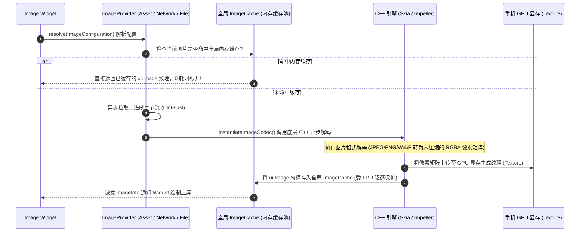
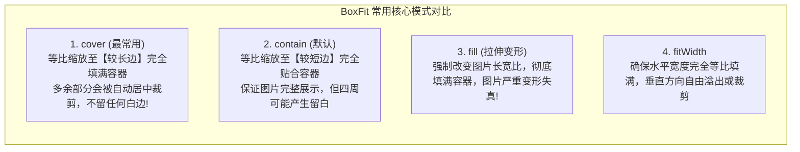

# 初级-图片组件Image全场景加载资产网络与缓存策略

在移动客户端图形渲染中，图片是占用内存最大、最易引发 GPU 掉帧与 OOM（Out of Memory）崩溃的重型资源。Flutter 提供了全场景图片展示控件 **`Image`** 与底层图片驱动体系 **`ImageProvider`**。初学者常因缺乏大图下采样意识导致解码显存暴增数十倍，或因网络图片缺乏磁盘持久化缓存导致列表快速滑动时频繁闪烁白块。本篇专题深入剖析 Flutter 图片解码管线、全局 `ImageCache` 物理模型，以及工业级加载最佳实践。

---

## 一、核心底层机制与全景架构

### 1.1 Flutter 图片从二进制到 GPU 纹理全链路时序

图片在 Flutter 中并不是简单的像素贴图，而是经历了一套严密的异步解码与显存上传管线：



---

### 1.2 四大 Image 构造函数物理来源与适用场景

| 构造函数 | 底层 ImageProvider | 物理数据来源 | 适用场景 |
| :--- | :--- | :--- | :--- |
| **`Image.asset(...)`** | `AssetImage` | 打包在 App 安装包内部的静态资产（Assets） | 本地固定图标、引导页插画、本地预置骨架图 |
| **`Image.network(...)`** | `NetworkImage` | 远程 HTTP / HTTPS 网络图片地址 | 用户网络头像、动态商品主图（无磁盘持久化） |
| **`Image.file(...)`** | `FileImage` | 手机本地文件系统磁盘物理路径（如 SD 卡、沙盒目录） | 相机新拍摄的照片、相册选取待上传的原图 |
| **`Image.memory(...)`** | `MemoryImage` | 内存中的原始二进制字节数组（`Uint8List`） | 原生端传递的字节流、Canvas 导出的 Base64 图片 |

---

## 二、源码级/算法物理推导

### 2.1 全局 `ImageCache` 物理内存模型与 LRU 驱逐

Flutter 在框架层维护了一个单例缓存池：`PaintingBinding.instance.imageCache`。

#### 内部核心结构体
```dart
class ImageCache {
  // 1. 正在使用或已被加载的活跃图片集合 (按照 LRU 排序)
  final Map<Object, _CachedImage> _currentImages = <Object, _CachedImage>{};
  
  // 2. 正在异步解码、尚未完成的挂起图片集合 (防止同一张图并发重复发起多次解码)
  final Map<Object, _PendingImage> _pendingImages = <Object, _PendingImage>{};

  // 默认物理配额限制
  int _maximumSize = 1000;              // 缓存图片的最大张数 (默认 1000 张)
  int _maximumSizeBytes = 100 << 20;     // 缓存占用的最大内存字节数 (默认 100MB)
}
```

- **LRU 淘汰机制**：当新图片解码完成加入缓存，且当前内存总量超过 `100MB` 或超过 `1000` 张时，底层会按照 **最近最少使用（Least Recently Used）** 原则，优先剔除最早未被访问的图片。被剔除图片的底层 GPU 纹理会被释放。

---

### 2.2 `BoxFit` 七大适配模式几何变换方程式

当容器的物理宽高比（$\frac{W_c}{H_c}$）与图片自身的原始宽高比（$\frac{W_i}{H_i}$）不一致时，`fit` 属性决定了图片的几何缩放与裁剪表现：



---

## 三、社招高频硬核连环追问

### 追问 1：为什么手机相机拍摄的照片直接用 `Image.file()` 渲染时，内存会突然暴增几百兆并引发 OOM？怎么彻底破局？
**标杆解答**：
1. **显存计算物理公式（Memory Expansion Reality）**：
   - 一张现代手机拍摄的 4800 万像素高清照片，在磁盘上经过 JPEG 压缩后文件大小可能只有 `5MB`；
   - 但是，**GPU 渲染无法直接读取压缩的 JPEG 二进制，必须在内存中完整解码为未压缩的 raw RGBA 像素矩阵**；
   - 内存占用计算公式：$$\text{内存字节数} = \text{宽} \times \text{高} \times 4\text{ 字节 (RGBA8888)}$$
     $$8000 \times 6000 \times 4 = 192,000,000\text{ 字节} \approx 183\text{ MB}!$$
   - 仅仅展示一张全尺寸照片，瞬间就吃光近 200MB 物理内存！若在 `ListView` 中快速滑动，连续解码几张，App 必被操作系统 OOM 杀进程强退！
2. **彻底破局：利用 `cacheWidth` / `cacheHeight` 实施下采样解码（Downsampling）**：
   - 绝大多数手机屏幕宽度只有 1080 像素，根本不需要 8000 像素的高清纹理；
   - 在加载图片时显式指定目标解码尺寸，通知底层 C++ 解码器直接以缩小后的分辨率进行光栅化：
     ```dart
     Image.file(
       imageFile,
       cacheWidth: 300, // 仅解码为 300 宽度的纹理，内存从 183MB 直降至 0.36MB (骤降 99.8%)!
       cacheHeight: 300,
     );
     ```

---

### 追问 2：为什么官方提供的 `Image.network()` 严禁在生产级列表业务中大面积使用？
**标杆解答**：
1. **只有内存缓存，缺失磁盘持久化缓存（No Disk Caching）**：
   - 官方自带的 `NetworkImage` 仅将图片缓存存在于当前运行期的内存堆（`ImageCache`）中；
   - 一旦用户杀掉 App 重新启动，所有的图片都必须重新通过 HTTP 网络再次下载，严重浪费用户流量与弱网首屏时间；
   - 当内存中的 `ImageCache` 达到 100MB 上限后，滚出屏幕的图片会被从内存中剔除；用户往回滚动时，又会重新发起网络请求，列表滑动出现疯狂白块闪烁。
2. **生产级标配解决方案**：
   - 必须使用工业界标准开源库 **`cached_network_image`**，其底层基于 SQLite / 本地文件系统维护了完备的二级缓存体系（**L1 内存缓存 + L2 本地磁盘持久化缓存**）。

---

### 追问 3：有时候后端更新了用户的头像，但头像的 URL 地址保持不变，为什么 Flutter 界面怎么刷新依然展示旧头像？怎么优雅清除？
**标杆解答**：
1. **ImageProvider 的 Key 映射机制**：
   - `ImageCache` 以 `ImageProvider` 计算出的 `Object key` 作为哈希键来检索缓存；
   - `NetworkImage` 默认以传入的完整 `url` 字符串作为唯一 Key。只要 URL 不变，Flutter 就会坚决命中内存与本地缓存，绝不会重新发起拉取。
2. **两大解决方案**：
   - **方案 A（服务端版本号指纹 - 最佳实践）**：在图片 URL 后面追加版本号或时间戳查询参数（如 `https://cdn.xxx.com/avatar.png?v=1716301234`），URL 变更驱动自然刷新；
   - **方案 B（代码强制逐出缓存）**：
     ```dart
     // 强制将指定 URL 对应的缓存从全局 ImageCache 中剔除
     PaintingBinding.instance.imageCache.evict(NetworkImage(avatarUrl));
     ```

---

## 四、生产级避坑指南与排障 SOP

### 4.1 生产级网络图片通用封装（带骨架占位 + 错误降级 + 内存下采样）

在业务中切忌直接写裸露的 `Image.network`，必须统一封装为健壮的受控组件：

```dart
import 'package:flutter/material.dart';

class SafeNetworkImage extends StatelessWidget {
  final String imageUrl;
  final double width;
  final double height;
  final double borderRadius;
  final BoxFit fit;

  const SafeNetworkImage({
    super.key,
    required this.imageUrl,
    required this.width,
    required this.height,
    this.borderRadius = 8.0,
    this.fit = BoxFit.cover,
  });

  @override
  Widget build(BuildContext context) {
    return ClipRRect(
      borderRadius: BorderRadius.circular(borderRadius),
      child: Image.network(
        imageUrl,
        width: width,
        height: height,
        fit: fit,

        // 核心性能优化: 指定内存解码上限 (乘以像素比防止在高刷屏模糊)
        cacheWidth: (width * MediaQuery.of(context).devicePixelRatio).round(),
        cacheHeight: (height * MediaQuery.of(context).devicePixelRatio).round(),

        // 1. 加载中骨架占位
        frameBuilder: (context, child, frame, wasSynchronouslyLoaded) {
          if (wasSynchronouslyLoaded || frame != null) {
            return child; // 已加载完成，展示真实图片
          }
          return Container(
            width: width,
            height: height,
            color: const Color(0xFFF1F5F9),
            child: const Center(
              child: SizedBox(
                width: 20,
                height: 20,
                child: CircularProgressIndicator(strokeWidth: 2, color: Colors.grey),
              ),
            ),
          );
        },

        // 2. 加载失败优雅降级 UI (网络超时、404 等绝不白屏)
        errorBuilder: (context, error, stackTrace) {
          return Container(
            width: width,
            height: height,
            color: const Color(0xFFE2E8F0),
            child: const Column(
              mainAxisAlignment: MainAxisAlignment.center,
              children: [
                Icon(Icons.broken_image_outlined, size: 28, color: Colors.grey),
                SizedBox(height: 4),
                Text('加载失败', style: TextStyle(fontSize: 10, color: Colors.grey)),
              ],
            ),
          );
        },
      ),
    );
  }
}
```
