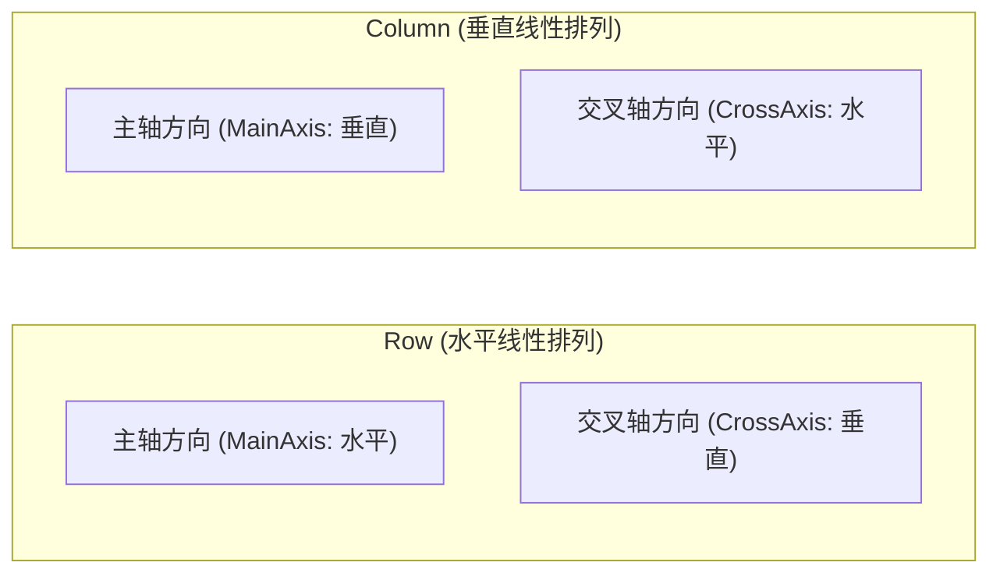
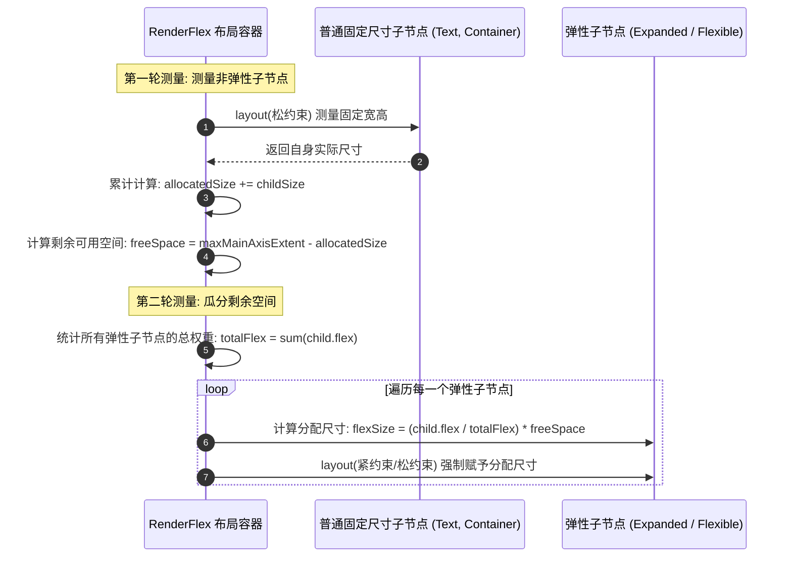

# 初级-基础排版布局Row-Column与Flex-Expanded自适应实战

在 Flutter 声明式 UI 开发中，`Row`（水平线性排列）与 `Column`（垂直线性排列）是最基础、使用频次最高的核心排版容器。初学者在开发中遇到频率最高、最令人头疼的控制台报错往往是**黄黑斑马线溢出警告（`A RenderFlex overflowed by xxx pixels`）**。本篇专题深入剖析 `RenderFlex` 的双轮测量算法、主轴与交叉轴对齐原理、`Expanded` 与 `Flexible` 弹性权重分配，并提供自适应布局的最佳实践。

---

## 一、核心底层机制与全景架构

### 1.1 主轴（MainAxis）与交叉轴（CrossAxis）物理空间模型

`Row` 和 `Column` 均继承自 **`Flex`**，两者的本质区别仅在于主轴方向的物理朝向：
- **`Row`**：主轴为**水平方向（X 轴，水平从左向右或 RTL）**，交叉轴为**垂直方向（Y 轴）**；
- **`Column`**：主轴为**垂直方向（Y 轴，垂直从上到下）**，交叉轴为**水平方向（X 轴）**。



---

### 1.2 对齐属性与尺寸策略速查

| 属性名称 | 物理语义 | 核心枚举取值与表现 |
| :--- | :--- | :--- |
| **`mainAxisAlignment`** | 子组件在**主轴**方向上的空间分布规则 | - `start`：紧贴主轴起点排列；<br/>- `end`：紧贴主轴终点排列；<br/>- `center`：居中紧凑排列；<br/>- `spaceBetween`：首尾贴边，其余元素平分剩余空间；<br/>- `spaceAround`：每个元素两侧拥有等量间距；<br/>- `spaceEvenly`：所有元素间及两侧的空白间隙完全均等。 |
| **`crossAxisAlignment`** | 子组件在**交叉轴**方向上的对齐规则 | - `center`（默认）：在交叉轴居中对齐；<br/>- `start`：交叉轴起点对齐；<br/>- `end`：交叉轴终点对齐；<br/>- `stretch`：**强制拉伸子组件以填满交叉轴的最大可用尺寸**。 |
| **`mainAxisSize`** | 容器在主轴方向上占用的物理尺寸上限 | - `MainAxisSize.max`（默认）：**强制撑满父容器允许的主轴最大尺寸**；<br/>- `MainAxisSize.min`：**仅包裹子元素内容的实际尺寸总和**（类似 Android 的 wrap_content）。 |

---

## 二、源码级/算法物理推导

### 2.1 `RenderFlex` 布局算法的两轮测量机制（Two-Pass Measurement）

`Row` 和 `Column` 底层对应的渲染对象是 **`RenderFlex`**。在 `RenderFlex.performLayout()` 源码中，针对子组件的尺寸计算严格分为**两轮测量**：



---

### 2.2 `Expanded` vs `Flexible` 的物理本质差异

在源码中，`Expanded` 仅仅是 `Flexible` 的一个便利子类，两者的唯一物理区别在于 **`fit`（适配策略）** 参数的默认值：

```dart
// 源码: packages/flutter/lib/src/widgets/basic.dart
class Expanded extends Flexible {
  const Expanded({
    super.key,
    super.flex = 1,
    required super.child,
  }) : super(fit: FlexFit.tight); // 核心区别: 默认强制 tight!
}
```

- **`FlexFit.tight`（紧约束 - Expanded 的默认值）**：
  子组件**必须无条件强制拉伸，完整填满分配给它的全部空间**，不论子组件自身真实内容有多大多小。
- **`FlexFit.loose`（松约束 - Flexible 的默认值）**：
  子组件**最大只能占用分配的空间，但如果内容本身较小，允许保持自身实际尺寸**，不强制拉伸。

```dart
// 对比示例
Row(
  children: [
    // 强制占满分配的 100px 宽度
    Expanded(
      child: Container(color: Colors.red, width: 30), // 这里的 width: 30 会被强制忽略!
    ),
    // 最大允许 100px，但内容只有 30px 时，实际只占 30px
    Flexible(
      fit: FlexFit.loose,
      child: Container(color: Colors.blue, width: 30),
    ),
  ],
)
```

---

## 三、社招高频硬核连环追问

### 追问 1：黄色黑色相间的斑马线溢出警告（`A RenderFlex overflowed by xxx pixels`）根本物理诱因是什么？怎么根治？
**标杆解答**：
1. **根本物理诱因（Unbounded Contradiction）**：
   - 当在 `Row`（或 `Column`）中放置了不可缩放的固定宽度组件（如一段很长的纯文本 `Text('超长文字...')`，或者一个固定 `width: 300` 的容器）；
   - 在第一轮测量中，所有子组件请求的尺寸累加和 $\sum \text{childSize}$ **超出了父级赋予 `RenderFlex` 的主轴最大约束尺寸**；
   - 剩余空间 `freeSpace` 变成负数，Flutter 无法继续为子组件分配物理像素，底层的 `PaintingContext` 会绘制黄色和黑色交叉的条纹带并向控制台抛出警告。
2. **彻底根治方案**：
   - **方案 A（弹性约束包裹）**：将变长或超长的子组件（如 `Text`）用 `Expanded` 或 `Flexible` 包裹，使其在第一轮测量中不占死空间，并在第二轮测量中受限在剩余可用区域内；配合 `Text` 的 `overflow: TextOverflow.ellipsis` 实现文字自动打点；
   - **方案 B（滚动容器包裹）**：若业务需求原本就允许内容超出视口滚动，将 `Row` 改用 `SingleChildScrollView(scrollDirection: Axis.horizontal, child: Row(...))` 包裹，赋予其无限主轴滚动空间。

---

### 追问 2：为什么在一个没有固定高度的 `Column` 中直接嵌套 `ListView` 会导致控制台抛出致命异常 `Vertical viewport was given unbounded height`？
**标杆解答**：
1. **双向无限冲突（Infinite Loop Dilemma）**：
   - `Column` 默认在垂直主轴方向上为其子节点提供**最大高度为无限大（`maxHeight: double.infinity`）**的松约束；
   - `ListView` 是一个具有滚动视口的容器，它的物理机制是**尝试尽可能向父容器索取最大的空间来支撑视口滚动**；
   - 当 `ListView` 询问 `Column`：“你能给我多大高度？” `Column` 回答：“你要多大我就能给多大（无限大）”；
   - `ListView` 无法确定自己的视口几何高度，导致视口渲染器 `RenderViewport` 崩溃抛错。
2. **根治规范**：
   - **规范一**：使用 `Expanded`（或 `Flexible`）包裹 `ListView`，强制 `Column` 为 `ListView` 分配一个确定性的剩余可用物理高度；
   - **规范二**：若列表项很少且不需要滚动，为 `ListView` 配置 `shrinkWrap: true`（让其仅包裹自身内容高度）与 `physics: NeverScrollableScrollPhysics()`。

---

### 追问 3：`Spacer` 组件的底层物理实现是什么？它与 `SizedBox(width: xxx)` 在使用场景上有什么本质区别？
**标杆解答**：
1. **`Spacer` 物理本质**：
   - `Spacer` 源码极其简洁，它本质上就是一个**包装了空 `SizedBox.shrink()` 的 `Expanded`**：
     ```dart
     class Spacer extends StatelessWidget {
       final int flex;
       const Spacer({super.key, this.flex = 1});
       @override
       Widget build(BuildContext context) {
         return Expanded(flex: flex, child: const SizedBox.shrink());
       }
     }
     ```
2. **选型区别**：
   - `SizedBox(width: 16)` 用于在两个元素之间插入**固定不变的绝对像素间距（16px）**；
   - `Spacer()` 用于**动态吸附对齐（Elastic Push）**：它会吞噬当前行或列中所有的剩余可用空白空间，把前后的组件硬生生推到两端（例如：左侧为标题，中间加一个 `Spacer()`，右侧为查看更多箭头）。

---

## 四、生产级避坑指南与排障 SOP

### 4.1 生产级电商商品信息卡片排版实战（完美避坑）

在真实业务开发中，左侧展示缩略图、右侧包含标题、标签与价格按钮的商品卡片极易因标题过长引发溢出。标准排版范式如下：

```dart
import 'package:flutter/material.dart';

class ProductItemCard extends StatelessWidget {
  final String title;
  final String tag;
  final String price;

  const ProductItemCard({
    super.key,
    required this.title,
    required this.tag,
    required this.price,
  });

  @override
  Widget build(BuildContext context) {
    return Container(
      padding: const EdgeInsets.all(12.0),
      margin: const EdgeInsets.symmetric(horizontal: 16.0, vertical: 8.0),
      decoration: BoxDecoration(
        color: Colors.white,
        borderRadius: BorderRadius.circular(12.0),
        boxShadow: [
          BoxShadow(
            color: Colors.black.withOpacity(0.04),
            blurRadius: 8,
            offset: const Offset(0, 2),
          ),
        ],
      ),
      child: Row(
        crossAxisAlignment: CrossAxisAlignment.start, // 交叉轴顶部对齐
        children: [
          // 1. 左侧固定尺寸缩略图 (非弹性，固定尺寸)
          ClipRRect(
            borderRadius: BorderRadius.circular(8.0),
            child: Container(
              width: 90,
              height: 90,
              color: const Color(0xFFE2E8F0),
              child: const Icon(Icons.image, size: 40, color: Colors.grey),
            ),
          ),

          const SizedBox(width: 12.0), // 固定间隙

          // 2. 右侧文本信息区：必须使用 Expanded 包裹，彻底封死水平溢出！
          Expanded(
            child: Column(
              crossAxisAlignment: CrossAxisAlignment.start,
              mainAxisSize: MainAxisSize.min, // 垂直方向仅包裹内容高度
              children: [
                // 标题文本: 超出两行自动打点
                Text(
                  title,
                  maxLines: 2,
                  overflow: TextOverflow.ellipsis,
                  style: const TextStyle(
                    fontSize: 15,
                    fontWeight: FontWeight.bold,
                    color: Color(0xFF1E293B),
                    height: 1.3,
                  ),
                ),

                const SizedBox(height: 6.0),

                // 标签徽章
                Container(
                  padding: const EdgeInsets.symmetric(horizontal: 6, vertical: 2),
                  decoration: BoxDecoration(
                    color: const Color(0xFFEFF6FF),
                    borderRadius: BorderRadius.circular(4),
                  ),
                  child: Text(
                    tag,
                    style: const TextStyle(
                      fontSize: 11,
                      color: Color(0xFF2563EB),
                    ),
                  ),
                ),

                const SizedBox(height: 10.0),

                // 底部价格与购买按钮行
                Row(
                  mainAxisAlignment: MainAxisAlignment.spaceBetween,
                  children: [
                    Text(
                      '¥$price',
                      style: const TextStyle(
                        fontSize: 18,
                        fontWeight: FontWeight.w800,
                        color: Color(0xFFE11D48),
                      ),
                    ),
                    ElevatedButton(
                      onPressed: () {},
                      style: ElevatedButton.styleFrom(
                        padding: const EdgeInsets.symmetric(horizontal: 12),
                        minimumSize: const Size(60, 30),
                        shape: RoundedRectangleBorder(
                          borderRadius: BorderRadius.circular(15),
                        ),
                      ),
                      child: const Text('抢购', style: TextStyle(fontSize: 12)),
                    ),
                  ],
                ),
              ],
            ),
          ),
        ],
      ),
    );
  }
}
```
