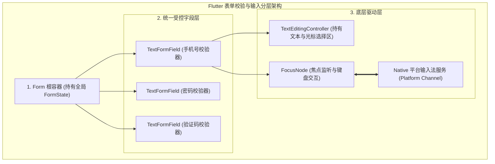
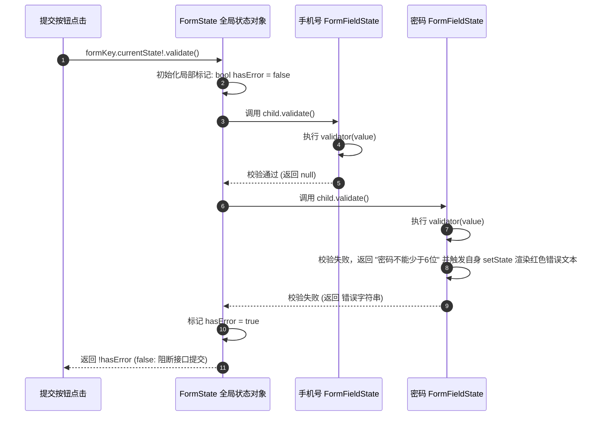

# 初级-基础表单输入TextField与Form表单校验体系

在移动端业务开发中，用户登录注册、个人资料修改与电商地址录入等场景离不开表单交互。Flutter 提供了底层的 **`TextField`（原生输入框）** 与结构化的 **`Form` / `TextFormField`（表单容器与校验体系）**。初学者常因控制器生命周期管理不当引发内存泄漏，或因软键盘弹起引发界面底部遮挡溢出。本篇专题深入剖析文本控制器、焦点树（FocusNode）以及表单统一校验状态机的底层机制。

---

## 一、核心底层机制与全景架构

### 1.1 Flutter 表单体系分层物理模型



---

### 1.2 核心控件参数与物理语义对照表

| 核心组件 | 物理职责 | 常见关键属性与方法 |
| :--- | :--- | :--- |
| **`TextField`** | 最基础的原生输入控件，负责渲染输入框并与系统键盘通道通信 | - `controller`：文本读写控制器；<br/>- `focusNode`：管理当前输入框的焦点状态；<br/>- `obscureText`：是否作为密码密文展示（小黑点）；<br/>- `keyboardType`：调起的键盘类型（`TextInputType.phone` / `emailAddress`）；<br/>- `textInputAction`：键盘右下角动作键（`TextInputAction.next` / `done`）。 |
| **`TextEditingController`** | 继承自 `ValueNotifier<TextEditingValue>`，保存当前输入框的物理文本字符串与光标选择区（Selection） | - `.text`：读取或程序化修改文本；<br/>- `.selection`：调整光标当前位置；<br/>- `dispose()`：**组件销毁时必须手动调用的内存释放函数**。 |
| **`FocusNode`** | 对应 Element 树上的焦点状态节点 | - `requestFocus()`：主动获取焦点并弹出软键盘；<br/>- `unfocus()`：释放焦点并收起软键盘；<br/>- `dispose()`：必须手动清理。 |
| **`Form`** | 集中管理表单内所有 `FormField` 的顶层容器，通常绑定一个 `GlobalKey<FormState>()` | - `formKey.currentState!.validate()`：一键触发所有子字段校验；<br/>- `formKey.currentState!.reset()`：一键重置所有子字段到初始值；<br/>- `formKey.currentState!.save()`：一键触发所有子字段的 `onSaved` 回调。 |

---

## 二、源码级/执行时序物理推导

### 2.1 `TextEditingController` 底层发布订阅机制

`TextEditingController` 内部持有 `TextEditingValue` 结构体：
```dart
// 包含实际文本内容与当前光标选区
class TextEditingValue {
  final String text;
  final TextSelection selection;
  final TextRange composing;
}
```
当用户在系统软键盘上打字时，原生系统通过 Platform Channel 将新文本发送给 Dart 引擎，控制器更新其 `value` 并触发全部监听者（Listeners）通知 `TextField` 重新绘制光标与字形；反之，若开发者在代码中执行 `controller.text = "新内容"`，控制器会反向通知原生系统同步更新输入法缓冲区。

---

### 2.2 `FormState.validate()` 深度遍历算法推导

当调用 `formKey.currentState!.validate()` 时，底层执行了严格的深度优先遍历：



---

## 三、社招高频硬核连环追问

### 追问 1：为什么没有在 `dispose()` 中注销 `TextEditingController` 会导致严重的脱钩内存泄漏？
**标杆解答**：
1. **全局输入法服务的长引用链（Window / IME Strong Reference）**：
   - `TextEditingController` 在初始化并与 `TextField` 绑定后，会向系统输入法管理器（`TextInput`）注册通道监听；
   - 控制器内部维护了 `List<VoidCallback> _listeners`；
2. **页面离开后的孤岛残留**：
   - 当包含输入框的页面被 `Navigator.pop()` 弹出销毁后，如果开发者漏写了 `controller.dispose()`，**底层的通道服务与观察者列表仍然持有该控制器实例的强引用指针**；
   - 控制器又间接引用了页面 State 中的各种闭包函数与大型数据，导致整座已销毁页面的内存堆无法被 Dart VM 垃圾回收器回收，形成典型的脱钩内存泄漏。

---

### 追问 2：在做“明文/密文切换”（查看密码眼睛图标）功能时，为什么切换 `obscureText = !obscureText` 后，输入框的光标会莫名其妙跳回最左侧第一个字符？怎么根治？
**标杆解答**：
1. **选区重置物理成因（Selection Reset Issue）**：
   - 某些初学者在切换密文状态时，采用了直接对控制器文本重新赋值的错误方式：
     ```dart
     setState(() {
       _obscure = !_obscure;
       _controller.text = _controller.text; // ❌ 错误操作！
     });
     ```
   - 当直接对 `controller.text` 进行全量重新赋值时，控制器默认会将光标选区 `selection` 重置为 `TextSelection.collapsed(offset: -1)` 或初始位置（最左侧 `0`）。
2. **根治方案**：
   - 切换 `obscureText` **只需要在 `setState` 中改变布尔标志位即可，绝对不要去重新给 `controller.text` 赋值**；
   - 若必须程序化更新文本且需要保持光标在末尾，必须显式重设光标位置：
     ```dart
     _controller.text = newText;
     _controller.selection = TextSelection.fromPosition(
       TextPosition(offset: _controller.text.length),
     );
     ```

---

### 追问 3：在长表单中，当用户在手机号输入框按键盘右下角的“下一步（Next）”键时，如何优雅实现焦点自动平滑跳转到密码框？
**标杆解答**：
- **基于 `FocusNode` 与 `FocusScope` 树的调度**：
  1. 为手机号输入框指定 `textInputAction: TextInputAction.next`；
  2. 为两个输入框分别创建 `_phoneFocusNode` 和 `_passwordFocusNode`；
  3. 在手机号的 `onFieldSubmitted` 回调中，调用 `FocusScope.of(context).requestFocus(_passwordFocusNode)` 让焦点秒级下移：
     ```dart
     onFieldSubmitted: (_) {
       FocusScope.of(context).requestFocus(_passwordFocusNode);
     }
     ```

---

## 四、生产级避坑指南与排障 SOP

### 4.1 避坑 1：软键盘弹起导致界面底部出现黄色斑马线（底部溢出）

在页面中使用 `Scaffold` 时，如果底部有按钮或表单内容靠下，软键盘弹起会挤压当前窗口的几何高度，引发 `RenderFlex overflowed by xxx pixels`。

**双重工程防御 SOP**：
1. **保证 `resizeToAvoidBottomInset: true`（Scaffold 默认开启）**：允许脚手架在键盘弹起时自动将 Body 高度缩小以避让键盘；
2. **表单根节点必须包裹 `SingleChildScrollView`**：让内容在视口被键盘压缩时能够自由上下滚动，绝不报错。

---

### 4.2 生产级用户登录表单组件全景实战代码

包含点击空白收起键盘、手机号与密码正则校验、眼睛图标密文切换、焦点自动跳转以及表单安全提交：

```dart
import 'package:flutter/material.dart';

class LoginFormScreen extends StatefulWidget {
  const LoginFormScreen({super.key});

  @override
  State<LoginFormScreen> createState() => _LoginFormScreenState();
}

class _LoginFormScreenState extends State<LoginFormScreen> {
  final _formKey = GlobalKey<FormState>();

  late final TextEditingController _phoneController;
  late final TextEditingController _passwordController;

  late final FocusNode _phoneFocusNode;
  late final FocusNode _passwordFocusNode;

  bool _obscurePassword = true;
  bool _isSubmitting = false;

  @override
  void initState() {
    super.initState();
    _phoneController = TextEditingController();
    _passwordController = TextEditingController();

    _phoneFocusNode = FocusNode();
    _passwordFocusNode = FocusNode();
  }

  // 生产级提交表单 SOP
  Future<void> _handleSubmit() async {
    // 1. 收起键盘
    FocusScope.of(context).unfocus();

    // 2. 触发全局校验
    if (!_formKey.currentState!.validate()) {
      return; // 校验失败，阻断提交
    }

    setState(() => _isSubmitting = true);

    try {
      // 模拟网络请求登录
      await Future.delayed(const Duration(seconds: 2));
      if (!mounted) return;
      ScaffoldMessenger.of(context).showSnackBar(
        const SnackBar(content: Text('登录成功！')),
      );
    } finally {
      if (mounted) {
        setState(() => _isSubmitting = false);
      }
    }
  }

  @override
  Widget build(BuildContext context) {
    // 技巧: 使用 GestureDetector 包裹，点击页面任意空白空白处均自动收起键盘
    return GestureDetector(
      onTap: () => FocusScope.of(context).unfocus(),
      child: Scaffold(
        appBar: AppBar(title: const Text('账号登录')),
        body: SafeArea(
          child: SingleChildScrollView(
            // 确保软键盘弹起时可自由滚动避让
            padding: const EdgeInsets.symmetric(horizontal: 24.0, vertical: 32.0),
            child: Form(
              key: _formKey,
              child: Column(
                crossAxisAlignment: CrossAxisAlignment.stretch,
                children: [
                  const Text(
                    '欢迎登录',
                    style: TextStyle(fontSize: 26, fontWeight: FontWeight.bold),
                  ),
                  const SizedBox(height: 32),

                  // 1. 手机号输入框
                  TextFormField(
                    controller: _phoneController,
                    focusNode: _phoneFocusNode,
                    keyboardType: TextInputType.phone,
                    textInputAction: TextInputAction.next,
                    decoration: const InputDecoration(
                      labelText: '手机号码',
                      hintText: '请输入11位中国大陆手机号',
                      prefixIcon: Icon(Icons.phone_android),
                      border: OutlineInputBorder(),
                    ),
                    validator: (val) {
                      if (val == null || val.trim().isEmpty) {
                        return '手机号不能为空';
                      }
                      if (!RegExp(r'^1[3-9]\d{9}$').hasMatch(val.trim())) {
                        return '请输入合法的11位手机号码';
                      }
                      return null;
                    },
                    onFieldSubmitted: (_) {
                      // 按键盘下一步，焦点自动跳转至密码输入框
                      FocusScope.of(context).requestFocus(_passwordFocusNode);
                    },
                  ),

                  const SizedBox(height: 20),

                  // 2. 密码输入框
                  TextFormField(
                    controller: _passwordController,
                    focusNode: _passwordFocusNode,
                    obscureText: _obscurePassword,
                    textInputAction: TextInputAction.done,
                    decoration: InputDecoration(
                      labelText: '登录密码',
                      prefixIcon: const Icon(Icons.lock_outline),
                      border: const OutlineInputBorder(),
                      suffixIcon: IconButton(
                        icon: Icon(
                          _obscurePassword
                              ? Icons.visibility_off
                              : Icons.visibility,
                        ),
                        onPressed: () {
                          // 安全切换密文状态，不重新赋值 controller.text
                          setState(() {
                            _obscurePassword = !_obscurePassword;
                          });
                        },
                      ),
                    ),
                    validator: (val) {
                      if (val == null || val.isEmpty) {
                        return '密码不能为空';
                      }
                      if (val.length < 6) {
                        return '密码长度不能少于6位';
                      }
                      return null;
                    },
                    onFieldSubmitted: (_) => _handleSubmit(),
                  ),

                  const SizedBox(height: 36),

                  // 3. 提交按钮
                  ElevatedButton(
                    onPressed: _isSubmitting ? null : _handleSubmit,
                    style: ElevatedButton.styleFrom(
                      padding: const EdgeInsets.symmetric(vertical: 14),
                      shape: RoundedRectangleBorder(
                        borderRadius: BorderRadius.circular(8),
                      ),
                    ),
                    child: _isSubmitting
                        ? const SizedBox(
                            width: 22,
                            height: 22,
                            child: CircularProgressIndicator(strokeWidth: 2),
                          )
                        : const Text('立即登录', style: TextStyle(fontSize: 16)),
                  ),
                ],
              ),
            ),
          ),
        ),
      ),
    );
  }

  @override
  void dispose() {
    // 生产级释放 SOP: 严格销毁控制器与焦点节点，防内存泄漏
    _phoneController.dispose();
    _passwordController.dispose();

    _phoneFocusNode.dispose();
    _passwordFocusNode.dispose();

    super.dispose();
  }
}
```
