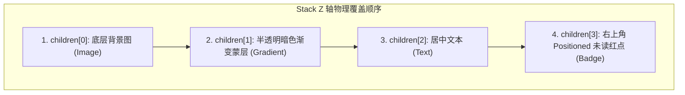
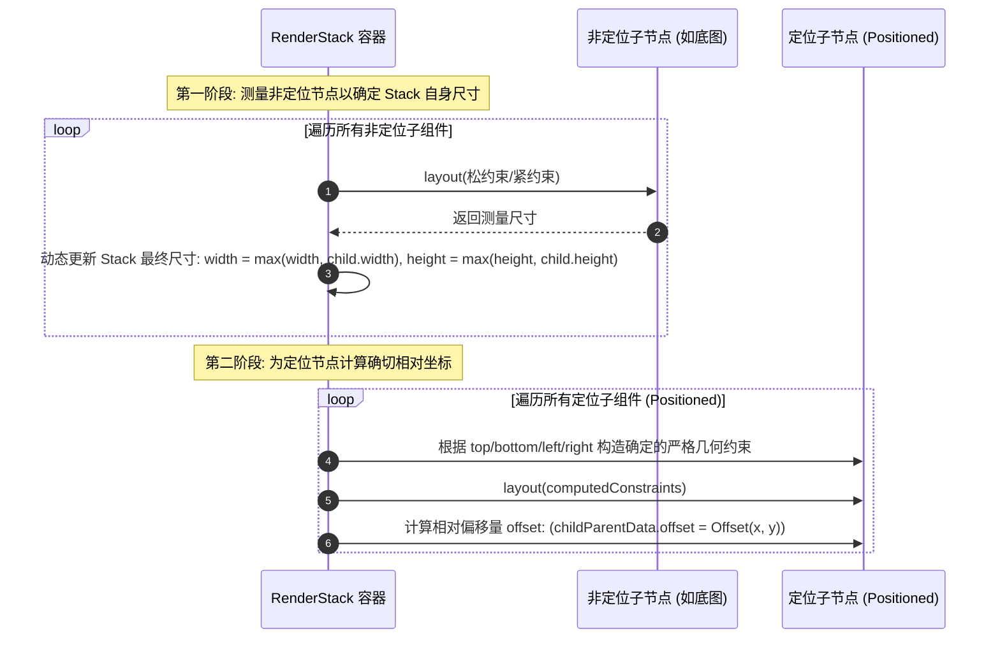

# 初级-层叠布局Stack与Positioned及层级覆盖实战

在复杂移动端界面设计中，重叠卡片、图片阴影渐变蒙层、右上角未读消息角标（Badge）以及吸顶悬浮控制栏是极其常见的高频交互形态。Flutter 提供了 **`Stack`（层叠容器）** 与 **`Positioned`（精确定位组件）** 协同方案。本篇专题深入剖析 `RenderStack` 底层对定位子节点与非定位子节点的几何测量算法、Z 轴渲染覆盖顺序，以及溢出裁剪 `clipBehavior` 的核心考点。

---

## 一、核心底层机制与全景架构

### 1.1 Stack 层叠模型与 Z 轴渲染顺序

`Stack` 的物理表现类似于 Web 中的 `position: relative` 与 `position: absolute` 组合，或者 Android 原生的 `FrameLayout`：
- **顺序决定层级**：`Stack` 的 `children` 数组中，**排在前面的元素处于底层，排在后面的元素依次覆盖在上方（Z 轴正向延伸）**。
- **子元素物理分类**：
  1. **非定位子节点（Non-positioned Children）**：未被 `Positioned` 包裹的普通 Widget。它们的尺寸直接参与计算并**决定整个 `Stack` 自身的默认尺寸**；
  2. **定位子节点（Positioned Children）**：被 `Positioned` 包裹的组件。它们完全不参与决定 `Stack` 自身的尺寸，而是根据 `Stack` 最终确定的几何边界，通过 `top`、`bottom`、`left`、`right` 坐标进行绝对定位。



---

### 1.2 核心属性物理语义速查表

| 核心参数 | 默认取值 | 物理作用与机制 |
| :--- | :--- | :--- |
| **`alignment`** | `AlignmentDirectional.topStart` | 控制**所有非定位子节点**以及未完全约束的定位子节点的对齐锚点（如 `Alignment.center` 居中对齐） |
| **`fit`** | `StackFit.loose` | 控制传递给**非定位子节点**的约束策略：<br/>- `loose`：松约束，允许子节点在 `0 ~ maxWidth` 之间自由决定尺寸；<br/>- `expand`：紧约束，**强制所有非定位子组件拉伸填满父级的最大可用空间**；<br/>- `passthrough`：将父级约束原样透传。 |
| **`clipBehavior`** | `Clip.hardEdge` | 控制当定位子节点的坐标超出 `Stack` 几何物理边界时是否执行视口裁剪：<br/>- `Clip.none`：允许子节点溢出在父容器外部正常渲染；<br/>- `Clip.hardEdge`：直接沿边界锐利裁剪超出部分。 |

---

## 二、源码级/算法物理推导

### 2.1 `RenderStack.performLayout` 尺寸测量算法全景

`Stack` 对应的底层渲染对象是 **`RenderStack`**。在执行布局时，算法严格分为两大阶段：



---

### 2.2 `Positioned` 坐标拉伸算法推导

`Positioned` 组件通过 6 个核心参数（`left`、`top`、`right`、`bottom`、`width`、`height`）来决定子节点的绝对几何位置。

#### 约束解析方程式
在水平维度（X 轴）上，参数之间必须遵循几何等式：
$$\text{StackWidth} = \text{left} + \text{width} + \text{right}$$

1. **若同时提供 `left` 与 `right`，且未指定 `width`**：
   `RenderStack` 会计算出子节点的精确确定宽度：$$\text{childWidth} = \text{StackWidth} - \text{left} - \text{right}$$
   此时子组件会被**在水平方向上强制拉伸**，填满两端剩余区域！
2. **垂直维度（Y 轴）同理**：
   若同时设置 `top: 0` 与 `bottom: 0`，子组件会在垂直方向上被强制拉伸至等同于 `Stack` 的高度。

---

## 三、社招高频硬核连环追问

### 追问 1：为什么把 `Positioned` 放在非 `Stack` 内部（如直接放在 `Column` 或 `Container` 中）会立即报断言崩溃？
**标杆解答**：
1. **ParentData 物理协议不匹配（ParentData Type Mismatch）**：
   - 在 Flutter 底层，任何带有定位或布局扩展特性的父容器都会为其直接子节点注入专属的 `ParentData` 数据结构；
   - `Stack` 要求其子节点的 `ParentData` 必须是 **`StackParentData`**（内部包含 `top`、`left`、`right`、`bottom`、`width`、`height` 字段）；
   - `Positioned` 是一个 `ParentDataWidget<StackParentData>`。当它的直接父节点不是 `Stack`（例如是 `Column`，其子节点的 ParentData 类型是 `FlexParentData`）时，`Positioned` 会在 `applyParentData()` 阶段类型转换失败，底层断言立即报错：
     ```
     Incorrect use of ParentDataWidget: Positioned widgets must be placed directly inside Stack widgets.
     ```

---

### 追问 2：如何在 `Stack` 中让一个子组件“突破”父容器的边界显示（如头像挂件伸出卡片外部），但点击事件却无法响应？怎么解决？
**标杆解答**：
1. **视觉突破与裁剪**：
   - 默认情况下 `Stack` 会将超出自身边界的内容裁剪。只需配置 `clipBehavior: Clip.none`，即可让设置了负坐标（如 `Positioned(top: -20)`）的挂件完美绘制在卡片外部。
2. **点击事件穿透失效的物理成因**：
   - **Flutter 命中测试机制（Hit Test）**：指针点击事件从根 RenderView 沿着 RenderObject 树向下分发。容器 `RenderStack` 在判断是否命中当前点击时，首先会执行 `size.contains(position)` 检查坐标是否落在 **`Stack` 自身的物理矩形边界内**；
   - 尽管挂件在视觉上画到了外部，但如果用户点击了超出 `Stack` 原生矩形外的区域，`RenderStack.hitTest` 直接返回 `false`，事件根本不会传递给子节点！
3. **解决方案**：
   - 不要盲目通过负偏移把子组件推到外部，应当将外层 `Stack` 的物理尺寸通过 `Padding` 或外层容器真实撑大，确保所有需要响应交互的图元都严格落在 `Stack` 自身的矩形边界内。

---

### 追问 3：`StackFit.expand` 和 `StackFit.loose` 在微观布局上有何本质差异？
**标杆解答**：
1. **`StackFit.loose`（松约束）**：
   - 传递给非定位子组件的约束是宽松的（`minWidth = 0, minHeight = 0`）；
   - 如果非定位子组件自身只有 `50x50`，那么该子组件渲染为 `50x50`，`Stack` 自身也会收缩为 `50x50`（若没有更大的子组件）。
2. **`StackFit.expand`（紧约束）**：
   - 传递给非定位子组件的约束是紧致强制的（`minWidth = maxWidth, minHeight = maxHeight`）；
   - **所有的非定位子组件都会被强制拉伸到父级允许的最大物理极限**。常用于全屏页面遮罩、全屏背景图铺满等场景。

---

## 四、生产级避坑指南与排障 SOP

### 4.1 生产级实战案例 1：右上角未读红点徽章（Badge）

```dart
import 'package:flutter/material.dart';

class CartIconWithBadge extends StatelessWidget {
  final int unreadCount;
  final VoidCallback onTap;

  const CartIconWithBadge({
    super.key,
    required this.unreadCount,
    required this.onTap,
  });

  @override
  Widget build(BuildContext context) {
    return InkWell(
      onTap: onTap,
      borderRadius: BorderRadius.circular(24.0),
      child: Padding(
        padding: const EdgeInsets.all(8.0),
        child: Stack(
          alignment: Alignment.center,
          clipBehavior: Clip.none, // 允许红点轻微超出图标边界
          children: [
            // 1. 底层核心图标 (非定位节点，决定整个 Stack 的基准尺寸)
            const Icon(
              Icons.shopping_cart_outlined,
              size: 28.0,
              color: Color(0xFF334155),
            ),

            // 2. 顶层定位徽章 (仅在数量大于 0 时展示)
            if (unreadCount > 0)
              Positioned(
                top: -4,
                right: -6,
                child: Container(
                  padding: const EdgeInsets.symmetric(horizontal: 5, vertical: 2),
                  decoration: BoxDecoration(
                    color: const Color(0xFFEF4444),
                    borderRadius: BorderRadius.circular(10),
                    border: Border.all(color: Colors.white, width: 1.5), // 白色描边增加对比度
                  ),
                  constraints: const BoxConstraints(
                    minWidth: 18,
                    minHeight: 18,
                  ),
                  child: Center(
                    child: Text(
                      unreadCount > 99 ? '99+' : '$unreadCount',
                      style: const TextStyle(
                        color: Colors.white,
                        fontSize: 10,
                        fontWeight: FontWeight.bold,
                        height: 1.0,
                      ),
                    ),
                  ),
                ),
              ),
          ],
        ),
      ),
    );
  }
}
```

---

### 4.2 生产级实战案例 2：视频封面卡片与渐变蒙层

在图文海报或视频封面上叠加白色标题时，如果封面背景也是浅色，会导致文字辨识度极低。标准做法是使用 `Stack` 叠加一层由下向上的渐变透明遮罩：

```dart
class VideoCoverCard extends StatelessWidget {
  final String title;
  final String durationText;

  const VideoCoverCard({
    super.key,
    required this.title,
    required this.durationText,
  });

  @override
  Widget build(BuildContext context) {
    return ClipRRect(
      borderRadius: BorderRadius.circular(12.0),
      child: SizedBox(
        width: 320,
        height: 180,
        child: Stack(
          fit: StackFit.expand, // 强制所有图层完全贴合 320x180
          children: [
            // 图层 1: 底层高清封面图
            Container(
              color: Colors.grey.shade800,
              child: const Icon(Icons.movie, size: 60, color: Colors.white38),
            ),

            // 图层 2: 底部黑色渐变阴影蒙层 (防文字吃色)
            Positioned(
              left: 0,
              right: 0,
              bottom: 0,
              height: 80,
              child: DecoratedBox(
                decoration: BoxDecoration(
                  gradient: LinearGradient(
                    begin: Alignment.bottomCenter,
                    end: Alignment.topCenter,
                    colors: [
                      Colors.black.withOpacity(0.85),
                      Colors.transparent,
                    ],
                  ),
                ),
              ),
            ),

            // 图层 3: 底部悬浮信息排版
            Positioned(
              left: 12,
              right: 12,
              bottom: 10,
              child: Row(
                mainAxisAlignment: MainAxisAlignment.spaceBetween,
                children: [
                  Expanded(
                    child: Text(
                      title,
                      maxLines: 1,
                      overflow: TextOverflow.ellipsis,
                      style: const TextStyle(
                        color: Colors.white,
                        fontSize: 14,
                        fontWeight: FontWeight.bold,
                      ),
                    ),
                  ),
                  Container(
                    padding: const EdgeInsets.symmetric(horizontal: 6, vertical: 2),
                    decoration: BoxDecoration(
                      color: Colors.black.withOpacity(0.6),
                      borderRadius: BorderRadius.circular(4),
                    ),
                    child: Text(
                      durationText,
                      style: const TextStyle(color: Colors.white, fontSize: 11),
                    ),
                  ),
                ],
              ),
            ),
          ],
        ),
      ),
    );
  }
}
```
