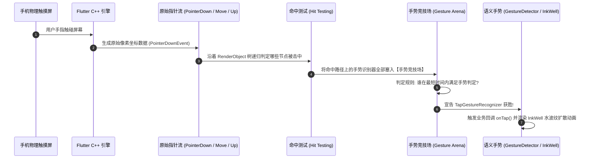
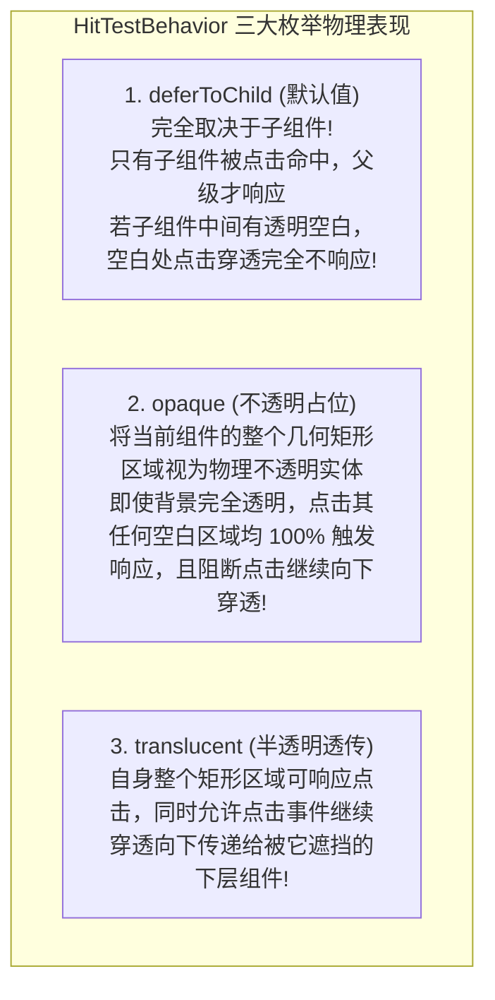

# 初级-手势识别GestureDetector与InkWell水波纹点击交互

在移动端人机交互中，点击、双击、长按、滑动与缩放是用户与应用沟通的核心载体。Flutter 提供了底层的语义化手势识别器 **`GestureDetector`**，以及遵循 Material Design 规范、带有物理水波纹动效的 **`InkWell` / `InkResponse`**。初学者常遭遇“点击空白区域无法响应”或“设置了背景色导致水波纹被彻底遮挡消失”等顽固问题。本篇专题深入剖析命中测试行为（HitTestBehavior）、水波纹物理渲染层级，以及工业级防暴击点击方案。

---

## 一、核心底层机制与全景架构

### 1.1 指针事件（Pointer Event）到语义化手势（Gesture）的分层流转

Flutter 的手势识别系统严格分为**原始指针层**与**语义手势层**两级管线：



---

### 1.2 核心控件参数与物理语义对照表

| 核心组件 | 物理机制与特性 | 典型使用场景 |
| :--- | :--- | :--- |
| **`GestureDetector`** | - 纯手势识别器，**完全不附带任何视觉渲染效果**；<br/>- 支持极其丰富的手势组合（单击、双击、长按、垂直滑动、水平滑动、双指缩放）；<br/>- 通过 `behavior` 控制空白透明区域的命中拦截。 | 复杂图表拖拽、非 Material 风格的自定义交互、图片双指缩放查看器 |
| **`InkWell`** | - Material 风格组件，点击时在被点击坐标产生**向外扩散的半透明水波纹（Ripple / Splash）**与高亮底色；<br/>- **物理上要求祖先节点树中必须存在 `Material` 组件**（水波纹是绘制在 `Material` 的专用画布上的）。 | 按钮、设置列表项、商品卡片等需要明确物理点击反馈的区域 |

---

## 二、源码级/算法物理推导

### 2.1 命中测试三大行为（HitTestBehavior）物理推导

初学者使用 `GestureDetector` 最常遇到的 Bug：**为一个包裹了空白区域的 `Container` 绑定点击，点击空白处完全没反应，只有精准点到中间的文字时才触发！**

这完全取决于 `GestureDetector` 的 **`behavior`** 属性：



#### 根治代码对比
```dart
// ❌ 错误做法：中间有空白时，点击空白区域毫无反应！
GestureDetector(
  onTap: () => print('clicked'),
  child: Container(
    width: 200,
    height: 60,
    // 没有设置 color，且 behavior 默认为 deferToChild
    child: const Center(child: Text('点击这里')),
  ),
);

// ✅ 正确做法：显式指定 behavior 为 opaque，整个 200x60 矩形区域无死角响应！
GestureDetector(
  behavior: HitTestBehavior.opaque,
  onTap: () => print('clicked'),
  child: SizedBox(
    width: 200,
    height: 60,
    child: const Center(child: Text('点击这里')),
  ),
);
```

---

### 2.2 为什么给 Container 加了 `color` 之后，`InkWell` 的水波纹完全消失了？

这是 Flutter 社区极其著名的“水波纹消失案”！

#### 物理图层覆盖原理推导
1. `InkWell` 本身并不负责绘制水波纹，它会将水波纹绘制请求提交给最近的祖先 **`Material`** 组件所持有的绘制图层（`MaterialInkController`）；
2. 架构渲染时序：
   ```
   [底层]: Material 画布 (水波纹在此图层扩散绘制)
   [中层]: Container(color: Colors.blue) 自身绘制的不透明实体背景色
   [顶层]: InkWell / Text
   ```
3. **真相大白**：水波纹确实在底层正常生成并扩散了，但 **`Container` 自身的不透明纯色背景直接在 Z 轴上将其彻底遮盖住了**，导致人眼完全看不到水波纹！

#### 工业级标准修复方案：使用 `Ink` 替代 `Container`
Flutter 官方专门推出了 **`Ink`** 组件，将背景装饰与 `Material` 水波纹图层完美对齐：
```dart
// ✅ 正确范式：使用 Ink 承载背景色与圆角，水波纹完美浮现在背景色之上！
Material(
  color: Colors.transparent, // 保持透明
  child: Ink(
    decoration: BoxDecoration(
      color: const Color(0xFF2563EB),
      borderRadius: BorderRadius.circular(8.0),
    ),
    child: InkWell(
      borderRadius: BorderRadius.circular(8.0), // 必须与背景圆角保持一致
      onTap: () => print('Button tapped'),
      child: const Padding(
        padding: EdgeInsets.symmetric(horizontal: 20, vertical: 12),
        child: Text('确定提交', style: TextStyle(color: Colors.white)),
      ),
    ),
  ),
);
```

---

## 三、社招高频硬核连环追问

### 追问 1：`GestureDetector` 和 `InkWell` 在技术选型与业务架构上有哪些核心考量？
**标杆解答**：
1. **交互反馈标准与规范**：
   - 遵循 Material 规范的常规可点击项（如按钮、卡片、设置行）必须提供明确的视觉微动效，**首选 `InkWell`**，它不仅提供水波纹，还能在桌面端/Web 端自动提供光标悬停（Hover）与焦点高亮（Focus）效果；
   - 纯工具性操作（如点击背景空白收起键盘、轮播图左右滑动手势、全屏手势返回）不需要水波纹，**首选轻量的 `GestureDetector`**。
2. **多手势组合支持度**：
   - `InkWell` 仅支持单击、双击与长按；
   - `GestureDetector` 具备完整的多维手势竞技体系，支持平移（Pan）、拖拽（Drag）、多指旋转与缩放（Scale）。

---

### 追问 2：两个嵌套的组件都绑定了 `onTap` 点击事件，为什么只有内层组件响应，外层完全不触发？
**标杆解答**：
1. **手势竞技场排他性竞争机制（Gesture Arena Winner Takes All）**：
   - 当用户手指按下并抬起时，内层与外层的两个 `TapGestureRecognizer` 都会被注册进手势竞技场；
   - 根据 Flutter 手势消解协议，在命中测试树中**距离叶子节点最近的内层手势识别器具有先验优势**。当检测到合法的点击微动作后，内层识别器率先声明获胜（`resolve(GestureDisposition.accepted)`）；
   - 一旦有选手获胜，**竞技场会强制将其余所有竞争对手（即外层识别器）全部判定为失败（`rejected`）并剔除**，因此外层的 `onTap` 绝不会被调用。

---

### 追问 3：在什么场景下手势会被系统的滚动组件（如 `ListView`）强行抢走并取消点击？
**标杆解答**：
1. **滚动竞争时序延迟判定**：
   - 当用户在 `ListView` 内部的按钮上按下手指时，系统并不确定用户是想要“点击该按钮”还是想要“滑动翻页列表”；
   - `ListView` 底层的 `VerticalDragGestureRecognizer` 会向手势竞技场申请保持悬决状态（Hold）；
   - 若用户手指在微小的时间和位移阈值（Slop Threshold，通常为 8~18 像素）内未发生大幅移动就抬起，竞技场将胜者裁定给按钮的 `TapGestureRecognizer`；
   - 若手指移动距离超过了 Slop 阈值，**`ListView` 立即宣布获胜并开始滚动，按钮的手势识别器被判定失败，按钮水波纹瞬间取消退散（Cancel）**。

---

## 四、生产级避坑指南与排障 SOP

### 4.1 生产级防暴击点击（防抖 Throttle 点击）通用最佳实践

在移动电商或金融支付场景中，用户在网络延迟时往往会狂点“立即支付”按钮。若未做防抖，会导致向服务端连发数次扣款请求：

```dart
import 'package:flutter/material.dart';

/// 生产级高阶防抖点击包装函数
VoidCallback throttleClick(
  VoidCallback action, {
  Duration duration = const Duration(milliseconds: 600),
}) {
  DateTime? lastClickTime;

  return () {
    final now = DateTime.now();
    if (lastClickTime == null || now.difference(lastClickTime!) > duration) {
      lastClickTime = now;
      action(); // 距离上次点击超过间隔，允许执行
    } else {
      debugPrint('[Throttle]: 拦截了一次高频重复点击！');
    }
  };
}

class SubmitOrderButton extends StatelessWidget {
  final VoidCallback onSubmit;

  const SubmitOrderButton({super.key, required this.onSubmit});

  @override
  Widget build(BuildContext context) {
    return Material(
      color: Colors.transparent,
      child: Ink(
        decoration: BoxDecoration(
          gradient: const LinearGradient(
            colors: [Color(0xFFE11D48), Color(0xFFBE123C)],
          ),
          borderRadius: BorderRadius.circular(24.0),
        ),
        child: InkWell(
          borderRadius: BorderRadius.circular(24.0),
          // 关键防护: 使用防抖函数包装点击事件
          onTap: throttleClick(onSubmit, duration: const Duration(seconds: 1)),
          child: const Padding(
            padding: EdgeInsets.symmetric(horizontal: 28, vertical: 14),
            child: Text(
              '提交订单',
              style: TextStyle(
                color: Colors.white,
                fontSize: 16,
                fontWeight: FontWeight.bold,
              ),
            ),
          ),
        ),
      ),
    );
  }
}
```
