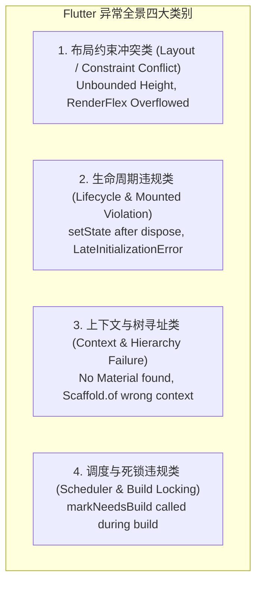

# 初级-新手常见报错排查指南与控制台Error根治SOP

在 Flutter 的学习与实战演进过程中，控制台输出的红色堆栈报错和手机屏幕上赫然出现的**红屏（Red Screen of Death）**或**黄黑斑马线溢出条**往往让初学者手足无措。这些错误并非随机故障，而是 Flutter 框架在底层约束传递、三棵树更新调度以及生命周期契约被破坏时触发的**防御性断言保护**。本篇专题深度剖析初学者阶段最高频的 **10 大经典致命报错**，从物理成因推导到工业级排查根治 SOP，全面建立系统化的排障内功。

---

## 一、核心底层机制与全景架构

### 1.1 Flutter 异常分类图谱



---

## 二、源码级/10大经典报错物理成因与根治SOP

### 01. `A RenderFlex overflowed by xxx pixels`（黄黑斑马线溢出）
- **物理成因**：
  在 `Row`（水平）或 `Column`（垂直）中放置了不可缩放的固定尺寸元素（如一段超长文字、固定宽度的 Container），其累加尺寸超过了父级赋予的主轴最大尺寸限制。
- **根治 SOP**：
  - 若为超长文本，必须使用 `Expanded` 包裹，并为 `Text` 配置 `overflow: TextOverflow.ellipsis`；
  - 若整个界面内容本身就很长，外层必须包裹 `SingleChildScrollView`。

---

### 02. `Vertical viewport was given unbounded height`（视口高度无限大冲突）
- **物理成因**：
  在没有固定高度的 `Column` 中直接嵌套了 `ListView` 或 `GridView`。`Column` 垂直方向约束是无限大（$\infty$），而滚动视口 `ListView` 也试图向外索取无限大，二者产生无限冲突导致渲染管线崩溃。
- **根治 SOP**：
  - **方案 1（自适应占满）**：使用 `Expanded` 将 `ListView` 包裹起来，赋予其确定性的剩余高度；
  - **方案 2（内容包裹）**：为 `ListView` 配置 `shrinkWrap: true` 与 `physics: const NeverScrollableScrollPhysics()`。

---

### 03. `setState() called after dispose()`（组件销毁后调用刷新）
- **物理成因**：
  在耗时异步任务（如网络请求、定时器、EventBus 回调）完成之前，用户点击返回离开了当前页面。页面彻底执行了 `dispose()`，但异步任务恢复后依然盲目执行了 `setState()`。
- **根治 SOP**：
  - 每一个 `setState()` 必须加上挂载守卫：`if (mounted) setState(...)`；
  - 在页面的 `dispose()` 钩子中，彻底销毁控制器（`controller.dispose()`）并取消定时器（`timer.cancel()`）。

---

### 04. `No Material widget found`（缺失 Material 祖先节点）
- **物理成因**：
  使用了依赖 Material 规范的主题组件（如 `TextField`、`ListTile`、`InkWell`），但当前组件的祖先树中**没有任何 `Material` 或 `Scaffold` 容器**，导致组件在向上查找 `Material.of(context)` 时抛出空断言。
- **根治 SOP**：
  - 最外层页面确保包裹了 `Scaffold`，或者在使用 `InkWell` 时手动包裹一层 `Material(color: Colors.transparent, child: ...)`。

---

### 05. `Scaffold.of() called with a context that does not contain a Scaffold`（上下文作用域查找失败）
- **物理成因**：
  在 `Scaffold` 的 `body` 参数中，直接写了一个按钮并调用 `Scaffold.of(context).openDrawer()`。此时传入的 `context` 是当前页面的 `build(context)` 提供的，它处于 `Scaffold` 的**同级或父级**，顺着作用域链向上根本找不到该 `Scaffold`。
- **根治 SOP**：
  - **方案 1（引入 Builder）**：在按钮外层包裹一层 `Builder` 组件，提供位于 `Scaffold` 下方的子级 `BuildContext`：
    ```dart
    Builder(
      builder: (scaffoldContext) => ElevatedButton(
        onPressed: () => Scaffold.of(scaffoldContext).openDrawer(),
        child: const Text('打开抽屉'),
      ),
    )
    ```
  - **方案 2**：为 `Scaffold` 绑定 `GlobalKey<ScaffoldState>()`，通过 `scaffoldKey.currentState!.openDrawer()` 驱动。

---

### 06. `setState() or markNeedsBuild() called during build`（构建期间触发更新死锁）
- **物理成因**：
  在当前组件的 `build()` 函数同步执行期间，直接调用了 `setState()`，或者直接调用了会触发其他组件重建的方法（如在 `build` 中无条件执行 `Navigator.push()` 或打开弹窗）。此时全局构建调度器正处于锁定状态，禁止递归标记脏节点。
- **根治 SOP**：
  - 路由跳转或弹窗操作必须推迟到当前帧渲染完成之后执行：
    ```dart
    WidgetsBinding.instance.addPostFrameCallback((_) {
      Navigator.pushNamed(context, '/login');
    });
    ```

---

### 07. `LateInitializationError: Field 'xxx' has not been initialized`（late 延迟变量未赋值）
- **物理成因**：
  声明了 `late final String token`，但在代码执行路径中，读取该变量前没有执行初始化赋值操作。
- **根治 SOP**：
  - 检查代码条件分支，确保在读取前 100% 赋过值；
  - 复杂场景改用可空类型 `String? token`，并通过常规的 `if (token != null)` 优雅防御。

---

### 08. `Looking up a deactivated widget's ancestor is unsafe`（上下文失效后寻址）
- **物理成因**：
  在异步 `await` 之后，直接使用了之前捕获的 `BuildContext` 去寻找祖先（如 `Navigator.of(context).pop()` 或 `Theme.of(context)`）。但如果该页面在等待期间已经被用户关闭，该 `context` 对应的 Element 已经处于非激活状态（Deactivated）。
- **根治 SOP**：
  - 在异步恢复后，优先校验 `if (!context.mounted) return;`（Flutter 3.7+ 官方内置）。

---

### 09. `Cannot hit test a render box with no size`（无尺寸节点的命中测试崩溃）
- **物理成因**：
  为一个尚未完成排版、或者宽度高度为 `0` 的 `RenderBox` 注入了手势监听或执行了 `findRenderObject()` 坐标计算，在手势触摸分发时抛出断言。
- **根治 SOP**：
  - 确保组件拥有合理的尺寸约束；测量坐标必须包裹在 `addPostFrameCallback` 中，等待首次首帧排版完成。

---

### 10. `Null check operator used on a null value`（强制解包断言踩雷）
- **物理成因**：
  在可空变量后面滥用了感叹号强制解包（`user!.name`），而在实际运行中，后端接口由于网络或数据清洗返回了 `null`。
- **根治 SOP**：
  - 严禁盲目使用 `!`；全面采用安全调用 `?.` 与空合并默认值 `??`：`final name = user?.name ?? '未知用户';`。

---

## 三、社招高频硬核连环追问

### 追问 1：为什么把 `showDialog` 或 `Navigator.push` 直接写在 `build()` 方法内部会引发框架死锁报错？
**标杆解答**：
1. **渲染管线的单向单次流水线规则（Phase Rule）**：
   - Flutter 每一帧的渲染流程是严格单向不可逆的：**`Build`（构建 Widget 树）-> `Layout`（计算几何尺寸）-> `Paint`（栅格化绘制）**；
   - 在 `build()` 方法被调用时，全局构建调度器 `BuildOwner` 正在遍历执行当前帧的脏节点列表；
2. **死锁机理**：
   - `showDialog` 或 `Navigator.push` 底层会向路由栈插入一个新的 `Route`，并立即调用 `markNeedsBuild()` 要求在 Element 树中增加新的 Overlay 节点；
   - 在当前帧正在构建时又强行插入新的构建请求，会导致构建循环无法收敛。因此框架底层设置了强断言，物理禁止在 `build()` 期间发起任何引起树结构改变的副作用。

---

### 追问 2：生产环境中，如何将原本可能引起用户惊恐的“红屏报错页面”彻底替换为优雅的友好降级 UI？
**标杆解答**：
- **定制 `ErrorWidget.builder` 全局降级渲染器**：
  在应用入口处重写全局错误组件构建器。当任何子组件内部由于未捕获异常导致 `build()` 崩溃时，框架会停止渲染红屏，自动展示该降级视图，保证整个 App 的其余部分仍可正常操作。

---

## 四、生产级避坑指南与排障 SOP

### 4.1 生产级全局崩溃拦截与优雅降级组件集成规范

```dart
import 'package:flutter/foundation.dart';
import 'package:flutter/material.dart';

void main() {
  WidgetsFlutterBinding.ensureInitialized();

  // 1. 生产环境彻底干掉红屏，替换为优雅降级 UI
  ErrorWidget.builder = (FlutterErrorDetails details) {
    // 本地开发期仍然打印详细堆栈以供排查
    if (kDebugMode) {
      return ErrorWidget(details.exception);
    }

    // 生产发布环境展示友好降级卡片
    return Material(
      color: Colors.transparent,
      child: Center(
        child: Padding(
          padding: const EdgeInsets.all(24.0),
          child: Column(
            mainAxisSize: MainAxisSize.min,
            children: [
              const Icon(
                Icons.error_outline_rounded,
                color: Color(0xFFEF4444),
                size: 48,
              ),
              const SizedBox(height: 12),
              const Text(
                '页面暂时开小差了',
                style: TextStyle(
                  fontSize: 16,
                  fontWeight: FontWeight.bold,
                  color: Color(0xFF1E293B),
                ),
              ),
              const SizedBox(height: 6),
              Text(
                '工程师正在紧急抢修中，请尝试重新打开',
                style: TextStyle(fontSize: 12, color: Colors.grey.shade600),
                textAlign: TextAlign.center,
              ),
            ],
          ),
        ),
      ),
    );
  };

  // 2. 收集 Flutter 框架层未捕获异常并上报 APM 监控
  FlutterError.onError = (FlutterErrorDetails details) {
    FlutterError.presentError(details); // 控制台输出
    // 上报至自研 APM 监控中台或 Sentry
    reportErrorToAPM(details.exception, details.stack);
  };

  runApp(const MyApp());
}

void reportErrorToAPM(Object exception, StackTrace? stack) {
  // 上报逻辑
}

class MyApp extends StatelessWidget {
  const MyApp({super.key});

  @override
  Widget build(BuildContext context) {
    return const MaterialApp(
      home: Scaffold(body: Center(child: Text('应用正常运行'))),
    );
  }
}
```
