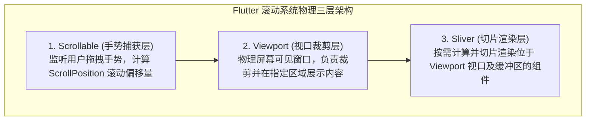
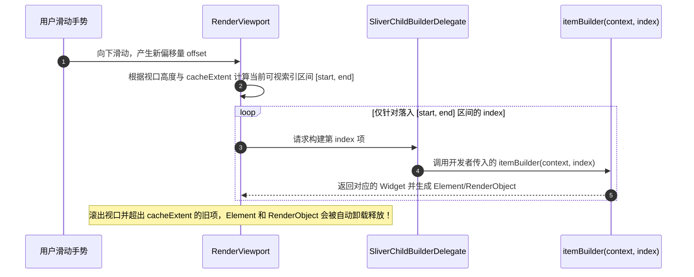

# 初级-滚动容器ListView与GridView基础用法与列表分割线

在移动端资讯信息流、商品瀑布流以及聊天列表中，高效展示成百上千条动态数据是核心高频场景。如果直接采用普通容器一次性渲染海量数据，会瞬间消耗数百兆堆内存并引发严重掉帧甚至 OOM 崩溃。Flutter 提供了基于虚拟化懒加载技术的 **`ListView`** 与 **`GridView`**。本篇专题深入剖析滚动视口底层架构、`ListView.builder` 懒加载时序、分割线交错算法，以及列表项状态保持机制。

---

## 一、核心底层机制与全景架构

### 1.1 Flutter 滚动视口分层三剑客

在 Flutter 源码中，任何可滚动组件都由三大核心分层协同驱动：



---

### 1.2 默认构造函数 vs 懒加载构造函数物理对比

| 维度对比 | `ListView(children: [...])` (默认构造函数) | `ListView.builder(...)` (懒加载构造函数) |
| :--- | :--- | :--- |
| **创建时机** | **一次性全量创建**。在父级构建时立即实例化数组中的所有 Widget 实例 | **视口按需懒加载**。只有滑入当前屏幕视口或进入预渲染缓冲区的项才会被构建 |
| **内存开销** | 随列表项数量呈线性激增 $O(N)$。1000 条复杂图文直接吃光内存卡死 | 内存恒定 $O(1)$，常驻内存仅为当前视口可见的数个至十数个节点 |
| **适用边界** | 仅适用于**固定且少量（10~20 条以内）**的静态设置页面或表单 | **适用于未知长度、动态分页拉取或海量数据列表（成千上万条）** |

---

## 二、源码级/算法物理推导

### 2.1 `ListView.builder` 懒加载虚拟化复用时序

`ListView.builder` 底层通过 `SliverChildBuilderDelegate` 代理对象实现按需实例化：



> [!NOTE]
> **预渲染缓冲区 `cacheExtent`**：`ListView` 默认在可视窗口的上下两端各自维护了一个 `cacheExtent: 250.0` 像素的缓冲区。位于缓冲区内的条目会提前被构建并光栅化，使得用户在匀速滚动时感受不到任何加载顿挫。

---

### 2.2 `ListView.separated` 分割线交错索引映射算法

在需要展示列表项分割线（Divider）时，官方提供了优雅的 `ListView.separated`。其底层算法并不是简单地把 `separator` 塞在 `item` 内部，而是将总条目数量翻倍（交错排列）：

$$\text{总子节点数} = \max(0, \text{itemCount} \times 2 - 1)$$

在底层分发时：
- **偶数索引（`index % 2 == 0`）**：调用 `itemBuilder(context, index ~/ 2)` 渲染真实的业务列表项；
- **奇数索引（`index % 2 != 0`）**：调用 `separatorBuilder(context, index ~/ 2)` 渲染分割线组件。
这种算法保证了分割线永远恰好夹在两个真实数据项之间，**列表的顶部和最底部绝不会出现多余难看的首尾分割线**。

---

### 2.3 GridView 两种常用 Delegate 几何计算公式

| 网格布局委托 | 核心参数与几何逻辑 | 计算公式 |
| :--- | :--- | :--- |
| **`SliverGridDelegateWithFixedCrossAxisCount`** | **固定列数**（如固定一行 3 列），每个格子的宽度随屏幕宽度自适应拉伸 | $$\text{itemWidth} = \frac{\text{crossAxisExtent} - (\text{count} - 1) \times \text{spacing}}{\text{count}}$$ |
| **`SliverGridDelegateWithMaxCrossAxisExtent`** | **指定每个格子的最大宽度上限**（如每个格子最多 150px），列数根据屏幕宽度动态计算（平板与折叠屏自适应首选） | $$\text{列数 count} = \left\lceil \frac{\text{crossAxisExtent}}{\text{maxCrossAxisExtent}} \right\rceil$$ |

---

## 三、社招高频硬核连环追问

### 追问 1：为什么在渲染海量数据（如 10,000 条）时直接使用 `ListView(children: [...])` 会导致 App 瞬间严重掉帧或 OOM 崩溃？
**标杆解答**：
1. **Dart 堆内存与三棵树的瞬间膨胀**：
   - 使用 `children: [...]` 时，Dart 会在执行当前页面 `build()` 时一次性在堆内存中实例化 10,000 个 Widget 对象；
   - 随之而来的是框架必须为这 10,000 个 Widget 同步创建 10,000 个 `Element` 逻辑节点，并初始化其关联的布局与渲染对象；
   - 手机的主线程 CPU 会在初次挂载时被长时间独占（数秒以上），触发严重掉帧（Jank）；
2. **图片显存暴增（GPU Memory Exhaustion）**：
   - 若每条数据中包含网络图片，全量创建会同时触发上千张图片的并发解码，显存瞬间超出移动操作系统物理阈值，直接被系统杀进程退出（Out of Memory）。
3. **解决方案**：强制使用 `ListView.builder`，让处于视口外部的条目保持未实例化状态，内存与数据总量完全脱钩。

---

### 追问 2：在 `ListView.builder` 中，当一个包含输入框或点赞状态的列表项滚出屏幕再滚回来时，为什么用户刚才输入的数据全没了？怎么彻底解决？
**标杆解答**：
1. **虚拟化卸载的代价**：
   - 为了节约内存，当列表项滚出视口并超出 `cacheExtent` 范围后，`ListView` 底层会自动调用该列表项 Element 的 `unmount()`，并彻底销毁其绑定的 `State` 实例；
   - 当该项重新滑回屏幕时，`itemBuilder` 会重新为其创建一个全新的、携带初始默认值的 `State` 实例，导致用户临时输入的状态完全丢失。
2. **彻底解决两部曲**：
   - **方案 A（状态提升至数据模型 - 最佳实践）**：将每个列表项的可变状态（如 `isLiked`、`inputText`）保存在外层的全局数据模型列表（`List<ItemModel>`）中。`itemBuilder` 每次重绘时，直接读取模型中的最新值进行回显；
   - **方案 B（混入 `AutomaticKeepAliveClientMixin`）**：
     让列表项的 `State` 混入 `AutomaticKeepAliveClientMixin`，并重写 `wantKeepAlive => true`：
     ```dart
     class _ListItemState extends State<ListItem> with AutomaticKeepAliveClientMixin {
       @override
       bool get wantKeepAlive => true; // 强制视口在滑出屏幕时保留 State 实例不被销毁

       @override
       Widget build(BuildContext context) {
         super.build(context); // 必须首行调用 super.build
         return TextField(...);
       }
     }
     ```

---

### 追问 3：`ScrollPhysics` 属性的作用是什么？iOS 与 Android 原生的物理滚动回弹有何区别？
**标杆解答**：
1. **物理滚动阻尼模拟器**：`ScrollPhysics` 决定了当用户手指拖拽列表、加速抛掷（Fling）或到达滚动边界时，视口所呈现的物理动画特征。
2. **两端原生默认差异**：
   - **`BouncingScrollPhysics`（iOS 默认）**：带有经典的“橡皮筋弹性回弹（Elastic Overscroll）”效果。当滑动到顶部或底部时，允许内容超出边界被拉伸，松手后以减速弹簧动画回弹；
   - **`ClampingScrollPhysics`（Android 默认）**：带有经典的“硬贴边 + 发光水波微波（Glowing Edge）”效果，到达边界时被物理夹住，绝对不允许内容继续向下或向上偏移拉伸。
3. **强制跨端统一**：若产品要求在两端呈现完全一致的 iOS 丝滑橡皮筋效果，直接显式指定 `physics: const BouncingScrollPhysics()`。

---

## 四、生产级避坑指南与排障 SOP

### 4.1 生产级新闻资讯列表（带分割线 + 触底自动加载更多）实战代码

```dart
import 'package:flutter/material.dart';

class NewsListScreen extends StatefulWidget {
  const NewsListScreen({super.key});

  @override
  State<NewsListScreen> createState() => _NewsListScreenState();
}

class _NewsListScreenState extends State<NewsListScreen> {
  final List<String> _newsList = [];
  late final ScrollController _scrollController;
  bool _isLoadingMore = false;
  bool _hasMoreData = true;

  @override
  void initState() {
    super.initState();
    _scrollController = ScrollController();
    
    // 1. 初始化拉取第一页数据
    _loadInitialData();

    // 2. 监听滚动位置，实现触底自动加载更多
    _scrollController.addListener(_onScroll);
  }

  void _loadInitialData() {
    for (int i = 0; i < 20; i++) {
      _newsList.add('资讯标题头条新闻 #$i: Flutter 深度开发');
    }
  }

  void _onScroll() {
    // 当滚动距离接近底部 200 像素以内时，自动触发加载下一页
    if (_scrollController.position.pixels >=
        _scrollController.position.maxScrollExtent - 200) {
      if (!_isLoadingMore && _hasMoreData) {
        _loadMoreData();
      }
    }
  }

  Future<void> _loadMoreData() async {
    setState(() => _isLoadingMore = true);

    // 模拟异步拉取分页接口
    await Future.delayed(const Duration(seconds: 2));

    if (!mounted) return;

    setState(() {
      final currentLen = _newsList.length;
      if (currentLen >= 60) {
        _hasMoreData = false; // 数据全部拉取完毕
      } else {
        for (int i = currentLen; i < currentLen + 20; i++) {
          _newsList.add('资讯标题头条新闻 #$i: Flutter 深度开发');
        }
      }
      _isLoadingMore = false;
    });
  }

  @override
  Widget build(BuildContext context) {
    return Scaffold(
      appBar: AppBar(title: const Text('资讯列表')),
      body: ListView.separated(
        controller: _scrollController,
        physics: const BouncingScrollPhysics(), // 跨端统一为弹性回弹
        // 关键点: 若有正在加载更多的指示器，列表项总数 +1
        itemCount: _newsList.length + (_hasMoreData ? 1 : 0),
        
        // 1. 列表项构建器
        itemBuilder: (context, index) {
          // 渲染底部的加载状态组件
          if (index == _newsList.length) {
            return const Padding(
              padding: EdgeInsets.symmetric(vertical: 20.0),
              child: Center(
                child: SizedBox(
                  width: 24,
                  height: 24,
                  child: CircularProgressIndicator(strokeWidth: 2),
                ),
              ),
            );
          }

          final title = _newsList[index];
          return ListTile(
            leading: CircleAvatar(
              backgroundColor: const Color(0xFFE2E8F0),
              child: Text('${index + 1}'),
            ),
            title: Text(title, maxLines: 1, overflow: TextOverflow.ellipsis),
            subtitle: Text('发布于 10 分钟前 · 科技板块'),
            trailing: const Icon(Icons.arrow_forward_ios, size: 14),
            onTap: () {},
          );
        },

        // 2. 列表分割线构建器 (首尾绝不会多余出现)
        separatorBuilder: (context, index) {
          return const Divider(height: 1, thickness: 0.5, indent: 16, endIndent: 16);
        },
      ),
    );
  }

  @override
  void dispose() {
    // 生产级清理 SOP: 注销滚动控制器，防内存泄漏
    _scrollController.removeListener(_onScroll);
    _scrollController.dispose();
    super.dispose();
  }
}
```
