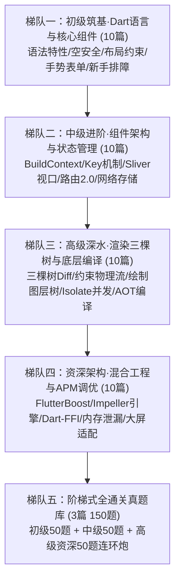

# Flutter 全阶梯技术图谱与社招通关前言

在现代大前端与跨平台演进中，**Flutter** 凭借其高保真跨平台渲染管线、单向数据流与现代语言特性（空安全、异步 Stream、编译期常量折叠），成为各大大厂与中大型企业构建移动端、桌面端与混合架构的核心主力。

为了彻底打破“只会用 Widget 拼积木、一问底层原理就哑火、遇到线上卡顿内存泄露束手无策”的瓶颈，本知识库深度参照一线大厂（腾讯、阿里、字节、美团、快手）**社招 2~5 年+ 资深/架构师级别面试与生产实战标杆**，构建了由浅入深、五层递进的**43 篇硬核实战体系**。

---

## 🌟 知识图谱五层梯队全景规划

---

## 📚 43 篇核心专题索引导航

### 梯队一：初级筑基·Dart语言与Flutter核心组件实战（10篇）
1. [01. Dart基础语法空安全与异步编程Future-Stream](/doc/flutter/初级-Dart基础核心语法空安全与异步编程Future-Stream)
2. [02. 工程目录结构与Widget声明式UI编程思想](/doc/flutter/初级-Flutter工程目录结构与Widget声明式UI编程思想)
3. [03. StatelessWidget与StatefulWidget核心生命周期与setState](/doc/flutter/初级-StatelessWidget与StatefulWidget核心生命周期与setState)
4. [04. 基础排版布局Row-Column与Flex-Expanded自适应实战](/doc/flutter/初级-基础排版布局Row-Column与Flex-Expanded自适应实战)
5. [05. 层叠布局Stack与Positioned及层级覆盖实战](/doc/flutter/初级-层叠布局Stack与Positioned及层级覆盖实战)
6. [06. 基础表单输入TextField与Form表单校验体系](/doc/flutter/初级-基础表单输入TextField与Form表单校验体系)
7. [07. 滚动容器ListView与GridView基础用法与列表分割线](/doc/flutter/初级-滚动容器ListView与GridView基础用法与列表分割线)
8. [08. 手势识别GestureDetector与InkWell水波纹点击交互](/doc/flutter/初级-手势识别GestureDetector与InkWell水波纹点击交互)
9. [09. 图片组件Image全场景加载资产网络与缓存策略](/doc/flutter/初级-图片组件Image全场景加载资产网络与缓存策略)
10. [10. 新手常见报错排查指南与控制台Error根治SOP](/doc/flutter/初级-新手常见报错排查指南与控制台Error根治SOP)

### 梯队二：中级进阶·组件架构、导航路由与状态管理实战（10篇）
11. [11. BuildContext本质作用域链与Theme-MediaQuery查找机制](/doc/flutter/中级-BuildContext本质作用域链与Theme-MediaQuery查找机制)
12. [12. Key机制ValueKey-ObjectKey与GlobalKey物理应用](/doc/flutter/中级-Flutter中的Key机制ValueKey-ObjectKey与GlobalKey物理应用)
13. [13. CustomScrollView与Sliver视口系统高级折叠滑动实战](/doc/flutter/中级-CustomScrollView与Sliver视口系统高级折叠滑动实战)
14. [14. 路由体系Navigator1.0对比Navigator2.0与go_router实战](/doc/flutter/中级-路由体系Navigator1.0对比Navigator2.0与go_router实战)
15. [15. InheritedWidget底层数据共享机制与updateShouldNotify](/doc/flutter/中级-InheritedWidget底层数据共享机制与updateShouldNotify)
16. [16. 状态管理选型对比Provider-Riverpod-Bloc-GetX深度实战](/doc/flutter/中级-状态管理选型对比Provider-Riverpod-Bloc-GetX深度实战)
17. [17. 动画体系核心AnimationController-Tween与CurvedAnimation](/doc/flutter/中级-动画体系核心AnimationController-Tween与CurvedAnimation)
18. [18. Dio企业级网络层封装拦截器Token无感刷新与取消请求](/doc/flutter/中级-Dio企业级网络层封装拦截器Token无感刷新与取消请求)
19. [19. 本地数据持久化Hive与SharedPreferences及Isar选型实战](/doc/flutter/中级-本地数据持久化Hive与SharedPreferences及Isar选型实战)
20. [20. 通用弹窗体系Dialog-BottomSheet与SnackBars优雅封装](/doc/flutter/中级-通用弹窗体系Dialog-BottomSheet与SnackBars优雅封装)

### 梯队三：高级深水·渲染三棵树、事件机制与底层编译源码（10篇）
21. [21. 渲染核心Widget-Element-RenderObject三棵树全生命周期](/doc/flutter/高级-渲染核心Widget-Element-RenderObject三棵树全生命周期)
22. [22. 布局核心Constraints物理传递向下约束向上确定尺寸](/doc/flutter/高级-布局核心Constraints物理传递向下约束向上确定尺寸)
23. [23. 绘制管道Layer图层树与RepaintBoundary重绘隔离](/doc/flutter/高级-绘制管道Layer图层树与RepaintBoundary重绘隔离)
24. [24. 手势竞技场GestureArena机制与多手势滑动冲突解决](/doc/flutter/高级-手势竞技场GestureArena机制与多手势滑动冲突解决)
25. [25. 自定义绘制CustomPainter与Canvas画笔贝塞尔曲线实战](/doc/flutter/高级-自定义绘制CustomPainter与Canvas画笔贝塞尔曲线实战)
26. [26. Dart多线程并发Isolate机制与compute轻量调度](/doc/flutter/高级-Dart多线程并发Isolate机制与compute轻量调度)
27. [27. Dart编译模式JIT与AOT及底层虚拟机DDC与Snapshot](/doc/flutter/高级-Dart编译模式JIT与AOT及底层虚拟机DDC与Snapshot)
28. [28. Flutter启动全时序从Native引导到首帧RenderView挂载](/doc/flutter/高级-Flutter启动全时序从Native引导到首帧RenderView挂载)
29. [29. 热重载HotReload物理原理与状态保留机制源码推导](/doc/flutter/高级-热重载HotReload物理原理与状态保留机制源码推导)
30. [30. 原生平台通道PlatformChannel编解码源码与二进制流](/doc/flutter/高级-原生平台通道PlatformChannel编解码源码与二进制流)

### 梯队四：资深架构·混合工程、性能调优与APM稳定性实战（10篇）
31. [31. 混合开发架构FlutterBoost与多引擎多Activity栈管理](/doc/flutter/资深-混合开发架构FlutterBoost与多引擎多Activity栈管理)
32. [32. 新一代渲染引擎Impeller架构对比Skia与着色器预编译](/doc/flutter/资深-新一代渲染引擎Impeller架构对比Skia与着色器预编译)
33. [33. Dart-FFI高性能原生C-C++绑定与内存指针交互](/doc/flutter/资深-Dart-FFI高性能原生C-C++绑定与内存指针交互)
34. [34. APM全链路性能监控卡顿掉帧FPS采集与卡顿堆栈还原](/doc/flutter/资深-APM全链路性能监控卡顿掉帧FPS采集与卡顿堆栈还原)
35. [35. 内存泄露排查DevTools-Memory分析与ImageCache调优](/doc/flutter/资深-Flutter内存泄露排查DevTools-Memory分析与ImageCache调优)
36. [36. 线上异常崩溃监控与Zone沙箱捕获及符号表解析](/doc/flutter/资深-线上异常崩溃监控与Zone沙箱捕获及符号表解析)
37. [37. 无头渲染与自动化测试单元测试Widget测试集成测试](/doc/flutter/资深-无头渲染与自动化测试单元测试Widget测试集成测试)
38. [38. CI-CD持续集成流水线Fastlane自动化打包与多渠道风味Flavor](/doc/flutter/资深-CI-CD持续集成流水线Fastlane自动化打包与多渠道风味Flavor)
39. [39. 包体积深度优化产物瘦身代码混淆与动态资产拆包](/doc/flutter/资深-包体积深度优化产物瘦身代码混淆与动态资产拆包)
40. [40. 跨平台桌面端与Web适配大屏响应式与键盘鼠标交互](/doc/flutter/资深-跨平台桌面端与Web适配大屏响应式与键盘鼠标交互)

### 梯队五：阶梯式全通关真题库·社招高频150题标准对标（3篇）
41. [41. Flutter全阶段面试通关-初级基础50题标准对标](/doc/flutter/Flutter全阶段面试通关-初级基础50题标准对标)
42. [42. Flutter全阶段面试通关-中级实战50题标准对标](/doc/flutter/Flutter全阶段面试通关-中级实战50题标准对标)
43. [43. Flutter全阶段面试通关-高级资深架构50道连环炮全景通关](/doc/flutter/Flutter全阶段面试通关-高级资深架构50道连环炮全景通关)

---

## 🎯 学习与面试通关建议

1. **初中级重点打牢实战**：重点攻克梯队一与梯队二。熟练运用约束规则、Sliver 视口、Provider/Bloc 状态管理以及 Dio 企业级拦截器，能独立交付高性能高可靠的业务页面。
2. **高级资深直击底层内核**：精读梯队三与梯队四。必须能脱稿画出三棵树与 Layer 树拓扑、推导约束传递方程与手势竞技场状态机，掌握混合栈 Surface 换绑与 Impeller AOT 着色器预编译机制。
3. **面试冲刺刷题对标**：进入面试前 1~2 周，系统通刷梯队五的 150 道标准题库，训练连环追问反证思维与精准的技术答辩话术。
