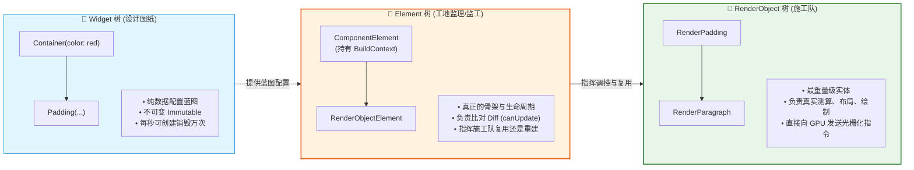
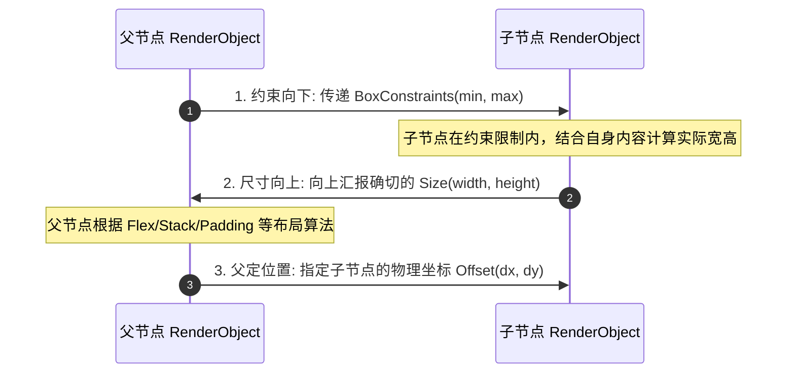

# Flutter渲染机制与三棵树深度剖析

## 🎯 招聘面试核心考点
- **面试官设问**：“Flutter 的 **Widget、Element、RenderObject 三棵树** 之间的生命周期与关联关系是什么？为什么 Widget 要设计成不可变（Immutable）的？”
- **深水区追问**：“Flutter 经典布局铁律‘**Constraints go down. Sizes go up. Parent sets position**’底层是怎么执行的？什么是**重布局边界（Relayout Boundary）**与**重绘边界（Repaint Boundary）**？为什么加了 **`const`** 的 Widget 能够在父组件重构时彻底跳过 `build()`？”

---

## 一、 三棵树架构与生命周期映射

::: tip 🏗️ 通俗心智模型：建筑工程的设计师、监工与施工队
很多初学者搞不懂为什么 Flutter 要折腾出“三棵树”，用建房子的过程一秒看透：
* **`Widget 树` 就像【建筑设计图纸】（轻量、不可变 Immutable）**：
  * 图纸只是纯粹的参数描述（“墙刷红色，宽 200px”）。
  * 哪怕业主只改了一个按钮颜色，**旧图纸直接揉成纸团扔掉，新画一张全新图纸**。因为图纸只有几张纸，每秒画一万张也根本不费力气（内存开销极轻）。
* **`Element 树` 就像【工地项目监工 / 总工程师】（核心枢纽、持有状态）**：
  * 监工永远常驻工地！他手里拿着新旧两张设计图纸对比（`canUpdate`：类型 `runtimeType` 和 `key` 变没变？）。
  * 如果图纸类型一致，监工**坚决不拆楼重盖**，而是对施工队喊一句：“图纸没换，只是墙漆换个颜色，你们把油漆刷新一下！”
  * **我们平时用的 `BuildContext`，本质上就是当前监工 `Element` 本人！**
* **`RenderObject 树` 就像【一线施工搬砖队】（重型对象、直接操作 GPU）**：
  * 施工队干的全是重活：拿皮尺量尺寸（Layout 布局）、拿水平仪算坐标（Paint 绘制），并直接生成 GPU 图元。
  * 施工队结构最重，在监工的协调下尽量长久常驻复用，绝不轻易推倒地基！
:::



### 1. 三者职责划分速记
- **Widget（配置蓝图）**：纯粹的数据配置对象，必须继承自 `@immutable`。它的生命周期极其短暂，每当调用 `setState()`，整棵被影响的 Widget 子树都会被立即重新创建并丢弃，**内存创建极轻**。
- **Element（上下文骨架）**：Widget 树在运行时的**真实实体**，负责维护树的层级结构并持有生命周期。我们平时使用的 **`BuildContext` 本质上就是当前 `Element` 的公开接口**！
- **RenderObject（渲染引擎）**：真正计算尺寸约束、处理命中测试（Hit Testing）、并最终调用 Skia / Impeller 生成底层 GPU 绘制指令的重量级实体。

---

## 二、 核心布局算法铁律：约束向下，尺寸向上，父定位置

::: tip 📏 通俗心智模型：家长给预算，孩子报花费，家长定房间
1. **Constraints go down（约束向下传递）**：
   - 就像家长给孩子划定预算范围：“给你 100~300 元，在这个范围里买衣服”（传递 `BoxConstraints(minWidth, maxWidth, minHeight, maxHeight)`）。
2. **Sizes go up（尺寸向上反馈）**：
   - 孩子挑好衣服后汇报总价：“我挑好了，实际花了 180 元”（子节点决定并上报自身的实际 `Size(width, height)`）。
3. **Parent sets position（父节点决定位置）**：
   - 家长根据全家人的安排，指挥孩子站在哪里：“好，那你去客厅靠墙角站着”（父节点根据自身排版规则决定子节点的相对坐标 `Offset(x, y)`）。
:::



```dart
// 源码级证明：RenderBox 核心布局方法
@override
void performLayout() {
  // 1. 约束向下：将修改后的约束传递给子节点并要求子节点完成测量
  child?.layout(constraints.loosen(), parentUsesSize: true);

  // 2. 尺寸向上：根据子节点的尺寸决定自己的尺寸
  size = Size(child?.size.width ?? 0, (child?.size.height ?? 0) + 20);

  // 3. 父定位置：指定子节点相对于自己的摆放坐标 (dx, dy)
  final BoxParentData childParentData = child!.parentData! as BoxParentData;
  childParentData.offset = const Offset(0, 10);
}
```

---

## 三、 性能隔离屏障：重布局边界与重绘边界（面试杀手锏）

### 1. Relayout Boundary（重布局边界）
- **痛点**：若页面某个微小组件尺寸改变，默认情况下它的 `markNeedsLayout()` 会一直向上冒泡通知父节点，导致整屏重新计算布局。
- **重布局边界判定条件**：如果一个节点的布局满足以下任一条件，它会自动成为**重布局边界**，布局脏标记绝不向外冒泡：
  1. `parentUsesSize == false`（父节点不关心子节点的尺寸）。
  2. 节点的约束是紧约束（`constraints.isTight`，即最大宽高等于最小宽高，尺寸已死）。
  3. `sizedByParent == true`（尺寸完全由父节点约束直接决定）。

---

### 2. Repaint Boundary（重绘边界）
- **业务场景**：页面包含一个**极高频持续旋转的加载动画（Indicator）**，而动画周围是一个**非常复杂的复杂长列表**。
- **灾难**：如果不用边界包裹，旋转动画每秒 60 次触发重绘，会导致整个列表连带全屏每秒重绘 60 次，CPU 和 GPU 瞬间被耗尽！
- **优化代码**：
  ```dart
  // 核心：使用 RepaintBoundary 将高频动画节点隔离成独立的图层 (RenderLayer)
  RepaintBoundary(
    child: CircularProgressIndicator(),
  )
  ```
  Flutter 引擎会为该子树分配一个独立的离屏缓冲区，动画重绘时**仅刷新自己的图层纹理，绝不波及外部列表**！

---

## 四、 为什么 `const` Widget 能够拯救 Flutter 性能？

- **底层原理**：
  在 Dart 中，被 `const` 修饰的对象是在**编译期确定、并在内存常量池中全局单例复用**的。
- **Diff 机制对比**：
  当父组件执行 `setState()` 时，框架遍历子树并执行 `Widget.canUpdate(oldWidget, newWidget)`：
  ```dart
  static bool canUpdate(Widget oldWidget, Widget newWidget) {
    return oldWidget.runtimeType == newWidget.runtimeType && oldWidget.key == newWidget.key;
  }
  ```
  如果该 Widget 使用了 `const`，新旧对象的**内存物理引用完全相同（`identical(oldWidget, newWidget) == true`）**！
  Element 发现引用一模一样，**立刻直接跳过该 Widget 及其所有子节点的 `build()` 方法**，实现亚毫秒级的极限智能跳过！
