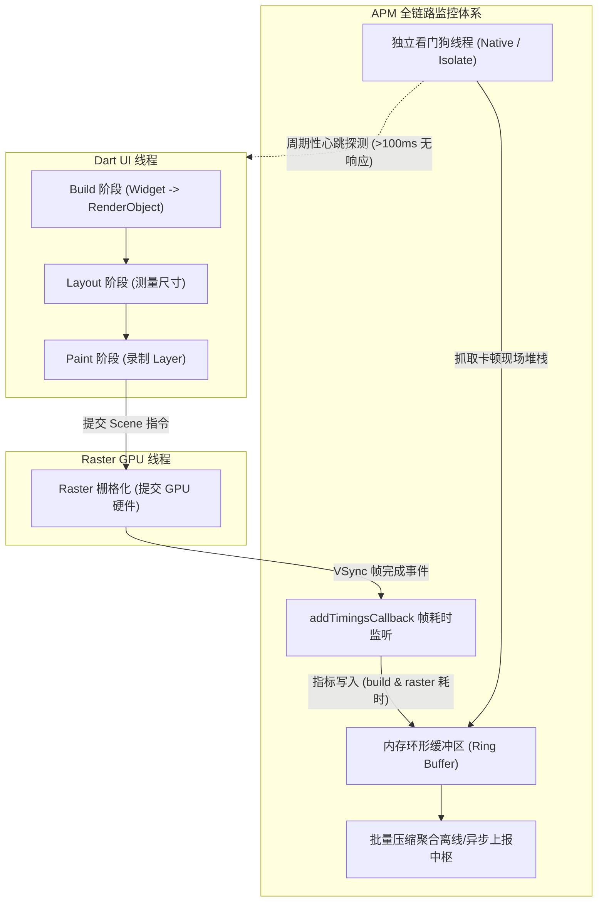
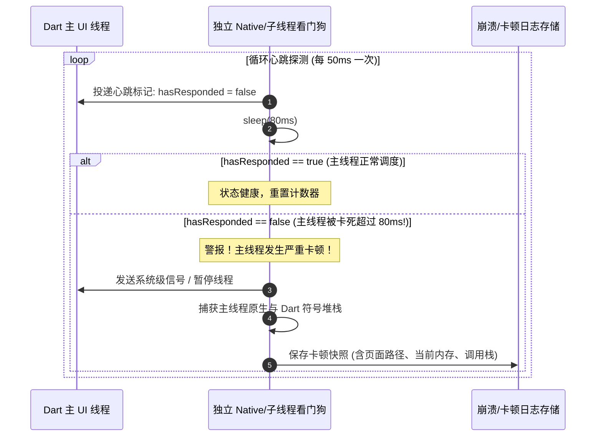
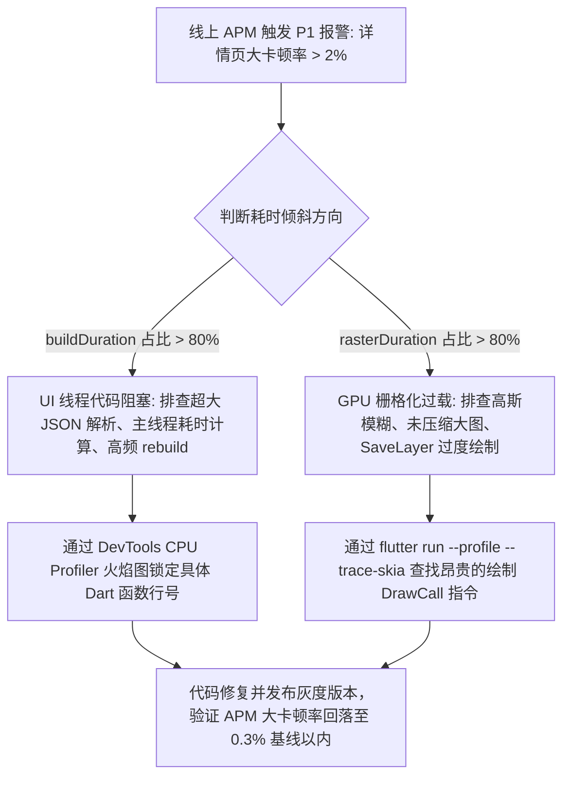

# 资深-APM全链路性能监控卡顿掉帧FPS采集与卡顿堆栈还原

在亿级 DAU 移动互联网业务的工程治理中，线下通过 DevTools 抓取性能火焰图只属于“体检手段”，而建立一套能够在生产环境中**低开销、全天候运行的 APM（Application Performance Monitoring）全链路性能监控体系**，才是保障业务大盘稳定性与流畅度的终极底牌。

在资深架构师社招考核中，面试官绝不会满足于“在控制台打印两行帧率日志”，而是会以大厂线上核心指标为切入点展开深度连环审讯：**为什么不能在 Dart UI 线程直接启动 Timer 抓卡顿？`addTimingsCallback` 底层采集的 `buildDuration` 与 `rasterDuration` 有何物理差异？如何设计一个开销低于 1% 的线上卡顿堆栈采样看门狗？面对只在 GPU Raster 线程超时的卡顿如何追溯根因？**

---

## 1. 核心底层机制与全景架构

### 1.1 Flutter 生产级 APM 性能采集全景拓扑



### 1.2 核心监控指标定义（大厂基线）

| 指标名称 | 物理计算公式 | 生产告警阈值 |
| :--- | :--- | :--- |
| **平均帧率 (FPS)** | $\frac{\text{总渲染帧数}}{\text{总耗时秒数}}$ | 60Hz 屏幕下 $< 55\text{fps}$ 触发预警 |
| **卡顿帧 (Jank Frame)** | $T_{\text{build}} + T_{\text{raster}} > 16.6\text{ms}$（60Hz）或 $> 8.3\text{ms}$（120Hz） | 卡顿率 $> 3\%$ 需治理 |
| **严重卡顿 (Frozen / Big Jank)** | $T_{\text{frame}} > 100\text{ms}$（连续丢 6 帧以上，肉眼严重阻滞） | 严重卡顿率 $> 0.5\%$ 必须派发 P1 告警 |
| **首屏上屏耗时 (TTFI)** | 从点击图标/页面路由切换到 `addPostFrameCallback` 触发的差值 | 大盘 P90 耗时 $> 800\text{ms}$ 判定为不达标 |

---

## 2. 源码级/算法物理推导

### 2.1 SchedulerBinding.addTimingsCallback 源码物理执行流

Flutter Framework 官方提供了生产环境极低开销的帧时序监听接口：

```dart
// 在 APM SDK 启动时注册监听
WidgetsBinding.instance.addTimingsCallback((List<FrameTiming> timings) {
  for (final FrameTiming timing in timings) {
    // 1. UI 线程计算耗时 (Build + Layout + Paint)
    final int buildDurationMs = timing.buildDuration.inMilliseconds;
    
    // 2. GPU 线程栅格化耗时 (Rasterization)
    final int rasterDurationMs = timing.rasterDuration.inMilliseconds;
    
    // 3. 整帧全生命周期物理跨度
    final int totalSpanMs = timing.totalSpan.inMilliseconds;

    // 判定是否发生物理丢帧
    if (totalSpanMs > 16) {
      APMCollector.recordJank(timing);
    }
  }
});
```

#### 为什么 `addTimingsCallback` 具有天然的低开销特权？
- 批量批处理分发（Batching）：底层不会每渲染一帧就立即触发一次 Dart 方法。C++ Engine 会在原生层将最近 1 秒内（通常为 60~100 帧）的 `FrameTiming` 数据打包成一个数组，通过一次 JNI/C-API 调用集中抛给 Dart 框架层。
- 绝不侵入正在运行的渲染流水线：回调的触发发生在当前帧已经在 GPU 上完成绘制、甚至下几帧已经在准备的空闲缝隙中，避免引入“观察者效应（Observer Effect）”。

### 2.2 双线程异步看门狗（Watchdog）抓栈算法推导

如果主线程已经被一个耗时 500ms 的长任务彻底死锁占据，`addTimingsCallback` 是无法在该 500ms 的卡顿时段内实时抓取到正在执行的堆栈信息的（只能事后感知丢帧）。



---

## 3. 社招/阶段必考高频硬核连环追问

### 追问 1：为什么不能直接在 Dart UI 线程启动一个 `Timer.periodic(Duration(milliseconds: 50))` 来检测 UI 卡顿？

> **答辩深度闭环**：
> 1. **同舟共济陷阱（Co-fate Traps）**：Dart 的 `Timer` 是排在当前 Isolate 的 Event 队列中等待调度的。
> 2. **完全失效**：当 UI 线程因为超大 JSON 解析或死循环发生严重卡顿阻塞时，整个事件循环被冻结，**`Timer` 的回调根本无法被执行**！
> 3. **事后诸葛亮**：直到 500ms 后主线程卡顿结束，`Timer` 才一次性把堆积的事件执行完。此时再去打印堆栈，抓取到的早已是卡顿结束后的正常现场，根本无法获知卡顿发生时那一瞬间是在哪一行代码上卡死的。
> 4. **唯一根治之道**：必须使用**独立的操作系统线程（Native Watchdog 线程）**，通过原生句柄脱离 Dart 事件循环的束缚进行旁路监视。

---

### 追问 2：如果 `addTimingsCallback` 报出的卡顿数据中，`buildDuration` 极短（仅 2ms），但 `rasterDuration` 极其漫长（高达 80ms），这种卡顿的物理根因通常是什么？如何排查？

> **答辩深度闭环**：
> 1. **责任不在 Dart 代码**：`buildDuration` 短意味着 Widget 构建、约束计算与绘制指令录制极其轻量，Dart 代码逻辑完全正常。
> 2. **GPU 硬件超载**：`rasterDuration` 漫长说明压力完全堆积在底层的 **GPU 栅格化线程与着色器执行管线**上。
> 3. **典型物理根因**：
>    - **图层过度绘制与非必要离屏渲染**：滥用 `BackdropFilter`（多重高斯模糊叠加）、大范围嵌套 `Opacity`（非 0/1 透明度触发了离屏缓冲 SaveLayer）。
>    - **超高分辨率大图未缩放**：直接将一张 4000x3000、20MB 的超大原图强塞进一个 50x50 的 `Image` 容器中，GPU 光栅化时需要执行繁重的下采样双线性纹理插值。
>    - **缺少 RepaintBoundary**：复杂列表滚动时，静态组件没有被边界隔离，导致 GPU 每帧全量重录全屏 Picture。

---

### 追问 3：在千万级用户的生产环境中，如果每个卡顿帧都将几十 KB 的堆栈上传到服务端，会造成严重的带宽与服务器雪崩。资深架构师如何设计上报治理策略？

> **答辩深度闭环**：
> 1. **采样率分级倾斜（Stratified Sampling）**：轻微卡顿（16ms~50ms）按 0.1% 极小采样率抽样；严重卡顿（>100ms）按 1% 采样；发生卡顿 ANR（>3000ms）按 100% 全量上报。
> 2. **本地堆栈聚合归一化（Stack De-duplication）**：在客户端对捕获的堆栈进行 MD5 哈希指纹计算。同一个用户在同一页面因为同一个死循环产生的 50 次卡顿，客户端只记录并上传 1 次完整堆栈，其余 49 次仅累计计数（Count++）。
> 3. **离线压缩与 Wi-Fi 批处理上报**：数据先写入本地轻量 SQLite 或 mmap 映射文件，利用 gzip 极速压缩，在应用切入后台或 Wi-Fi 连接时才执行网络批量上报。

---

## 4. 生产级避坑指南与排障 SOP

### 4.1 生产级低开销 APM 帧率监控 SDK 核心源码

```dart
import 'dart:ui';
import 'package:flutter/widgets.dart';

class EnterpriseAPM {
  static final EnterpriseAPM instance = EnterpriseAPM._();
  EnterpriseAPM._();

  bool _isInitialized = false;
  int _jankFrameCount = 0;
  int _totalFrameCount = 0;

  void init() {
    if (_isInitialized) return;
    _isInitialized = true;

    // 核心注册：生产级无侵入帧耗时回调
    WidgetsBinding.instance.addTimingsCallback(_processFrameTimings);
  }

  void _processFrameTimings(List<FrameTiming> timings) {
    for (final FrameTiming timing in timings) {
      _totalFrameCount++;

      final int buildMs = timing.buildDuration.inMilliseconds;
      final int rasterMs = timing.rasterDuration.inMilliseconds;
      final int totalMs = timing.totalSpan.inMilliseconds;

      // 判定是否达到卡顿标准 (> 16.6ms)
      if (totalMs > 16) {
        _jankFrameCount++;

        // 判定严重大卡顿 (> 100ms)
        if (totalMs > 100) {
          _reportBigJank(
            buildMs: buildMs,
            rasterMs: rasterMs,
            totalMs: totalMs,
          );
        }
      }
    }
  }

  void _reportBigJank({required int buildMs, required int rasterMs, required int totalMs}) {
    // 异步低优先级写入环形缓冲区，绝不阻塞当前执行流
    debugPrint(
      '[APM-Jank] 🚨 检测到严重大卡顿: 总耗时=${totalMs}ms '
      '(UI Build=${buildMs}ms, GPU Raster=${rasterMs}ms)',
    );
  }

  // 获取当前周期的健康度大盘指标
  Map<String, dynamic> collectMetrics() {
    final double jankRate = _totalFrameCount == 0 ? 0.0 : (_jankFrameCount / _totalFrameCount) * 100;
    return {
      'totalFrames': _totalFrameCount,
      'jankFrames': _jankFrameCount,
      'jankRate': '${jankRate.toStringAsFixed(2)}%',
    };
  }
}
```

### 4.2 卡顿排查与线上告警响应 SOP


