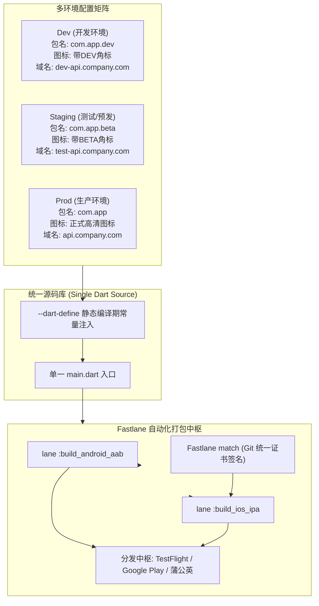
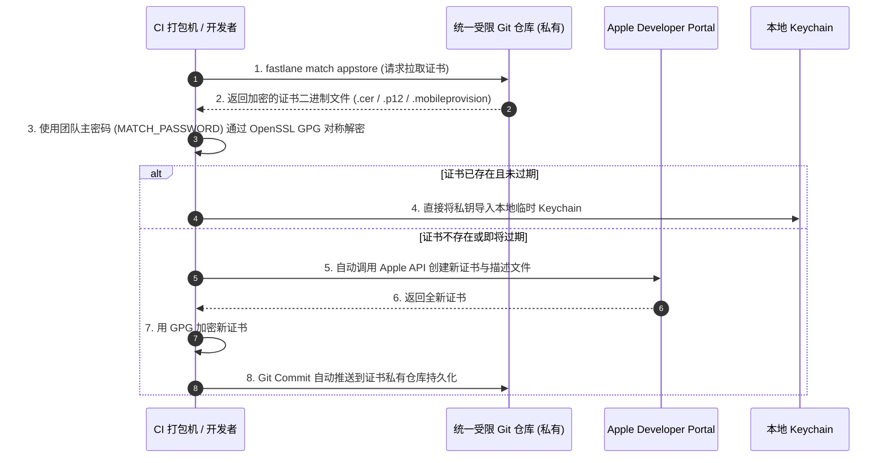

# 资深-CI-CD持续集成流水线Fastlane自动化打包与多渠道风味Flavor

在工程规模化阶段，如果发布新版本依然依赖开发者在本地 Android Studio 或 Xcode 中手动改代码、改接口域名、手动导出 APK/IPA、再人肉上传到应用市场或内测分发平台，不仅耗时费力，更极易因“开发期测试配置被意外带上生产”而引发严重线上事故。

构建一套基于 **多渠道风味（Flavors / Schemes）** 与 **Fastlane 自动化 CI/CD 流水线** 的工程基础设施，是资深架构师实现团队研发效能跃升与质量护航的核心基本功。

在资深架构师面试中，面试官将围绕以下要点进行严苛技术考核：**`--dart-define` 与传统多入口文件（`main_dev.dart`）相比在 AOT 编译树剪枝上的物理优势是什么？Android `productFlavors` 与 iOS `XCConfig / Schemes` 如何完美映射？Fastlane `match` 证书管理系统的 Git + GPG 加密原理是什么？**

---

## 1. 核心底层机制与全景架构

### 1.1 多环境风味（Flavors）矩阵架构图

企业级开发通常至少划分三个运行环境，需实现**不同包名共存、不同应用图标、不同 API 域名、不同第三方 SDK Key** 的完全解耦：



### 1.2 环境变量注入模式对比：多入口 vs `--dart-define`

| 维度对比 | 传统多入口文件方案 (`main_dev.dart`) | 现代 `--dart-define` 编译期常量注入 |
| :--- | :--- | :--- |
| **入口管理** | 产生大量冗余的 `main_xxx.dart` 样板代码 | **全局唯一 `main.dart` 入口**，代码库清爽统一 |
| **原生层感知** | 原生 Android/iOS 无法直接感知 Dart 文件的配置 | **原生 Gradle 和 Xcode 均可无缝直接读取环境变量** |
| **Tree-Shaking 优化** | 运行时判断环境变量，所有分支代码依然打包进二进制 | **编译期静态求值**，未命中的环境代码被 AOT 彻底连根剔除！ |
| **密钥安全性** | 敏感密钥明文固化在源码中，易被反编译 | 编译时从 CI 环境变量动态注入，**源码零密钥泄露风险** |

---

## 2. 源码级/算法物理推导

### 2.1 --dart-define 编译期内联与死代码剪枝推导

在 Flutter 3.7+ 中，推荐将环境参数固化在 JSON 文件中通过 `--dart-define-from-file` 注入：

```dart
// 业务环境配置常量类
abstract class EnvironmentConfig {
  // 核心：使用 const 声明编译期常量
  static const String envName = String.fromEnvironment('ENV_NAME', defaultValue: 'dev');
  static const String apiBaseUrl = String.fromEnvironment('API_BASE_URL');
  static const bool enableDebugTools = bool.fromEnvironment('ENABLE_DEBUG_TOOLS', defaultValue: false);
}
```

#### 物理编译底层推导：
当执行 `flutter build apk --dart-define=ENABLE_DEBUG_TOOLS=false` 时：
1. **静态常量折叠（Constant Folding）**：Dart CFE 前端直接在语法分析树上将 `EnvironmentConfig.enableDebugTools` 替换为字面量 `false`。
2. **死代码树消除（Dead Code Elimination）**：
   ```dart
   if (EnvironmentConfig.enableDebugTools) {
     initHeavyVConsole(); // 这里的代码块在 AST 阶段直接判定为永远不可达！
   }
   ```
   AOT 编译器（`gen_snapshot`）执行 Tree-Shaking 遍历时，该分支完全不会被纳入可达节点，庞大的调试工具类库**物理级零字节打包进最终二进制产物中**！

### 2.2 Fastlane match 证书管理算法与工作流

iOS 企业打包最大的痛点就是证书冲突与过期。Fastlane `match` 颠覆了传统手动导出 `.p12` 和描述文件的乱象，实现了 **“代码化证书管理（Codesigning as Code）”**：



---

## 3. 社招/阶段必考高频硬核连环追问

### 追问 1：同一个手机上为什么经常无法同时安装同一个 App 的 Dev 版和 Release 版？需要配置原生双端的什么核心标识？

> **答辩深度闭环**：
> 1. **操作系统唯一宿主标识**：
>    - **Android 物理准则**：Android 系统判定应用唯一的唯一基准是 `applicationId`（而非 Java 的 package 包名）。若两个 APK 的 `applicationId` 完全一致，安装新包会覆盖旧包；若签名证书不同则直接报错 `INSTALL_FAILED_UPDATE_INCOMPATIBLE`。
>    - **iOS 物理准则**：iOS 系统判定唯一的基准是 `CFBundleIdentifier`（Bundle ID）。
> 2. **解法（多 Flavor 包名后缀隔离）**：
>    - Android 端在 `build.gradle` 的 ProductFlavors 中配置 `applicationIdSuffix ".dev"`。
>    - iOS 端在 Build Settings 中为各 Configuration 配置不同的 `PRODUCT_BUNDLE_IDENTIFIER`（如 `com.company.app.dev`）。

---

### 追问 2：如何在原生 Android 的 `AndroidManifest.xml` 和 iOS 的 `Info.plist` 中，直接无缝读取 `--dart-define` 传入的参数？

> **答辩深度闭环**：
> 1. **底层机制**：`--dart-define` 传入的参数会被 Flutter 编译工具链自动转换为 Base64 字符串，存入 Gradle 的 `DART_DEFINES` 属性以及 Xcode 的 `DART_DEFINES` 环境变量中。
> 2. **Android 侧映射（Gradle 解析）**：
>    在 `app/build.gradle` 中编写一段解码逻辑，将 Base64 解析为 Key-Value 映射，并通过 `manifestPlaceholders` 注入：
>    ```groovy
>    // build.gradle
>    android {
>        defaultConfig {
>            manifestPlaceholders += [
>                GAODE_MAP_KEY: project.hasProperty('GAODE_KEY') ? GAODE_KEY : "default_key"
>            ]
>        }
>    }
>    ```
> 3. **iOS 侧映射（Preprocessor Macros）**：
>    在 `ios/Flutter/Generated.xcconfig` 中，Flutter 已经将相关定义写入，可直接在 `Info.plist` 中以 `$(VARIABLE_NAME)` 占位符读取。

---

### 追问 3：在大型互联网公司，为什么严禁在 CI/CD 服务器上使用永久常驻的 Keychain 来保存 iOS 打包证书？

> **答辩深度闭环**：
> 1. **并发竞态与污染风险**：在 GitLab Runner 或 Jenkins 共享构建机上，若多个流水线任务并发执行，共享全局 Keychain 会导致证书查找竞态错乱、锁死或权限被覆盖。
> 2. **安全合规风险**：如果构建机遭到黑客横向渗透，常驻 Keychain 中的私钥和企业发布证书可能被直接导出兜售，引发灾难性的签名勒索风险。
> 3. **最佳工程范式（Ephemeral Keychain）**：Fastlane 打包时必须使用 `create_keychain` 动态创建一个带有随机密码的**内存级独立临时 Keychain**，证书导入打包完成后，在 `finally` 阶段无条件执行 `delete_keychain` 彻底销毁，确保构建环境零状态残留。

---

## 4. 生产级避坑指南与排障 SOP

### 4.1 生产级多环境配置文件范式

#### `env/prod.json`（生产环境配置）
```json
{
  "ENV_NAME": "prod",
  "API_BASE_URL": "https://api.company.com",
  "ENABLE_DEBUG_TOOLS": false
}
```

#### 本地构建命令：
```bash
flutter build apk --release --dart-define-from-file=env/prod.json
```

### 4.2 企业级 Fastlane 自动化流水线实战代码（`Fastfile`）

```ruby
# fastlane/Fastfile
default_platform(:android)

platform :android do
  desc "自动编译生产环境 AAB 并上传至 Google Play"
  lane :deploy_prod do
    # 1. 确保 Git 工作区绝对干净
    ensure_git_status_clean

    # 2. 拉取最新依赖
    sh("flutter", "pub", "get")

    # 3. 运行静态代码检查与全量单元测试
    sh("flutter", "analyze")
    sh("flutter", "test")

    # 4. 执行 AOT 生产打包 (注入生产环境配置与符号表剥离)
    sh(
      "flutter", "build", "appbundle",
      "--release",
      "--dart-define-from-file=env/prod.json",
      "--obfuscate",
      "--split-debug-info=./build/symbols"
    )

    # 5. 上传至 Google Play 内部测试轨道 (Internal Track)
    upload_to_play_store(
      track: 'internal',
      aab: '../build/app/outputs/bundle/release/app-release.aab',
      skip_upload_metadata: true,
      skip_upload_images: true,
      skip_upload_screenshots: true
    )

    # 6. 企业微信 / 钉钉群机器人发送流水线成功通报
    slack(
      message: "🎉 Android 生产版本流水线打包发布成功！",
      success: true
    )
  end
end

platform :ios do
  desc "自动同步证书并编译 IPA 发布至 TestFlight"
  lane :beta_ios do
    # 1. 动态创建干净临时 Keychain，避免并发污染
    create_keychain(
      name: "CI_TEMP_KEYCHAIN",
      password: ENV["CI_KEYCHAIN_PWD"],
      default_keychain: true,
      unlock: true,
      timeout: 3600
    )

    # 2. 借助 match 安全同步证书与配置文件
    match(type: "appstore", readonly: true, keychain_name: "CI_TEMP_KEYCHAIN")

    # 3. 编译 iOS 生产包
    sh(
      "flutter", "build", "ipa",
      "--release",
      "--dart-define-from-file=env/prod.json",
      "--obfuscate",
      "--split-debug-info=./build/symbols"
    )

    # 4. 上传至苹果官方 TestFlight
    upload_to_testflight(
      ipa: "../build/ios/ipa/Runner.ipa",
      skip_waiting_for_build_processing: true
    )

    # 5. 清理销毁临时 Keychain (极其重要!)
    delete_keychain(name: "CI_TEMP_KEYCHAIN")
  end
end
```
通过该套标准规范，团队彻底摆脱了人工打包的低级操作，每次代码合入主分支后，自动化机器人 10 分钟内完成全量质量守门、编译签名与分发。
