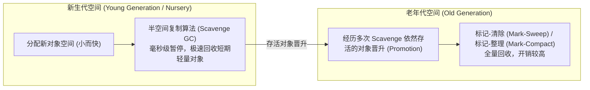
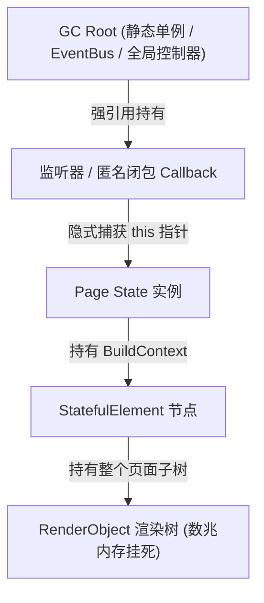
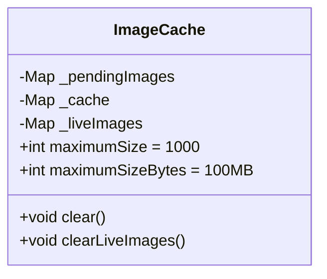

# 资深-Flutter内存泄露排查DevTools-Memory分析与ImageCache调优

在移动端高质量保障体系中，**内存泄漏（Memory Leak）** 是潜伏最深、危害最持久的致命“慢性病”。用户在使用 App 过程中，内存若只增不减，初期会导致手机发烫、由于频繁触发 GC 而严重卡顿，最终当进程内存触及系统红线时，操作系统底层（如 Android LowMemoryKiller 或 iOS Jetsam）会直接向应用发送 `SIGKILL` 强杀信号，造成灾难性的崩溃并严重拉低 App 留存率。

在资深架构师面试中，面试官将围绕生产级内存治理展开体系化考核：**Dart 新生代与老年代 GC 算法物理原理、内存泄漏背后的 GC Root 强引用链推导、`ImageCache` 的三级缓存与 `_liveImages` 泄漏大坑、以及如何通过 DevTools Memory 精准抓取内存快照并定位到具体代码行？**

---

## 1. 核心底层机制与全景架构

### 1.1 Dart 垃圾回收机制（Generational GC）底层架构

Dart 虚拟机将堆内存划分为两大核心空间，采用分代收集算法：



### 1.2 Flutter 最常见内存泄漏四大元凶拓扑



1. **未取消订阅的 Stream / EventBus / ChangeNotifier**：退出页面时忘记 `cancel()`，导致全局监听链表永久强引用已退出的 `State`。
2. **未销毁的各种 Controller**：`AnimationController`、`TextEditingController`、`ScrollController`、`FocusNode` 未在 `dispose()` 中释放。
3. **未取消的长轮询 `Timer`**：`Timer.periodic` 内部闭包捕获了 `State`，页面退出后定时器依然在后台无限空转。
4. **超大图片未压缩常驻 `ImageCache`**。

---

## 2. 源码级/算法物理推导

### 2.1 ImageCache 核心架构与 _liveImages 机制推导

Flutter 官方为了防止图片重复解码，在 `PaintingBinding` 中维护了全局 `imageCache`。其内部设计了三级存储模型：



- **`_pendingImages`**：正在网络下载或磁盘 I/O 解码中的图片任务，避免并发重复加载。
- **`_cache`**：基于 LRU（最近最少使用）淘汰算法的内存缓存池，受 `maximumSize`（默认 1000 张）和 `maximumSizeBytes`（默认 100MB）严格限制。
- **`_liveImages`**：**最容易被忽视的内存深坑！** 只要屏幕上还有任何一个 `Image` Widget 正在展示该图片，该图片即使被从 `_cache` 中 LRU 淘汰，也**必须常驻在 `_liveImages` 中**！
  - 为什么？因为若强制清空它，屏幕上正在显示的图片在下一帧刷新时就会因为找不到纹理而变成空白或被迫全链路重新解码。
  - **避坑陷阱**：调用 `PaintingBinding.instance.imageCache.clear()` 仅能清空 `_cache`，**绝对无法清除 `_liveImages`**！如果页面组件泄漏导致其持有的 Image 永远不销毁，这些图片将永远在 `_liveImages` 中吞噬内存！必须搭配 `clearLiveImages()`。

### 2.2 列表超大图未下采样导致的显存雪崩物理推导

很多开发者在列表项中加载原图：
```dart
// ❌ 致命错误代码：一张 4000x3000 的 4K 原图，直接展示在 100x100 的头像框里！
Image.network(avatarUrl, width: 100, height: 100)
```

#### 物理显存计算推导：
- 图片文件在磁盘/网络中可能经过了 JPEG 压缩，只有 800KB。
- 但当 Skia/Impeller 将其解码为位图加载进内存时，内存占用由 **解压后的像素分辨率** 决定：
  $$\text{Memory} = 4000 \times 3000 \times 4\text{ Bytes (RGBA8888)} = 48,000,000\text{ Bytes} \approx 48\text{ MB}!$$
- 一个包含 10 个头像的列表，瞬间吞噬 **480MB** 内存，在低端 Android 机上必崩无疑！
- **正确解法（强制指定下采样解码尺寸）**：
  ```dart
  // ✅ 生产级正确范式：通过 cacheWidth / cacheHeight 强制底层仅解码 200x200 像素
  Image.network(
    avatarUrl,
    width: 100,
    height: 100,
    cacheWidth: 200, // 仅占用 200*200*4 = 160KB 内存！降低了 300 倍！
    cacheHeight: 200,
  )
  ```

---

## 3. 社招/阶段必考高频硬核连环追问

### 追问 1：为什么在 `dispose()` 方法中调用了 `controller.dispose()`，DevTools 里依然能看到该页面对象存活在内存中？

> **答辩深度闭环**：
> 1. **`dispose()` 的物理语义**：调用 `controller.dispose()` 仅仅是将其内部的状态机置为已销毁，并清空该 controller 自身所注册的观察者，它**并不能主动切断外部全局对象对当前页面的引用**。
> 2. **GC 存活性判定（Reachability）**：Dart GC 判断一个对象是否存活，依据的是从根节点（GC Roots，如静态变量、正在执行的栈帧、全局单例）出发的可达性分析。
> 3. **隐匿强引用仍然存在**：如果外部的全局 EventBus、全局 StreamSubscription、或者正在后台运行的异步任务（`Future.delayed`）内部闭包依然间接持有着当前 `State` 或 `BuildContext` 的指针，GC 就会判定该对象“仍在使用”，绝不会将其释放！

---

### 追问 2：如何在架构设计层面彻底消灭“忘记在 `dispose()` 中关闭 Stream / Controller”的团队人为疏漏？

> **答辩深度闭环**：
> 1. **自动生命周期混入（AutoDispose Mixin）**：封装基础 `BaseState` 或利用状态管理自带的生命周期自动回收能力（如 `flutter_hooks` 的 `useAnimationController`、Riverpod 的 `ref.onDispose`）。
> 2. **静态代码分析（Custom Lint）**：在工程 CI 流程中引入 `flutter_lints` 配合自定义规则，扫描继承自 `State` 的类，若声明了 `AnimationController` 但在 `dispose()` 中未包含对应的 `.dispose()` 调用，直接中断编译并提示报错。
> 3. **Debug 模式下的断言巡检**：在控制器未释放时，析构时利用 `assert` 抛出明显警告。

---

### 追问 3：在低内存设备（如 2GB 内存以下的低端机）上，如何对 Flutter 的 `ImageCache` 进行动态缩容调优？

> **答辩深度闭环**：
> 1. **动态读取系统设备内存**：通过原生通道获取当前硬件的总内存与可用内存。
> 2. **按比例动态削减缓存上限**：
>    ```dart
>    void optimizeImageCacheForLowEndDevice(bool isLowEndDevice) {
>      if (isLowEndDevice) {
>        // 缩容至 100 张 / 30MB (默认是 1000 张 / 100MB)
>        PaintingBinding.instance.imageCache.maximumSize = 100;
>        PaintingBinding.instance.imageCache.maximumSizeBytes = 30 * 1024 * 1024;
>      }
>    }
>    ```
> 3. **响应系统内存低水位警告（OnTrimMemory）**：在 Android 宿主触发 `onTrimMemory(TRIM_MEMORY_RUNNING_CRITICAL)` 或 iOS 触发 `didReceiveMemoryWarning` 时，立即通过通道通知 Flutter 执行 `imageCache.clear()`，主动释放全部未展示的图片内存，避开系统 OOM 强杀。

---

## 4. 生产级避坑指南与排障 SOP

### 4.1 DevTools Memory 实战排查内存泄漏 SOP

1. **启动测试环境**：必须在真机上以 `--profile` 模式运行，严禁在 Debug 模式下排查内存：
   ```bash
   flutter run --profile
   ```
2. **连接 DevTools**：打开 DevTools 并切换到 **Memory** 选项卡。
3. **基准快照录制（Snapshot 1）**：在首页稳定状态下，点击 **Take Snapshot** 保存基准内存。
4. **反复触发目标业务流**：例如进入“订单详情页”，停留 3 秒，退出；重复该过程 **10 次**。
5. **增量快照录制（Snapshot 2）**：回到首页，手动点击右侧垃圾桶图标（**Collect Garbage / 强制 GC**），然后录制第二个快照。
6. **比对差异（Diff）**：
   - 过滤搜索页面类名：`OrderDetailPageState`。
   - 正常情况下其实例数应当为 **0**。
   - 如果显示 **Instances = 10**，说明发生了 100% 的内存泄漏！
7. **展开 Retaining Path（保留路径链）**：
   - 查看是谁持有着该 State 的强引用，顺着引用线层层向上回溯，直到找到源头的那个全局单例或未关闭的闭包。

### 4.2 生产级防泄漏基类（AutoCancelableState）封装规范

```dart
import 'dart:async';
import 'package:flutter/material.dart';

abstract class SafeBaseState<T extends StatefulWidget> extends State<T> {
  final List<StreamSubscription> _subscriptions = [];
  final List<ChangeNotifier> _controllers = [];

  // 安全注册 Stream 订阅，页面退出时全量自动 cancel
  void autoCancel(StreamSubscription subscription) {
    _subscriptions.add(subscription);
  }

  // 安全注册各类 Controller，页面退出时全量自动 dispose
  void autoDispose(ChangeNotifier controller) {
    _controllers.add(controller);
  }

  @override
  @mustCallSuper
  void dispose() {
    // 1. 批量取消所有异步流
    for (final sub in _subscriptions) {
      sub.cancel();
    }
    _subscriptions.clear();

    // 2. 批量释放所有控制器
    for (final controller in _controllers) {
      controller.dispose();
    }
    _controllers.clear();

    super.dispose();
  }
}
```
使用时仅需在初始化时一行代码挂载，彻底根治人为漏写 `dispose()` 引发的线上内存雪崩。
