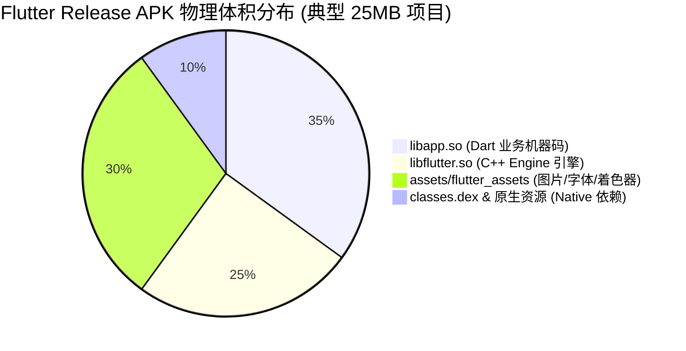
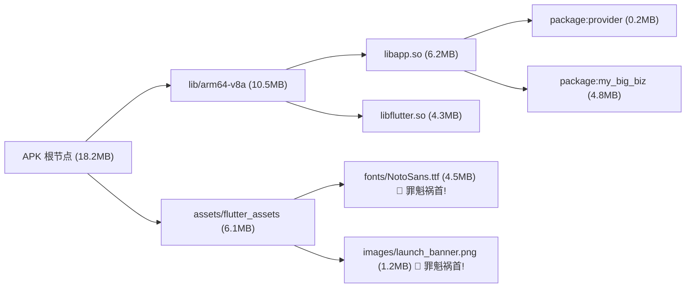

# 资深-包体积深度优化产物瘦身代码混淆与动态资产拆包

在移动应用生态中，**安装包体积（App Download Size）** 与核心业务漏斗的转化率直接强相关。行业大数据表明：应用安装包体积每增加 6MB，应用的下载转化率就会下降 1%。由于 Flutter 框架为了保证跨平台自绘一致性，必须在每个 App 中内置自研的 C++ 渲染引擎与 Dart 运行时，导致纯原生几兆的“空壳应用”在引入 Flutter 后起步体积通常在 **15MB ~ 25MB** 之间。

如何对 Flutter 进行深度的“外科手术式产物脱水瘦身”，是衡量团队资深架构师掌控底层二进制打包产物与工程治理能力的标志性门槛。

在资深面试中，面试官将直击核心：**Flutter 打包产物的物理目录拓扑结构是什么？`libflutter.so` 与 `libapp.so` 的体积各自受什么决定？如何运用中文字体动态裁切（Font Subsetting）、ABI 架构分包、动态下发（Play Feature Delivery）以及 AOT 符号剥离将包体积压缩 50% 以上？**

---

## 1. 核心底层机制与全景架构

### 1.1 Flutter 安装包底层物理二进制拓扑（Android APK 解构）

通过对一个标准的 Release APK 进行解压，其体积分布主要由以下四大部分构成：



```
├── lib/
│   ├── arm64-v8a/
│   │   ├── libflutter.so      <-- Flutter C++ 渲染引擎 (约 4~5MB)
│   │   └── libapp.so          <-- Dart 源码经 AOT 编译出的原生机器码 (业务主体)
├── assets/
│   └── flutter_assets/        <-- 图片资源、中英文字体、编译期 Shader 产物
│       ├── FontManifest.json
│       ├── fonts/
│       └── packages/
└── classes.dex                <-- 原生 Java/Kotlin 字节码 (原生三方 SDK)
```

### 1.2 包体积深度治理四重防线矩阵

| 治理防线 | 核心手段 | 物理减重效果 |
| :--- | :--- | :--- |
| **架构分包** | 彻底抛弃 Fat-APK，使用 Android App Bundle (AAB) 或 `--split-per-abi` | **直接削减 50% ~ 60% 体积**（剔除无用 CPU 架构 so） |
| **机器码瘦身** | 开启 `--obfuscate` 混淆与 `--split-debug-info` 符号剥离 | `libapp.so` **缩小 15% ~ 25%** |
| **字体极限压缩** | 采用 `font-subset` 离线子集化裁切，或云端字体按需下载 | 15MB 中文字体**瞬间压缩至 50KB 以内** |
| **资产动态化拆包** | 本地仅保留骨架图，核心大图、动画 Lottie、音视频全部移出包体，走 CDN 预热 | 资产目录**体积缩减 70% 以上** |

---

## 2. 源码级/算法物理推导

### 2.1 包体积深度诊断算法：analyze-size 与 bloat 分析

在执行盲目优化之前，必须依靠数据支撑。Flutter 官方提供了基于图论的包体积归因解析工具：

```bash
# 生成包含完整符号权重与图谱的分析文件
flutter build apk --release --analyze-size --target-platform=android-arm64
```
该命令底层会生成一个 `apk-code-size-analysis_01.json`。通过 DevTools 的 **App Size Tool** 载入该 JSON，其底层通过 Treemap 矩形树图算法呈现代码包容权重：



### 2.2 字体子集化裁切（Font Subsetting）物理推导

中文字体（如思源黑体、苹方）由于包含了数万个生僻汉字与全套字形，一个标准的 `.ttf` 或 `.otf` 文件通常在 **15MB ~ 30MB**。

#### 生产级子集化算法原理：
如果业务仅在标题或数字展位需要特殊艺术字体，可利用 HARFBUZZ 引擎的 `font-subset` 工具，扫描工程中所有用到的特定字符（如 `0123456789.¥万元`），将未使用的 99.9% 字形矢量轮廓物理擦除：
$$\text{Output Font Size} = \text{Header} + N_{\text{used\_chars}} \times \text{GlyphData} \approx 20\text{KB}!$$

---

## 3. 社招/阶段必考高频硬核连环追问

### 追问 1：为什么执行 `flutter build apk` 打出来的默认包被称为“Fat APK（胖包）”？为什么上架 Google Play 必须使用 AAB（Android App Bundle）？

> **答辩深度闭环**：
> 1. **全 ABI 冗余打包**：默认的 `flutter build apk` 会同时将 `armeabi-v7a`（32 位 ARM）、`arm64-v8a`（64 位 ARM）以及 `x86_64` 的 `libflutter.so` 和 `libapp.so` 全部塞进同一个安装包中，导致包体内存放了多份体积庞大的动态链接库。
> 2. **AAB 的动态下发机制**：Google Play 强制要求上传 `.aab` 格式。Google Play 在云端会根据下载用户的真实物理机型 CPU 架构、屏幕 DPI、语言资源，**动态组装切片**出仅适配该设备的专用精简 APK（Split APKs）。用户手机仅会下载到一份专属的 64 位 so 库，下载体积瞬间减半。
> 3. **国内渠道方案**：国内应用市场不支持 AAB 时，必须在命令行显式指定 `--split-per-abi` 分别打出独立的 32 位和 64 位独立渠道包。

---

### 追问 2：如果在分析工具中发现 `libapp.so` 异常膨胀（如超过 30MB），在代码编写层面有哪些典型的“坏味道”会导致机器码体积失控？

> **答辩深度闭环**：
> 1. **泛型特化爆炸（Generic Specialization Bloat）**：在底层 AOT 编译中，如果针对大量不同的自定义类实例化了复杂的嵌套泛型，编译器有时会为每一种类型组合生成单独的机器码特化函数，导致指令段线性膨胀。
> 2. **庞大的静态嵌入数据（Inlined Hardcoded Constants）**：在 Dart 代码中直接硬编码数万行的全国省市区行政区划 JSON、长文本协议字符串或超大 Base64 图片，这些数据会被直接固化进 `kDartIsolateSnapshotInstructions` 代码段中。
> 3. **未被 Tree-Shaking 剪枝的反射或复杂三方库**：引入了过度设计、内部包含大量未解耦子模块的大型第三方库。

---

### 追问 3：在工程中将 PNG 图片全量转换为 WebP 格式，是否能保证 100% 的体积收益？有没有坑？

> **答辩深度闭环**：
> 1. **普遍收益显著**：在相同画质下，WebP 的有损压缩比 PNG 体积减小约 60%~80%，无损压缩减小约 30%，能极大地降低资产包体积。
> 2. **边界踩坑（解压 CPU 耗时与微小图标）**：
>    - **微型图标反弹**：对于尺寸低于 32x32 的纯色小图标，由于 WebP 包含较为复杂的头信息与编码表，转为 WebP 后体积可能反而比 8-bit PNG 更大。
>    - **老旧 Android 4.x/5.x 兼容性**：早期 Android 系统的原生 WebP 解码器对包含 Alpha 透明通道的无损 WebP 支持存在偶发性解码缓慢。
> 3. **最佳工程选型**：纯色简单矢量图标优先使用**矢量字体（IconFont）**；大图一律采用有损 WebP（Quality 75~80）；多色复杂动效采用 **Lottie JSON** 或矢量 SVG。

---

## 4. 生产级避坑指南与排障 SOP

### 4.1 生产级极限瘦身打包命令标准 SOP

在 CI 自动化打包时，集成全套极限制冷编译参数：

```bash
#!/bin/bash
# 生产级 Android 极限瘦身编译指令 (AAB 格式)
flutter build appbundle \
  --release \
  --obfuscate \
  --split-debug-info=./build/symbols \
  --dart-define-from-file=env/prod.json

# 若针对国内应用市场导出独立架构包 (仅保留主流 arm64-v8a)
flutter build apk \
  --release \
  --split-per-abi \
  --obfuscate \
  --split-debug-info=./build/symbols \
  --target-platform=android-arm64
```

### 4.2 生产级动态资产云端按需下载与解压加载 SOP

为保证 App 裸包极简，所有超过 500KB 的非核心资产全部剥离至 CDN 动态下载：

```dart
import 'dart:io';
import 'package:dio/dio.dart';
import 'package:flutter/material.dart';
import 'package:path_provider/path_provider.dart';

class DynamicAssetManager {
  static final DynamicAssetManager instance = DynamicAssetManager._();
  DynamicAssetManager._();

  // 获取本地缓存或动态拉取云端大图
  Future<File> getDynamicBanner(String bannerKey, String cdnUrl) async {
    final Directory docDir = await getApplicationDocumentsDirectory();
    final String localPath = '${docDir.path}/assets_cache/$bannerKey.webp';
    final File localFile = File(localPath);

    // 1. 命中本地缓存，直接毫秒级返回
    if (await localFile.exists()) {
      return localFile;
    }

    // 2. 未命中，后台下载并安全落盘
    await localFile.parent.create(recursive: true);
    final Dio dio = Dio();
    await dio.download(cdnUrl, localPath);

    return localFile;
  }
}

// 业务端展示动态大图
class DynamicBannerWidget extends StatelessWidget {
  final String bannerKey;
  final String cdnUrl;

  const DynamicBannerWidget({Key? key, required this.bannerKey, required this.cdnUrl}) : super(key: key);

  @override
  Widget build(BuildContext context) {
    return FutureBuilder<File>(
      future: DynamicAssetManager.instance.getDynamicBanner(bannerKey, cdnUrl),
      builder: (context, snapshot) {
        if (snapshot.hasData) {
          // 本地已下载好的动态文件渲染
          return Image.file(snapshot.data!, fit: BoxFit.cover);
        }
        // 占位骨架屏
        return Container(color: Colors.grey.shade200);
      },
    );
  }
}
```
通过上述全链路治理，通常可将原本 40MB 的臃肿 Flutter 安装包**极限收敛压榨至 12MB ~ 16MB 之间**，全面达到一线大厂严苛的体积基线标准。
