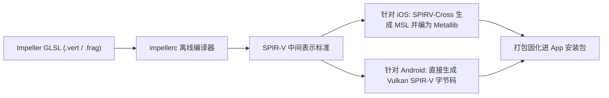

# 资深-新一代渲染引擎Impeller架构对比Skia与着色器预编译

在 Flutter 早期的性能批评中，最为人诟病的“原罪”就是 **首帧动画卡顿（Early-onset Jank / Shader Compilation Jank）**。即使在搭载了高性能芯片的旗舰 iPhone 或高通骁龙手机上，当用户第一次打开带有圆角阴影、高斯模糊或复杂转场动画的页面时，依然有大概率出现一次触目惊心的突发性掉帧（掉至 15FPS 甚至停顿 100ms）。

为了彻底斩断着色器编译卡顿的病根，Flutter 团队花费数年时间，自研并落地了全新的渲染引擎——**Impeller**（iOS 现已全量默认启用，Android Vulkan 支持已趋于成熟）。

在资深图形学与架构师面试中，面试官不仅考查 Impeller 的宏观优势，更会深入剖析：**Skia 运行时编译着色器的数学与硬件瓶颈是什么？`impellerc` 是如何在构建期（Build-time）将着色器 AOT 预编译为 Metal/Vulkan 字节码的？Impeller 的 Entity 与 RenderPass 渲染管线是如何实现极度并行化的？**

---

## 1. 核心底层机制与全景架构

### 1.1 Skia 着色器卡顿（Jank）的物理成因剖析

在传统的 Skia 渲染引擎架构下：
1. **动态代码生成**：Skia 是一个通用型 2D 跨平台图形库，在面对不同的图形滤镜、阴影半径、混合模式（BlendMode）与裁剪路径时，Skia 会在**运行时动态生成对应的着色器源码（GLSL / MSL）**。
2. **GPU 驱动编译耗时失控**：手机操作系统底层在第一次遇到该着色器时，必须调用移动端 GPU 驱动的编译器将文本代码编译为硬件机器码。在移动设备上，单个复杂着色器的编译耗时常常高达 **30ms ~ 120ms**！
3. **管线阻塞**：由于渲染管线必须等待着色器编译就绪才能执行栅格化，这直接打断了 16.6ms（60Hz）或 8.3ms（120Hz）的硬件刷新节拍，形成了肉眼可见的剧烈卡顿。

```mermaid
graph TD
    subgraph Skia_Jank["传统 Skia 运行时着色器编译 (高延迟风险)"]
        S_Draw["绘制圆角/阴影/模糊"] --> S_Gen["运行时动态生成 GLSL 源码"]
        S_Gen --> S_Drv["调用 GPU 驱动实时编译为 GPU 机器码"]
        S_Drv -->|"耗时 50~100ms (严重超标!)"| S_Jank["💥 出现首帧丢帧卡顿 (Jank)"]
    end

    subgraph Impeller_AOT["新一代 Impeller AOT 构建期预编译 (零运行时编译)"]
        I_Src["Impeller 预制 Shader 源码"] --> I_Comp["impellerc 构建期编译"]
        I_Comp --> I_Spirv["离线转为 SPIR-V / MSL 机器字节码"]
        I_Spirv --> I_App["直接打包进 IPA / APK 产物中"]
        I_App --> I_Run["运行时直接加载预编译管线，0ms 驱动编译耗时！"]
    end
```



### 1.2 Impeller 核心架构特征对比

| 架构对比维度 | 传统 Skia 渲染引擎 | 新一代自研 Impeller 渲染引擎 |
| :--- | :--- | :--- |
| **设计定位** | 历史悠久的通用 2D 库（涵盖 Chrome、Android OS、Flutter） | **专为 Flutter 声明式 UI 物理特性定制的专属现代化引擎** |
| **底层图形 API** | 基于历史包袱沉重的 OpenGL 体系封装，Metal/Vulkan 仅为适配层 | **纯现代 API 原生构建**：iOS 为 Metal，Android 为 Vulkan（保留 GLES 兜底） |
| **Shader 编译时机** | **运行时（JIT）按需动态编译**（极易引发首次绘制掉帧） | **静态打包期（AOT）全量离线预编译**，运行时零编译等待 |
| **多线程指令提交** | 严重受制于 OpenGL 单上下文单线程状态机限制 | 全面支持现代 GPU API 的**多线程并发 Command Buffer 录制与提交** |
| **首帧动画流畅度** | 首次滑入动画掉帧率高（10%~30%） | **从第 1 帧到第 10000 帧保持绝对均质的满帧体验** |

---

## 2. 源码级/算法物理推导

### 2.1 离线编译器 impellerc 与 SPIR-V 编译流推导

Impeller 彻底消灭卡顿的核心利器是官方自研的离线着色器编译器——**`impellerc`**。



#### 构建期物理产物：
在工程打包阶段，`impellerc` 会将所有可能用到的几何图形、抗锯齿、抗矩形裁切、阴影混合着色器全部离线实例化并预编译。运行时，引擎只需通过哈希键直接向驱动请求已预置的 Pipeline State Object（PSO），耗时为 $O(1)$ 微秒级，真正做到了 **“首帧即巅峰”**。

### 2.2 Impeller 渲染分层管线：Entity 与 Pass

在 Impeller 内部，传统 DisplayList 被重构为现代化的拓扑传递结构：
1. **`Entity`（实体）**：代表一个原子绘制单元，封装了几何变换矩阵（Transform）、包围盒（AABB）、混合属性与绘制内容。
2. **`Pass`（渲染通路）**：
   - **`EntityPass`**：负责收集整棵树的所有 Entity，进行视图剔除（Frustum Culling）和图层深度优化。
   - **`RenderPass`**：与 Metal 的 `MTLRenderCommandEncoder` 或 Vulkan 的 `vkCmdBeginRenderPass` 直接 1:1 映射，充分释放现代 GPU 的并发光栅化吞吐能力。

---

## 3. 社招/阶段必考高频硬核连环追问

### 追问 1：既然 Skia 官方也提供了 Shader Warm-up（着色器预热/录制），为什么这套机制在生产中被公认“治标不治本”？

> **答辩深度闭环**：
> 1. **录制覆盖度极低（Combinatorial Explosion）**：在真实业务中，界面的形状、阴影模糊半径、颜色通道、抗锯齿模式组合成千上万种。Skia 的预热需要开发者在本地真机上手动滑动录制一套 SkSL 数据并打包进 App。业务稍有改动或新增页面，旧的 SkSL 缓存立即失效。
> 2. **跨设备碎片化失效**：不同手机的 GPU 架构（高通 Adreno、ARM Mali、苹果 Apple Silicon）生成的着色器驱动机器码完全不同。一台设备上录制的 SkSL 往往无法在另一台芯片架构不同的机型上实现精准预热，依然无法摆脱掉帧命运。
> 3. **Impeller 降维打击**：Impeller 放弃了通用排列组合生成源码的旧思路，将着色器解构为有限的预设数学着色单元，在 AOT 构建期直接生成目标硬件字节码，从根本上终结了繁重的人工预热流程。

---

### 追问 2：Impeller 在将绘图指令提交给 GPU 时，相比传统 OpenGL 驱动有哪些显存与多线程优势？

> **答辩深度闭环**：
> 1. **消除全局单锁竞争**：传统的 OpenGL 上下文是一个庞大的全局状态机，不能在多线程中同时操作，导致所有光栅化指令必须在单个 Raster 线程中排队串行提交。
> 2. **支持并行 Command Buffer 录制**：现代 API（Metal 与 Vulkan）允许在多个后台线程中同时独立录制各自子图层的渲染命令（Secondary Command Buffers），并在主光栅线程瞬间一并提交给 GPU 队列，大幅提升多核利用率。
> 3. **统一内存架构（UMA）显存零拷贝**：在 iOS 与现代 Android SoC 上，CPU 与 GPU 共享物理内存。Impeller 针对性优化了顶点缓冲（Vertex Buffer）与 Uniform 数据的生命周期，直接使用主机内存映射，大幅降低了总线带宽消耗与发热量。

---

### 追问 3：在现阶段灰度开启 Impeller 时，哪些特殊场景可能会遇到兼容性 Bug？线上如何设计降级兜底？

> **答辩深度闭环**：
> 1. **边缘兼容性风险**：
>    - 某些深奥的 `BlendMode`（如高级色彩混合模式）在早期的 Vulkan Impeller 实现上可能出现色差。
>    - 复杂的自定义嵌套裁剪 `canvas.clipPath(nonConvexPath)` 或高精度反走样在某些老旧低端 GPU 上可能存在微弱的阶梯噪点。
>    - 与第三方包含 OpenGL 原始绘制的外接 Native Plugin 混用时可能产生上下文冲突。
> 2. **防御降级方案**：在发布前，必须在原生配置中保留可由服务端下发的配置开关（Android 侧通过配置元数据降级回 Skia，iOS 侧必要时允许回滚），建立严密的分机型/分系统版本灰度监控。

---

## 4. 生产级避坑指南与排障 SOP

### 4.1 生产级 Impeller 开关与配置实战

#### 1. iOS 侧配置（Flutter 3.10+ 默认开启）
如果在线上遇到极端严重的 Impeller 渲染异常，可在 `Info.plist` 中配置强制回滚回 Skia（仅做应急逃生）：
```xml
<!-- 仅用于生产紧急回退排障，不建议常规使用 -->
<key>FLTEnableImpeller</key>
<false/>
```

#### 2. Android 侧配置（Flutter 3.16+ 开始逐步预览并推广）
在 Android `AndroidManifest.xml` 中配置开启或测试 Impeller：
```xml
<application ...>
    <!-- 显式启用 Android Impeller (优先采用 Vulkan 后端) -->
    <meta-data
        android:name="io.flutter.embedding.android.EnableImpeller"
        android:value="true" />
</application>
```

```bash
# 命令行强制使用 Impeller (Vulkan 后端) 运行调试
flutter run --enable-impeller

# 命令行强制回退 Skia 运行对比性能
flutter run --no-enable-impeller
```

### 4.2 线上着色器卡顿诊断与性能排查 SOP

在 Profile 模式下利用 DevTools 抓取渲染帧耗时，对比开启 Impeller 前后的真实效果：

```bash
# 启动 profile 追踪 skia/impeller 轨迹
flutter run --profile --trace-skia
```
在 DevTools **Performance** 面板中：
1. 观察 **Raster Thread Frame Time**（光栅化耗时）。
2. 在 Skia 模式下，寻找带有深红色柱状标记的 **Shader Compilation** 耗时条（通常耗时 > 50ms）。
3. 切换至 Impeller 模式下复测同一路径，确认 Shader Compilation 耗时完全归零（消失在火焰图中），整个 Raster 耗时平稳收敛在 5ms 以内。
