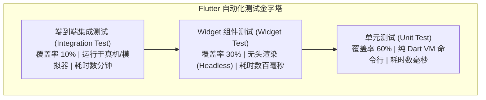
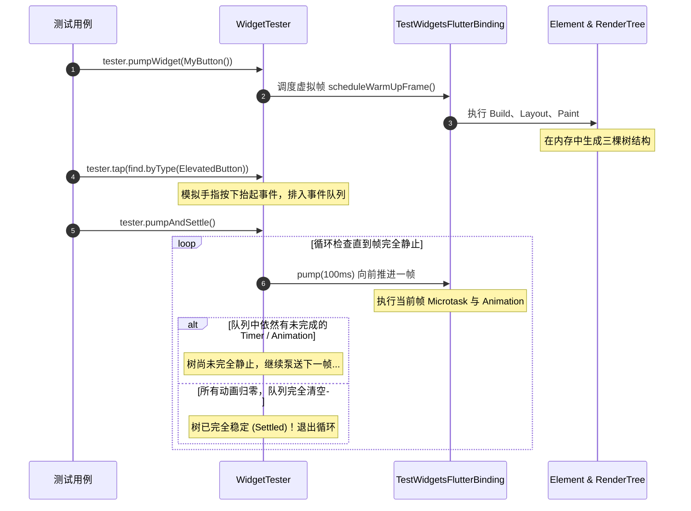

# 资深-无头渲染与自动化测试单元测试Widget测试集成测试

在大型企业级软件工程与敏捷迭代中，随着代码量从几万行飙升至百万行、团队由几人扩张到数十人，光靠人工点按黑盒测试不仅效率低下，且极易在修复某个边缘 Bug 时引发核心主流程的意外严重回退（Regression）。构建一套覆盖**单元测试（Unit Test）、组件/Widget 测试（Widget Test）与端到端集成测试（Integration Test）** 的金字塔型测试防护体系，是资深架构师守护工程质量的坚固防线。

在资深架构师面试中，面试官将围绕以下硬核考点展开技术盘问：**Flutter 的“无头渲染（Headless Rendering）”底层是如何跳过 GPU 物理屏幕在内存中完成光栅化模拟的？`tester.pump()` 与 `pumpAndSettle()` 的时间泵送与死锁机制是什么？Golden Test 黄金快照比对算法原理是什么？如何在 CI/CD 流水线中构建秒级运行的自动化测试矩阵？**

---

## 1. 核心底层机制与全景架构

### 1.1 Flutter 自动化测试金字塔与运行环境对比



| 测试类型 | 运行宿主环境 | 渲染与硬件依赖 | 核心测试目标 | 单用例耗时 |
| :--- | :--- | :--- | :--- | :--- |
| **单元测试 (Unit)** | 本地纯 Dart VM 命令行 | 零 UI 依赖，无渲染管道 | 纯算法逻辑、数据模型转换（JSON）、Bloc/Cubit 状态机变化 | $\le 10\text{ms}$ |
| **Widget 测试 (Component)** | `TestWidgetsFlutterBinding` | **无头渲染（Headless）**，在 RAM 中模拟整棵树的构建与布局，不依赖真机和真实 GPU | 组件渲染正确性、手势点击响应、表单校验、条件渲染逻辑 | $50\text{ms} \sim 200\text{ms}$ |
| **集成测试 (Integration)** | 物理真机 / 模拟器 | 完整操作系统、原生窗口、真实 GPU 光栅化 | 跨多页面完整业务闭环（如“登录 $\rightarrow$ 选购 $\rightarrow$ 下单 $\rightarrow$ 支付成功”） | $10\text{s} \sim 60\text{s}$ |

### 1.2 无头渲染（Headless Rendering）物理本质

传统的真机渲染需要向操作系统申请 `Surface`、初始化 OpenGL / Metal 上下文、并等待硬件的 VSync 垂直同步节拍推进。

而在 Widget 测试中，底层通过单例 **`TestWidgetsFlutterBinding`** 接管了一切：
- **虚拟时钟（FakeAsync）**：测试中的“时间”完全由开发者手动控制（调用 `tester.pump(duration)` 进行时间向前快进），彻底消除了现实中等待 `Future.delayed(Duration(seconds: 3))` 的无谓耗时。
- **内存虚拟画布**：所有的 `RenderBox.performLayout` 和 `paint` 生成的指令只在内存中计算坐标和矩阵，绝不向真正的显卡发送绘图指令，因此在 CI 服务器（如 Linux Docker 无显卡环境）上可以并发并行高速执行上千个 UI 测试！

---

## 2. 源码级/算法物理推导

### 2.1 pump 与 pumpAndSettle 物理执行机理

在 Widget 测试中，最核心的 API 是 `tester.pump()` 系列：



#### `pump` 与 `pumpAndSettle` 关键差异：
- **`tester.pump(Duration duration)`**：仅让虚拟时钟向前推进指定的物理时间，并**强制触发一次且仅此一次**新帧绘制。
- **`tester.pumpAndSettle(Duration duration)`**：内部是一个 `while` 循环，持续以 `duration` 步长泵送新帧，**直到整棵树上所有的动画完全停止、所有的定时器和微任务全部消费完毕**。

### 2.2 Golden Test 黄金快照比对算法

在 UI 视觉回归测试中，Golden Test 将渲染出的像素在内存中栅格化为一张 PNG 二进制位图，并与代码库中保存的标准基准图（Golden File）进行**逐像素哈希比对**：
$$\text{Pixel Difference} = \sum_{x,y} |P_{\text{current}}(x, y) - P_{\text{golden}}(x, y)|$$
若差异像素百分比超过阈值（如容差 $> 0.1\%$），测试失败并自动输出差异红线对比图（Diff Image），防止意外的文字样式变动或边距错位上线。

---

## 3. 社招/阶段必考高频硬核连环追问

### 追问 1：如果一个页面包含持续旋转的加载圈（如 `CircularProgressIndicator`）或循环播放的 Banner 动画，调用 `await tester.pumpAndSettle()` 会发生什么？如何破解？

> **答辩深度闭环**：
> 1. **死锁超时崩溃（Pump Timed Out）**：`CircularProgressIndicator` 底层挂载了一个无限循环的 `AnimationController.repeat()`。因为动画永远不会结束，`pumpAndSettle()` 内部的“等待树静止”循环条件永远无法满足。
> 2. **测试超时**：持续泵送达到默认的超时上限（如 10 分钟）后，测试用例抛出致命异常：`FlutterError: pumpAndSettle timed out`。
> 3. **解决方案**：
>    - **严禁无脑使用 `pumpAndSettle`**：对于包含无限动画的组件，改用**定步长推进**：`await tester.pump(const Duration(milliseconds: 500))`，手动泵送几帧后立即执行断言。
>    - **Mock 禁用动画**：在测试环境中将动画控制器时长置为 0，或通过全局配置将 loading 状态置为已完成。

---

### 追问 2：为什么在 Widget 测试中如果组件发起真实网络请求（如 `http.get`），测试会直接抛出 `SocketException` 或无响应卡死？

> **答辩深度闭环**：
> 1. **底层物理屏蔽（HttpOverrides）**：`TestWidgetsFlutterBinding` 在初始化时，默认安装了专为测试定制的 `HttpOverrides`。它在底层**拦截并强行禁用了所有真实的 TCP/HTTP Socket 网络套接字创建**，任何向外部真实 IP 发起网络连接的操作都会直接抛出异常或返回 400。
> 2. **设计初衷**：单元与组件测试必须具备**100% 确定性、无网络依赖、毫秒级执行**的特征。依赖外网环境会导致网络波动引发用例偶发失败。
> 3. **生产级根治方案**：
>    - 使用依赖注入（如 `get_it` 或 Provider），在测试中注入 Mock 数据层仓库（`MockRepository`）。
>    - 使用 `mocktail` 或 `mockito` 预先存根（Stubbing）接口返回值。

---

### 追问 3：在 CI/CD 流水线中，不同操作系统平台（如 macOS 与 Linux Ubuntu）执行 Golden File 黄金测试时经常因为“字体渲染微小差异”报错，如何解决？

> **答辩深度闭环**：
> 1. **图形栈字体引擎渲染差异**：macOS 采用 CoreText 字体栅格化引擎，而 Linux 采用 FreeType，两者在子像素抗锯齿（Subpixel Anti-aliasing）与字偶间距计算上存在微米级浮点差异，导致跨平台比对像素哈希必然不匹配。
> 2. **工业级统一基准解法**：
>    - **引入 `golden_toolkit` 并加载统一测试字体**：在测试启动时，显式将开源字体（如 Ahem 字体，它将所有文字统一渲染为规则的黑色方块）或开源 Roboto 字体注入 `FontLoader`，确保跨平台字形栅格化一致。
>    - **容器化基准环境（Dockerized CI）**：团队统一规定 Golden 测试的基准图**必须在统一的 Linux Docker 容器中生成和校验**，避免开发机本地 macOS 差异污染仓库。

---

## 4. 生产级避坑指南与排障 SOP

### 4.1 生产级标准 Widget 交互与状态断言实战代码

```dart
import 'package:flutter/material.dart';
import 'package:flutter_test/flutter_test.dart';

// 待测试的目标计数器卡片
class CounterCardWidget extends StatefulWidget {
  final String title;
  const CounterCardWidget({Key? key, required this.title}) : super(key: key);

  @override
  State<CounterCardWidget> createState() => _CounterCardWidgetState();
}

class _CounterCardWidgetState extends State<CounterCardWidget> {
  int _count = 0;

  @override
  Widget build(BuildContext context) {
    return Column(
      mainAxisSize: MainAxisSize.min,
      children: [
        Text(widget.title, style: const TextStyle(fontWeight: FontWeight.bold)),
        Text('当前数量: $_count', key: const Key('counter_text_key')),
        ElevatedButton(
          key: const Key('increment_btn_key'),
          onPressed: () => setState(() => _count++),
          child: const Text('增加'),
        ),
      ],
    );
  }
}

// 生产级 Widget 单元测试用例
void main() {
  testWidgets('验证点击自增按钮时计数器正确自增且文本更新', (WidgetTester tester) async {
    // 1. 无头模式挂载组件 (必须包裹 MaterialApp 以提供基础主题与 MediaQuery 上下文)
    await tester.pumpWidget(
      const MaterialApp(
        home: Scaffold(
          body: CounterCardWidget(title: '商品加购计数器'),
        ),
      ),
    );

    // 2. 验证初始状态断言
    expect(find.text('商品加购计数器'), findsOneWidget);
    expect(find.text('当前数量: 0'), findsOneWidget);
    expect(find.text('当前数量: 1'), findsNothing);

    // 3. 模拟用户手势交互 (通过语义化的 Key 精准寻址)
    final btnFinder = find.byKey(const Key('increment_btn_key'));
    expect(btnFinder, findsOneWidget);
    await tester.tap(btnFinder);

    // 4. 核心：推进虚拟时钟泵送新帧，促使 setState 触发的 rebuild 落地
    await tester.pump();

    // 5. 验证点击后的 UI 状态变更
    expect(find.text('当前数量: 1'), findsOneWidget);
    expect(find.text('当前数量: 0'), findsNothing);
  });
}
```

### 4.2 CI/CD 测试覆盖率守门流水线配置 SOP

在团队提交 PR（Pull Request）时，通过自动化脚本执行全量质量检查：

```bash
#!/bin/bash
# 执行全量单元测试与组件测试，并生成 lcov 代码覆盖率文件
set -e

echo "🚀 开始执行 Flutter 自动化测试全矩阵..."
flutter test --coverage

# 检查测试是否全部通过
if [ $? -eq 0 ]; then
  echo "✅ 所有自动化测试用例通过！"
else
  echo "❌ 存在失败测试用例，拦截合并！"
  exit 1
fi

# 使用 lcov 提取覆盖率百分比并设定 80% 基线红线
COVERAGE=$(lcov --summary coverage/lcov.info | grep lines | awk '{print $4}' | cut -d'%' -f1)
echo "📊 当前核心业务代码测试覆盖率: ${COVERAGE}%"

# 设定质量门禁
MIN_COVERAGE=80.0
if (( $(echo "$COVERAGE < $MIN_COVERAGE" | bc -l) )); then
  echo "🚨 代码覆盖率未达到团队质量红线 (${MIN_COVERAGE}%)，禁止合并 PR！"
  exit 1
fi
echo "🎉 门禁校验通过，允许合并！"
```
