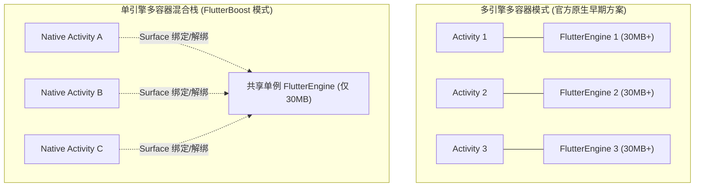
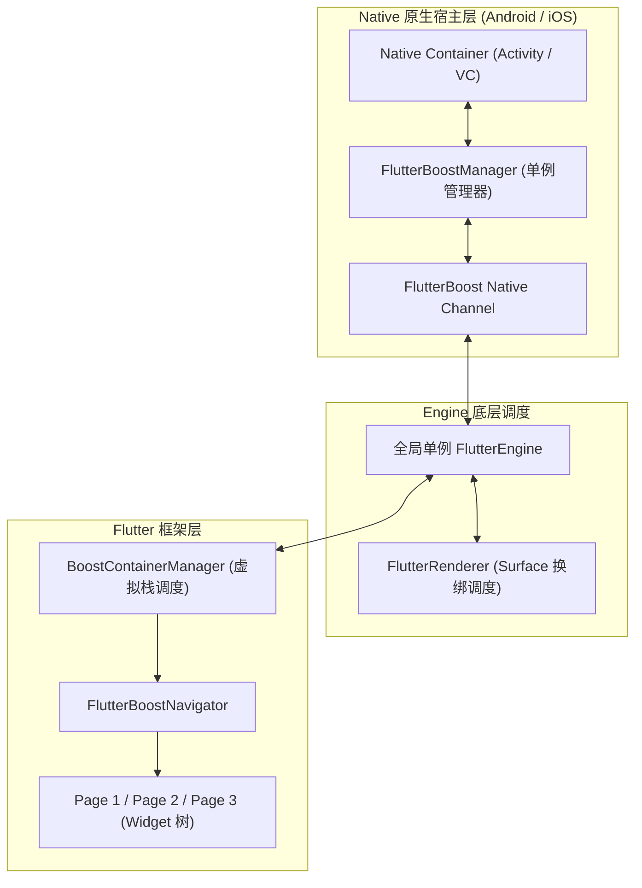
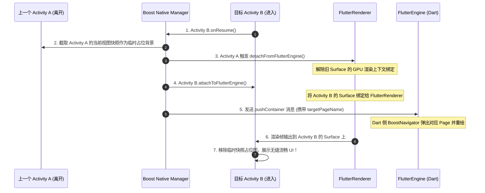

# 资深-混合开发架构FlutterBoost与多引擎多Activity栈管理

在大型互联网中后台与亿级国民 App（如闲鱼、淘宝、微信、美团）的渐进式重构落地中，全量推倒重来使用纯 Flutter 重写整座系统几乎是不可能的。现实中 90% 以上的企业均采用 **混合开发（Add-to-App）架构**。

而在混合开发中，最大的技术天堑莫过于 **“混合导航栈（Hybrid Stack）”** 的治理：当业务在 Native Activity/ViewController 与 Flutter 页面之间反复交替跳转（如 `Native A -> Flutter B -> Native C -> Flutter D`）时，系统底层如何管理引擎内存？如何避免每次打开新页面白屏与几十兆内存暴增？阿里的 **FlutterBoost** 核心机制是什么？

在资深架构师面试中，面试官将直切底层内核：**单引擎与多引擎架构的内存与拓扑差异、多 Native 容器复用单一 FlutterEngine 的 Surface 换绑技术、以及混合栈退栈时的生命周期与手势穿透治理。**

---

## 1. 核心底层机制与全景架构

### 1.1 混合栈两大流派物理对比

混合开发架构在演进中形成了两大截然不同的方案：



| 核心维度 | 官方早期多引擎模式（Multi-Engine） | 阿里 FlutterBoost 单引擎共享模式 |
| :--- | :--- | :--- |
| **内存开销** | 每开一个页面吞噬 30~50MB 内存，5 个页面即可能引发 OOM 崩溃 | **全局仅占一份 Engine 内存（~30MB）**，多页面近乎零额外引擎开销 |
| **启动速度** | 新建引擎需重新加载 Dart VM 与动态库，首屏卡顿延迟（~500ms） | **秒开秒显**，引擎常驻内存，复用已热身好的渲染管道 |
| **数据通信** | 多个引擎运行在不同 Isolate，内存物理隔离，通信必须走进程内 IPC | **全局状态完全共享**，全局单例、Provider、EventBus 天然互通 |
| **实现复杂度** | 官方封装好，直接使用 `FlutterActivity` 即可 | 架构极其复杂，需要拦截 Native 生命周期与底层 Surface 挂载 |

### 1.2 FlutterBoost 4.x 全景架构图



---

## 2. 源码级/算法物理推导

### 2.1 核心机制：Surface 动态挂接与快照防闪烁

在单引擎复用模式下，屏幕上同一时间展示的只有一个 Native Activity。FlutterBoost 是如何把同一个 `FlutterEngine` 的渲染输出在不同 Native 窗口之间灵活切换的？



### 2.2 虚拟双端导航栈映射同步算法

在业务调用 `FlutterBoostNavigator.pushNamed("native_page")` 或从 Native 打开 Flutter 页面时，底层维护了一个双向映射哈希表：

```dart
// FlutterBoost Dart 虚拟容器调度模型
class BoostContainerManager extends StatefulWidget {
  // 维护全局容器链表与 Native 容器唯一 ContainerId 绑定
  final List<BoostContainer> _containers = <BoostContainer>[];

  void pushContainer(String containerId, String pageName, Map<String, dynamic> arguments) {
    setState(() {
      // 1. 创建新的虚拟容器包装器
      final BoostContainer container = BoostContainer(
        containerId: containerId,
        pageName: pageName,
        arguments: arguments,
      );
      // 2. 压入栈顶，触发局部 Offstage / Visibility 隐藏下层
      _containers.add(container);
    });
  }

  void popContainer(String containerId) {
    setState(() {
      // 移除匹配的 Native 容器对应的 Flutter 页面
      _containers.removeWhere((container) => container.containerId == containerId);
    });
  }
}
```

---

## 3. 社招/阶段必考高频硬核连环追问

### 追问 1：既然 Flutter 官方在 2.0+ 之后推出了 `FlutterEngineGroup`，它与 FlutterBoost 相比有何异同？大厂应该如何选型？

> **答辩深度闭宽**：
> 1. **官方 FlutterEngineGroup 原理**：官方为了解决多引擎内存问题，推出了 `FlutterEngineGroup`。它允许多个 `FlutterEngine` **共享同一个 Dart VM 实例的只读 AOT 内存段与公共 Skia 字体字形缓存**，将每个新引擎的内存消耗从 30MB 降低到约 2MB~5MB。
> 2. **致命短板**：虽然内存大幅优化，但 `FlutterEngineGroup` 派生出来的每个引擎仍然拥有**独立的 Isolate 堆内存**！这意味着各页面的全局变量、单例和业务状态依然是完全隔离的，无法像纯 Flutter 那样通过简单的 Provider 或状态管理跨页面直接读写，必须编写大量的跨引擎通信逻辑。
> 3. **选型决策**：
>    - 如果项目是多业务线深度解耦的大型 App，各模块独立性极强且不希望全局状态产生耦合，优先选 **官方 `FlutterEngineGroup`**。
>    - 如果项目在混合页面间存在极其频繁的状态共享、购物车联动或复杂交互，且团队希望沿用纯 Flutter 开发思维，**`FlutterBoost` 是更成熟轻便的生产解法**。

---

### 追问 2：在 Native 容器切换解绑 Surface 时，为什么偶现“短暂黑屏或上个页面的残影”？底层的物理成因是什么？

> **答辩深度闭环**：
> 1. **GPU 帧缓冲区未清空与帧未上屏**：在 Android 平台上，当 `FlutterSurfaceView` 或 `FlutterTextureView` 从旧 Activity 解除绑定，并重新 `attach` 到新 Activity 时，底层的 OpenGL / Vulkan Context 需要重建渲染管线。
> 2. **时间差碰撞**：新 Activity 的 View 已经展示出来，但 Dart UI 线程新页面的首帧光栅化尚未完成。在这一间隙（约 50~100ms），Surface 显示的是空白像素（黑屏）或者保留了上一次后台 Buffer 中的残留像素（残影）。
> 3. **根治手段（快照遮罩法）**：在旧页面 `detach` 瞬间，Native 侧使用 `PixelCopy` 截取一张静态 Bitmap 作为新页面的默认 Background。直到 Flutter 侧触发 `onFlutterUiDisplayed`（首帧渲染回调），原生再执行淡出动画移除该临时 Bitmap，实现绝对平滑过渡。

---

### 追问 3：在混合栈中，Android 物理返回键（Back Pressed）与 Flutter 内部的 `PopScope` / `WillPopScope` 冲突，如何设计仲裁优先级？

> **答辩深度闭环**：
> 1. **两级栈仲裁原则**：物理事件首先由当前活跃的 Native Activity 的 `onBackPressed()` 拦截。
> 2. **第一优先级：Flutter 内部栈查询**：Activity 不得擅自直接 `finish()`，而是通过 Channel 同步/异步询问 Flutter 侧当前页面是否有内部 Sub-route 或未关闭的弹窗（`Navigator.canPop(context)`）：
>    - 若 `canPop == true`：通知 Flutter 侧执行 `Navigator.pop(context)`，Native Activity 保持存活。
>    - 若 `canPop == false`：Flutter 内部已无路由可退，通知 Native 容器直接执行原生的退出销毁流程。

---

## 4. 生产级避坑指南与排障 SOP

### 4.1 生产级内存泄漏排查：混合容器销毁时 Engine 解绑不彻底

#### 故障现场：
用户在 Native 列表与 Flutter 详情页之间反复进出 20 次，App 内存从 120MB 飙升至 800MB，最终暴毙于 OOM。内存分析显示大量 `FlutterBoostActivity` 无法被 GC 回收。

#### 生产级 SOP 规范防线：
在自定义的 `BaseFlutterActivity` 中，必须严谨处理生命周期逆向解绑与静态监听器清理：

```java
// Android Native 端防泄漏基类规范
public abstract class BaseFlutterActivity extends AppCompatActivity implements FlutterBoostListener {

    @Override
    protected void onCreate(Bundle savedInstanceState) {
        super.onCreate(savedInstanceState);
        // 绑定引擎并注册监听
        FlutterBoost.instance().getPlugin().addBoostListener(this);
    }

    @Override
    protected void onDestroy() {
        // ❌ 常见大坑：忘记解绑监听器导致静态单例强引用当前 Activity 实例！
        FlutterBoost.instance().getPlugin().removeBoostListener(this);

        // 核心解绑：通知引擎解除当前 Surface 引用
        if (flutterView != null) {
            flutterView.detachFromFlutterEngine();
        }
        super.onDestroy();
    }
}
```

### 4.2 混合开发路由拦截与白名单防护实战

```dart
// Flutter 侧集中式混合路由路由表配置
class AppBoostRoutes {
  static final Map<String, FlutterBoostRouteFactory> routerMap = {
    'native_user_center': (settings, uniqueId) {
      return PageRouteBuilder<dynamic>(
        settings: settings,
        pageBuilder: (_, __, ___) => const UserCenterPage(),
      );
    },
    'flutter_order_detail': (settings, uniqueId) {
      final args = settings.arguments as Map<String, dynamic>? ?? {};
      return MaterialPageRoute<dynamic>(
        settings: settings,
        builder: (_) => OrderDetailPage(orderId: args['orderId'] ?? ''),
      );
    },
  };

  static Route<dynamic>? routeFactory(RouteSettings settings, String? uniqueId) {
    FlutterBoostRouteFactory? func = routerMap[settings.name];
    if (func == null) {
      // 生产降级：未匹配路由统一跳转 404 兜底页，严禁抛出未捕获异常导致混合栈挂起
      return MaterialPageRoute(builder: (_) => const NotFoundFallbackPage());
    }
    return func(settings, uniqueId);
  }
}
```
